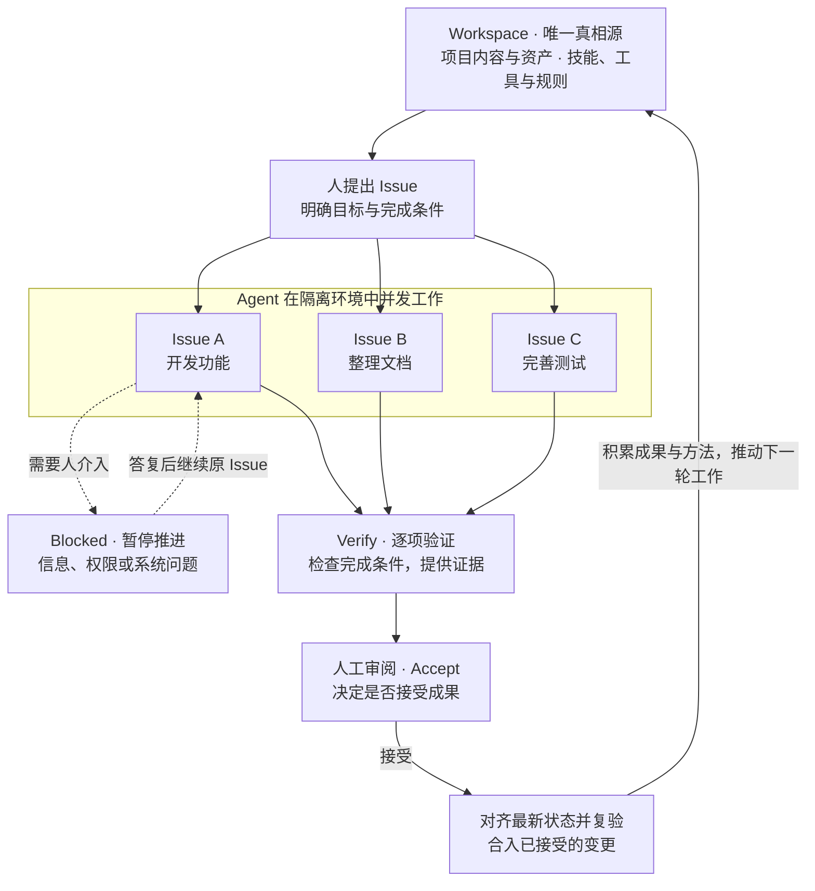

<p>
  
</p>

# Foundry

**以 Workspace 为唯一真相源，让 Agent 并发工作，经验证与人工接受，推动项目成果与工作能力共同演进。**

简体中文 | [English](docs/README.en.md)

[快速开始](#快速开始) · [文档](#文档) · [路线图](#roadmap) · [反馈问题](https://github.com/BD777/foundry/issues)

Foundry 是一个让 Agent 围绕同一项目协作的 AI 工作平台。你提出目标，Agent 可以同时开发功能、整理文档、完善测试；经过验证并由你接受的成果回到 Workspace，成为下一次工作的基础。

## 工作方式

Workspace 保存项目的内容，也保存 Agent 使用的技能、工具和规则。下面这张图展示了它如何在一次次工作中持续演进：



Blocked 必须带具体原因，例如 Needs input、Needs permission、System error；解决后继续原 Issue，其他 Issue 可照常推进。图中以 Issue A 示意这一分支。短暂自动重试和容量等待仍可作为执行进度，执行确实无法继续时进入 Blocked。

每项 Issue 独立验证、审阅与接受；需要修改时，反馈回到该 Issue 继续推进。Verify 优先使用确定性检查，并保留需要模型或人工判断的依据；Accept 由人决定。**已接受的项目状态以 Workspace 为准，产品成果与可复用的工作能力在这里共同积累。**

## Roadmap

目标形态见 [Workspace 与 Sandbox 总纲](docs/workspace-sandbox-overview.md)。Roadmap 按模块组织：每个模块写现在能做什么、下一步做什么，设计与实现边界见各模块链接的文档。

<p align="center">
  
</p>

上层依赖下层，下层不知道上层。橙色虚线是还没开始的部分。Chats 直接在 Workspace 中工作，不经 Sandbox；外部 Agent 经 `foundry` CLI / MCP 直接使用 Agent 能力面。图的源文件是 [architecture.mmd](docs/assets/architecture.mmd)。

| 模块                                                 | 现在能做                                                                                                                                                                                                                                                                                               | 下一步                                                                                                                                      |
| ---------------------------------------------------- | ------------------------------------------------------------------------------------------------------------------------------------------------------------------------------------------------------------------------------------------------------------------------------------------------------ | ------------------------------------------------------------------------------------------------------------------------------------------- |
| [渠道](docs/channels.md)                             | 飞书 Bot：群或单聊配对到 Workspace，话题对应会话，回复以流式卡片更新，消息里的图片和文件作为会话附件；群以生成配对码的账号身份和权限执行。                                                                                                                                                             | 飞书中的 Issue：已实现并以模拟事件测试，待真实群验收。探索：抽出通用 IM Adapter，接入飞书以外的 IM。                                        |
| [Chats](docs/chat-experience.md)                     | 一个会话就是一个原生 Claude Code / Codex 会话，直接在所选 Workspace 中工作；附件、Server 侧排队、steer、中断恢复、会话产出与 diff、后台任务、分组与检索。                                                                                                                                              | —                                                                                                                                           |
| [Issues](docs/issue-workflow.md)                     | 与只读澄清 Agent 定下准出条件并确认；执行者在候选 Worktree 中实现，可派出协作会话、经 `ask_person` 进入 Blocked；系统采集证据、程序检查与独立 Agent 判定；人接受后对齐并合入。Claude 与 Codex 都已按[准出标准](docs/foundry-conversation-release-gate.md)完成真实浏览器闭环，macOS 与 Linux 均可运行。 | 暂停新功能，等真实使用的反馈。探索：CI 结果作为反馈来源；同一 Issue 的不同步骤交给不同 Agent；Workflow 插件化。                             |
| [Agent 能力面](docs/session-orchestration-design.md) | Claude 与 Codex 会话注入同一套 Foundry MCP，工具只在 Server 实现一次：派出、观察、steer、交接会话，读其他会话及其产出，租用资源，使用外部账号。`foundry` CLI 调用同一套工具，供人和外部 Agent 使用。                                                                                                   | CLI 在真实的外部 Agent 中验证。HTTP MCP 的 OAuth 2.1 等出现 Foundry 之外的远程 Agent 时再做。                                               |
| [执行内核](docs/execution-kernel.md)                 | Session Runtime 统一启动原生会话；Sandbox 在 macOS（Seatbelt）与 Linux（bubblewrap）实现同一接口，只负责写边界与 Foundry 治理状态，其他系统 fail closed。                                                                                                                                              | Docker 容器隔离；凭据不以明文交给 Agent；部署、发消息等外部副作用按次授权。                                                                 |
| [Resources](docs/resources.md)                       | 设备上的资源被发现、登记并列出；可租用的资源经 Server 由会话独占租用、排队与回收，可跨设备使用，目前是 Computer Use（macOS）与远程命令；浏览器由会话在本机按需启动、用完回收。                                                                                                                         | 模拟器、真机等资源接入同一生命周期。探索：多台机器共享执行与验证资源，支持异地验证。                                                        |
| [Skills](docs/skills.md)                             | Skill 库：设备扫描与 git 仓库跟随，按不可变版本入库并带依赖；Workspace 选用并可固定版本，个人默认 Skill 覆盖本人设备上的 Workspace；Skill 所需程序在各设备上检测，Skill 包声明的工具可在设备上一键安装；私有来源可由本人的设备读取。                                                                   | 从 Skill 推断出的所需程序也能从 Foundry 安装（目前只检测并告知会话）；Server 直接读取私有来源，不依赖设备在线。探索：自动提炼与推荐 Skill。 |
| [模型与账号](docs/models-and-accounts.md)            | 使用设备自己的 Claude Code / Codex 登录，缺失时按官方方式安装；模型服务配置 API 或网关，可按模型设上下文窗口，设备配置里的端点可提升为模型服务；模型目录经原生 SDK 读取并缓存。                                                                                                                        | —                                                                                                                                           |
| [连接器](docs/connectors.md)                         | 飞书应用由 Server 保管密钥、经网关提供；个人外部账号可绑定到 Workspace，Agent 经 `feishu-cli` 以本人或 Bot 身份使用，设备上不留密钥。                                                                                                                                                                  | —                                                                                                                                           |
| [设备与 Workspace](docs/devices-and-workspaces.md)   | Daemon 主动连接 Server，多设备、多 Workspace；配对、登录时启动、由 Server 下发 Worker 更新；跨设备启动会话；[Docker 部署](deploy/README.md)与[并行开发栈](docs/dev-stacks.md)。                                                                                                                        | 探索：[云端 Workspace](docs/devices-and-workspaces.md#cloud-workspace)，托管项目文件与持久状态，不同执行端按权限访问同一个逻辑 Workspace。  |
| [身份与共享](docs/accounts-permissions-design.md)    | 所有接口要求登录；邀请、设备凭证与资源归属；按 Viewer / Member / Maintainer / Owner 共享 Workspace，撤销立即生效。                                                                                                                                                                                     | 飞书身份登录并按发送者本人授权；审计与所有权转移；设备密钥对认证。                                                                          |

### Personal Agent（未开始）

现在由人建立和维护 Workspace，再在 Workspace 里工作：上下文边界清楚，Agent 才能把事做对，这是基础。在此之上加一层 Personal Agent：人只用自然语言提出要做的事，由它判断落到哪个已有 Workspace，或用已有的知识新建一个，再进入该 Workspace 工作。

- **它本身是一个 Workspace。** 里面放其他 Workspace 的索引，按渐进式披露组织：先看概要，需要时再读具体 Workspace。不另建一个真相源，它的知识同样经验证与接受积累。
- **只做两件事**：Dispatch（判断落到哪里、是否新建），以及与人交互时的快速响应。具体工作仍在各自 Workspace 中完成。
- **分发要可确认。** 先给出"放到哪个 Workspace"的建议由人确认，新建 Workspace 作为一次需要人接受的变更；建议足够准确后再自动分发。
- **需要下层补齐**：不绑定 Workspace 的入口；每个 Workspace 可供分发判断的简介；Agent 可调用的新建与登记 Workspace 工具；个人层与 Workspace 层记忆的边界。

## 快速开始

### 环境准备

- Node.js 22
- pnpm 11.7.0
- Go 1.24.0 或更高版本（以 [go.mod](apps/server/go.mod) 为准）
- Git；本地 Worker 支持 macOS 和 Linux，Linux 的 Issue 执行需要 bubblewrap 和可用的 user namespace。Issue 的澄清、独立判定与 Accept 集成在两个平台都可用；Linux 上受控 HTTP 目标暂不可用。Issue 在沙箱中只写自己的候选、读不到 Foundry 自身的凭据与状态；由你本人发起的 Issue 可以使用你本机的配置与凭据。Chat 在两个平台都可用，且不经沙箱。

### 安装与启动

```bash
git clone https://github.com/BD777/foundry.git
cd foundry
pnpm install
```

在两个终端中分别启动服务端和 Web 应用：

```bash
pnpm dev:server
```

```bash
pnpm dev:web
```

打开 [http://127.0.0.1:31983](http://127.0.0.1:31983/)。

### 连接本地 Worker

在网页里打开“设备 → 添加设备”，生成配对命令，在要干活的机器上运行（macOS 或 Linux，Node.js 20 或更高）。命令从 npm 安装 Worker、用一次性配对码配对，并设为登录时启动（Linux 用 systemd 用户服务；没有 systemd 的环境会打印前台启动命令）：

```bash
npx -y @bd777/foundry-worker@latest install --server http://127.0.0.1:31982 --token <配对码> --workspace /absolute/path/to/workspace
```

Worker 使用这台机器自己的 Claude Code 或 Codex，不另带一份。没装的话，在“设备 → 模型与账户”里点“安装”，Worker 会在这台设备上运行官方安装命令（Claude Code：`curl -fsSL https://claude.ai/install.sh | bash`；Codex：`curl -fsSL https://chatgpt.com/codex/install.sh | sh`），也可以自己运行；装好后用 `claude` 或 `codex login` 登录，再点“重新检查”。版本低于 Foundry 所需（Claude Code 2.1.201、Codex 0.142）时仍可使用，但页面会提示升级命令（Claude Code 用 `claude update`；Codex 按它的安装方式，例如重新运行官方安装脚本或 `npm install -g @openai/codex@latest`）。也可以在“模型服务”里配置 API 或网关。

Worker 以 root 运行时，Issue 照常执行（它在 Foundry 的沙箱里）；对话里 Claude Code 不允许以 root 身份跳过权限确认，请为对话选择其他权限模式，或用普通用户运行 Worker。

从源码运行 Worker（开发用）时，同样需要配对码：

```bash
pnpm --filter @bd777/foundry-worker foundry-worker -- setup --server http://127.0.0.1:31982 --workspace /absolute/path/to/workspace --token <配对码>
```

更多安装选项、认证配置、预览与排查说明见[开发指南](docs/development.md)。

## 项目结构

```text
apps/web/          React / Vite 界面
apps/server/       Go API、SQLite 状态投影与 Worker 通信
packages/worker/   本地 Agent 执行、文件、worktree 与预览
packages/protocol/ 组件间共享协议
docs/              使用指南、产品设计、架构与研究
cases/             产品回归场景与验证要求
```

服务端负责控制与状态投影，Worker 负责实际执行。数据存放、凭据处理和远程访问规则见[安全边界](docs/security.md)。

## 文档

| 文档                                       | 内容                                    |
| ------------------------------------------ | --------------------------------------- |
| [文档索引](docs/README.md)                 | 全部文档的分类入口                      |
| [开发指南](docs/development.md)            | 安装、运行、Worker 配置与验证           |
| [并行开发栈](docs/dev-stacks.md)           | 多套 Foundry 同时开发的隔离栈与体检工具 |
| [产品理念](docs/philosophy.md)             | 项目目标与工作闭环                      |
| [技术架构](docs/technical-selection.md)    | 组件职责与技术选型                      |
| [总纲](docs/workspace-sandbox-overview.md) | Workspace、Sandbox 与 Issue 的整体设计  |
| [路线图](#roadmap)                         | 后续工作与优先级                        |

## 参与贡献

欢迎通过 [Issue](https://github.com/BD777/foundry/issues) 反馈问题、讨论需求，或提交 Pull Request。问题反馈请尽量附上复现步骤、运行环境和相关日志，并移除凭据等敏感信息。

开始修改前，请阅读 [AGENTS.md](AGENTS.md) 和[开发指南](docs/development.md)；当前工作上下文见 [CONTEXT.md](CONTEXT.md)。提交前运行项目回归检查：

```bash
pnpm regression:commit
```

涉及可观察行为的功能或修复，请同步维护[回归场景](cases/README.md)。修改项目介绍或启动方式时，请同步更新[英文 README](docs/README.en.md)。

## 许可证

本项目基于 [Apache License 2.0](LICENSE) 开源。
