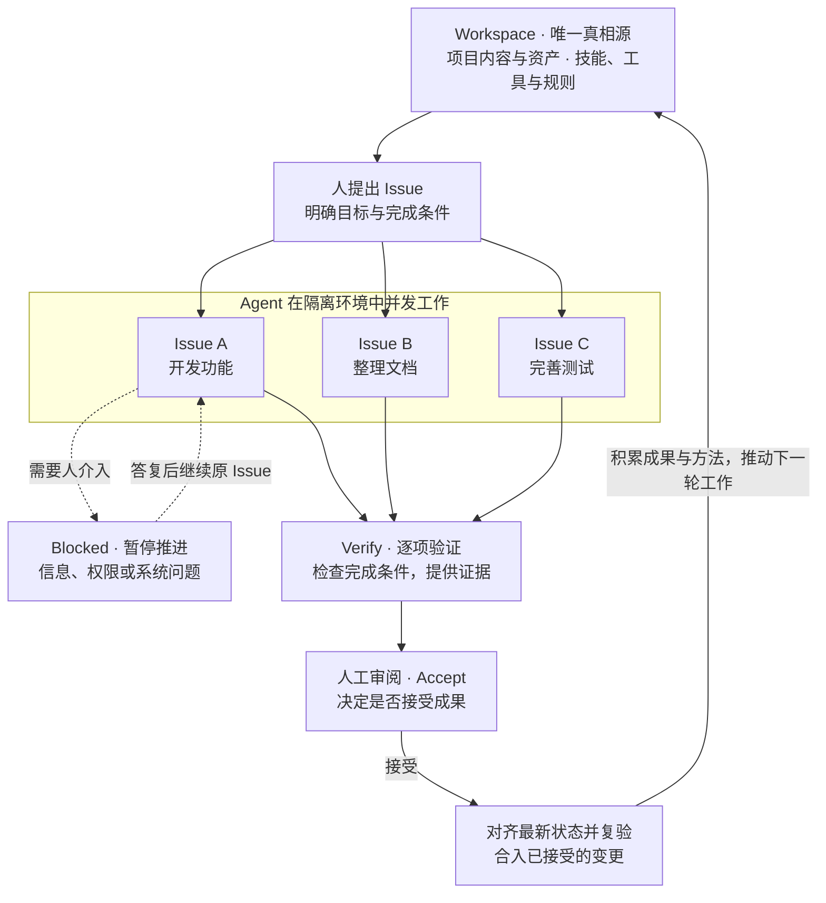

<p>
  
</p>

# Foundry

**以 Workspace 为唯一真相源，让 Agent 并发工作，经验证与人工接受，推动项目成果与工作能力共同演进。**

简体中文 | [English](docs/README.en.md)

[快速开始](#快速开始) · [文档](#文档) · [路线图](#roadmap) · [反馈问题](https://github.com/BD777/foundry/issues)

Foundry 是一个让 Agent 围绕同一项目协作的 AI 工作平台。你提出目标，Agent 可以同时开发功能、整理文档、完善测试；经过验证并由你接受的成果回到 Workspace，成为下一次工作的基础。

## 工作方式

Workspace 保存项目的内容，也保存 Agent 使用的技能、工具和规则。下面这张图展示了它如何在一次次工作中持续演进：



Blocked 必须带具体原因，例如 Needs input、Needs permission、System error；解决后继续原 Issue，其他 Issue 可照常推进。图中以 Issue A 示意这一分支。短暂自动重试和容量等待仍可作为执行进度，执行确实无法继续时进入 Blocked。

每项 Issue 独立验证、审阅与接受；需要修改时，反馈回到该 Issue 继续推进。Verify 优先使用确定性检查，并保留需要模型或人工判断的依据；Accept 由人决定。**已接受的项目状态以 Workspace 为准，产品成果与可复用的工作能力在这里共同积累。**

## Roadmap

各模块现在能做什么、接下来做什么、完成标准与依赖，统一维护在 **[docs/roadmap.md](docs/roadmap.md)**（唯一的 Roadmap 与待办清单）。目标形态见 [Workspace 与 Sandbox 总纲](docs/workspace-sandbox-overview.md)。

<p align="center">
  
</p>

上层依赖下层，下层不知道上层；虚线框是规划中的部分。Chats 直接在 Workspace 中工作，不经 Sandbox；Issues 在候选中工作，经接受后合入；外部 Agent 经 `foundry` CLI / MCP 直接使用 Agent 能力面。图的源文件是 [architecture.mmd](docs/assets/architecture.mmd)。

| 模块                                                 | 现在                                                                                                                    | 设计文档                                                                |
| ---------------------------------------------------- | ----------------------------------------------------------------------------------------------------------------------- | ----------------------------------------------------------------------- |
| [渠道](docs/roadmap.md#渠道)                         | 飞书 Bot：群或单聊配对到 Workspace，话题对应会话，流式卡片，附件                                                        | [channels.md](docs/channels.md)                                         |
| [Personal Agent](docs/roadmap.md#personal-agent)     | 测试中：自动路由与新建 / 调整 Workspace、派出并监督会话、飞书单聊入口                                                   | [personal-agent.md](docs/personal-agent.md)                             |
| [Chats](docs/roadmap.md#chats)                       | 一个会话就是一个原生 Claude Code / Codex 会话：附件、排队、steer、恢复、产出与 diff、后台任务、分组与检索               | [chat-experience.md](docs/chat-experience.md)                           |
| [Issues](docs/roadmap.md#issues)                     | 准出条件 → 候选中执行 → 证据与独立判定 → 人接受 → 合入；新功能暂停，等真实使用反馈                                      | [issue-workflow.md](docs/issue-workflow.md)                             |
| [工作流平台](docs/roadmap.md#工作流平台)             | 规划：把候选 Workspace、合入队列、证据与判定从 Issues 中抽成平台能力                                                    | [workflow-platform.md](docs/workflow-platform.md)                       |
| [Agent 能力面](docs/roadmap.md#agent-能力面)         | 同一套 Foundry MCP / CLI：派出、观察、steer、交接会话，租用资源，使用连接器                                             | [session-orchestration-design.md](docs/session-orchestration-design.md) |
| [执行内核](docs/roadmap.md#执行内核)                 | Session Runtime 统一启动原生会话；Sandbox 在 macOS 与 Linux 实现同一接口，其他系统 fail closed                          | [execution-kernel.md](docs/execution-kernel.md)                         |
| [Resources](docs/roadmap.md#resources)               | Computer Use 与远程命令可租用、排队、回收，可跨设备；浏览器按需启动                                                     | [resources.md](docs/resources.md)                                       |
| [Skills](docs/roadmap.md#skills)                     | Skill 库与不可变版本、Workspace 选用与固定、个人默认、草稿试用、所需程序检测                                            | [skills.md](docs/skills.md)                                             |
| [模型与账号](docs/roadmap.md#模型与账号)             | 设备原生登录与官方安装、模型服务（API 或网关）、模型目录                                                                | [models-and-accounts.md](docs/models-and-accounts.md)                   |
| [连接器](docs/roadmap.md#连接器)                     | Server 持有型（飞书、Cloudflare）与设备持有型（bytedcli、AWS CLI），按 Workspace 绑定，设备上不留 Server 持有的真实凭据 | [connectors.md](docs/connectors.md)                                     |
| [设备与 Workspace](docs/roadmap.md#设备与-workspace) | Daemon 主动连接、配对与自动更新、多设备多 Workspace、跨设备会话、[Docker 部署](deploy/README.md)                        | [devices-and-workspaces.md](docs/devices-and-workspaces.md)             |
| [身份与共享](docs/roadmap.md#身份与共享)             | 所有接口要求登录；按 Viewer / Member / Maintainer / Owner 共享 Workspace，撤销立即生效                                  | [accounts-permissions-design.md](docs/accounts-permissions-design.md)   |

## 快速开始

### 环境准备

- Node.js 22
- pnpm 11.7.0
- Go 1.24.0 或更高版本（以 [go.mod](apps/server/go.mod) 为准）
- Git；本地 Worker 支持 macOS 和 Linux，Linux 的 Issue 执行需要 bubblewrap 和可用的 user namespace。Issue 的澄清、独立判定与 Accept 集成在两个平台都可用；Linux 上受控 HTTP 目标暂不可用。Issue 在沙箱中只写自己的候选、读不到 Foundry 自身的凭据与状态；由你本人发起的 Issue 可以使用你本机的配置与凭据。Chat 在两个平台都可用，且不经沙箱。

### 安装与启动

```bash
git clone https://github.com/BD777/foundry.git
cd foundry
pnpm install
```

在两个终端中分别启动服务端和 Web 应用：

```bash
pnpm dev:server
```

```bash
pnpm dev:web
```

打开 [http://127.0.0.1:31983](http://127.0.0.1:31983/)。

### 连接本地 Worker

在网页里打开“设备 → 添加设备”，生成配对命令，在要干活的机器上运行（macOS 或 Linux，Node.js 20 或更高）。命令从 npm 安装 Worker、用一次性配对码配对，并设为登录时启动（Linux 用 systemd 用户服务；没有 systemd 的环境会打印前台启动命令）：

```bash
npx -y @bd777/foundry-worker@latest install --server http://127.0.0.1:31982 --token <配对码> --workspace /absolute/path/to/workspace
```

Worker 使用这台机器自己的 Claude Code 或 Codex，不另带一份。没装的话，在“设备 → 模型与账户”里点“安装”，Worker 会在这台设备上运行官方安装命令（Claude Code：`curl -fsSL https://claude.ai/install.sh | bash`；Codex：`curl -fsSL https://chatgpt.com/codex/install.sh | sh`），也可以自己运行；装好后用 `claude` 或 `codex login` 登录，再点“重新检查”。版本低于 Foundry 所需（Claude Code 2.1.201、Codex 0.142）时仍可使用，但页面会提示升级命令（Claude Code 用 `claude update`；Codex 按它的安装方式，例如重新运行官方安装脚本或 `npm install -g @openai/codex@latest`）。也可以在“模型服务”里配置 API 或网关。

Worker 以 root 运行时，Issue 照常执行（它在 Foundry 的沙箱里）；对话里 Claude Code 不允许以 root 身份跳过权限确认，请为对话选择其他权限模式，或用普通用户运行 Worker。

从源码运行 Worker（开发用）时，同样需要配对码：

```bash
pnpm --filter @bd777/foundry-worker foundry-worker -- setup --server http://127.0.0.1:31982 --workspace /absolute/path/to/workspace --token <配对码>
```

更多安装选项、认证配置、预览与排查说明见[开发指南](docs/development.md)。

## 项目结构

```text
apps/web/          React / Vite 界面
apps/server/       Go API、SQLite 状态投影与 Worker 通信
packages/worker/   本地 Agent 执行、文件、worktree 与预览
packages/protocol/ 组件间共享协议
docs/              使用指南、产品设计、架构与研究
cases/             产品回归场景与验证要求
```

服务端负责控制与状态投影，Worker 负责实际执行。数据存放、凭据处理和远程访问规则见[安全边界](docs/security.md)。

## 文档

| 文档                                       | 内容                                    |
| ------------------------------------------ | --------------------------------------- |
| [文档索引](docs/README.md)                 | 全部文档的分类入口                      |
| [开发指南](docs/development.md)            | 安装、运行、Worker 配置与验证           |
| [并行开发栈](docs/dev-stacks.md)           | 多套 Foundry 同时开发的隔离栈与体检工具 |
| [产品理念](docs/philosophy.md)             | 项目目标与工作闭环                      |
| [技术架构](docs/technical-selection.md)    | 组件职责与技术选型                      |
| [总纲](docs/workspace-sandbox-overview.md) | Workspace、Sandbox 与 Issue 的整体设计  |
| [Roadmap](docs/roadmap.md)                 | 按模块的现状、待办与完成标准            |

## 参与贡献

欢迎通过 [Issue](https://github.com/BD777/foundry/issues) 反馈问题、讨论需求，或提交 Pull Request。问题反馈请尽量附上复现步骤、运行环境和相关日志，并移除凭据等敏感信息。

开始修改前，请阅读 [AGENTS.md](AGENTS.md) 和[开发指南](docs/development.md)；当前工作上下文见 [CONTEXT.md](CONTEXT.md)。提交前运行项目回归检查：

```bash
pnpm regression:commit
```

涉及可观察行为的功能或修复，请同步维护[回归场景](cases/README.md)。修改项目介绍或启动方式时，请同步更新[英文 README](docs/README.en.md)。

## 许可证

本项目基于 [Apache License 2.0](LICENSE) 开源。
