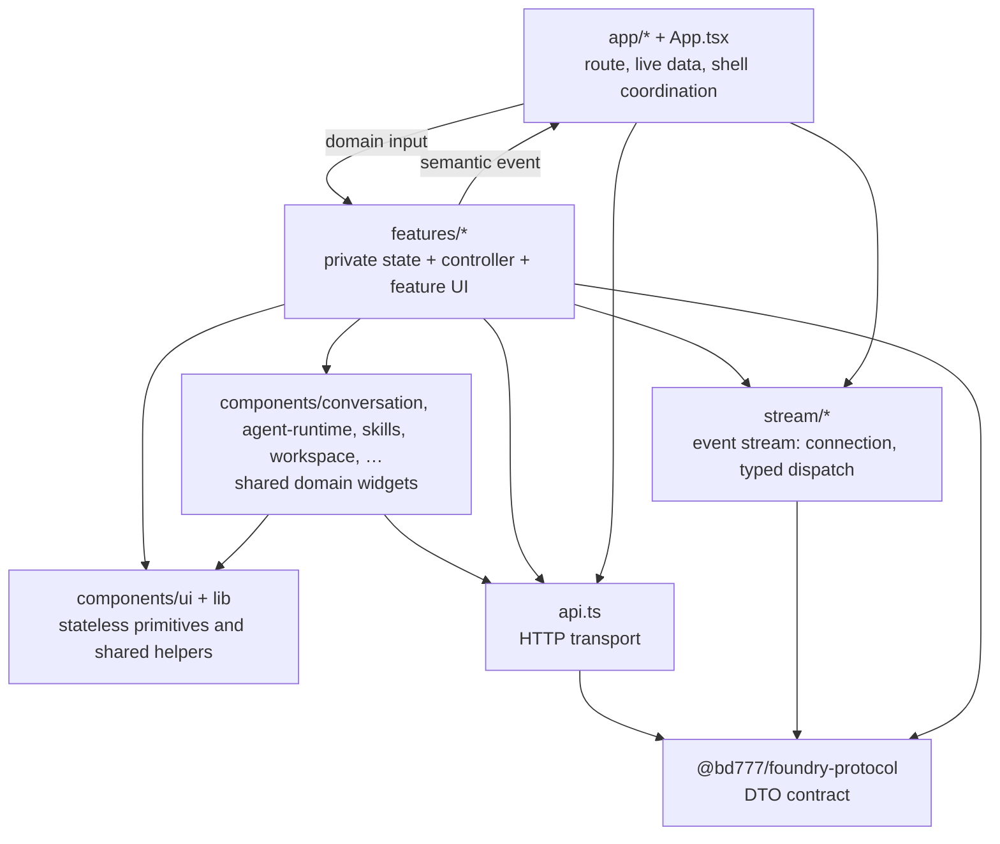

# Foundry Web Architecture

The frontend uses a feature-first architecture. A feature owns its interaction
state and implementation details, accepts domain inputs, and emits semantic
events. The app shell coordinates navigation and data shared across features.



## Ownership rules

### App layer

The app layer owns only state that coordinates multiple features:

- current route and workspace;
- the server projection shared by sidebar counts and several features;
- cross-feature requests, such as opening an issue draft from chat;
- global notices and theme.

Browser history, live-data batching/polling, and shared projection merging live
in focused hooks/modules under `app/`; `App.tsx` composes them instead of
implementing their state machines inline.

It must not own a page's filters, form drafts, expanded rows, directory lookup,
or other view-only state.

### Feature layer

Each folder under `features/` is a vertical slice. It may contain a facade,
private components, a controller hook, and domain presentation helpers.

A feature's public `index.ts` is its only public entry point. Feature-to-feature
imports are forbidden. Cross-feature communication goes through a typed event
handled by the app shell.

Examples:

```ts
type RunsFeatureEvent = {
  type: "run.selected";
  issueId: string;
  runId: string;
};
```

Events describe user or domain intent. They must not expose internal setters,
refs, drag state, loading maps, or component implementation details.

### Shared layer

`components/ui` contains reusable visual primitives and patterns. `lib` contains
pure shared helpers. Shared code cannot import the app layer or a feature.

The other folders under `components/` are shared domain widgets: UI used by
several features, such as `conversation` (transcript and input),
`agent-runtime` (agent picker, composer, runtime controls, model combobox,
runtime mark), `external-connection-setup` (the agent picker's connection
setup), `skills` (compare/promotion) and `workspace` (dialogs, pickers,
directory browser). They may read data through `api.ts` and use
`components/ui` and `lib`, but, like all shared code, never import a feature
or the app layer.

If a component is useful only inside one feature, keep it private in that
feature instead of adding it to `components/ui`.

Routes: `lib/routes.ts` is the URL schema (route types, `parseAppRoute`,
`pathForAppRoute`); `lib/in-app-navigation.ts` moves through browser history
with it, for features and the app alike. `app/navigation.ts` keeps the
sidebar menu and per-view scroll and toast placement, and
`app/shell-preferences.ts` what the browser remembers for the shell (theme,
sidebar, workspace).

### Transport and protocol

`api.ts` performs HTTP transport: one module per area under `api/`, all
re-exported by `api.ts`. Only `api/` calls `request`, `send` or `apiFetch`;
features and widgets call its functions. `@bd777/foundry-protocol` defines
transport DTOs.
Feature view models may derive from protocol data, but UI-only state must not be
added to protocol DTOs.

`stream/` owns the event stream (`GET /api/events`): one shared connection per
browser with resume, epoch, reconnect and resync, and dispatch by event type.
Tabs of one origin elect a leader with a Web Lock (`tabs.ts`); it keeps the
connection and relays every message over a BroadcastChannel, and the next
tab in line takes over, resuming from the last relayed id, when it closes.
Each tab keeps its own subscribers, lifecycle and epoch. Reads every tab
makes when the same thing happens (workspace data, chat titles, layout,
queue) go through `shared-reads.ts`: the leader reads once for all tabs.
Without Web Locks or BroadcastChannel every tab streams and reads alone.
Features never see tabs.

- A feature follows the types it owns with `onStreamEvent` (inside an
  effect) or `useStreamEvent` (a hook that requires `onResync`), optionally
  for one `workspaceId`. It receives only its own type's payloads; it never
  filters every event.
- A hybrid event carries what changed or only says it changed;
  `carriedData(type, payload)` decides which, once, for every consumer.
- The workspace-data projection alone follows every event
  (`onAnyStreamEvent`). What an event does to that data is declared per domain
  in `app/projections/` (`sessions`, `issues`, `devices`, `chats`,
  `data-changes`): `apply` a run of events, `reads` what only a read shows,
  `touches` for ordering reads against events, `supersedes` for compaction;
  each domain also names the kinds of entity it touches and how a read's
  answer of its fields merges with what events changed (`LoadedMerges`).
  A type no domain declares changes nothing there; adding an event type means
  adding a slice, not editing the live-data, merge or ledger modules.
- A user action does not re-read workspace data: its answer and the events
  the server publishes for it show the result (a chat's session answer is
  applied as its stream event would be). A view that waits for its change to
  show reads only the fields it shows (`app/view-fields.ts`).

## State placement test

Place state at the lowest owner that can make the decision:

1. Used by one component: keep it in that component.
2. Used by several components in one feature: keep it in the feature facade or
   a private controller hook.
3. Coordinates two features: lift only the semantic request/result to the app.
4. Comes from the server: keep it in the shared server projection/cache.

Passing an explicit input down and emitting a typed event up is preferred over
sharing mutable state or importing another feature's internals.

## Styling

Styles live next to the code that renders them, and one file decides the
cascade.

- **One entry.** `src/styles.css` imports every sheet exactly once, in cascade
  order. Modules never `import "./x.css"`: such an import lands wherever the
  bundler first meets the module, so its place in the cascade is an accident.
- **Layers**, in import order: third-party sheets; `styles/tokens.css` (the
  theme: `:root` and the dark theme) and `styles/base.css` (element rules,
  fonts, keyframes nobody owns); primitives (`components/ui/*.css`); shared
  widgets (`components/<widget>/*.css`); shared patterns (`styles/*.css`);
  features (`features/<name>/**/*.css`); the app shell (`app/app.css`). Within
  a layer the order is the legacy cascade order; add a new sheet at the end of
  its layer.
- **Ownership.** A sheet belongs to the module whose folder holds it and
  styles only the classes that module renders, including their media and
  container queries (there is no global responsive sheet). Large modules split
  by concern (`conversation-transcript.css`, `chat/list/chat-list.css`).
  `src/styles/` keeps only the tokens, the base rules and patterns that
  several modules render (`members.css` for accounts and sharing,
  `conversation-surface.css` for chat and issue detail…).
- **Restyling someone else's element** goes through its public API, never its
  classes (`.fdy-area .fdy-button`). Give the primitive a `className` and style
  that class (`.fdy-own.fdy-button` when it must out-rank the primitive's
  variants), or add a prop or variant to the primitive and style it in the
  primitive's own sheet: `ScrollArea` `viewportClassName`/`contentLayout`,
  `SegmentedControl` `fill`/`itemClassName`, `InfoRow`
  `iconClassName`/`bodyClassName`/`tone`, `ChecklistRow` `shape`, `SelectMenu`
  `triggerClassName`/`compactTrigger="auto"`, `HelpHint` `className`.

`audit:v3-layout` (`scripts/audit-v3-layout-contract.mjs`) checks the
structure, not values: every sheet is imported once by `src/styles.css` and by
nothing else; a selector names only classes its module renders (or a
primitive's class on its own element), and a shared sheet only classes
several modules render; no class is styled that nothing renders; one
`display` meaning per class across sheets; every token used is defined and the
dark theme only overrides `:root` tokens; the shell's layout containers.

## Migration status

- `issues`, `runs`: composer/board and filter state are private; they emit
  typed issue and `run.selected` events. Runs remain an internal history view.
  The Issues sidebar entry is currently hidden; `/issues` renders the
  workspace overview.
- `workspaces`: path draft, directory suggestions, debounce and register/remove
  pending state are private; the active working location is chosen on the
  dedicated `/locations` page (`features/workspaces/workspace-selection-panel.tsx`).
- `assets`, `skills`, `devices`: feature facades expose semantic contracts
  instead of page JSX living in `App.tsx`. Device sections cover workspaces,
  skills, Models & accounts (official accounts vs server API connections) and
  device settings; workspace CRUD lives under the device, not in a switcher.
- `accounts`, `sharing`, `channels`: sign-in and members, workspace role
  sharing, and the workspace's Channels tab: how it is reached (web Chats,
  and per channel type in `channel-types.ts`, today the Feishu bot on a
  Connectors app with chat pairing).
- `profiles`: server-owned endpoint profiles, device bindings and the
  selection-only model catalog UI; credential fields are write-only and never
  rendered back.
- `issue-detail`: contract confirmation cards, evidence materials,
  verification results, candidate review, environment and the issue
  conversation compose the issue surface; its evidence access goes through
  `api/evidence.ts`.
- `chat`: the controller owns attachments, selected agent, runtime overrides,
  model discovery, archived-session hydration, send/steer/cancel and message
  projection. The conversation UI itself (transcript stage, virtualization,
  turn navigator, queue, input hook, scroll follow) is shared in
  `components/conversation/` and used by both Chat and Issue detail; the chat
  feature folder holds the controller and its projection adapters, grouped by
  concern: `list/` (sidebar list, groups, layout), `archive/`, `thread/`
  (transcript projection, loading, notices), `context/` (side panel cards and
  their models), `detail/` (the panel's file, change, background and timer
  screens), `composer/` (send, queue, outbox, attachments) and `session/`
  (runtime choice, linked sessions, selection); the facade, surface and
  shared types stay at its root.
- `app`: browser routing, view scroll reset, live SSE batching/polling, and
  shared server-projection merging are isolated from feature code; the
  per-domain event slices live in `app/projections/`. Workspace
  scoping/selection (`workspace-selectors.ts`) and loaded-chat selection
  precedence (`chat-selection.ts`) are pure modules with unit tests; `App` keeps
  only the state and browser-coupled wiring around them.

`audit-feature-architecture.mjs` prevents cross-feature imports, shared-layer
(`components/**`, `lib/**`) back-dependencies, feature deep imports, feature-facade growth (350 lines),
feature modules over 1000 lines, and `App.tsx` growth beyond its 1200-line
shell budget.
