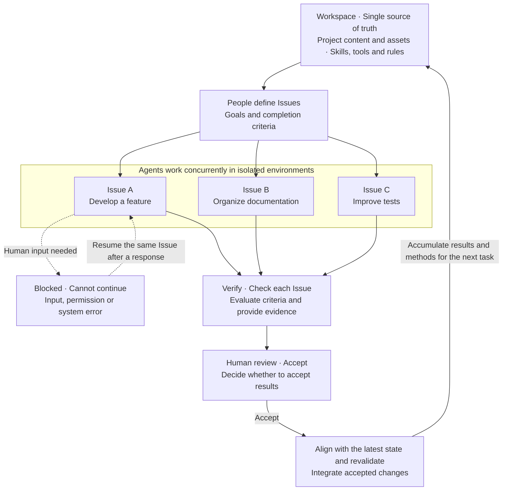

<p>
  
</p>

# Foundry

**A workspace as the single source of truth, where agents work concurrently and verified, human-accepted contributions advance both the project and its working capabilities.**

[简体中文](../README.md) | English

[Quick start](#quick-start) · [Documentation](#documentation) · [Roadmap](#roadmap) · [Report an issue](https://github.com/BD777/foundry/issues)

Foundry is an AI work platform where agents collaborate around a shared project. You set the goals; agents can develop features, organize documentation and improve tests concurrently. Verified results that you accept return to the workspace as the foundation for the next task.

## How it works

The workspace holds the project's content alongside the skills, tools and rules agents use. This diagram shows how it evolves through successive contributions:



Blocked carries a specific reason, such as Needs input, Needs permission or System error. Once resolved, the same Issue continues while other Issues progress independently. Issue A illustrates this branch. Temporary retries and capacity waits may remain execution progress; an execution that cannot continue becomes Blocked.

Each Issue is verified, reviewed and accepted independently. Feedback returns to the same Issue for further work. Verify prioritizes deterministic checks and retains the basis for model or human judgments; people decide whether to Accept. **The workspace is authoritative for the accepted project state, accumulating both product results and reusable working capabilities.**

## Roadmap

What each module does now, what comes next, completion criteria and dependencies are maintained in one place: **[roadmap.md](roadmap.md)** (Chinese), the only roadmap and to-do list. The target shape is described in the [Workspace and Sandbox overview](workspace-sandbox-overview.md) (Chinese).

<p align="center">
  
</p>

Upper layers depend on lower ones, never the reverse; dashed boxes are planned. Chats work directly in the workspace without the Sandbox; Issues work in a candidate and are integrated after acceptance; external agents use the agent surface through the `foundry` CLI / MCP. The diagram source is [architecture.mmd](assets/architecture.mmd).

| Module                                                | Works now                                                                                                                                               | Design (Chinese)                                                   |
| ----------------------------------------------------- | ------------------------------------------------------------------------------------------------------------------------------------------------------- | ------------------------------------------------------------------ |
| [Channels](roadmap.md#渠道)                           | Feishu bot: groups or direct chats pair to a workspace, threads map to sessions, streaming cards, attachments                                           | [channels.md](channels.md)                                         |
| [Personal Agent](roadmap.md#personal-agent)           | Under testing: automatic routing, creating / adjusting workspaces, dispatching and supervising sessions, Feishu direct chat                             | [personal-agent.md](personal-agent.md)                             |
| [Chats](roadmap.md#chats)                             | One session is one native Claude Code / Codex session: attachments, queue, steering, recovery, outputs and diffs, background tasks, groups and search   | [chat-experience.md](chat-experience.md)                           |
| [Issues](roadmap.md#issues)                           | Criteria → work in a candidate → evidence and independent judgment → human acceptance → integration; new features paused until real-use feedback        | [issue-workflow.md](issue-workflow.md)                             |
| [Workflow platform](roadmap.md#工作流平台)            | Planned: extract candidate workspaces, the integration queue and evidence/judgment from Issues into platform capabilities                               | [workflow-platform.md](workflow-platform.md)                       |
| [Agent surface](roadmap.md#agent-能力面)              | One Foundry MCP / CLI: dispatch, observe, steer and hand off sessions, lease resources, use connectors                                                  | [session-orchestration-design.md](session-orchestration-design.md) |
| [Execution kernel](roadmap.md#执行内核)               | Session Runtime starts native sessions; the Sandbox implements one interface on macOS and Linux and fails closed elsewhere                              | [execution-kernel.md](execution-kernel.md)                         |
| [Resources](roadmap.md#resources)                     | Computer Use and remote commands are leased, queued and reclaimed, also across devices; browsers start on demand                                        | [resources.md](resources.md)                                       |
| [Skills](roadmap.md#skills)                           | Skill library with immutable versions, per-workspace selection and pinning, personal defaults, draft trials, required-program checks                    | [skills.md](skills.md)                                             |
| [Models and accounts](roadmap.md#模型与账号)          | The device's native logins and official installs, model services (API or gateway), model catalogs                                                       | [models-and-accounts.md](models-and-accounts.md)                   |
| [Connectors](roadmap.md#连接器)                       | Server-held (Feishu, Cloudflare) and device-held (bytedcli, AWS CLI), bound per workspace; no server-held secret on the device                          | [connectors.md](connectors.md)                                     |
| [Devices and workspaces](roadmap.md#设备与-workspace) | The daemon connects out, pairing and automatic updates, several devices and workspaces, cross-device sessions, [Docker deployment](../deploy/README.md) | [devices-and-workspaces.md](devices-and-workspaces.md)             |
| [Identity and sharing](roadmap.md#身份与共享)         | Sign-in required everywhere; workspaces shared as Viewer / Member / Maintainer / Owner, with immediate revocation                                       | [accounts-permissions-design.md](accounts-permissions-design.md)   |

## Quick start

### Prerequisites

- Node.js 22
- pnpm 11.7.0
- Go 1.24.0 or later, as declared in [go.mod](../apps/server/go.mod)
- Git; local workers support macOS and Linux. Issue execution on Linux requires bubblewrap and a working user namespace. Issue clarification, independent-agent verification and Accept integration work on both; on Linux, controlled HTTP targets are not available yet. In the sandbox an Issue writes only its own candidate and cannot read Foundry's own credentials and state; an Issue you started yourself can use your local configuration and credentials. Chat works on both and is not sandboxed.

### Install and run

```bash
git clone https://github.com/BD777/foundry.git
cd foundry
pnpm install
```

Start the server and web app in separate terminals:

```bash
pnpm dev:server
```

```bash
pnpm dev:web
```

Open [http://127.0.0.1:31983](http://127.0.0.1:31983/).

### Connect a local worker

In the web app open Devices → Add device, create a pairing command and run it on the machine that should do the work (macOS or Linux, Node.js 20 or later). It installs the worker from npm, pairs it with a one-time token and starts it at login (a systemd user service on Linux; without systemd it prints the command to run it in the foreground):

```bash
npx -y @bd777/foundry-worker@latest install --server http://127.0.0.1:31982 --token <pairing token> --workspace /absolute/path/to/workspace
```

The worker uses that machine's own Claude Code or Codex; it does not bring a copy of either. If one is missing, choose Install under Devices → Models & accounts and the worker runs the official installer on that device (Claude Code: `curl -fsSL https://claude.ai/install.sh | bash`; Codex: `curl -fsSL https://chatgpt.com/codex/install.sh | sh`), or run it yourself. Then sign in with `claude` or `codex login` and choose Re-check. A version older than Foundry needs (Claude Code 2.1.201, Codex 0.142) still works, and the page shows the update command (`claude update` for Claude Code; for Codex, whatever installed it, such as the official script again or `npm install -g @openai/codex@latest`). API endpoints and gateways can be configured under Model providers instead.

A worker running as root still runs Issues (they run inside Foundry's sandbox). In chats, Claude Code refuses to skip permission prompts as root: choose another permission mode for chats, or run the worker as a regular user.

A worker run from the source checkout (for development) needs the pairing token too:

```bash
pnpm --filter @bd777/foundry-worker foundry-worker -- setup --server http://127.0.0.1:31982 --workspace /absolute/path/to/workspace --token <pairing token>
```

See the [development guide](development.md) for installation options, authentication, previews and troubleshooting.

## Project structure

```text
apps/web/          React / Vite interface
apps/server/       Go API, SQLite projections and worker communication
packages/worker/   Local agent execution, files, worktrees and previews
packages/protocol/ Shared component protocols
docs/              Guides, product design, architecture and research
cases/             Product regression scenarios and verification requirements
```

The server handles coordination and state projections; workers perform execution. See the [security boundary](security.md) for data placement, credential handling and remote access rules.

## Documentation

| Document                                         | Contents                                                                        |
| ------------------------------------------------ | ------------------------------------------------------------------------------- |
| [Documentation index](README.md)                 | All documentation, organized by topic                                           |
| [Development guide](development.md)              | Installation, startup, worker configuration and verification                    |
| [Parallel dev stacks](dev-stacks.md)             | Isolated stacks for running multiple Foundry copies, with doctor/repair tooling |
| [Product philosophy](philosophy.md)              | Project goals and the work loop                                                 |
| [Technical architecture](technical-selection.md) | Component responsibilities and technology choices                               |
| [Overview](workspace-sandbox-overview.md)        | Overall design of Workspace, Sandbox and Issues (Chinese)                       |
| [Roadmap](roadmap.md)                            | Status, next steps and completion criteria by module (Chinese)                  |

## Contributing

Use [Issues](https://github.com/BD777/foundry/issues) to report bugs or discuss requests, or submit a Pull Request. Include reproduction steps, your environment and relevant logs when reporting a problem, and remove credentials or other sensitive information.

Before making changes, read [AGENTS.md](../AGENTS.md) and the [development guide](development.md). Current working context is in [CONTEXT.md](../CONTEXT.md). Run the regression gate before submitting changes:

```bash
pnpm regression:commit
```

Update the [regression catalogue](../cases/README.md) for features or fixes that change observable behavior. Keep this README and the [Chinese README](../README.md) in sync when updating the project introduction or startup instructions.

## License

Foundry is licensed under the [Apache License 2.0](../LICENSE).
