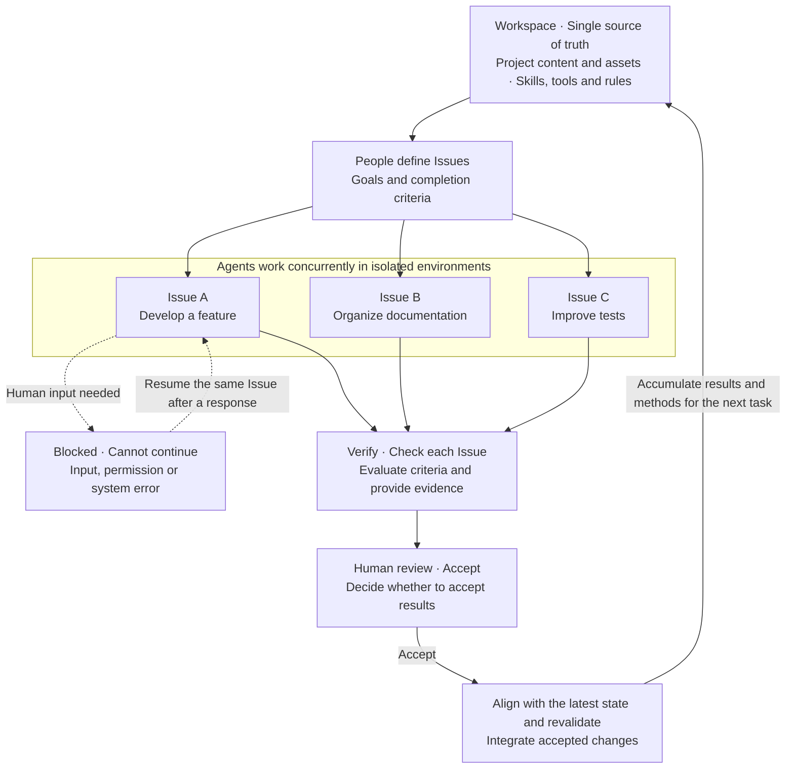

<p>
  
</p>

# Foundry

**A workspace as the single source of truth, where agents work concurrently and verified, human-accepted contributions advance both the project and its working capabilities.**

[简体中文](../README.md) | English

[Quick start](#quick-start) · [Documentation](#documentation) · [Roadmap](#roadmap) · [Report an issue](https://github.com/BD777/foundry/issues)

Foundry is an AI work platform where agents collaborate around a shared project. You set the goals; agents can develop features, organize documentation and improve tests concurrently. Verified results that you accept return to the workspace as the foundation for the next task.

## How it works

The workspace holds the project's content alongside the skills, tools and rules agents use. This diagram shows how it evolves through successive contributions:



Blocked carries a specific reason, such as Needs input, Needs permission or System error. Once resolved, the same Issue continues while other Issues progress independently. Issue A illustrates this branch. Temporary retries and capacity waits may remain execution progress; an execution that cannot continue becomes Blocked.

Each Issue is verified, reviewed and accepted independently. Feedback returns to the same Issue for further work. Verify prioritizes deterministic checks and retains the basis for model or human judgments; people decide whether to Accept. **The workspace is authoritative for the accepted project state, accumulating both product results and reusable working capabilities.**

## Roadmap

The target shape is described in the [Workspace and Sandbox overview](workspace-sandbox-overview.md) (Chinese). The roadmap is organized by module: each module states what works now and what comes next; its design and implementation boundary are in the linked module document (Chinese).

<p align="center">
  
</p>

Upper layers depend on lower ones; lower layers know nothing of the layers above. The dashed orange row has not started yet. Chats work directly in the workspace without the Sandbox; external agents use the agent surface directly through the `foundry` CLI / MCP. The diagram source is [architecture.mmd](assets/architecture.mmd).

| Module                                                 | Works now                                                                                                                                                                                                                                                                                                                                                                                                                                                                                               | Next                                                                                                                                                                                                                                                                                                                                                                                                                                                             |
| ------------------------------------------------------ | ------------------------------------------------------------------------------------------------------------------------------------------------------------------------------------------------------------------------------------------------------------------------------------------------------------------------------------------------------------------------------------------------------------------------------------------------------------------------------------------------------- | ---------------------------------------------------------------------------------------------------------------------------------------------------------------------------------------------------------------------------------------------------------------------------------------------------------------------------------------------------------------------------------------------------------------------------------------------------------------- |
| [Channels](channels.md)                                | Feishu bot: groups or direct chats pair to a workspace, threads map to sessions, replies stream into cards, and images and files in messages reach the session as attachments; a group acts with the identity and permissions of the account that generated its pairing code.                                                                                                                                                                                                                           | Issues in Feishu: built and tested with simulated events, awaiting acceptance in a real group. Exploration: extract a general IM Bot Adapter for IMs beyond Feishu.                                                                                                                                                                                                                                                                                              |
| [Personal Agent](personal-agent.md)                    | Built (2026-10-15): home and settings, automatic routing and creating / adjusting projects, Feishu direct chats, stop and confirmations, supervision; routing accuracy still improving.                                                                                                                                                                                                                                                                                                                 | Build the work packages in the [design](personal-agent.md) (Chinese): one assistant workspace per person that summarizes their other workspaces and devices; it decides where work belongs, creates or adjusts workspaces as needed, dispatches and supervises sessions and reports in plain words; the server's policy decides which actions need the person's OK, and the stop switch bypasses the model; a web home, Feishu direct chat and a settings panel. |
| [Chats](chat-experience.md)                            | One session is one native Claude Code / Codex session working directly in the selected workspace; attachments, server-side queue, steering, recovery after interruption, session outputs and diffs, background tasks, groups and search.                                                                                                                                                                                                                                                                | —                                                                                                                                                                                                                                                                                                                                                                                                                                                                |
| [Issues](issue-workflow.md)                            | Agree completion criteria with a read-only clarification agent and confirm them; the executor works in a candidate worktree, can dispatch collaborating sessions and enters Blocked through `ask_person`; the system collects evidence, runs program checks and independent agent judgments; after human acceptance the change is aligned and integrated. Claude and Codex both passed the real-browser loop of the [release gate](foundry-conversation-release-gate.md) (Chinese), on macOS and Linux. | No new features until real use gives feedback. Exploration: CI results as a feedback source; different agents for different steps of one Issue; workflow plugins.                                                                                                                                                                                                                                                                                                |
| [Agent surface](session-orchestration-design.md)       | Claude and Codex sessions get the same Foundry MCP, implemented once on the server: dispatch, observe, steer and hand off sessions, read other sessions and their outputs, lease resources, use external accounts. The `foundry` CLI calls the same tools for people and external agents.                                                                                                                                                                                                               | Verify the CLI with a real external agent. OAuth 2.1 for the HTTP MCP once remote agents outside Foundry appear.                                                                                                                                                                                                                                                                                                                                                 |
| [Execution kernel](execution-kernel.md)                | Session Runtime starts every native session; the Sandbox implements one interface on macOS (Seatbelt) and Linux (bubblewrap), owns only the write boundary and Foundry governance state, and fails closed elsewhere.                                                                                                                                                                                                                                                                                    | Docker container isolation; credentials never handed to agents in plaintext; per-use authorization for external side effects such as deploying or sending messages.                                                                                                                                                                                                                                                                                              |
| [Resources](resources.md)                              | Device resources are discovered, registered and listed; leasable ones are held exclusively per session through the server, queued and reclaimed, also across devices — currently Computer Use (macOS) and remote commands; browsers are started locally per session and reclaimed after use.                                                                                                                                                                                                            | Simulators, real devices and other resources join the same lifecycle. Exploration: machines share execution and verification resources, enabling remote verification.                                                                                                                                                                                                                                                                                            |
| [Skills](skills.md)                                    | Skill library: device scans and followed git repositories enter as immutable versions with dependencies; workspaces select and may pin versions, each person's default skills reach the workspaces on their devices; required programs are checked on each device, tools a bundle declares install on the device in one click; private sources can be read by the person's own device.                                                                                                                  | Install the programs a skill is inferred to need from Foundry (today they are only detected and reported to the session); the server reads private sources itself, without depending on a device being online. Exploration: automatic skill extraction and recommendation.                                                                                                                                                                                       |
| [Models and accounts](models-and-accounts.md)          | Uses the device's own Claude Code / Codex login and installs them the official way when missing; model services configure an API or gateway, with a per-model context window, and an endpoint found in a device's configuration can be promoted to one; model catalogs are read through the native SDKs and cached.                                                                                                                                                                                     | —                                                                                                                                                                                                                                                                                                                                                                                                                                                                |
| [Connectors](connectors.md)                            | The server keeps Feishu app secrets and serves them through a gateway; a person's external accounts can be bound to workspaces, and agents use them through `feishu-cli` as the person or as the bot, with no secret on the device.                                                                                                                                                                                                                                                                     | —                                                                                                                                                                                                                                                                                                                                                                                                                                                                |
| [Devices and workspaces](devices-and-workspaces.md)    | The daemon connects out to the server; several devices and workspaces; pairing, start at login, worker updates served by the server; sessions started on another device; [Docker deployment](../deploy/README.md) and [parallel dev stacks](dev-stacks.md).                                                                                                                                                                                                                                             | Exploration: [cloud workspace](devices-and-workspaces.md#cloud-workspace), hosting project files and persistent state so different execution environments access one logical workspace by permission.                                                                                                                                                                                                                                                            |
| [Identity and sharing](accounts-permissions-design.md) | Sign-in required for every API; invites, device credentials and resource ownership; workspaces shared as Viewer / Member / Maintainer / Owner, with immediate revocation.                                                                                                                                                                                                                                                                                                                               | Feishu sign-in with authorization as the sender; audit and ownership transfer; device key-pair authentication.                                                                                                                                                                                                                                                                                                                                                   |

### Personal Agent (built, being tuned)

Today people build and maintain workspaces, then work inside them: a clear context boundary is what lets agents get things right, and it is the base. A Personal Agent layer (shown as "Assistant") goes on top: a person only says what they want; it decides which workspace the work belongs to, creates or adjusts one when needed, and hands the work to sessions there. The design is in [Personal Agent](personal-agent.md) (Chinese).

- **Exactly one Personal Agent workspace per person.** The server summarizes the person's other workspaces and devices into it for progressive disclosure; it keeps only derived summaries and pointers, never a second source of truth.
- **It decides; the server keeps it safe.** Routing, creating, renaming and adjusting skills and connectors are its decisions, and the person never needs these concepts; which actions need the person's one-tap OK is structured policy the server enforces, and the stop switch bypasses the model.
- **It routes and supervises.** The work itself still happens in sessions in the target workspace; it does small things itself.

## Quick start

### Prerequisites

- Node.js 22
- pnpm 11.7.0
- Go 1.24.0 or later, as declared in [go.mod](../apps/server/go.mod)
- Git; local workers support macOS and Linux. Issue execution on Linux requires bubblewrap and a working user namespace. Issue clarification, independent-agent verification and Accept integration work on both; on Linux, controlled HTTP targets are not available yet. In the sandbox an Issue writes only its own candidate and cannot read Foundry's own credentials and state; an Issue you started yourself can use your local configuration and credentials. Chat works on both and is not sandboxed.

### Install and run

```bash
git clone https://github.com/BD777/foundry.git
cd foundry
pnpm install
```

Start the server and web app in separate terminals:

```bash
pnpm dev:server
```

```bash
pnpm dev:web
```

Open [http://127.0.0.1:31983](http://127.0.0.1:31983/).

### Connect a local worker

In the web app open Devices → Add device, create a pairing command and run it on the machine that should do the work (macOS or Linux, Node.js 20 or later). It installs the worker from npm, pairs it with a one-time token and starts it at login (a systemd user service on Linux; without systemd it prints the command to run it in the foreground):

```bash
npx -y @bd777/foundry-worker@latest install --server http://127.0.0.1:31982 --token <pairing token> --workspace /absolute/path/to/workspace
```

The worker uses that machine's own Claude Code or Codex; it does not bring a copy of either. If one is missing, choose Install under Devices → Models & accounts and the worker runs the official installer on that device (Claude Code: `curl -fsSL https://claude.ai/install.sh | bash`; Codex: `curl -fsSL https://chatgpt.com/codex/install.sh | sh`), or run it yourself. Then sign in with `claude` or `codex login` and choose Re-check. A version older than Foundry needs (Claude Code 2.1.201, Codex 0.142) still works, and the page shows the update command (`claude update` for Claude Code; for Codex, whatever installed it, such as the official script again or `npm install -g @openai/codex@latest`). API endpoints and gateways can be configured under Model providers instead.

A worker running as root still runs Issues (they run inside Foundry's sandbox). In chats, Claude Code refuses to skip permission prompts as root: choose another permission mode for chats, or run the worker as a regular user.

A worker run from the source checkout (for development) needs the pairing token too:

```bash
pnpm --filter @bd777/foundry-worker foundry-worker -- setup --server http://127.0.0.1:31982 --workspace /absolute/path/to/workspace --token <pairing token>
```

See the [development guide](development.md) for installation options, authentication, previews and troubleshooting.

## Project structure

```text
apps/web/          React / Vite interface
apps/server/       Go API, SQLite projections and worker communication
packages/worker/   Local agent execution, files, worktrees and previews
packages/protocol/ Shared component protocols
docs/              Guides, product design, architecture and research
cases/             Product regression scenarios and verification requirements
```

The server handles coordination and state projections; workers perform execution. See the [security boundary](security.md) for data placement, credential handling and remote access rules.

## Documentation

| Document                                         | Contents                                                                        |
| ------------------------------------------------ | ------------------------------------------------------------------------------- |
| [Documentation index](README.md)                 | All documentation, organized by topic                                           |
| [Development guide](development.md)              | Installation, startup, worker configuration and verification                    |
| [Parallel dev stacks](dev-stacks.md)             | Isolated stacks for running multiple Foundry copies, with doctor/repair tooling |
| [Product philosophy](philosophy.md)              | Project goals and the work loop                                                 |
| [Technical architecture](technical-selection.md) | Component responsibilities and technology choices                               |
| [Overview](workspace-sandbox-overview.md)        | Overall design of Workspace, Sandbox and Issues (Chinese)                       |
| [Roadmap](#roadmap)                              | Upcoming work and priorities                                                    |

## Contributing

Use [Issues](https://github.com/BD777/foundry/issues) to report bugs or discuss requests, or submit a Pull Request. Include reproduction steps, your environment and relevant logs when reporting a problem, and remove credentials or other sensitive information.

Before making changes, read [AGENTS.md](../AGENTS.md) and the [development guide](development.md). Current working context is in [CONTEXT.md](../CONTEXT.md). Run the regression gate before submitting changes:

```bash
pnpm regression:commit
```

Update the [regression catalogue](../cases/README.md) for features or fixes that change observable behavior. Keep this README and the [Chinese README](../README.md) in sync when updating the project introduction or startup instructions.

## License

Foundry is licensed under the [Apache License 2.0](../LICENSE).
