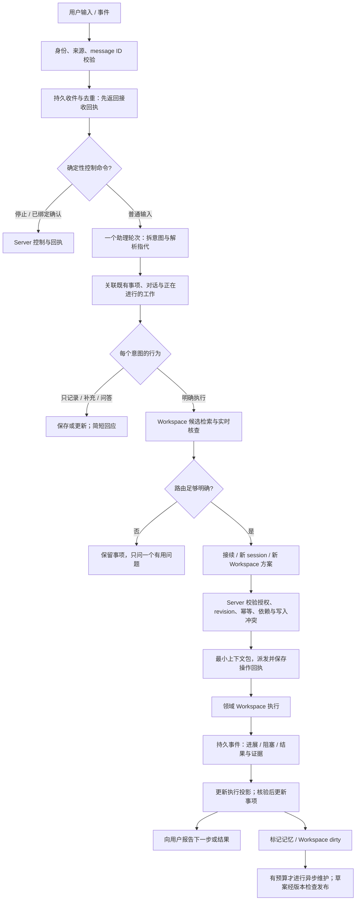

# DEV-023 · Personal Agent：事项接入、记忆、路由与 Workspace 治理

状态：**2026-10-21 用户已授权按推荐默认推进完整实施，实施中。** 全部交付矩阵、当前代码与验证状态见 [实施记录](DEV-023-implementation.md)。以下保留 10-19/20 的研究与设计依据；历史“待讨论/未实施”对应当时状态，不再构成等待方案批准的阻塞。首版研究归档依据见 [DEV-025](DEV-025-release-closure.md)，当前方案补充见 §14。

## 1. 建议先确定的产品方向

Personal Agent 应当是**可靠接住事项、帮助选择下一步、把明确授权的工作送进合适 Workspace 并接回结果的入口**。Workspace 继续承载领域知识、技能、产物和工作规范；不把各项目的历史都搬进一个巨大个人上下文。

建议在现有能力上演进，先交付“收件不丢、已有工作可接续、执行不重复”的闭环，再增加自动整理记忆和 Workspace。逻辑上分为入口协调、记忆维护、Workspace 治理三个职责，运行时先只需要**一个前台助理，加按事件启动的维护作业**；不让每条消息依次经过三个常驻模型。

记忆建议采用 **hybrid，但不按“个人事实=全局、项目事实=局部”划分所有权**。Workspace 可以是求职、学习、家庭或任何领域。每条事实选择一个权威维护位置，可以是领域 Workspace，也可以是私有 Memory Workspace；后者汇集跨域引用，以及用户选择独立维护的共享知识，不收走所有个人正文。Server 是控制面数据库，保存操作权限、事项/执行关联和可重建的检索索引，**不是隐藏的另一个 Workspace**。任务状态、批准和停止回执保持产品数据结构。

Memory Workspace 的存储设备与前台助理执行设备独立设置。推荐最初一个私有 memory 根、每条事实单写；多领域来源通过引用接入，不等于多个可互相覆盖的 memory 主副本。四类角色可统一默认、按角色覆盖账号/模型/effort；作业默认在其目标 Workspace 所在设备执行，换设备或 Provider 必须在已配置的数据流向与 fallback 范围内。前台保留对话身份，后台按事件启动短作业，均不要求模型进程永远存活。

最小版本优先级：**可靠收件 → 稳定事项与现有 session 关联 → 安全派发 → 下一步建议 → 记忆治理 → Workspace 治理**。不要求先迁移所有记忆、引入向量库或完成全自动多 Agent 架构才能使用。

## 2. 真实案例：已发生什么，仍不知道什么

证据：[个人 workspace 原会话（需要访问权限）](https://dev.foundryapp.app/chats/sess_1792379847652402476?workspace=ws_92b9c609-361d-469e-a554-e589c32814f3)。本轮通过 workspace 允许的 foundry 技能读取 thread，提取全部四条用户输入及四次最终答复；另用 changes/file 读取实际创建的规则和当日日记。未修改该 workspace、未派发其中事项、未把原始个人事项复制到本仓库。

| 证据层   | 观察                                                                                                           | 对设计的要求                                                       |
| -------- | -------------------------------------------------------------------------------------------------------------- | ------------------------------------------------------------------ |
| 用户表达 | 需要存个人背景与每日 TODO，未来可能迁入 Personal Agent；希望约定简短                                           | 接入要轻，不能先让用户填写项目、优先级、分类和表单                 |
| 实际产物 | `AGENTS.md` 已建立；助手工具与最终答复有 `CLAUDE.md` symlink 的创建/验证证据                                   | 原生 CLI 的规则复用已解决一个局部问题，尚非跨 Workspace 系统       |
| 实际产物 | 一份 daily 文件记下七项跨两个领域的事项，并保留未知上下文与候选想法                                            | “已接住”应独立于“可以执行”；多个意图要逐项保留，不能只处理最后一条 |
| 规则     | 个人信息按需写 `profile.md`；仅已确认信息；完成需用户确认或实际依据；记录不等于提醒或执行                      | 来源和行为授权是不同字段；不把闲聊、猜想或引用变为长期事实         |
| 完成边界 | 没有看到 `profile.md` 已创建证据；`TODO.md` 总表、`projects/` 和“一件当前重点、三件今日重点”只是助手提出的建议 | 不把建议当用户批准或现有实现                                       |
| 用户痛点 | 事项太多，切换上下文会遗失，难以分配时间；设计助理本身也成为负担                                               | 产品成功标准是减少遗失、恢复成本和选择成本，不是 Agent 数量        |

未决需求：实际期限、外部依赖、哪个事项已在其他 session 推进、用户愿意让助理主动执行的范围、时间分配偏好均没有完整答案。不能根据领域、措辞强弱或助手猜测编造紧急度。只有一个用户的案例，不构成普遍用户画像。

从案例抽象出五个场景：随口记多件事；给旧事项补上下文；从一个项目临时切走再回来；问“现在先做什么”；明确要求执行某一项。日记可保留历史，但不能靠逐天复制 checkbox 维护唯一当前状态，否则跨日重建与重复派发会成为常态。

## 3. 现状审计：设计声称、可见实现和缺口

审计基线为本地 `main`，HEAD `c2e46c6e405afbee31263402e2fe9d5d5fc79d1d`，同时存在 DEV-006/007、DEV-022 等未提交工作。以下是 2026-10-19 的静态源码审计，不是部署核验或重跑旧模型评测。未碰共享构建、服务和测试账号。旧 research 仅作为线索；外部结论重新查了一手资料。

| 能力/设计声称                       | 当前实现证据                                                                                                                                                          | 缺口或结论                                                                                                                                                                                    |
| ----------------------------------- | --------------------------------------------------------------------------------------------------------------------------------------------------------------------- | --------------------------------------------------------------------------------------------------------------------------------------------------------------------------------------------- |
| 唯一 PA Workspace、私有入口         | `sqlitestore/personal_agent.go` 的 `personal_agents` 以 user 为主键、workspace 唯一；`httpapi/personal_agent_service.go` 的 `assistantConversation` 根据角色/来源判定 | 已有持久身份，不需要另造全局超级 Agent；memory workspace 不必是第二个 PA 身份                                                                                                                 |
| 记忆及来源                          | `personalagent/memory.go` 的 `MemoryOrigin`、`QuoteGrounded`；`mcp_personal_agent.go:planRemember`；`store/personal_agent.go`                                         | `pa_memory` 是个人事实正文真相源，**不是只有摘要和指针**。有 stated/edited/inferred/external、source session/input、supersedes、verifiedAt；没有有效期、实体键、冲突状态或读取时失效判断      |
| 来源可信                            | 引用只匹配当前助理 conversation 内的用户输入，排除通知/定时等；external 为 pending                                                                                    | 匹配证明引文出现过，不能证明摘要被原话蕴含。`inferred=true` 可生成 active 推断；`verifiedAt` 是来源/编辑时间，不是事实正确性认证。需要来源主体与内容推断分别记录                              |
| 遗忘                                | `sqlitestore/personal_agent.go:ForgetPersonalAgentMemory` 清空该项及其 supersedes 前驱链正文；全部遗忘也清空内容                                                      | 不等于删原聊天、缓存、备份或已注入运行中上下文；文案必须限定遗忘范围                                                                                                                          |
| 本人清单                            | `store/personal_agent_list.go`、`httpapi/personal_agent_list.go:planUpdateList`、SQLite `pa_items`；Web `person-list.tsx`                                             | 已有原话、自然语言时间、提醒、open/done/dropped、单个 taskId；缺 stable input/item 幂等、revision、下一步、等待原因、workspace/session 直接关联、多次执行关系、依赖                           |
| 清单与派出任务分开                  | `pa_items` vs `pa_tasks`；`recordAssistantTask`、`assistantHasTask`                                                                                                   | 正确的分离应保留；现有 TaskID 仅接受自己的 PA task，无法直接表达用户已在普通 session 做的工作。清单完成变更仍依赖用户原话，尚无独立的证据完成协议                                             |
| 意图预制+动态判断                   | `personalagent/prompt/system.md` 已列停止/回应/问答/记忆/计划/执行/闲聊及多意图要求                                                                                   | 主要依赖提示词；未见一个持久 input→多个事项→行为计划的可恢复契约，模型中途失败可能只完成部分记录                                                                                              |
| Workspace 检索                      | `workspacedigest/rank.go:RankRecords` 按名称、purpose、routeWhen/notWhen、历史、文件、notes 等 BM25 式加权，含 CJK 分词、recency；`findWorkspaceForMCP` 返回 close    | score 是压缩后的相似度，不是路由正确概率。close margin=0.05 是启发式。不能把 0.9 当“90% 可以自动执行”                                                                                         |
| 实时核查与摘要                      | `workspace_digests.go`、`workspacedigest/service.go`；`getWorkspaceForMCP` 读取 live/instructions/note；概括为只读 Foundry session                                    | 已有确定性刷新、增量概括、权限过滤和 staleness；live 是查询时观察，非锁。离线无法读源文件；文件截断有标记，不能当完整上下文                                                                   |
| 路由纠正与审计                      | `cards/<workspaceId>.md` 被 `assistantNotes` 读取；`pa_routing_decisions` 有类型、表、存储方法                                                                        | 全生产源码搜索仅找到 `RecordPersonalAgentRoutingDecision` 定义与接口，未找到调用。工具 action 审计不是完整路由决定记录；不能宣称纠错评测闭环已接通                                            |
| 同一 Workspace 一个写会话、其余排队 | 设计 §6 与 prompt 要求；创建路径有助理并发/用量限额                                                                                                                   | 审计 `admitAssistantSession`、创建服务及相关路径，未找到 PA 专属按 Workspace 的写入 lease/排队仲裁；MCP `create_session` 仍明确同目录并发写会竞争。单个 native writer 锁不等于 Workspace 写锁 |
| 监督与恢复                          | `personal_agent_supervision.go` 根据 session 事件刷新 pa_tasks，完成/失败/询问通知，静默/连接失败检查；离线等待已有 session 层支持                                    | `endsWithQuestion` 用尾部问号判询问，`taskStatusOf(completed)` 为 done，均不是验收成功。跨重启通知、业务完成证据及事项状态应独立建模                                                          |
| 策略、提议、停止                    | `assistantWrite`、`personalagent/policy.go`、`personal_agent_service.go`；接受与规则放宽的 Server 检查                                                                | 复用，不改成模型裁决。PA 的旧 session 停止不能自动代表所有持久计划/服务已停，需与持续工作能力及回执统一                                                                                       |
| Workspace 生命周期                  | `workspace_lifecycle.go` 共用 REST/MCP 服务；Worker `personal-agent-settings.ts` 的受管根；初始化逻辑与测试已存在                                                     | 建目录/写规则是基础，不代表领域目标、事实、来源、验收、权限已足够。需要“上下文就绪”检查；当前目的字段与简报不能代替治理                                                                       |
| 夜间 lint 与旧 Workspace 自动治理   | 设计 §3 规定 03:00 lint；`personalagent/defaults.go` 有 `NightlyLintHour=3`                                                                                           | 全仓生产路径只找到该常量定义，未找到调度与实施链路；按设计项处理，不认定已上线                                                                                                                |
| Web、Worker 与提示词                | Web `assistant-home.tsx`、`person-list.tsx`、设置/提议/任务组件；Worker `session-policy.ts` 附加 PA instructions；Server 分离稳定说明与每轮状态                       | 可复用的真实产品能力很多；现状并非空壳，但尚缺可恢复事项协议与上下文治理闭环                                                                                                                  |

以上路径位于 `apps/server/internal/`（省略前缀的 Server 路径）、`apps/web/src/features/personal-agent/`、`packages/worker/src/`。关键可直接核查：[清单协议](../../apps/server/internal/store/personal_agent_list.go)、[清单写入](../../apps/server/internal/httpapi/personal_agent_list.go)、[记忆/路由工具](../../apps/server/internal/httpapi/mcp_personal_agent.go)、[排序](../../apps/server/internal/workspacedigest/rank.go)、[助理派发服务](../../apps/server/internal/httpapi/personal_agent_service.go)、[监督](../../apps/server/internal/httpapi/personal_agent_supervision.go)、[当前提示词](../../apps/server/internal/personalagent/prompt/system.md)。

现行设计的历史评测记录称：117 例脱敏集，确定性排序 top-1 约 58–61%；端到端局部优化后总体 80%，留出集约 55%；平均约 12 秒、每次约 $0.43，输入常达 4–6 万 token。**这些是原报告的历史结果，本轮未复现，也不能归因于当前版本。** 它们足以反对“已有排序即已解决路由”，不足以据此设定今天模型的价格或承诺新方案效果。

### 与现行设计必须显式修订的决定

| 原决定                                  | 本轮需求/推荐                        | 冲突如何处理                                                                                                       |
| --------------------------------------- | ------------------------------------ | ------------------------------------------------------------------------------------------------------------------ |
| PA 目录不放个人记忆；正文在 Server      | 用户偏好 memory as workspace         | 必须明确变更正文真相源，采用一次切换而非双向自由写；本轮只提案                                                     |
| 每人一个 PA Workspace                   | 一个入口，另有专用知识空间           | 保留唯一 PA 身份；可先在其私有 workspace 内划 memory 区，后续指定单独私有 memory workspace，不能给它第二个入口身份 |
| PA 不做第二个真相源，只存派生摘要和指针 | 全局个人知识与跨项目信息需要维护     | 项目事实仍在项目；个人偏好/跨项目关联可在 memory 为原生内容。派生项强制指向来源和版本，不存任务实时状态副本        |
| inferred 记忆立即 active                | 案例要求仅确认内容，不猜测           | 默认推断留候选或当前对话，不自动升级为长期事实；用户可另选低风险偏好学习                                           |
| 夜间模型整理、自动新建                  | 用户不想增加负担，治理不扰动当前工作 | 无变化不运行模型；事件合并；新建仅随明确执行且适合独立领域，不因记录一条 TODO 自动建项目                           |
| 提示词保证单写入与完成核查              | 必须防重复派发、上下文变化和误报     | 增加 Server 事务/operation、必要的写入仲裁、证据与回执；不能靠另一份更长提示词补齐                                 |

## 4. 一手资料对照：哪些可借鉴，哪些未证明

以下链接均于 **2026-10-19** 实际打开。动态文档没有固定发行号的，注明为当日文档，不虚构运行版本。没有安装或运行这些框架，没有调用其推理服务；“官方描述已核实”不等于“在 Foundry 验证”。旧 research 的供应商跑分和二手事故叙述不作为采纳依据。

| 来源/版本/层次                                                                                                                                                                                | 已核实机制                                                                         | 对 Foundry 的启发与局限                                                                                                    |
| --------------------------------------------------------------------------------------------------------------------------------------------------------------------------------------------- | ---------------------------------------------------------------------------------- | -------------------------------------------------------------------------------------------------------------------------- |
| [OpenClaw Memory](https://docs.openclaw.ai/concepts/memory)，当日文档，应用/运行时                                                                                                            | Markdown 工作区记忆、启动摘要与按需读取、压缩前落盘；明确记忆不执行权限策略        | 文件可以是内容源；需预算与来源。不能据文档证明自然语言路由或遗忘可靠；不照搬其调度和 provider 接入                         |
| [Letta MemFS](https://docs.letta.com/concepts/memfs)，当日文档，应用/CLI；[Agent SDK memory](https://docs.letta.com/agent-sdk/memory)，当日 SDK 文档                                          | Git 记忆投影到设备、按需读取、后台整理；本地改动与同步有区别                       | 支持“知识空间+版本化发布”的可行性。两页对根文件与 `system/` 注入有版本口径差异；仅采纳机制，不宣称某目录规则通用于所有版本 |
| [Letta shared repositories](https://docs.letta.com/agent-sdk/repositories)，当日 SDK，Cloud 功能                                                                                              | 临时 session 引用与持久 attach 分开，更新可带 content hash 前置条件，写入返 commit | 借鉴绑定寿命与 CAS；不是 Foundry 本地任意目录已获同步/权限保证，也不要求引入其 Cloud                                       |
| [LangGraph memory](https://docs.langchain.com/oss/python/concepts/memory)，当日 OSS Python 概念文档                                                                                           | thread checkpoint 与跨 thread JSON namespace store 分开；热路径和后台记忆更新      | 任务恢复与知识检索分层；namespace 是组织方式，权限仍需应用实现。提供原语，不负责个人任务优先级                             |
| [Graphiti overview](https://help.getzep.com/graphiti/getting-started/overview)，v4 文档下的 OSS 框架；[作者时态说明](https://www.getzep.com/blog/beyond-static-knowledge-graphs/)，2024-10-02 | episode 来源、双时间、事实失效与混合检索；当前框架与托管 Zep 服务分开              | 先借鉴 valid time/recorded time 和修订链；没有多跳关系需求时不引入图数据库和抽取成本。供应商性能宣传不作收益证据           |
| [Anthropic Building effective agents](https://www.anthropic.com/engineering/building-effective-agents)，2024-12 原文及当日更新，架构经验                                                      | 区分固定 routing workflow 与动态 orchestrator；从简单可评测路径开始                | 支持适度预制意图与按需分解，不证明三 Agent 优于一 Agent。页面已提示旧工具环境变化                                          |
| [Anthropic Context engineering](https://www.anthropic.com/engineering/effective-context-engineering-for-ai-agents)，2025-09-29，工程经验                                                      | 按需取材、压缩、结构化笔记及上下文隔离                                             | 用来源指针和恢复胶囊替代全量拼接；不是该方案效果的受控实验                                                                 |
| [Anthropic Managed Agents](https://www.anthropic.com/engineering/managed-agents)，2026-04-08，托管架构经验                                                                                    | 区分 session 状态、执行环境和 harness 的上下文管理                                 | 说明可恢复状态不应依附某次模型运行；不意味着 Foundry 应迁到托管服务或同用 provider API                                     |
| [Codex AGENTS.md](https://learn.chatgpt.com/docs/agent-configuration/agents-md)，当日官方文档，CLI/agent 配置                                                                                 | 全局/项目/子目录指令发现，组合预算默认 32 KiB                                      | 项目上下文可分层，但指令不是事实数据库；Foundry 的受管配置隔离会改变原生默认加载面，需以实际 Worker 为准                   |
| [Temporal workflow execution](https://docs.temporal.io/workflow-execution)，当日服务/SDK 文档                                                                                                 | 历史事件恢复、命令与等待、不同终态、取消确认                                       | 借鉴持久事件与操作回执，不在 MVP 新引入 Temporal。它不解决语义路由，重试也不能自动保证外部副作用仅一次                     |
| [LongMemEval](https://arxiv.org/abs/2410.10813v2)，v2，2025-03-04，ICLR 2025 论文                                                                                                             | 500 个问题，评估提取、跨 session、时间、更新、未知拒答                             | 采用能力分解做验收；问答基准不能证明派发安全、权限或任务完成率，不将旧模型分数外推到当前模型                               |

结论是：文件知识、结构化状态、来源/有效期、渐进检索、事件恢复各有成熟机制；**没有上述来源证明一个完整 Personal Agent 能可靠替用户理解全部事项并自主分配时间**。本方案中的默认动作、阈值、角色组合和优先级建议属于针对 Foundry 的设计推断，需要本地基准与试用验证。

## 5. 真相源和 memory 方案

### 5.1 四类信息不能混用

2026-10-20 修订：下表按信息的职责区分，不按“是不是个人信息”强制决定文件位置。跨域可用范围与事实权威来源分别记录，详细规则及 job-hunting 例子见 §14.1。

| 信息                           | 唯一权威源                                                               | 其他位置可以保存什么                                                                   |
| ------------------------------ | ------------------------------------------------------------------------ | -------------------------------------------------------------------------------------- |
| 项目事实、成果、具体操作规范   | 领域 Workspace 的源文件、系统记录或经证实产物                            | 路由目录和 memory 只保存来源引用、版本与短摘要；实时事实回源                           |
| 个人稳定事实、偏好、跨项目关系 | 每条选择一个领域 Workspace 或 Memory Workspace；旧项迁移前为 `pa_memory` | 跨域使用按 publication/引用授权；Server 只读索引带源 revision，不按个人/项目分类搬正文 |
| 用户事项/意图、授权、依赖      | Server 的 `pa_items` 演进及关联记录                                      | `TODO.md`/daily 可导出为视图；不同时维护另一个可执行任务表                             |
| 实际执行、持久服务、计划和停止 | sessions / session_work 及 Worker 观察与控制回执；`pa_tasks` 是协调投影  | 用户视图和胶囊标明 observedAt；“某日做完”记忆不能作为当前完成状态                      |

政策、权限、范围批准和停止屏障在 Server。Memory 可以解释“用户为何有此偏好”，不能授予权限。会话完成只说明运行结束；计划定义仍可能存在，服务仍可能存活；个人事项也可能只完成一个子步骤。

### 5.2 三种选择的权衡

| 维度         | 纯 memory workspace                                           | 全局结构化服务                                       | 推荐 hybrid                                                      |
| ------------ | ------------------------------------------------------------- | ---------------------------------------------------- | ---------------------------------------------------------------- |
| 可审计、便携 | Markdown 易读、diff、导出；Git 留历史但增加遗忘困难           | typed 审计清晰，需额外人读视图与完整导出             | 正文可直接读；结构化变更与来源可追溯，明确导出规范               |
| 一致性、并发 | 多会话直接覆盖风险；Git merge 不懂事实冲突                    | 事务/CAS/唯一约束方便；仍可能写入语义矛盾            | 每条内容单写入通道+revision；索引可重建，有同步复杂度            |
| 检索         | 小规模 rg 足够；跨设备离线和大量材料不便                      | namespace/filter/时间检索方便，可扩充语义检索        | ACL 过滤后从索引选小集合，再读权威版本；先关键词，后按基准加语义 |
| 权限         | Workspace/目录可读不等于每条事实可分享；普通 shell 能绕过约定 | 每次 API 可查用户/用途/目标权限；Server 集中持有隐私 | 私有正文不挂到所有执行者；broker 最小上下文包；仍需沙箱落实      |
| 跨设备       | 需同步/迁移协议，不能假设同一路径即同文件                     | Server 在线时一致可见                                | 单内容主写设备+版本缓存；以后才考虑多副本冲突处理                |
| 离线         | 本机可以记，但其他设备看不见；状态不可联动                    | Server 不可达则不能写权威状态；设备离线仍可收件      | Server 收件，正文未落源显示 pending sync；源离线不伪称知识已生效 |
| 成本         | 存储低、模型整表整理可能高；全文每轮注入最贵                  | 数据库/检索服务成本；模型抽取仍不可免                | 只增量更新和按需召回；多一层同步工程，未必短期更便宜             |
| 过期与纠错   | 文件不会自动失效，需前置信息和维护者                          | 定时过滤容易，仍要事实语义判定                       | 读取时确定性过滤+事件失效+批量语义复核；过期不是物理删除         |

选择 hybrid 的理由是用户需要可控、可迁移的知识，同时 Foundry 已有跨设备控制面。它的风险在于同步协议和多处视图；如果团队暂不愿承担这部分，**先保留 Server 真相源并做规范导出**，也比立即双写可靠。推荐作为目标架构，不作为 MVP 阻塞条件。

### 5.3 memory workspace 的最小组织与元数据

下面是拟采用的格式示例，不创建这些目录，不包含案例私密内容：

```text
memory/
  INDEX.md               # 可读索引；短指针，不拼入所有会话
  facts/<id>.md          # 选择由此处维护的共享事实/偏好；不包括所有领域正文
  links/<domain>.md      # 跨项目关系，引用源 Workspace
  journal/YYYY-MM-DD.md  # 只记录必要变更与出处；非完整聊天归档
  candidates/            # 未确认推断/待核对来源
```

每项至少：`id, kind, subject/key, authorityWorkspaceId, scope, audience, sourceRefs, sourceAuthority, observedAt, recordedAt, validFrom, validUntil?, reviewAfter?, revision, status, supersedes?`。事实正文是人类可读短文；frontmatter 跟正文在同一原子修订里。`sourceRefs` 指向具体输入/文件版本/外部文档，不只指整场聊天。`confidence` 用“用户确认/直接观察/推断”及理由表达，不伪造概率；真需要数值也只作经过校准的模型判断分数。跨域引用还记录 `publicationId/sourceRevision`，发布与源正文的读权限分别检查（§14.1）。

来源与有效性分开：一个可信来源可以描述过去、假设或引用别人的话。授权主体由入口/连接器身份确定，不由模型写一句 `stated` 决定。事实抽取保留引用与转述之间的关系；候选内容不能通过 `inferred` 绕过来源检查。可允许“回答风格”这类非行动偏好临时使用，但不默认升级为长期事实。

维护策略：

- **事件优先**：用户明确纠正、源文件 revision 变化、成员权限撤销、项目归档时，相关索引立即失效/变脏。对同一 subject/key、scope 的明确新说明生成 superseding revision；范围不同的事实可并存，不能机械用“最新一句”覆盖全部。
- **读取时判断**：过 validUntil 的事实不得用于当前行动；过 reviewAfter 的项可以作为历史线索，但要回源或询问。用户明确“本周”的约束设具体有效区间；稳定偏好不随意设七天失效。
- **定时兜底**：每日确定性扫描检查到期、断链、格式、权限；有 dirty 才排合并维护批次。模型仅处理需要语义判断的冲突/归并，按预算封顶；没有变化不唤醒模型。定时必须进入 Foundry 持久工作控制面。
- **纠正与遗忘**：用户可查看“记住什么/从哪里来/影响哪些用法”，修改或撤销。撤销先加 tombstone 与 revision 屏障，让索引停止召回，再清除正文、派生摘要/向量/缓存；断开的副本回来必须先处理 tombstone 才可服务。
- **历史边界**：过期、归档、superseded 是停止当前使用，不是删除历史；forget 是删除记忆内容及派生内容。原聊天、外部源、备份、已交给运行中会话的信息另有保留范围，必须显示剩余范围与完成回执。Git 文件直接删除不能称真正遗忘；需处理历史或不用 Git 保存敏感正文历史。

### 5.4 写入与索引协议：避免双真相源

拟新增的知识读写服务层是受限代码接口，不默认创建另一个常驻 Workspace service 或推理平台：请求带 `operationId + expectedRevision + sourceRefs`，Server 检查权限，登记待写操作；目标设备原子更新内容与 revision manifest；收到内容 hash/revision 回执后发布新索引。读者只读已发布版本，读不到则返回 stale/unavailable。崩溃恢复按 operationId 对账，不重新猜一条事实写入。

用户在文件里直接编辑仍然有价值：Watcher 把它识别为新修订候选，经格式/来源/权限校验后发布。**文件里自填的批准和来源可信度不能自动生效**。目标是正文可编辑，控制字段不能被普通文件修改提升权限。新修订未发布前 UI 明示“本地已改，尚未同步”。跨设备 MVP 只选一个主写位置；离线写入是待合并分支，冲突不以最后写入胜出。

Server 索引只保存检索所需摘要、来源 ID、版本、scope/ACL 和有效期；可选缓存必须有保留上限与遗忘传播。索引读之前和实际发给目标 Workspace 之前分别校验权限。权限撤销后不得靠旧摘要继续泄露内容。向量检索以后再评估；若采用，也必须符合本仓库原生 SDK/CLI 推理边界，不能偷偷接入直接 provider 调用。

## 6. 一句话进来之后

### 6.1 完整流程



“收到”必须在持久存储成功后发；它只表示原始请求未丢，不能说“已记好七件”而实际上尚未拆项。即使模型故障，收件箱仍显示“待整理”并可恢复。所有普通聊天不必成为 TODO：先保留输入，再仅把事项意图转成项；问答/闲聊在处理后标为无需事项。

这是对现有入口的重要改变：收件必须独立于 PA 家设备在线和模型可用性；Server 在线即可接收，后续由持久队列在能力恢复时整理。若 Server 本身不可达，客户端只能显示“待发送”，不能伪称服务端已接收。Web/飞书使用各自稳定 message ID 归一化，敏感内容按既有私有会话权限保存，不额外向公共日志复制正文。

一条输入可有多个段落和行为，例如“记下两个方向，先查第一个，不联系别人”。保留一个 input envelope，提取多个有稳定 ID 的意图与 source span；未识别清楚的部分留待整理，不吞掉它。首轮能确定的记录与只读准备先完成；执行权限不清的部分保持待澄清，不能因其他一项可执行就整条放行。

### 6.2 适度预制意图，动态填充目标与计划

预制的是有限、可测试的行为：`capture / update / query / execute / remember / policy / control / converse`。执行子类型可以动态解释，Workspace 类型不要写死为工作、生活、代码。预制意图不要求单选：一个输入可有多个互相引用的 intent。

上下文线索按证据强弱解析：显式 item/session/workspace 链接 → 当前等待的问题或选中事项 → 当前对话中明确目标 → 用户自己的活跃事项 → Workspace 检索候选。最近用过的项目只是弱线索；不能仅凭“上次在那里”决定“这个”“继续”的对象。

路由先识别**事项是否已经存在**，再判**动作**，最后选**执行地点**。否则“继续上次的排查”容易再次生成一个同名 session；“今天做完了”容易被当成新的执行任务。

| 分支                  | 判定依据与动作                                                                       | 不足时的回退                                                                      |
| --------------------- | ------------------------------------------------------------------------------------ | --------------------------------------------------------------------------------- |
| 现有 Workspace 匹配   | 名称/领域说明/routeWhen/notWhen/资源匹配，查 live 与权限；新工作启动一个合适 session | 有多个接近候选时给两个简短选项；保留事项，问题不阻塞其他已明确项                  |
| 接续已有工作          | 同一事项+目标+受控 session；读当前状态与最后检查点，增量 `send_message`              | 旧历史误导或目标变化，显式 handoff 新 session，沿用 itemId，保留关联，不另建 TODO |
| 已在普通 session 进行 | 关联已有 session/Issue；不要求先由 PA 创建；初始只读跟踪                             | 用户可读不代表可 steer；不可控制就给入口，不能克隆一次执行来“接管”                |
| 暂无合适 Workspace    | 先判断是一次性答复/笔记，还是独立长期领域；后者在明确执行范围内提出/完成新建与初始化 | 地点、资源或权限不足时保留待办，说明缺什么；不因低相似度就自动新建                |
| 只记待办              | 保存项、已知时间和原话；无执行 session、无提醒、无自动建 Workspace                   | 日后用户说“现在开始”再重新核查地点、授权和实时状态                                |
| 跨 Workspace          | 一个事项拆有限执行步骤，确定主负责方、依赖、输入输出和可共享数据                     | 有环依赖或数据不能跨权限边界，停止相关边而非全部乱派；让结果留在源域              |

相似度、模型自评和行为风险分别看。初期自动执行只放行明确目标/明确接续及经基准验证的高精度路径；不明确时可以先做只读定位。阈值需用独立留出集校准，报告“覆盖率与误路由率”的曲线，不能只优化 top-1。向用户解释一句具体理由，例如“它和正在排查的同一条问题有关，接到原进度上了”，不展示思维链或分数。

### 6.3 事项、执行与完成的拟新增契约

在 `pa_items` 上渐进增加，而不是新建并行 TODO 产品：

```text
Item: id, revision, sourceInputRefs[], text, mode(record|execute),
      lifecycle(open|done|dropped), progress(inbox|ready|waiting|working|review),
      nextAction?, dueAt?, timeEstimateRange?, waitingReason?, focusRank?,
      workspaceRefs[], workRefs[], dependencyRefs[], completionEvidenceRefs[]

WorkRef: itemId, workspaceId, sessionId/issueId/workId, relation,
         controlCapability, observedAt, resultEvidenceRef?

DispatchOperation: operationId, itemId, itemRevision, intentRevision,
                   target, action(create|continue|handoff), authorizationRef,
                   contextManifestHash, state, executionRef, resultReceipt
```

字段由助理按已知事实填，未知保留空，不给用户一张必填表。`mode` 描述本次请求，不授予永久代办权限。`workRefs` 支持多次尝试和跨域步骤，但 UI 仍呈现一个事项；已关联服务按 DEV-022 的共享引用显示，不复制服务定义。

**幂等分两层**：相同来源 message ID/重试使用相同 operationId，事务唯一约束保证只收一次、只派一次；语义近似的新消息只提示/关联候选，不静默删掉可能不同的事项。一个 message 多意图的子 ID 在首次计划提交时固定，重试使用已保存计划，不能重新分词后又分裂一套 ID。

建议新增受限的 `dispatch_item` 服务（名称待实现评审）：Server 事务校验 item revision、授权、依赖和已有 operation，登记 outbox，再调用现有 session 服务。超时返回“派发结果待确认”，由 operationId 查询实际 session，**不得直接重建**。这保证 Foundry 派发幂等；外部系统的副作用另需其幂等键或事后对账，不能承诺端到端 exactly-once。

不能只新增工具而保留可绕过的 PA 派发路径：PA 角色的创建/接续入口要共用 operation 校验，旧工具可做兼容 adapter；普通业务 session 的现有编排另行保留其语义。后台整理也不能伪装成用户当前发言：收件保留不可伪造的 actor、原 input ID 和来源 span，`update_list`/`remember` 的来源校验需要能解析该受信引用，替代“只能在当前对话匹配引文”的限制。新旧接口双跑时仍共享同一幂等账本。

同一目标已有写会话时，能确证同一工作才接续；独立只读可并行；不同写任务在明确隔离下并行，否则排队。治理写入更保守：检查所有活动 writer 和 base revision，再应用 patch。不能用一个 workspace 级全局锁永久阻塞用户正常独立工作，具体冲突粒度可先保守串行、以后细化到可隔离工作区/文件集合。

完成分三种：用户说本人完成了；执行 session 已结束；验收证据满足目标。三者分别记录。子任务失败/取消不把本人 TODO 勾掉；子任务自述完成但测试失败转 review/needs attention；长期运行服务启动成功也不等于服务生命周期结束。执行故障用机器可读原因，替代尾部问号判断，向用户只报告一次“卡在哪里、已保留什么、需要什么”。

## 7. 最小上下文交接与具体体验

交接包由确定性字段与一次语义整理构成：目标/原因、当前事项 revision、必要事实及出处、已排除选项、允许动作/限制、验收条件、执行依赖、检查点、结果回报位置。不要注入整个 profile、其他领域日记或助理聊天。来源正文与指令分开；原会话引文不能被外部内容伪造为用户批准。

Context manifest 记录每段来自哪里、revision/hash、读取时间、scope、目的。目标 session 先读本 Workspace 的规则与相关文件；远端附件必须明确复制并核权限，单给本机路径无效。历史压缩用可验证的恢复胶囊：`目标 / 当前证据 / 未决 / 下一步 / 工作引用 / 使用的上下文版本`，摘要不足时可回源，不把摘要当实时状态。

以下均为合成例子，非真实个人事项：

| 用户输入                                               | 预期处理与一句回应                                                                                           |
| ------------------------------------------------------ | ------------------------------------------------------------------------------------------------------------ |
| “记一下：周内完善家庭账单，另一个产品要研究导出格式。” | 一次收件、两个事项，保留模糊时间，不新建或派发。“两件都记下了；需要推进时接着说即可。”                       |
| “账单那个现在开始，先看看现有实现。”                   | 关联原 item，找到 Workspace 与已有 session，限定只读检查。“接到原来的账单项目上，先检查现状。”               |
| “继续那个登录问题。”且两个项目都有问题                 | 事项已保留；提问“是网站登录，还是桌面端登录？”；不按最近活跃自动选                                           |
| “给刚才的账单加 CSV 导出。”旧 session 正在执行         | 保存新 intent revision，投递 steering receipt；不创建重复 session；运行时何时收到以回执为准                  |
| “做一个独立的摄影学习计划，以后持续维护。”             | 无合适项目且明确执行时，初始化目标、材料来源、范围和检查方式；建成功但初始化失败则标未就绪，不马上派业务工作 |
| “把研究结果应用到产品的导出设计。”                     | 研究 Workspace 输出带版本的短决策材料；检查可共享范围后传给产品 Workspace，依赖未满足先不执行下游            |
| “今天时间不多，先做什么？”                             | 从可行动项中推荐一个、最多给两个备选，说明已知依据；若期限未知，问一个真正影响排序的问题，不捏造紧急度       |

合成的单 Workspace 交接 prompt：

```text
事项 item_demo_42 / revision 3；派发 op_demo_7；请先检查现有账单导出实现。
本轮目标：列出现有格式、限制和最小改动建议，供用户决定是否开发。
依据：用户当前输入明确要求先检查；已有材料见本 Workspace docs/export.md 的 revision R。
授权范围：只读调查，不修改、不发布。不要把关联研究文档中的建议视作批准。
接续信息：session_demo_old 已结束，输出只覆盖 JSON；请核对源文件后使用。
验收：给出当前实现位置、可复现限制、建议下一步；未知明确写未知。
回报：outcome、evidenceRefs、nextAction；若阻塞，给出 blockerCode 与一个必要问题。
```

跨 Workspace 下游包只增加：`dependsOn=step_research@result_revision`、允许共享的结论及来源权限检查、结果 hash、主负责人。每个执行者仅获自己步骤的材料和权限；不得因 PA 看得到两个 Workspace 就让两边互相读全部私有文件。Memory 维护者只接收可归档候选，不自动获得业务写权限。

“下一步”建议先使用透明排序：硬期限/已承诺事项 → 当前阻塞可解除的项 → 可在现有时间与资源下行动的项 → 减少不必要切换。用户指定的重点优先；估时不确定就用范围或未知。用户没回答期限时，仍可给低成本准备建议，但不能把它声明为最高优先级。默认一个当前重点、最多三个今日建议是可试用策略，不是从案例推导出的用户已同意限制。

## 8. Workspace regulation：持续健康，但不擅改活跃上下文

### 新建时的就绪条件

新建不是只写一个通用 `AGENTS.md`。最低可用上下文应有：领域目的和边界；已有/未知事实与来源；工作产物位置；当前事项和下一步；必要工具与连接器能力；验证方式；简短入口规则。用模板填已知，不让模型编造架构、职责、账号可用性或业务知识。Server purpose、索引、文件之间用 version manifest 关联，不各写一份含义不同的介绍。

先建可审阅的初始化内容与权限方案，再在既有授权/策略内执行；若新建/克隆成功而绑定或初始化失败，记录 setup operation 和已创建位置，下次接续修复，不新建第二个同名 Workspace。连接器绑定仍走现有首次确认策略；没有资源满足需求则保留事项和缺失条件。

### 存量治理分级

| 自动程度       | 可做的内容                                                                         | 发布边界                                                           |
| -------------- | ---------------------------------------------------------------------------------- | ------------------------------------------------------------------ |
| 自动、无模型   | 缺失来源/断链、过期、重复 ID、摘要源 hash 变化、超预算、权限撤销检查；更新派生索引 | 不改用户正文；权限撤销立即停用相关检索                             |
| 自动草案、可逆 | 旧条目归档建议、明显重复合并、恢复胶囊/索引整理、建议缩短规则                      | 独立草案或 patch，附依据和 baseRevision；不直接改运行中的依赖文件  |
| 可选择自动应用 | 用户已允许的低风险维护：生成区索引、已显式到期条目的状态标记等                     | 无活跃写者、CAS 一致、可回滚，有审计；文件类型与操作白名单         |
| 需要人判断     | 改领域目的、删重要知识、冲突规则取舍、跨私有/共享空间移动内容、放宽权限/绑定新身份 | 给具体差异、影响与推荐；少量合并问题，不能反复要求用户批准同一授权 |

健康指标用“源更新但摘要未更新”“存在互相冲突的规则”“恢复时缺必要链接”“入口规则占用预算”这类可解释信号，不给一个看似科学但不可验证的健康总分。不要为了文档整齐定期重写所有知识；也不要自动删除近期没访问、但可能重要的材料。

事件触发：Workspace 初始化/目的变更、材料或规则 revision 变更、任务阶段完成、重复路由纠错、长时间未维护后首次使用。先确定性筛查，再合并成一个受预算约束的维护请求。治理写自己生成的索引不再次触发自己；使用 `maintenanceOrigin + sourceRevision` 去重，防止“摘要变更→再摘要”的循环。

运行中的 session 使用已记录的上下文版本；普通语义规则更新在安全边界应用，不偷偷替换其正在依赖的源文件。仅把文件启动时快照化也不够：Agent 可能再次读原文件，所以需对原文件写入排队或明确 steer/handoff。权限收紧/撤销属于控制面，立即在工具边界执行；若当前运行无法隔离已授权数据，应报告并按控制能力停止/交接，不能假装已从上下文里抹掉。DEV-006/007 的受管配置、Skill 草稿/快照是接入点，不在本文推断其全部验收已完成。

## 9. 角色、调用与成本

| 逻辑角色             | 输入/输出                                                    | 默认何时运行                                       |
| -------------------- | ------------------------------------------------------------ | -------------------------------------------------- |
| 入口协调者（含路由） | 用户输入+最小事项/候选上下文 → 行为计划、解释、派发/回报     | 人说话或关键结果事件；不常驻轮询模型               |
| 记忆维护者           | 新证据、纠正、过期/冲突候选 → 有来源的知识 revision/待确认项 | 变化合并后；轻微明确记忆可在前台一次写完           |
| Workspace 治理者     | 某个领域的规范/源版本/健康检查 → 局部 patch/风险说明         | 就绪检查或 dirty 超阈值；有活跃 session 时只读准备 |
| 领域执行者           | 明确目标+领域 Workspace+最小上下文包 → 成果与证据            | 只有授权需要执行才创建/接续                        |

记忆维护与 Workspace 治理共享扫描、版本、来源和草案发布机制，但**不是同一个知识范围或权限**。一个维护运行可复用代码与模型配置，不应同时拿全部个人隐私和全部项目写权限。最初可以由同一个受限维护作业按 scope 处理；只有负载、专长或权限隔离确有需要才分为多个执行 Agent。路由是前台助理职责，通常不值得再起一个路由子会话。

热路径预算建议：确定性收件无需推理；明确的记忆/清单操作在一个助理轮次内完成；普通路由在同一轮完成检索与决策。一次轮次可能含多次原生模型请求，不能把“一轮”冒称“一次调用”。复杂多域才分解执行；每个事项有最大深度、并发、重试与 token 预算。后台维护不得无限派生维护者或反向唤醒路由者；只有需要用户决定/结果有变化才发通知。

先量测总 token、缓存命中、原生系统开销、检索包和工具结果的分别占比。建议应用层常驻摘要预算 1–2k token、按需路由包通常不超过 4k（超过时说明原因）；这是待测目标，不保证原生总输入也降到该数。无 dirty 维护为 0 模型请求；批量通知一次合并。避免为检查离线、权限、格式和到期启动完整模型会话。

## 10. 分期落地与迁移

各阶段都是待批准的后续产品计划，本次不自动创建执行项目或 schedule。模型请求一律经 Foundry 已有原生 SDK/CLI。不要为采用某 SDK 直接调用 provider endpoint。

下表保留首版四阶段主线；2026-10-20 的增量排期以 §14.8 为准：Memory 独立位置与最低受控引用接口提前到 P1，成熟自动维护与迁移仍在 P2。

| 阶段               | 最小交付                                                                                             | 复用与新增                                                                                                          | 放行标准                                                                |
| ------------------ | ---------------------------------------------------------------------------------------------------- | ------------------------------------------------------------------------------------------------------------------- | ----------------------------------------------------------------------- |
| P0：可靠接住与恢复 | 独立收件回执、可见待整理；稳定 item ID/revision；原话和来源；下一步/阻塞；关联现有普通 session/Issue | 复用 pa_items、清单 UI、会话读取；新增 input envelope、幂等 capture、workRefs 与恢复胶囊                            | 多意图不漏项、模型失败可恢复；“只记”不会启动/提醒；已有工作可找到       |
| P1：最小可用助理   | 显式执行/接续、候选选择、少量歧义提问、可解释路由、幂等派发与完成证据；“现在先做什么”                | 复用 find/get_workspace、session、策略/提议与监督；补 dispatch operation/outbox、路由审计、冲突仲裁、结构化 blocker | 重试不重复执行，接续不另起，源离线/权限不足可解释；P0+P1 作为 MVP       |
| P2：memory hybrid  | 个人知识格式、明确/候选分流、revision/有效期、可重建索引、纠正/遗忘传播、单主写同步                  | pa_memory 经 adapter 逐项迁移；保留用户查看/编辑界面；新增内容发布协议                                              | 文件与索引对账、离线 pending、并发冲突和撤销生效验证通过                |
| P3：治理与多域依赖 | 新建上下文就绪检查、局部治理草案、安全发布；有限依赖 DAG 和跨域材料传递                              | 对接 DEV-006/007 的快照/草案，DEV-022 的持续工作能力与控制回执                                                      | 活跃 session 不受隐式改写，权限隔离通过，无自触发循环，任务过载指标改善 |

P0/P1 不必等 P2 完成。先读已有个人文件获得迁移预览是未来可选能力；本轮未获迁移授权、没有做迁移。实施时对已有 daily、总表和 pa_items 去重映射为稳定 ID，保留旧 source/date，未知状态保持未知。用户审阅导入范围后，旧日记变为历史证据，Server 清单为当前状态；再生成 Markdown 视图时明确标“派生”。

P2 迁移每条旧 `pa_memory` 先选择权威目标，标记 `authority={kind:server|workspace, workspaceId?, factId, epoch}`：可以迁入 Memory Workspace，也可迁入适合维护它的领域 Workspace，未选择的继续留在旧源。影子生成、比较、切换 authority、冻结旧写入口；失败回滚时也要有新的 epoch，不能继续两边写。领域原始材料不因启用 Memory Workspace 就迁移。完成数量/来源/修订一致性检查后才移除已迁移正文；遗忘 tombstone 在迁移前后都生效。先小范围 opt-in，不从所有聊天无限提取个人信息。

接口依赖已于 2026-10-20 按合入后的 main 复核：DEV-022 提供工作 kind/source/desiredState/observation/revision/allowedActions、直接子 session 与 Workspace service 边界；DEV-006/007 提供受管输入与草案/快照机制。PA 接入方案见 §14.4–14.6；不把既有底座已合入当作本方案已接入，也不把安装包版本当作实际宿主能力。本轮不改这些代码或发布产物。

## 11. 验收、失败路径与指标

以下为拟定门槛，**不是已达到的成绩**。先建立脱敏合成集和经用户同意的真实改写集：覆盖短指代、多意图、中英文混合、同名项目、历史纠正、源离线、重复消息、超时、权限变化及恶意外部材料。至少 120 个基础场景，按 conversation/Workspace 分组划训练与留出集，避免同一项目同义句同时进入两边。路由正确答案应人工复核“意图/行为/目标/是否应执行”，不能把历史所在 Workspace 直接当金标准。

| 场景                                        | 必须观察到的结果                                                                    | 失败如何可恢复                                      |
| ------------------------------------------- | ----------------------------------------------------------------------------------- | --------------------------------------------------- |
| 一条七项记录，模型第三项后失败              | receipt 已存在；每项或待整理片段可追踪；恢复后无漏项/重复                           | 重用已提交计划和子 ID，不从头无约束重写             |
| 同一消息重送、按钮双击、Server 返回前断网   | 一份 input、一份事项关系、一份 dispatch operation；同 operation 返回原 executionRef | 超时为 unknown，查回执后再决定，不直接重派          |
| “只记一下”混合“先查其中一件”                | 全部记住，仅明确那件只读执行；没有提醒/外发                                         | 每个 intent 独立行为范围                            |
| 原任务正在跑、用户补充；旧 session 已结束   | 分别 steering/续轮/必要 handoff；稳定 itemId，无重建事项                            | 对旧上下文不兼容显式交接，保留证据与链接            |
| 两个匹配项目，“那个问题”                    | 有解释的歧义问题，无先写后问                                                        | 事项留存且其他明确意图继续                          |
| 设备离线或创建部分成功                      | 显示等设备/初始化未完成，确切已有位置与 operation                                   | 上线对账接续，不重复建目录或 session                |
| 跨域依赖未完成、权限撤销                    | 下游不启动/不收到不该共享的摘要；源域任务仍可按权限继续                             | 依赖状态持久化，权限重新获得后仍需核对目标 revision |
| 完成自述与验证失败冲突                      | item 不自动 done；执行终态和 review 分开                                            | 指明失败证据和下一步，不泛称“完成”                  |
| 旧记忆与用户新说明冲突、网页诱导记忆        | 来源与有效时间可解释；旧项 superseded；外部内容不升级权限                           | 可一键纠正；候选不影响行动                          |
| 遗忘时另一设备离线                          | 本地/Server 索引停止召回；离线副本待清除状态可见                                    | 再上线先应用 tombstone；不得提前说全部抹除          |
| 治理时 session 正在依赖 AGENTS/事实文件     | 只生成 patch；原文件不变；发布需重新检查 revision                                   | 新写入造成 CAS 冲突则重读重做，不覆盖               |
| 用户停止后存在 schedule/service/native task | 显示实际范围和不支持项；逐项 verified 才称已停止                                    | 以 DEV-022 能力和回执对账，不靠模型保证             |

建议量测与门槛：

| 指标           | 定义与初期门槛                                                                                                                    |
| -------------- | --------------------------------------------------------------------------------------------------------------------------------- |
| 丢项           | 已接收的事项片段既无 item 也无可见待整理的比例；故障注入集 **0**，真实试用按周人工抽查                                            |
| 重复派发       | 同 input intent/action revision 意外产生第二执行的次数；幂等/超时/重连测试 **0**；允许的显式新尝试另计                            |
| 错误执行/权限  | record-only 执行、未授权外发、越域材料注入；验收集 **0**，任何一次阻断自动范围扩张                                                |
| 路由质量       | 自动执行子集的误路由目标 ≤1%，同时报告覆盖率、明确引用/隐含/歧义各分层 precision/recall；小样本 0 次不宣称真实错误率为 0          |
| 无依据记忆     | 生效事实不能追溯或不被证据支持；种子集 0，真实样本逐项复核；分开衡量引用存在与转述忠实                                            |
| 时间/更新/拒答 | 引用 LongMemEval 的能力分类设计本地例子；旧事实不当新事实、未知明确未知；不以总平均掩盖失败类型                                   |
| 切换恢复成本   | 从“继续”到正确下一步所需用户补充次数和时间；试用目标多数情形无需重贴材料，p90 ≤1 次必要澄清                                       |
| 延迟           | 持久接收回执 p95 <1 秒（Server 健康条件）；分别报告整理/路由/执行启动时延，普通明确路由 p95 初始目标 <15 秒，需实测原生开销后调整 |
| token/资源     | 每成功接入、正确派发、维护批次的原生请求数、输入/输出/cache token；模型版本固定对照；无变化维护 0 请求                            |
| 用户负担       | 每事项纠正/确认次数、未必要提问率、每日整理耗时；两周试用比较用户自报的遗失和选择困难，不以多写笔记为产出                         |
| 新鲜度/治理    | 新 revision 到索引发布时延；读取被撤销内容次数=0；活跃上下文被无提示修改次数=0；冲突 patch 必须拒绝                               |

离线评测必须在只读/合成 Workspace 和禁止真实外发环境，不能把真实首句回放到生产权限下。故障注入覆盖“事务已落但响应丢失”“session 已建但关联未返”“Worker 重连”“索引更新晚于遗忘”。在线先 shadow route 与记录建议，再开放明确路径；纠正回流评测集前脱敏并隔离留出数据。

## 12. 当前推荐与少量待拍板项（2026-10-20 修订）

用户已认可意图路由与 Workspace 治理主线；保留“只记录不执行”、已有工作优先接续、治理不隐式改活跃依赖的方案，不重新让用户选择整套架构。

1. **跨域共享默认。** 推荐领域事实留原 owner，跨域默认发布最小引用，授权范围内自动按版本刷新；确有独立生命周期时才转移所选事实的权威维护权到 Memory Workspace。个人默认只自动用于本人私有 Workspace，进入共享 Workspace 需要明确可共享的发布范围。需讨论的是是否接受这一默认，还是所有跨域引用都先问一次。
2. **位置与账户默认。** 推荐一个可单独选择设备和既有/新私有 Workspace 的 Memory 位置；助理另选执行设备。前台和维护角色先继承统一运行偏好，目标设备没有合法映射时等待配置；高级设置允许逐角色覆盖。用户配置时只需选实际位置和账户，不必现在决定机器名或把所有角色分别配一遍。
3. **失败时怎样继续。** 推荐默认保持原设备与账户、持久等待；用户可预设具体备用设备/账户/模型及数据范围，系统才可自动切换。代价是可用性低于“任何能用就换”，但私人信息的流向可预测。后台先开确定性检查与草案，语义正文仍按原治理边界发布。

推荐将这些默认一并试用，而不是新增大量必填开关。无需再讨论“是否另建 Server Workspace”：本方案不建。更细的字段名、检索参数和各模型能力门槛由实现验证决定，不给未经测试的当代模型智力排名。分期调整见 §14.8。

## 13. 本轮交付状态与流水

| 理解/调研                                    | 业务代码   | dev Server/Web | Worker     | Agent 自验                                   | 人工验收                   |
| -------------------------------------------- | ---------- | -------------- | ---------- | -------------------------------------------- | -------------------------- |
| 真实案例、源码审计、一手资料与分期方案已形成 | 本轮不涉及 | 本轮不涉及     | 本轮不涉及 | 文档一致性/链接/格式检查见流水；未做产品验收 | 待讨论方案；不表示实施授权 |

| 时间（UTC+8） | 工作与证据                                                                                                                                            | 边界/下一步                                                                      |
| ------------- | ----------------------------------------------------------------------------------------------------------------------------------------------------- | -------------------------------------------------------------------------------- |
| 2026-10-19    | 读取本地 AGENTS 与 Personal Agent 设计/研究；审计 Server、Worker、Web 和持续工作接口                                                                  | 保留并行 dirty 工作；仅写本文件和索引的 DEV-023 行                               |
| 2026-10-19    | 读取受权限保护的个人会话完整相关用户输入/答复，并核对实际规则与 daily 文件                                                                            | 只抽象行为需求，不复制原始 TODO；profile/TODO 总表未认定已创建                   |
| 2026-10-19    | 重新打开官方文档与论文；区分 OSS/SDK/CLI/托管应用、供应商描述与本轮推断                                                                               | 不将旧研究或功能宣传当成已验证成效                                               |
| 2026-10-19    | 形成 hybrid、事项先收件、幂等接续、版本化治理与分期验收方案，并向 parent 报告关键缺口                                                                 | 本轮无业务改造、迁移、部署、计划创建或 Git 提交                                  |
| 2026-10-19    | 自验：本地引用路径均存在，私密事项词核查无匹配；Mermaid 11.17.2 在独立 Chromium 页面渲染成功（21 节点），浏览器已关闭；最终 scoped check-changed 通过 | 纯 Node 的 Mermaid 检查因缺 DOM 失败，改用真实浏览器完成；未做产品功能或部署验收 |

最终检查范围：`scripts/check-changed.sh --files docs/devlog/DEV-023-personal-agent.md docs/devlog/README.md`，仅文档格式检查，无业务构建或测试。索引更新采用修改前重读与内容一致性检查，并验证最终只改变 DEV-023 一行。

## 2026-10-20 显式委托准出记录

用户于 01:07 明确委托“你验证OK了的，你都先确认归档吧”。本轮按已验证范围由 Agent 准出，未追加用户本人测试的声明；历史未通过/待验条目是对应时点记录，不抹除。最终边界、浏览器/版本/合入证据见 [DEV-025](DEV-025-release-closure.md)。

## 14. 2026-10-20 补充：跨域知识、独立存储与角色运行契约

本节是本轮新增设计。用户补充：Workspace 不限工程，个人背景也可由求职等领域维护；Memory 位置不必与唯一前台执行位置相同；需要解释 Server 结构化数据以及各角色的 Provider、设备、触发和生命周期。以下方案取代首版中“个人稳定事实统一归 Memory”的过强划分，不改变已认可的路由与治理主线。

### 14.1 领域拥有知识，跨域通过明确发布复用

必须分开四个维度：**权威位置**决定修改哪份内容；**适用范围**决定何时使用；**共享权限**决定谁及哪个执行环境可以看到；**事实证据**决定是否可信。全局默认优先级只解决适用规则冲突，不能让错误事实变真，也不能扩大权限。

以合成的 `job-hunting` Workspace 为例（不包含用户实际履历）：

| 内容                                    | 建议权威位置                                             | 跨域使用与回写                                                                                 |
| --------------------------------------- | -------------------------------------------------------- | ---------------------------------------------------------------------------------------------- |
| JD 原文、公司研究、完整简历与各岗位版本 | job-hunting 的文件/领域系统                              | 默认不自动共享；需要时只提供已授权的必要片段。简历是面向岗位的产物，不是所有历史事实的唯一声明 |
| 投递/面试状态与跟进记录                 | job-hunting 的领域任务表或外部系统                       | PA 可关联“跟进申请”事项和读状态，但不能把自己的 pa_items 变成第二份投递台账                    |
| 经用户确认的某段任职起止时间、技能事实  | 默认由 job-hunting 的事实记录维护，引用确认输入/材料版本 | 给个人网站或学习 Workspace 发布最小事实引用；发现错误回写此 owner，经新 revision 传播          |
| “求职邮件使用英文且正式”                | job-hunting 的领域偏好                                   | 只在求职通信适用；不能推导所有聊天都使用英文                                                   |
| 用户明确“所有项目给我回复尽量简短”      | 可由 Memory Workspace 独立维护                           | 是个人默认，在允许的本人 Workspace 使用；不附带完整求职材料                                    |
| 从履历得出的“可能适合某岗位”            | job-hunting 的候选判断                                   | 标注推断与适用时间，不发布为已确认技能、意向或用户决定                                         |

推荐先支持两种发布方式，而不是无差别“同步所有个人信息”：

| 方式                 | 语义/优点                                                                                                                                | 代价及写入规则                                                                                                                             |
| -------------------- | ---------------------------------------------------------------------------------------------------------------------------------------- | ------------------------------------------------------------------------------------------------------------------------------------------ |
| **源引用（默认）**   | 一个 factId、一个 owner；Memory 只登记 publication 和定位。发布可固定 `sourceRevision` 供复现，或按政策追踪该 fact 的已发布最新 revision | 源离线时不能保证最新。更正回 owner；其他 Workspace 只有缓存/只读投影，不反向覆盖                                                           |
| **独立共享知识**     | 用户选择一条值得跨域长期维护的知识，由 Memory 拥有新正文；可不再依赖整个求职 Workspace 在线                                              | 对同一当前事实须显式转移 owner/authority epoch，原领域改为引用，原始证据仍留原处。不是复制两份同时权威；领域不能继续把旧独立条目当当前事实 |
| 历史快照（辅助材料） | “截至某日确认的履历片段”，用于某份已发出的简历或审计，不随未来修订改写历史                                                               | 是有日期的历史断言，不能冒充当前事实；事实纠正可附修正记录。敏感快照仍受保留/删除政策约束                                                  |

不推荐第一期双向同步同一事实的可编辑副本。即便技术上可做冲突合并，也无法仅凭文本判断哪份应代表用户当前意思。这里“单写”表示**所有修改提交到唯一权威位置并校验 revision**，不表示必须永远由同一个模型进程写。

跨域授权支持两种不同情况：目标 Workspace 本来能读源，则提供普通源引用；目标不能读完整源，但用户允许共享一个最小事实，则由源侧生成受限 `publication`。目标获得的是发布条目的读取许可，不得到整份简历或整场聊天的读权限。目录索引只列目标可发现的条目，字段名/摘要本身也按敏感数据处理。未经发布，跨项目检索仅知道有不可用来源时返回“权限不足”，不泄露其内容。

合成流程：用户在求职空间确认 `career_7@r3` → 发布许可允许“个人网站”读取任职事实 → 网站作业收到 `pub_7 → job-hunting/career_7@r3` 与最小正文 → 用户在助理里纠正日期 → 助理定位 owner，向 job-hunting 提交带 `expectedRevision=r3` 的修订 → 新版本 r4 发布后网站生成内容标记 stale。**可以自动刷新事实投影，不可因此自动重新发布网站或改已投递简历**；这些是新的领域动作，需要原授权覆盖。若 job-hunting 离线，更正先落收件/待写操作，旧条目可先标 disputed、禁止用于新的重要行动，不能说已改好源文件。

源变更使依赖它的抽取事实待复核：内容 hash 变化只证明材料变了，不证明旧结论必定错误；删掉一个简历段落也不自动撤销那段历史。只有明确撤销事实或 publication 才传播相应 tombstone。撤销共享仅停止该目标的新召回并清理授权范围内缓存，不等于删除源事实；“忘记此事实”需要沿 lineage 清理正文/派生物并报告保留范围。已交给运行中会话或外部 Provider 的内容无法保证收回，应用层只能阻止后续投递、使本地派生失效，必要时从受控检查点另起会话。

同一 subject/key 的相互矛盾声明保留各自出处，先判时间、语义范围和事实 owner；无法判断就标 conflict，不用“全局覆盖领域”解决。偏好适用顺序建议为：用户对当前事项的明确例外 → 领域偏好 → 个人默认 → 产品默认；它仅适用于已授权且彼此兼容的行为偏好。事实值不按此顺序选真伪，权限取所有适用限制的交集，任何层的偏好不能放宽 Server 策略。

### 14.2 Memory 的位置：一处私有主根，许多受控来源

面向用户：**“记忆放在哪里”与“助理在哪里运行”是两个设置。** 可以把前台助理留在常在线机器 A，把 Memory 放在自己指定的机器 B，求职材料留在机器 C。A 上的 CLI 可能把提示发给所选 Provider；“文件保存在 B”不意味着参与推理的数据永远不离开 B，应在运行预览中同时显示存储、执行与推理服务位置。

建议由用户设置一个 `MemoryLocation={deviceId, workspaceId, rootPath?, bindingRevision, authorityEpoch}`，是**绑定的特殊用途/角色**，不新增第二个 personal_agent 身份或隐藏 Server Workspace。优先选择已登记、用户拥有且私有的 Workspace；rootPath 是该 Workspace 内的明确受管区域，canonical 校验拒绝路径逃逸。不能把任意路径当跨设备共享盘，也不能把一个共享 Workspace 的子目录称为私有边界。

- **默认**：展示可选设备，建议常在线、用户独享的合适设备；新建一个专用私有 memory Workspace 是推荐项，不擅自建目录。用户也可选择已有的个人 Workspace，预览内容用途，保留原文件，不自动整理整个目录。
- **既有 job-hunting 能否选**：若满足所有权和私有条件，可以绑定指定区域，但不因此公开其简历/JD。通常建议只将其作为领域来源，减少记忆与求职生命周期耦合。选择已有区域需检查其他 session 正在使用的文件；不改变活跃上下文。
- **共享/权限变更**：MVP 拒绝将共享或非本人拥有的 Workspace 作为 memory 主根；绑定期间新增成员/共享必须明确解除绑定或完成迁移，不能静默让私人记忆扩散。这是拟新增服务端规则，当前普通 `project` 的成员管理并不自动具备此保护。
- **多根**：MVP 一个主根；跨领域来源通过 publication 多源索引接入，仍可有不同 fact owner。以后有工作/个人分区等证据再引入多个 memory 根及明确解析顺序。多个设备缓存不叫多个可写主根。

“私有 Workspace”是 Foundry 的访问范围，不保证同机其他 OS 用户/进程无法读磁盘。设置应沿用设备共享状态提示；运行需最小数据包与实际沙箱/文件权限约束。未经隔离的普通 CLI 若可直接读整个私有目录，broker 的条目授权本身不能阻止其越界，不能把拟新增 API 检查当作已完成设备安全隔离。

推荐记忆维护作业默认跑在 B，领域治理跑在各自领域设备，前台只通过权限检查的读取接口取最小条目。如果 B 不具备已获准的 runtime/profile，文件仍可以存放在那里；维护进入 waiting，不假定把 A 的本地账号搬过去。高级模式可允许 A 上的维护作业接收 B 的有限、版本化快照，生成 patch 后回 B CAS 应用；A 不直接挂 B 的私有目录。此远端维护属于后续能力，不能通过普通 shell/附件接口自动获得所有知识库访问权。

**读写与缓存**：拟新增 broker 由 Server 检查 actor、目标 Workspace、publication、执行设备和账户策略，经现有 Worker 通道在源设备读取指定版本/条目；源侧只执行确定性读写，不为每次读文件起模型。跨设备写入复用 §5.4 的 operation/revision/hash 发布协议。当前 `ReadWorkspaceFile`、附件传递、`read_context` 等是可复用传输原语，不是已经存在的细粒度知识授权服务。

源在线时回源核验；离线时优先保留事项等待。默认缓存定位和有效性元数据，不自动缓存整个简历或其他敏感正文。用户可允许指定设备保存已发布条目的加密只读快照，带 revision、fetchedAt、expiresAt 和缓存 epoch；读前仍需控制面确认授权未撤销。Server 不可达的跨域 Agent 检索在 MVP 暂停，不靠离线缓存绕过撤销；用户本机自行读自己的文件是另一种已有能力。非敏感且未过期缓存可在授权策略内用于草稿，必须注明版本；改事实、对外行动和任何需要最新状态的决策等源恢复。TTL、在线、语义有效期、授权状态是四件事。

**位置迁移**是显式操作，不是改一个 device 字段：准备目标区域并验证私有属性 → 在源写入屏障处记录 revision → 拷贝用户选定内容、manifest 与 tombstone → 校验数量/hash → 原子切换 location authority epoch → 旧位置只读并停止服务。发布期间已运行作业只可提交旧版本草案，写回被 epoch 拒绝，重读后重算。源离线时默认延期；只能从已批准且足够新的快照恢复，必须向用户说明损失范围并阻止旧源重上线后再次成为 writer。迁移不搬 OAuth/连接器凭据，不自动删除旧副本；旧副本的保留和清除状态可见。

### 14.3 Server 记录是什么：产品的控制面数据库

给用户的解释：“求职资料仍在求职空间，记忆仍在你选的位置。Server 记着这条请求是否收到、交给谁、是否还在等、可不可以读取某条知识，以及到哪里取原文。”数据库记录和界面对象无需都做成文件，也不需要一个可 cd 进去的“Server 项目”。Server 上有用户事项文本、输入和必要元数据，不意味着 Server 完全不存个人数据；它不再增设第二套**可独立编辑的知识正文**。

| 对象                           | 已有/拟新增                                      | 目标职责及真相地位                                                                    | 删除/重建界限                                                        |
| ------------------------------ | ------------------------------------------------ | ------------------------------------------------------------------------------------- | -------------------------------------------------------------------- |
| `pa_items`                     | 已有，扩展                                       | 本人的事项状态、原话、下一步与执行意图的权威记录                                      | 不能从记忆摘要准确重建；领域投递表等仍归领域源                       |
| `pa_tasks`                     | 已有                                             | 助理派出与监督关系是持久协调记录；运行状态是 sessions 的投影                          | 运行状态可刷新；归属/派发关系不应靠模型重猜                          |
| `pa_memory`                    | 已有，兼容迁移                                   | 当前正文权威，未迁项继续；迁移后只保留明确旧项映射/必要 tombstone，禁止继续编辑旧正文 | 单项切换，不把现有用户记忆直接删除或全部强迁                         |
| input envelopes                | 拟新增，复用现有 input/message 身份              | 收件、来源 actor/span、解析进度、幂等处理状态；原始正文优先引用已有私有输入记录       | 权威持久收件，不是普通可丢缓存；不为通知再复制一份 transcript        |
| item/work refs                 | 拟扩展                                           | 一个事项与多个 session/Issue/service 的关系；关联不是拥有或可控制                     | 关系权威，所指状态回源；不能跨 Workspace 给 service 偷增使用关系     |
| dispatch operations / outbox   | 拟新增                                           | “按哪次意图和配置，是否已派发”的权威操作账本                                          | 去重和恢复依赖它，不可从文本日志猜；请求/结果分开                    |
| policy、proposal、数据发布许可 | 前两者已有，细粒度发布许可新增                   | 谁允许什么、作用域与撤销版本的权威控制面                                              | 不能从 AGENTS/模型记忆重建授权；保留必要审计                         |
| routing decisions              | 已有表/方法，生产写入待接                        | 选择、备选、依据、纠正的审计/评测记录，不是执行权限                                   | 不拿它代替 operation；按保留期限清理                                 |
| knowledge index                | 现有 digest 可复用，新 fact/publication 索引待做 | source location/revision、可搜索摘要、有效期的派生视图                                | 可从权威源与发布清单重建；权限撤销、tombstone 和共享许可不是可丢索引 |
| role config / job ledger       | 拟新增                                           | 用户运行偏好、数据流向允许集、合并事件游标、配置 revision、作业状态                   | 控制面权威；执行状态仍引用 session/work，不造第二执行器              |

例如：数据库记录 `item_42 → op_7 → session_9`，并存 `pub_7 → ws_job/facts/career_7@r4` 的定位、发布范围和更新时间；Agent 要写个人网站时取 pub_7。更新任职日期应写 `ws_job` 的权威事实，再重建索引；更新“正在写网站”的状态应改 execution/事项关系，不去 memory 文件改一句“已完成”。

拟新增接口按职责划分即可，不另建推理基础设施：收件/事项关联、`resolve_run_config`、`query/read_publication`、`propose/commit_fact_revision`、`dispatch_item`、维护 job 的合并/claim/结果发布、memory location 绑定/迁移。每个 mutation 带 actor、operationId、expectedRevision，业务角色与 REST 共用服务。接口名可变，必须保持单权威、可见失败与幂等契约。

### 14.4 运行配置：模型供应方、执行设备和数据位置三者分开

本轮静态审计基线：main `a31ae8037e35e3f75c71c3322a881fdbfd966b7b`（PR #136 合入后）。读取最新 AGENTS、DEV-022/025 与相关 Server/Worker/Web 源码；没有访问账号秘密、探测推理服务或启动业务作业。

| 本地证据                                                                                                                                              | 已实现语义                                                                                                               | 对本方案的缺口/约束                                                                                                           |
| ----------------------------------------------------------------------------------------------------------------------------------------------------- | ------------------------------------------------------------------------------------------------------------------------ | ----------------------------------------------------------------------------------------------------------------------------- |
| [PA settings 类型](../../apps/server/internal/store/personal_agent.go)、[模型设置 UI](../../apps/web/src/features/personal-agent/settings-models.tsx) | assistantProfileId、assistantModel；delegateModel 只有 device_default/same_as_assistant；UI 选择家设备的 profile         | 没有四角色配置、独立 MemoryLocation、角色级 effort/fallback；“跟随助理”不保证另一台设备有同一账号                             |
| [账号选择](../../apps/server/internal/httpapi/session_accounts.go)                                                                                    | 区分 device_login/device_endpoint/model_service；未指定账号时使用目标设备历史成功/默认/可用候选                          | 该可用性选择不是用户授权的数据接收者名单；`accountReadiness` 对未知状态不直接视坏，usable 不等于最新在线验证                  |
| [Web assistantRuntime](../../apps/web/src/features/personal-agent/assistant-model.ts)                                                                 | 所选 profile 在家设备找不到时可退到 healthy/首个候选                                                                     | 与本轮“配置消失不静默换账户”的严格目标有差距，需新 resolver 统一 Web/渠道/后台                                                |
| [profile 解析](../../apps/server/internal/httpapi/profiles.go)、[sessionDevice](../../apps/server/internal/httpapi/session_service.go)                | 目标 Workspace → device → enabled profile binding；有同 runtime+endpoint 的 promotion twin 处理；loopback 服务有设备约束 | Server profile 可以分配给设备，不表示任意机器都能用。promotion twin 不应被描述为可任意换 Provider；需要对账实际账户和端点身份 |
| [协议 profiles](../../packages/protocol/src/profiles.ts)、[Worker credential scope](../../packages/worker/src/session/provider-credentials.ts)        | deviceId/runtime/connectionType、目录/状态/账号信息，以及各原生 runtime 的 effort 字段；凭据按运行边界准备               | 官方登录是该设备环境里的身份，不能搬到另台机器当通用 API key；已有沙箱凭据隔离不等于所有普通 session 都是最小权限             |
| [session 派发](../../apps/server/internal/httpapi/session_dispatch.go)、Worker session preparation                                                    | 运行在目标 Workspace 设备，派发 profile、token、Skill 等受管输入                                                         | 原地执行可复用；“任意角色随便选一台机器读写远端任意 Workspace”不是现有能力                                                    |

术语给 UI 简化为“运行方式、账号/模型服务、模型、思考强度”。技术上 `runtime` 为 Codex/Claude 等原生运行程序；当前 API 的 `provider` 字段常代表 runtime，不能直接拿它表示模型供应商。`profileRef` 是设备本地账号或已绑定模型服务；Provider/endpoint/tenant 的数据接收边界需独立解析。调用统一走原生 CLI/SDK，Server 不因有数据库和调度就直接调用模型。

默认推荐一份 `RunPreference`，四角色可覆盖；解析顺序为“本次用户明确选择 → Workspace 对该角色的明确覆盖 → 用户角色覆盖 → 统一默认”。所有层先与权限/允许设备/允许模型服务求交；配置优先级不能越权。模型+effort 作为兼容的一组解析，换模型时重新校验 effort，不能将某 runtime 的 `high` 当成另一个模型等值算力。

统一默认不是把 A 的本地 profile ID 原样复制给 B。用户可以选择“各目标设备已指定的默认账号”（解析后固定本次实际账号，初次展示数据流向），或选择已被分配到这些设备的同一模型服务。设备无映射、绑定关闭、模型不在目录或 runtime 缺能力时，返回具体不可用原因；不能去“第一个可用账户”偷偷代替。用户更新设备默认属于新配置 revision，历史作业不随之漂移。

每次派发产生不可变 `RunConfigSnapshot`：`role, configRevision, executionDeviceId, executionWorkspaceId, targetDataRefs, runtime/version/generation, profileRef/fingerprint, providerBoundary, requestedModel, requestedEffort, dataGrantRefs, contextManifestHash, limits, fallbackPolicyRevision`。运行后另记录原生回报的实际模型/effort 与证据；未回报就写 unknown，不能把请求值当实测值。秘密本身不写入快照，引用凭据版本即可。当前 session 的下一轮配置变化要显示并按原生能力在安全边界生效；不能在进行中的一步替换模型或把旧 Provider 对话历史直接交给新 Provider。跨 runtime/数据边界时采用经重新筛选的 handoff 包。

模型服务若是网关，Foundry 能核验选定端点、账号和声明的路由策略，不一定能独立验证网关背后的实际供应方。UI 应区分“配置声明”与“原生回报”；有严格供应方限制的内容不能靠未知网关路由自动放行。这里不承诺 Foundry 能撤回 Provider 已接收的数据。

能力验证不是“智商评级”：先查实际宿主支持的工具/控制/沙箱与目录，再用脱敏小场景测多意图、证据抽取、结构化输出和 patch 安全性。协议兼容不代表这些能力够用。较便宜的模型可以生成候选和草案，CAS/权限/发布仍由服务端强制；不合格就缩小可自动执行范围，或交给已允许的复核配置，而不是加一句“请认真”后放宽权限。此轮不推荐未经基准验证的具体模型排名。

**fallback 默认关闭跨账号/设备切换**，同 profile 的瞬时重试有次数和预算上限。高级 fallback 必须列具体设备+profile/model、允许的数据种类/Workspace、触发原因、重试上限；不能用“任意便宜模型”或“任意在线设备”。前一次派发结果未知时先对账，不能同时启动备用执行。每次切换写 operation/配置与用户可见说明；权限错误、数据许可不足不触发 fallback。

还要核对原生 CLI 自身的自动 model fallback：Foundry 不能只约束自己的选择器。尽可能关闭或限制到已准许列表，记录运行时实际模型/effort；若某版本不能确保用户严格指定的边界，不给它运行需要该保证的作业。原生自动降低 effort 不能被 UI 声称为请求值已生效。

本轮补充一手验证（访问日期均为 **2026-10-20**，滚动文档，无统一发行版本）：[Codex authentication](https://learn.chatgpt.com/docs/auth) 区分官方登录、环境凭据和自定义 Provider；原生文档包含人工复制 auth cache 的方式，但这不是 Foundry 自动跨设备搬登录的授权。[Codex configuration](https://learn.chatgpt.com/docs/config-file/config-reference) 明确 effort 随模型和客户端能力变化。[Claude model configuration](https://code.claude.com/docs/en/model-config) 说明 effort、fallback 与原生版本边界；[Claude deployment](https://code.claude.com/docs/en/third-party-integrations) 区分运行环境和推理供应方的部署/认证。只据此确认配置机制，未进行 Provider 运行测试，未采用其模型效果宣传。

### 14.5 四类角色：在哪里、何时运行，怎样结束

以下为拟议默认，表中“目标设备”不是另一个万能计算池。先复用现有 Workspace 就地执行；远端快照维护需明确配置与新增受控接口。

| 角色           | 默认运行配置及覆盖                                                         | 执行位置 / 目标数据                                                                   | 触发与生命周期                                                                                                                                 |
| -------------- | -------------------------------------------------------------------------- | ------------------------------------------------------------------------------------- | ---------------------------------------------------------------------------------------------------------------------------------------------- |
| 入口协调/路由  | 用户统一账号、模型、effort；可单独覆盖                                     | 前台 PA Workspace 的设备 A；只读允许的事项/路由索引及必要发布知识                     | 用户消息、有效澄清、需要汇报的结果事件；保存对话身份，每次有限轮次执行，空闲释放进程。状态查询/停止等可确定性完成时不调用模型                  |
| 记忆维护       | 继承统一偏好在目标设备的合法映射；可设专用较低成本或更强复核配置           | 默认 Memory 所在 B；处理选定候选与发布清单。领域 fact 的语义改写默认在 owner 设备完成 | 用户要求记住/纠正、来源变更、到期扫描产生的 dirty 批次；短作业，按 memory scope/source revision 合并。明确单条记忆能在前台直写时不再起维护模型 |
| Workspace 治理 | 继承偏好，允许 Workspace/角色覆盖                                          | 被治理 Workspace 的设备；只读检查，写入走局部 patch 发布                              | 初始化、规则/材料变化、反复路由纠错、首次使用陈旧上下文；一次一 scope，检查点保存草案，等待不是挂着模型轮询                                    |
| 领域执行       | 默认目标设备/Workspace 显式默认账户；可继承用户偏好或逐 Workspace/任务覆盖 | 目标 Workspace 设备 C；仅当前任务所需领域材料和发布知识                               | 明确执行、满足依赖或用户接续；优先复用合适 session，跨域拆子工作；进程退出不等于事项验收完成                                                   |

所有角色最终解析 runtime/profile/provider/model/effort 快照；未配置的字段从合法默认解析，不能随机选。后台需要的思考强度可以不同，但具体选择由能力验收和成本数据决定。默认并发建议：每个助理 conversation 一个协调轮次；每个 memory 主根一个发布 writer；每个治理目标一个维护作业；领域执行遵守当前并发配额及写入隔离。只读扫描可合并，不占模型额度。

维护 job 状态建议：`pending → ready → running → succeeded | waiting | failed | cancelled`；waiting 带 `device_offline/account_unavailable/source_unavailable/conflict/needs_person/budget` 等原因。waiting 不长期占用原生进程或凭据租约。完成需已发布 revision/无变更回执或清楚的草案交付；失败保留已完成部分和检查点。一次自动重试后仍失败可转 waiting/needs attention，具体次数可配置，禁止无限子 Agent 循环。

合并键为 `role + scope + sourceRevisionRange + policy/configRevision`，原始事件有稳定 ID；处理时保存 high-watermark，运行期间新增事件进入下一批。调度 claim/lease 到期只说明可能失联，必须核对执行引用和写入回执后才重跑。对需要写入的作业使用 fencing epoch，旧持有者恢复后不能抢写。摘要/索引自己的更新不触发同源无限循环。

上下文恢复使用已保存 job/input/来源版本和结果引用，先重新检查权限与数据是否过期；不依靠某个“永生 Agent”的对话记忆。调度器和 Worker 本身可以常驻，但没有 dirty 就没有模型作业。运行结束清理临时明文快照、scratch 与凭据租约，保留受保留策略约束的 manifest、状态和必要审计；进程实际退出与清理失败要可观察，不以 session completed 当作资源已回收。

### 14.6 与 DEV-022 对齐：身份、断线与停止范围

已合入代码依据：[工作类型/能力](../../apps/server/internal/store/session_work.go)、[会话工作控制](../../apps/server/internal/httpapi/session_work.go)、[SQLite 控制与共享服务](../../apps/server/internal/sqlitestore/session_work.go)、[Workspace 服务入口](../../apps/server/internal/httpapi/workspace_services.go)。现有会话视图不递归摊平所有后代；Workspace service 可脱离创建者会话存活，跨 Workspace 关联受限制；native 子 Agent 只读，原生操作仅按实际版本/allowedActions 提供。

**协调拓扑**：一次前台派发的领域/维护 session 是其直接子 session，前台列直接子工作，进一步子工作在自己的 owner 处展示。后台事件触发的新维护 session 可由 Server 作为角色 job 顶层启动，归属于原 PA 账户/相关 Workspace 与 job ledger；不伪造它是已经结束前台会话的 native 子 Agent。PA 可展示事项的跨域 workRefs，但这是链接与结果索引，不改变 session_work 的一度所有权或把跨域 service 关联进 PA Workspace。

**持久性选择**：会话内短等待/后台命令用可用的原生机制；必须跨原生进程存活的唤醒通过既有 Foundry durable work 能力或 Server 的持久 job outbox 接入同一控制账本，实施时复用已有调度底座，不新增互不知情的计时器。维护是有界 job，不为它默认创建 Workspace 永久服务。确有常驻索引器等需求时作为单个 Workspace service 显式设置，作用和停止影响可见。本文没有创建任何计划或服务。

**不同断线不能混成一个状态**：

| 故障点                       | 可继续什么                                                   | 必须等待什么                                                                                     |
| ---------------------------- | ------------------------------------------------------------ | ------------------------------------------------------------------------------------------------ |
| 前台执行 A 离线，Server 在线 | 收件与确定性状态查看/停止请求；后台已获授权且不依赖 A 的作业 | 需要 A 的路由推理/对话，除非已有明确 fallback；不让 B 暗中接管用户对话                           |
| Memory 存储 B 离线           | 记录事项；不需要该知识的工作；获准的有效快照草稿             | 事实权威写入、最新知识核验；已提交修订标 pending，不回报成功                                     |
| 领域设备 C 离线              | 事项和派发 operation 持久保留；现有 session 等设备机制可复用 | 实际领域执行/现场核验；当前 session 的 24 小时等待超时是一次执行失败，不删除事项，也不擅自换机器 |
| Provider/本地账号不可用      | 同 profile 有界重试、显示原因，或按明确备用策略处理          | 未获准的 Provider 切换；账号出错不应通过扩大数据分享范围修复                                     |
| Server 不可达                | 已有本地执行按已授予边界工作；客户端保留待发送               | 新跨域授权、知识发布与全局派发；不能声称最新撤销或全局停止已生效                                 |

重连先同步停止屏障、配置 epoch、撤销/tombstone 和已执行回执，再 claim 待办；同一个 operationId 接续。不能因存在旧待发消息就先执行、之后才发现用户已停止。长期等待只在必要时提醒一次；恢复若已超用户期限或授权窗口，转待确认，不自动补做过时动作。

建议界面明确三个操作，而不是沿用含糊的“关掉前台=所有事都没了”：

| 用户动作                   | 预期效果                                                                         | 不包含什么/回执                                                                                                                                     |
| -------------------------- | -------------------------------------------------------------------------------- | --------------------------------------------------------------------------------------------------------------------------------------------------- |
| 暂停助理自动工作           | Server 写入 PA dispatch barrier；停止新增自动派发/维护，保留收件、状态和待办     | 现有领域执行与独立服务继续，界面列明；恢复只解除派发屏障，不重复重启已取消工作                                                                      |
| 停止助理发起的工作         | 先 barrier，再枚举 PA job/事项明确拥有且当前可控制的执行与持久唤醒，逐项请求停止 | 不扩成“所有 Workspace 一键清场”；只读跟踪的别人会话、native 无独立 stop 的子 Agent、独立/共享 service 分列未操作/不可控制；以实际 verified 回执报告 |
| 停止某个 Workspace service | 到该服务明确范围控制，使用 revision/referenceRevision 和幂等键                   | 影响其所有使用会话，先显示影响；解绑链接不是 stop，结束创建者也不 stop                                                                              |

“停止本轮回复”只控制前台当前执行。现有 `StopPersonalAgent` 仍主要取消 `PersonalAgentActiveSessions` 并返回数量，没有完成上表的统一 PA job/service 回执语义；不能把 DEV-022 已合入等同 PA 停止自动升级。实现前需把新 PA 作业归属和 barrier 接进控制面，保留当前控制工具的一度范围，不重新引入隐式后代 bulk stop。对明确独占的后代任务如需停止，通过其 owner 精确控制和聚合回执；不能因为父项隐藏了后代就宣布它们已停。离线或原生不支持时如实显示 pending/unsupported，不能编造成功。

### 14.7 设置 UI：默认简单，运行边界可查

不让用户先填写四份 Agent 配置。首页设置只需要“记忆位置”和“助理运行默认”，其余继承；高级角色覆盖按行展开，不嵌套多层卡片。下列是信息架构草案，不是 UI 实现。

| 设置区               | 默认展示与用户选择                                                                         | 高级内容/状态                                                                                          |
| -------------------- | ------------------------------------------------------------------------------------------ | ------------------------------------------------------------------------------------------------------ |
| 记忆与知识           | 设备 → 已有私有 Workspace/新建；显示确切目录、是否独享、在线情况；已有领域知识默认保留原处 | 发布来源列表、目标 Workspace/数据范围、owner、缓存许可、迁移/撤销进度；选择位置不自动导入全部文件      |
| 助理在哪里运行       | 前台设备与 PA Workspace；不联动修改 Memory 位置                                            | 可用 runtime/账号来源、网络/CLI/实际宿主能力、最后验证时间；“本地已登录”和“在线已验证”分开             |
| 默认模型与账号       | 统一运行偏好；模型目录选项与原生默认；effort 只列实际支持值                                | 账号所属设备/服务分配、实际 Provider/端点边界、模型窗口和 requested/effective effort；目录过期如实显示 |
| 按角色覆盖           | 协调/记忆/治理/执行四行，默认“继承”；执行位置默认“目标 Workspace 所在设备”                 | 修改 runtime/profile/model/effort、预算、准许的远端快照执行设备；不显示运行不了的组合为可选成功态      |
| 触发、预算与失败处理 | 明确执行立即处理；维护事件合并；无变化不调用模型；默认不跨账户/设备 fallback               | 安静时段、维护 token/时长/并发预算、已列举备用项及数据许可；通知与执行时段分别设置                     |
| 当前运行与变更       | 展示哪些作业用了哪个配置版本，以及待应用更改                                               | 暂停派发/精确停止入口；独立服务去 Workspace 管理；迁移和故障可取消/接续                                |

用户不必选择自动扫描周期、幂等键、prompt 长度或每个目录字段。可以由系统合理默认：一个 memory 根、就地维护、有限批处理、低噪声通知、当前模型的原生默认 effort（未验证的高级值不强填）。系统推荐合适设备后仍展示并让用户选定存储位置，不以“最在线”代替隐私决定。

保存前给一条可理解的效果预览，例如：“助理在电脑 A 运行；记忆文件在电脑 B；求职作业在电脑 C，只将你允许的履历事实交给该作业所选模型服务。”改 Provider/执行设备时，预览会转移哪些上下文类别及哪些仍在旧配置上运行。

**生效规则**：常规模型/位置/预算变更作用于下一次新作业；运行中的 job 固定配置 revision，未派发队列可取消/重新解析并记录新 operation revision。要让当前工作立即换配置，显式 checkpoint/handoff，不能热改凭据。权限收紧和撤销在 Server 下一次工具/数据读取边界立即生效，不等待 job 完成；已在途模型请求只能按可用取消能力处理并报告剩余范围。调高预算/放宽数据范围仍按既有策略确认，不能用设置保存绕过权限。

### 14.8 分期调整、验收增量与讨论摘要

P0/P1 仍是事项闭环，**先把配置与知识边界建模，不把通用跨设备计算平台塞进 MVP**：

| 阶段     | 本轮调整                                                                                                                                                                                    | 明确推后                                                                   |
| -------- | ------------------------------------------------------------------------------------------------------------------------------------------------------------------------------------------- | -------------------------------------------------------------------------- |
| P0       | input/item/work refs 保留 authority/publication 与配置引用位置；收件不依赖模型在线；解释 Server 控制面                                                                                      | 不自动迁移用户个人目录，不自动抽取全量简历                                 |
| P1 / MVP | 前台默认配置+领域就地执行；明确配置解析/快照/错误，不静默 fallback；一个可独立选择的 memory 位置，支持少量经批准的源引用与受控按需读写。记忆整理可先手动触发，既有 pa_memory 继续服务未迁项 | 四角色全功能自动调优、多 memory 根、多主同步、跨设备任意执行、全面后台归档 |
| P2       | 完成每角色覆盖（可先共享配置 UI）、事件合并维护、单 owner 发布/选定事实转移、纠错/遗忘传播和显式位置迁移                                                                                    | 不保证每个现有 Provider 都通过所有角色基准；不自动互换账号                 |
| P3       | 依据需求开放受限远端快照维护、更多治理草案自动发布、跨域依赖与完整停止聚合；后续才评估分区多根                                                                                              | 不将更多 Agent/更多存储副本作为阶段成功标准                                |

相较首版，独立 Memory 位置和“读取哪份权威知识”的最低接口提前到 P1；批量同步、成熟维护与迁移仍在 P2。可先以已有 `pa_memory` 加导出完成事项 MVP 的内部验证，但对外不能宣称已交付本轮 Memory Workspace 需求。新增实现量主要是 source/publication/binding 与 run-config resolver，复用现有传输、账户、会话及控制面，不另造模型网关或全局共享目录。

新增的合成验收场景：

1. job-hunting 的完整简历保持私有，个人网站只拿 pub_7 的批准字段；更正回原 owner，新 revision 使网站草稿 stale，但不自动发布网站。
2. 同一履历事实从 job-hunting 转移维护权到 Memory 后，旧 owner 的过期写入被 epoch/CAS 拒绝；原简历材料仍在原处，两个当前权威不会同时出现。
3. Memory 选 B、前台 A、求职 C；B 离线仍收到事项，已授权无关工作可继续，更正显示待写；B 重连先处理撤销再恢复，只有一个 operation。
4. 选择 A 的官方登录为统一偏好，B 没有该账户：显示缺合法映射并等待，不能拷凭据或改用 B 的首个 Provider。Server 服务未绑定 B、loopback 地址在别机、模型/effort 不支持分别拒绝并说明。
5. role config 改为新 Provider 时，活跃作业仍能看到其旧配置版本；新作业重新过滤上下文。未配置 fallback、未知派发结果、原生 runtime 自身 fallback 都有独立失败路径。
6. 暂停助理后不再启动维护；停止其明确工作只报告精确可控范围；Workspace service 和 native 只读对象不被冒称已停，关联/解绑不产生新 generation。
7. 发布许可撤销时目标在线/离线缓存均不能再参与新跨域检索；报告原聊天/既有产物/外部 Provider 已接收内容的保留边界，不声称网络外数据被抹除。

给用户的讨论摘要：**可以跨 Workspace 用知识，但不必跨 Workspace 搬整份知识；Memory 是可选位置的私有知识汇聚空间，Server 是状态与权限数据库；四角色可以选择不同运行配置，但默认继承、就地执行、按事件启动。** 主要代价是离线时有些动作会等待，以及维护权转移需要明确操作。收益是事实只有一个修改入口、数据流向可解释、运行恢复不依赖常驻模型。待拍板项已收敛到 §12，意图路由和治理主线不再重开。

### 14.9 本轮修订记录

2026-10-20：核对合入 main 的 profile/device 解析、PA 现有设置、Workspace 服务与 native 控制能力；新增本节，修订 §1/5/10/12 的知识所有权与分期口径。原研究来源不重写；仅补充原生认证/配置官方资料。只改本报告与 README 的 DEV-023 行，保留 DEV-026 及其他事项改动；未实施业务代码、实际迁移、创建用户项目、计划、服务或提交。

本轮文档自验：所有本地引用路径存在；流程图内容与已渲染验证的首版完全一致，未重复启动浏览器；DEV-026 文件 hash 前后一致。README 每次保存前检查并发变更，格式化结果只改变 DEV-023 一行。`scripts/check-changed.sh --files docs/devlog/DEV-023-personal-agent.md docs/devlog/README.md` 通过（Prettier，2 files）。这只证明文档检查完成，不代表拟新增接口、配置隔离或跨设备知识流程已经运行验收。

### 14.10 Delegation 选择边界与评估设计（2026-10-20 补充）

用户观察到“Codex 似乎更常用 Foundry sub-session，Claude 更常用 native subagent”。这是值得测的现象，尚不是模型偏好的结论。两套委派工具同时出现且缺少选择标准，可能使 Agent 将同一任务重复拆分、反复转交或付出不必要的恢复成本；但工具可用性、系统指令、具体任务与用户显式要求也能解释差异。本对话许多 Foundry 会话正是用户要求独立事项 owner、指定模型与后续跟踪，不能以该样本推断 Codex 天然偏好。

**先核实约束，再讨论选择。** 本轮只读核对 main 源码，未运行模型实验：

| 证据                                                                                                                                              | 能证明什么                                                                                                                                                    | 不能据此推断什么                                                                                                   |
| ------------------------------------------------------------------------------------------------------------------------------------------------- | ------------------------------------------------------------------------------------------------------------------------------------------------------------- | ------------------------------------------------------------------------------------------------------------------ |
| [Codex 配置](../../packages/worker/src/runner/codex-options.ts) 的 `codexSessionConfig`                                                           | `managed.skills.some(skill.draft)                                                                                                                             |                                                                                                                    | managed.excludedNames`为真时生成`features.multi_agent=false`。这是系统配置；条件检查 excludedNames 的存在/真值，不是列表长度 | 受限样本不用 native 不代表模型不喜欢；还须核查实际派发快照和最终合并配置 |
| [Claude 配置](../../packages/worker/src/session-policy.ts) 的 `claudeSessionOptions`；[launch](../../packages/worker/src/runner/claude-launch.ts) | 同一草稿/排除条件生成 `disallowedTools: ["Agent", "Task"]`，launch 消费受管配置；[session roles](../../packages/worker/src/session-roles.ts) 还按角色限制工具 | 不能假设 Claude 在相同草稿试验中仍可以自由选择 native，或所有角色都拿到同一工具集合                                |
| session-policy 的 `codexFoundryTools` / `buildClaudeLaunchPlan`                                                                                   | 两侧均接入 Foundry MCP，并受角色、会话 token 与 Server 授权约束                                                                                               | MCP 出现在配置中不等于每个写工具实际可用；模型侧的工具目录、发现路径和描述也要记录                                 |
| workspace 允许的 foundry 技能描述                                                                                                                 | 有 “part of your task is better done in other sessions” 这一宽泛触发条件，和通用 native 委派描述可能重叠                                                      | 它不是“所有并行都用 Foundry”的规则，也不覆盖本会话的显式委派限制。缺少两者选择边界是设计风险，不是已证明的效率回归 |

还应记录本次实际加载的 AGENTS/skills/开发者指令和 CLI 版本，尤其“仅显式要求才可委派”等条件；不能通过静态默认工具表猜测模型当时看见了什么。这里“native 只读”指 DEV-022 上层观察/控制面不虚构生命周期操作，不表示原生子 Agent 一定只能读文件。原生子 Agent 的独立上下文、持久 thread、恢复和模型选择能力取决于 runtime/版本，**不能用“native 没有独立上下文或持久身份”作为选择 Foundry 的理由**。

建议的选择次序如下，作为待验证规则，不在本轮注入系统提示词：

| 情况                                                                               | 默认选择                                 | 判断依据                                                                                            |
| ---------------------------------------------------------------------------------- | ---------------------------------------- | --------------------------------------------------------------------------------------------------- |
| 短任务、强依赖当前上下文、拆分后只能串行，或交接比工作本身重                       | 当前 Agent 自己做                        | 先问是否值得委派；工具 I/O 可并行不等于需要另一个 Agent                                             |
| 同 Workspace、当前目标内临时独立子任务，有明确输入/输出，原生能力及隔离符合要求    | 优先 native subagent                     | 减少跨会话协调的候选路径；不是保证 native 必定更快。指令不允许/草稿隔离禁用时不走此路               |
| 跨 Workspace/device/Provider；独立长期事项；需要独立 owner、后续接续和用户可见追踪 | Foundry session，已有合适 session 则接续 | 使用 Foundry 已有权限、设备/profile 与事项身份；独立并不意味着必须跨设备                            |
| native 不可用但任务也不值得独立会话                                                | 自己做，必要时说明受限                   | 不为了追求并行而自动新增 Foundry session；若确需委派，必须保持等价的 Skill/权限隔离，不绕过禁用目的 |

同目录写入的隔离不能由工具名称保证。两种方式都需明确文件/工作区所有权；依赖过强或会互改同一事实时串行处理。避免“Foundry 子会话再为同一子目标派 native，再把相同问题交回另一 Foundry 会话”；必要的嵌套应有新的独立子目标、预算与汇报边界。跨 Provider 仍适用 §14.4 的数据许可与配置校验。

**成本结论保留为假设。** native 和 Foundry 委派都消耗模型 token。Foundry 可能增加启动、重新加载资料和跨会话汇报成本；native 也可能重复加载系统上下文、隔离后重读材料或增加整合回合。缓存、runtime 复用、模型和任务结构会改变结果。目前没有同条件实测，不给倍数或断言哪种总是更省。

**A/B/C 对照（仅设计，尚未执行）**：

| 组                          | 配置                                                                              | 用途                                                                         |
| --------------------------- | --------------------------------------------------------------------------------- | ---------------------------------------------------------------------------- |
| A：native-only              | 合成隔离环境仅开放 native 委派；保留同等的必要只读 Foundry 查询，其余任务工具不变 | native 可完成的同域任务基线；不是生产环境移除 Foundry 的提案                 |
| B：两者可用、无专门选择规则 | native 与 Foundry 委派均可用，使用同一版 MCP 描述与发现机制                       | 测工具选择重叠下的行为                                                       |
| C：两者可用、有明确边界     | 与 B 完全相同工具集合，仅加入上表选择次序                                         | B/C 是选择规则效果的主要对照；A/B 包含工具选择空间变化，不能全部归因于提示词 |

每个 runtime 内使用同任务、同模型与 effort、相同输入材料/源版本、Skill 快照、工具权限、总内容/token 预算、子任务并发与深度上限；主/子模型都固定，不能 native 用更小模型而 Foundry 用主模型。实际参数无法对齐的组合单列，不假装公平。两侧原生工具可用性先验证一致；草稿/排除条件下 native 被禁的样本只作为受限场景，不纳入“自主偏好”对照。Claude 与 Codex 若不能跑同一模型，分别做组内比较，再讨论差异，不直接把 runtime 间差值归因为 MCP。

选少量脱敏合成任务，包含短任务、强依赖任务、可独立只读并行和有写冲突风险的任务；跨设备/跨域任务另列功能覆盖场景，不把 A 天然做不到计为模型能力失败。固定验收标准、盲评结果质量，随机顺序并重复配对运行，记录冷/暖缓存条件；用户明确要求某种委派的任务另分层，不作为自由选择样本。

| 指标           | 记录口径                                                                                                                                                  |
| -------------- | --------------------------------------------------------------------------------------------------------------------------------------------------------- |
| 成功与质量     | 完成验收、事实/产物正确性、遗漏与返工；质量不达标不能因省 token 算胜                                                                                      |
| 延迟           | 用户请求到有效结果的端到端时延，分解启动/排队/执行/整合；并行用关键路径，不把所有子任务时长相加当体验延迟                                                 |
| token / 成本   | 汇总主 Agent、所有 native 子 Agent、Foundry 子会话、重试及汇报；分别列非缓存输入、缓存输入、输出，缓存输入不重复计入总输入；缺失 usage 标 unknown，不当 0 |
| 重复劳动       | 同一来源的重复读取次数/字节、重复交接材料、状态轮询与汇报回合；区分必要核验与无效重复                                                                     |
| 编排复杂度     | 自己做/native/Foundry 选择比例，session/subagent 数量与深度、重复目标、无收益嵌套；两种身份分别计数                                                       |
| 冲突与用户负担 | 写冲突/覆盖/权限失败、需要用户纠正或介入次数、无必要的消息/打断；自动评测的澄清次数与真人试用的注意力负担分开报告                                         |

采纳条件是 C 在同等成功质量下改善延迟/资源或显著减少混乱，而不是强行提高 native 使用率。若差异主要来自草稿开关、角色工具或用户指定，就先准确呈现这些约束，不归咎模型。保留原生能力、由上层统一观察和按真实能力控制的主线不变。本轮只追加本节，未隐藏工具、禁用功能、实施选择路由或启动昂贵实验。
