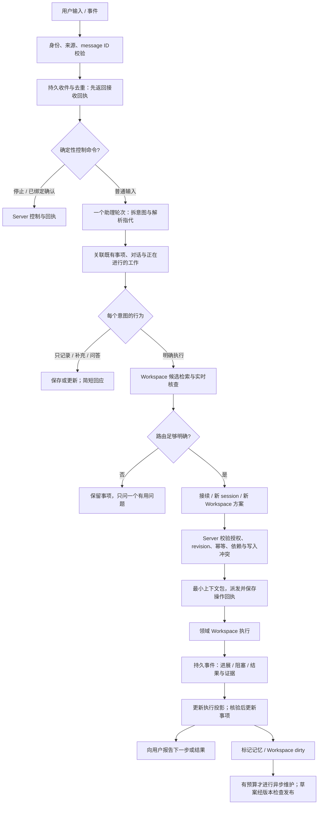

# DEV-023 · Personal Agent：事项接入、记忆、路由与 Workspace 治理

状态：2026-10-20 按用户统一归档授权，研究交付已归档、方案仍待讨论；本轮没有实施产品改造。原调研日期为 2026-10-19（UTC+8），下文建议均非已实现能力。统一归档依据见 [DEV-025](DEV-025-release-closure.md)。

## 1. 建议先确定的产品方向

Personal Agent 应当是**可靠接住事项、帮助选择下一步、把明确授权的工作送进合适 Workspace 并接回结果的入口**。Workspace 继续承载领域知识、技能、产物和工作规范；不把各项目的历史都搬进一个巨大个人上下文。

建议在现有能力上演进，先交付“收件不丢、已有工作可接续、执行不重复”的闭环，再增加自动整理记忆和 Workspace。逻辑上分为入口协调、记忆维护、Workspace 治理三个职责，运行时先只需要**一个前台助理，加按事件启动的维护作业**；不让每条消息依次经过三个常驻模型。

记忆建议采用 **hybrid**：私有 memory workspace 保存个人知识正文及来源，Server 保存操作权限、事项/执行关联与控制状态，并维护可重建的记忆检索索引。它不是把同一事实同时交给文件和数据库编辑。任务状态、批准、停止回执都不能以 Markdown 记忆代替。纯文件适合当前个人工作台，但不足以独自保证跨设备并发、离线接入和派发幂等；纯 Server 最容易继承现状，却弱化用户对知识的直接拥有与迁移。

最小版本优先级：**可靠收件 → 稳定事项与现有 session 关联 → 安全派发 → 下一步建议 → 记忆治理 → Workspace 治理**。不要求先迁移所有记忆、引入向量库或完成全自动多 Agent 架构才能使用。

## 2. 真实案例：已发生什么，仍不知道什么

证据：[个人 workspace 原会话（需要访问权限）](https://dev.foundryapp.app/chats/sess_1792379847652402476?workspace=ws_92b9c609-361d-469e-a554-e589c32814f3)。本轮通过 workspace 允许的 foundry 技能读取 thread，提取全部四条用户输入及四次最终答复；另用 changes/file 读取实际创建的规则和当日日记。未修改该 workspace、未派发其中事项、未把原始个人事项复制到本仓库。

| 证据层   | 观察                                                                                                           | 对设计的要求                                                       |
| -------- | -------------------------------------------------------------------------------------------------------------- | ------------------------------------------------------------------ |
| 用户表达 | 需要存个人背景与每日 TODO，未来可能迁入 Personal Agent；希望约定简短                                           | 接入要轻，不能先让用户填写项目、优先级、分类和表单                 |
| 实际产物 | `AGENTS.md` 已建立；助手工具与最终答复有 `CLAUDE.md` symlink 的创建/验证证据                                   | 原生 CLI 的规则复用已解决一个局部问题，尚非跨 Workspace 系统       |
| 实际产物 | 一份 daily 文件记下七项跨两个领域的事项，并保留未知上下文与候选想法                                            | “已接住”应独立于“可以执行”；多个意图要逐项保留，不能只处理最后一条 |
| 规则     | 个人信息按需写 `profile.md`；仅已确认信息；完成需用户确认或实际依据；记录不等于提醒或执行                      | 来源和行为授权是不同字段；不把闲聊、猜想或引用变为长期事实         |
| 完成边界 | 没有看到 `profile.md` 已创建证据；`TODO.md` 总表、`projects/` 和“一件当前重点、三件今日重点”只是助手提出的建议 | 不把建议当用户批准或现有实现                                       |
| 用户痛点 | 事项太多，切换上下文会遗失，难以分配时间；设计助理本身也成为负担                                               | 产品成功标准是减少遗失、恢复成本和选择成本，不是 Agent 数量        |

未决需求：实际期限、外部依赖、哪个事项已在其他 session 推进、用户愿意让助理主动执行的范围、时间分配偏好均没有完整答案。不能根据领域、措辞强弱或助手猜测编造紧急度。只有一个用户的案例，不构成普遍用户画像。

从案例抽象出五个场景：随口记多件事；给旧事项补上下文；从一个项目临时切走再回来；问“现在先做什么”；明确要求执行某一项。日记可保留历史，但不能靠逐天复制 checkbox 维护唯一当前状态，否则跨日重建与重复派发会成为常态。

## 3. 现状审计：设计声称、可见实现和缺口

审计基线为本地 `main`，HEAD `c2e46c6e405afbee31263402e2fe9d5d5fc79d1d`，同时存在 DEV-006/007、DEV-022 等未提交工作。以下是 2026-10-19 的静态源码审计，不是部署核验或重跑旧模型评测。未碰共享构建、服务和测试账号。旧 research 仅作为线索；外部结论重新查了一手资料。

| 能力/设计声称                       | 当前实现证据                                                                                                                                                          | 缺口或结论                                                                                                                                                                                    |
| ----------------------------------- | --------------------------------------------------------------------------------------------------------------------------------------------------------------------- | --------------------------------------------------------------------------------------------------------------------------------------------------------------------------------------------- |
| 唯一 PA Workspace、私有入口         | `sqlitestore/personal_agent.go` 的 `personal_agents` 以 user 为主键、workspace 唯一；`httpapi/personal_agent_service.go` 的 `assistantConversation` 根据角色/来源判定 | 已有持久身份，不需要另造全局超级 Agent；memory workspace 不必是第二个 PA 身份                                                                                                                 |
| 记忆及来源                          | `personalagent/memory.go` 的 `MemoryOrigin`、`QuoteGrounded`；`mcp_personal_agent.go:planRemember`；`store/personal_agent.go`                                         | `pa_memory` 是个人事实正文真相源，**不是只有摘要和指针**。有 stated/edited/inferred/external、source session/input、supersedes、verifiedAt；没有有效期、实体键、冲突状态或读取时失效判断      |
| 来源可信                            | 引用只匹配当前助理 conversation 内的用户输入，排除通知/定时等；external 为 pending                                                                                    | 匹配证明引文出现过，不能证明摘要被原话蕴含。`inferred=true` 可生成 active 推断；`verifiedAt` 是来源/编辑时间，不是事实正确性认证。需要来源主体与内容推断分别记录                              |
| 遗忘                                | `sqlitestore/personal_agent.go:ForgetPersonalAgentMemory` 清空该项及其 supersedes 前驱链正文；全部遗忘也清空内容                                                      | 不等于删原聊天、缓存、备份或已注入运行中上下文；文案必须限定遗忘范围                                                                                                                          |
| 本人清单                            | `store/personal_agent_list.go`、`httpapi/personal_agent_list.go:planUpdateList`、SQLite `pa_items`；Web `person-list.tsx`                                             | 已有原话、自然语言时间、提醒、open/done/dropped、单个 taskId；缺 stable input/item 幂等、revision、下一步、等待原因、workspace/session 直接关联、多次执行关系、依赖                           |
| 清单与派出任务分开                  | `pa_items` vs `pa_tasks`；`recordAssistantTask`、`assistantHasTask`                                                                                                   | 正确的分离应保留；现有 TaskID 仅接受自己的 PA task，无法直接表达用户已在普通 session 做的工作。清单完成变更仍依赖用户原话，尚无独立的证据完成协议                                             |
| 意图预制+动态判断                   | `personalagent/prompt/system.md` 已列停止/回应/问答/记忆/计划/执行/闲聊及多意图要求                                                                                   | 主要依赖提示词；未见一个持久 input→多个事项→行为计划的可恢复契约，模型中途失败可能只完成部分记录                                                                                              |
| Workspace 检索                      | `workspacedigest/rank.go:RankRecords` 按名称、purpose、routeWhen/notWhen、历史、文件、notes 等 BM25 式加权，含 CJK 分词、recency；`findWorkspaceForMCP` 返回 close    | score 是压缩后的相似度，不是路由正确概率。close margin=0.05 是启发式。不能把 0.9 当“90% 可以自动执行”                                                                                         |
| 实时核查与摘要                      | `workspace_digests.go`、`workspacedigest/service.go`；`getWorkspaceForMCP` 读取 live/instructions/note；概括为只读 Foundry session                                    | 已有确定性刷新、增量概括、权限过滤和 staleness；live 是查询时观察，非锁。离线无法读源文件；文件截断有标记，不能当完整上下文                                                                   |
| 路由纠正与审计                      | `cards/<workspaceId>.md` 被 `assistantNotes` 读取；`pa_routing_decisions` 有类型、表、存储方法                                                                        | 全生产源码搜索仅找到 `RecordPersonalAgentRoutingDecision` 定义与接口，未找到调用。工具 action 审计不是完整路由决定记录；不能宣称纠错评测闭环已接通                                            |
| 同一 Workspace 一个写会话、其余排队 | 设计 §6 与 prompt 要求；创建路径有助理并发/用量限额                                                                                                                   | 审计 `admitAssistantSession`、创建服务及相关路径，未找到 PA 专属按 Workspace 的写入 lease/排队仲裁；MCP `create_session` 仍明确同目录并发写会竞争。单个 native writer 锁不等于 Workspace 写锁 |
| 监督与恢复                          | `personal_agent_supervision.go` 根据 session 事件刷新 pa_tasks，完成/失败/询问通知，静默/连接失败检查；离线等待已有 session 层支持                                    | `endsWithQuestion` 用尾部问号判询问，`taskStatusOf(completed)` 为 done，均不是验收成功。跨重启通知、业务完成证据及事项状态应独立建模                                                          |
| 策略、提议、停止                    | `assistantWrite`、`personalagent/policy.go`、`personal_agent_service.go`；接受与规则放宽的 Server 检查                                                                | 复用，不改成模型裁决。PA 的旧 session 停止不能自动代表所有持久计划/服务已停，需与持续工作能力及回执统一                                                                                       |
| Workspace 生命周期                  | `workspace_lifecycle.go` 共用 REST/MCP 服务；Worker `personal-agent-settings.ts` 的受管根；初始化逻辑与测试已存在                                                     | 建目录/写规则是基础，不代表领域目标、事实、来源、验收、权限已足够。需要“上下文就绪”检查；当前目的字段与简报不能代替治理                                                                       |
| 夜间 lint 与旧 Workspace 自动治理   | 设计 §3 规定 03:00 lint；`personalagent/defaults.go` 有 `NightlyLintHour=3`                                                                                           | 全仓生产路径只找到该常量定义，未找到调度与实施链路；按设计项处理，不认定已上线                                                                                                                |
| Web、Worker 与提示词                | Web `assistant-home.tsx`、`person-list.tsx`、设置/提议/任务组件；Worker `session-policy.ts` 附加 PA instructions；Server 分离稳定说明与每轮状态                       | 可复用的真实产品能力很多；现状并非空壳，但尚缺可恢复事项协议与上下文治理闭环                                                                                                                  |

以上路径位于 `apps/server/internal/`（省略前缀的 Server 路径）、`apps/web/src/features/personal-agent/`、`packages/worker/src/`。关键可直接核查：[清单协议](../../apps/server/internal/store/personal_agent_list.go)、[清单写入](../../apps/server/internal/httpapi/personal_agent_list.go)、[记忆/路由工具](../../apps/server/internal/httpapi/mcp_personal_agent.go)、[排序](../../apps/server/internal/workspacedigest/rank.go)、[助理派发服务](../../apps/server/internal/httpapi/personal_agent_service.go)、[监督](../../apps/server/internal/httpapi/personal_agent_supervision.go)、[当前提示词](../../apps/server/internal/personalagent/prompt/system.md)。

现行设计的历史评测记录称：117 例脱敏集，确定性排序 top-1 约 58–61%；端到端局部优化后总体 80%，留出集约 55%；平均约 12 秒、每次约 $0.43，输入常达 4–6 万 token。**这些是原报告的历史结果，本轮未复现，也不能归因于当前版本。** 它们足以反对“已有排序即已解决路由”，不足以据此设定今天模型的价格或承诺新方案效果。

### 与现行设计必须显式修订的决定

| 原决定                                  | 本轮需求/推荐                        | 冲突如何处理                                                                                                       |
| --------------------------------------- | ------------------------------------ | ------------------------------------------------------------------------------------------------------------------ |
| PA 目录不放个人记忆；正文在 Server      | 用户偏好 memory as workspace         | 必须明确变更正文真相源，采用一次切换而非双向自由写；本轮只提案                                                     |
| 每人一个 PA Workspace                   | 一个入口，另有专用知识空间           | 保留唯一 PA 身份；可先在其私有 workspace 内划 memory 区，后续指定单独私有 memory workspace，不能给它第二个入口身份 |
| PA 不做第二个真相源，只存派生摘要和指针 | 全局个人知识与跨项目信息需要维护     | 项目事实仍在项目；个人偏好/跨项目关联可在 memory 为原生内容。派生项强制指向来源和版本，不存任务实时状态副本        |
| inferred 记忆立即 active                | 案例要求仅确认内容，不猜测           | 默认推断留候选或当前对话，不自动升级为长期事实；用户可另选低风险偏好学习                                           |
| 夜间模型整理、自动新建                  | 用户不想增加负担，治理不扰动当前工作 | 无变化不运行模型；事件合并；新建仅随明确执行且适合独立领域，不因记录一条 TODO 自动建项目                           |
| 提示词保证单写入与完成核查              | 必须防重复派发、上下文变化和误报     | 增加 Server 事务/operation、必要的写入仲裁、证据与回执；不能靠另一份更长提示词补齐                                 |

## 4. 一手资料对照：哪些可借鉴，哪些未证明

以下链接均于 **2026-10-19** 实际打开。动态文档没有固定发行号的，注明为当日文档，不虚构运行版本。没有安装或运行这些框架，没有调用其推理服务；“官方描述已核实”不等于“在 Foundry 验证”。旧 research 的供应商跑分和二手事故叙述不作为采纳依据。

| 来源/版本/层次                                                                                                                                                                                | 已核实机制                                                                         | 对 Foundry 的启发与局限                                                                                                    |
| --------------------------------------------------------------------------------------------------------------------------------------------------------------------------------------------- | ---------------------------------------------------------------------------------- | -------------------------------------------------------------------------------------------------------------------------- |
| [OpenClaw Memory](https://docs.openclaw.ai/concepts/memory)，当日文档，应用/运行时                                                                                                            | Markdown 工作区记忆、启动摘要与按需读取、压缩前落盘；明确记忆不执行权限策略        | 文件可以是内容源；需预算与来源。不能据文档证明自然语言路由或遗忘可靠；不照搬其调度和 provider 接入                         |
| [Letta MemFS](https://docs.letta.com/concepts/memfs)，当日文档，应用/CLI；[Agent SDK memory](https://docs.letta.com/agent-sdk/memory)，当日 SDK 文档                                          | Git 记忆投影到设备、按需读取、后台整理；本地改动与同步有区别                       | 支持“知识空间+版本化发布”的可行性。两页对根文件与 `system/` 注入有版本口径差异；仅采纳机制，不宣称某目录规则通用于所有版本 |
| [Letta shared repositories](https://docs.letta.com/agent-sdk/repositories)，当日 SDK，Cloud 功能                                                                                              | 临时 session 引用与持久 attach 分开，更新可带 content hash 前置条件，写入返 commit | 借鉴绑定寿命与 CAS；不是 Foundry 本地任意目录已获同步/权限保证，也不要求引入其 Cloud                                       |
| [LangGraph memory](https://docs.langchain.com/oss/python/concepts/memory)，当日 OSS Python 概念文档                                                                                           | thread checkpoint 与跨 thread JSON namespace store 分开；热路径和后台记忆更新      | 任务恢复与知识检索分层；namespace 是组织方式，权限仍需应用实现。提供原语，不负责个人任务优先级                             |
| [Graphiti overview](https://help.getzep.com/graphiti/getting-started/overview)，v4 文档下的 OSS 框架；[作者时态说明](https://www.getzep.com/blog/beyond-static-knowledge-graphs/)，2024-10-02 | episode 来源、双时间、事实失效与混合检索；当前框架与托管 Zep 服务分开              | 先借鉴 valid time/recorded time 和修订链；没有多跳关系需求时不引入图数据库和抽取成本。供应商性能宣传不作收益证据           |
| [Anthropic Building effective agents](https://www.anthropic.com/engineering/building-effective-agents)，2024-12 原文及当日更新，架构经验                                                      | 区分固定 routing workflow 与动态 orchestrator；从简单可评测路径开始                | 支持适度预制意图与按需分解，不证明三 Agent 优于一 Agent。页面已提示旧工具环境变化                                          |
| [Anthropic Context engineering](https://www.anthropic.com/engineering/effective-context-engineering-for-ai-agents)，2025-09-29，工程经验                                                      | 按需取材、压缩、结构化笔记及上下文隔离                                             | 用来源指针和恢复胶囊替代全量拼接；不是该方案效果的受控实验                                                                 |
| [Anthropic Managed Agents](https://www.anthropic.com/engineering/managed-agents)，2026-04-08，托管架构经验                                                                                    | 区分 session 状态、执行环境和 harness 的上下文管理                                 | 说明可恢复状态不应依附某次模型运行；不意味着 Foundry 应迁到托管服务或同用 provider API                                     |
| [Codex AGENTS.md](https://learn.chatgpt.com/docs/agent-configuration/agents-md)，当日官方文档，CLI/agent 配置                                                                                 | 全局/项目/子目录指令发现，组合预算默认 32 KiB                                      | 项目上下文可分层，但指令不是事实数据库；Foundry 的受管配置隔离会改变原生默认加载面，需以实际 Worker 为准                   |
| [Temporal workflow execution](https://docs.temporal.io/workflow-execution)，当日服务/SDK 文档                                                                                                 | 历史事件恢复、命令与等待、不同终态、取消确认                                       | 借鉴持久事件与操作回执，不在 MVP 新引入 Temporal。它不解决语义路由，重试也不能自动保证外部副作用仅一次                     |
| [LongMemEval](https://arxiv.org/abs/2410.10813v2)，v2，2025-03-04，ICLR 2025 论文                                                                                                             | 500 个问题，评估提取、跨 session、时间、更新、未知拒答                             | 采用能力分解做验收；问答基准不能证明派发安全、权限或任务完成率，不将旧模型分数外推到当前模型                               |

结论是：文件知识、结构化状态、来源/有效期、渐进检索、事件恢复各有成熟机制；**没有上述来源证明一个完整 Personal Agent 能可靠替用户理解全部事项并自主分配时间**。本方案中的默认动作、阈值、角色组合和优先级建议属于针对 Foundry 的设计推断，需要本地基准与试用验证。

## 5. 真相源和 memory 方案

### 5.1 四类信息不能混用

| 信息                           | 唯一权威源                                                              | 其他位置可以保存什么                                                 |
| ------------------------------ | ----------------------------------------------------------------------- | -------------------------------------------------------------------- |
| 项目事实、成果、具体操作规范   | 领域 Workspace 的源文件、系统记录或经证实产物                           | 路由目录和 memory 只保存来源引用、版本与短摘要；实时事实回源         |
| 个人稳定事实、偏好、跨项目关系 | 推荐的私有 memory workspace；迁移前仍为 `pa_memory`                     | Server 索引/只读缓存带 source revision；同一 ID 同一时刻只一个可写源 |
| 用户事项/意图、授权、依赖      | Server 的 `pa_items` 演进及关联记录                                     | `TODO.md`/daily 可导出为视图；不同时维护另一个可执行任务表           |
| 实际执行、持久服务、计划和停止 | sessions / session_work 及 Worker 观察与控制回执；`pa_tasks` 是协调投影 | 用户视图和胶囊标明 observedAt；“某日做完”记忆不能作为当前完成状态    |

政策、权限、范围批准和停止屏障在 Server。Memory 可以解释“用户为何有此偏好”，不能授予权限。会话完成只说明运行结束；计划定义仍可能存在，服务仍可能存活；个人事项也可能只完成一个子步骤。

### 5.2 三种选择的权衡

| 维度         | 纯 memory workspace                                           | 全局结构化服务                                       | 推荐 hybrid                                                      |
| ------------ | ------------------------------------------------------------- | ---------------------------------------------------- | ---------------------------------------------------------------- |
| 可审计、便携 | Markdown 易读、diff、导出；Git 留历史但增加遗忘困难           | typed 审计清晰，需额外人读视图与完整导出             | 正文可直接读；结构化变更与来源可追溯，明确导出规范               |
| 一致性、并发 | 多会话直接覆盖风险；Git merge 不懂事实冲突                    | 事务/CAS/唯一约束方便；仍可能写入语义矛盾            | 每条内容单写入通道+revision；索引可重建，有同步复杂度            |
| 检索         | 小规模 rg 足够；跨设备离线和大量材料不便                      | namespace/filter/时间检索方便，可扩充语义检索        | ACL 过滤后从索引选小集合，再读权威版本；先关键词，后按基准加语义 |
| 权限         | Workspace/目录可读不等于每条事实可分享；普通 shell 能绕过约定 | 每次 API 可查用户/用途/目标权限；Server 集中持有隐私 | 私有正文不挂到所有执行者；broker 最小上下文包；仍需沙箱落实      |
| 跨设备       | 需同步/迁移协议，不能假设同一路径即同文件                     | Server 在线时一致可见                                | 单内容主写设备+版本缓存；以后才考虑多副本冲突处理                |
| 离线         | 本机可以记，但其他设备看不见；状态不可联动                    | Server 不可达则不能写权威状态；设备离线仍可收件      | Server 收件，正文未落源显示 pending sync；源离线不伪称知识已生效 |
| 成本         | 存储低、模型整表整理可能高；全文每轮注入最贵                  | 数据库/检索服务成本；模型抽取仍不可免                | 只增量更新和按需召回；多一层同步工程，未必短期更便宜             |
| 过期与纠错   | 文件不会自动失效，需前置信息和维护者                          | 定时过滤容易，仍要事实语义判定                       | 读取时确定性过滤+事件失效+批量语义复核；过期不是物理删除         |

选择 hybrid 的理由是用户需要可控、可迁移的知识，同时 Foundry 已有跨设备控制面。它的风险在于同步协议和多处视图；如果团队暂不愿承担这部分，**先保留 Server 真相源并做规范导出**，也比立即双写可靠。推荐作为目标架构，不作为 MVP 阻塞条件。

### 5.3 memory workspace 的最小组织与元数据

下面是拟采用的格式示例，不创建这些目录，不包含案例私密内容：

```text
memory/
  INDEX.md               # 可读索引；短指针，不拼入所有会话
  facts/<id>.md          # 一条可修订的个人事实/偏好，含结构化 frontmatter
  links/<domain>.md      # 跨项目关系，引用源 Workspace
  journal/YYYY-MM-DD.md  # 只记录必要变更与出处；非完整聊天归档
  candidates/            # 未确认推断/待核对来源
```

每项至少：`id, kind, subject/key, scope, audience, sourceRefs, sourceAuthority, observedAt, recordedAt, validFrom, validUntil?, reviewAfter?, revision, status, supersedes?`。事实正文是人类可读短文；frontmatter 跟正文在同一原子修订里。`sourceRefs` 指向具体输入/文件版本/外部文档，不只指整场聊天。`confidence` 用“用户确认/直接观察/推断”及理由表达，不伪造概率；真需要数值也只作经过校准的模型判断分数。

来源与有效性分开：一个可信来源可以描述过去、假设或引用别人的话。授权主体由入口/连接器身份确定，不由模型写一句 `stated` 决定。事实抽取保留引用与转述之间的关系；候选内容不能通过 `inferred` 绕过来源检查。可允许“回答风格”这类非行动偏好临时使用，但不默认升级为长期事实。

维护策略：

- **事件优先**：用户明确纠正、源文件 revision 变化、成员权限撤销、项目归档时，相关索引立即失效/变脏。对同一 subject/key、scope 的明确新说明生成 superseding revision；范围不同的事实可并存，不能机械用“最新一句”覆盖全部。
- **读取时判断**：过 validUntil 的事实不得用于当前行动；过 reviewAfter 的项可以作为历史线索，但要回源或询问。用户明确“本周”的约束设具体有效区间；稳定偏好不随意设七天失效。
- **定时兜底**：每日确定性扫描检查到期、断链、格式、权限；有 dirty 才排合并维护批次。模型仅处理需要语义判断的冲突/归并，按预算封顶；没有变化不唤醒模型。定时必须进入 Foundry 持久工作控制面。
- **纠正与遗忘**：用户可查看“记住什么/从哪里来/影响哪些用法”，修改或撤销。撤销先加 tombstone 与 revision 屏障，让索引停止召回，再清除正文、派生摘要/向量/缓存；断开的副本回来必须先处理 tombstone 才可服务。
- **历史边界**：过期、归档、superseded 是停止当前使用，不是删除历史；forget 是删除记忆内容及派生内容。原聊天、外部源、备份、已交给运行中会话的信息另有保留范围，必须显示剩余范围与完成回执。Git 文件直接删除不能称真正遗忘；需处理历史或不用 Git 保存敏感正文历史。

### 5.4 写入与索引协议：避免双真相源

拟新增的 memory service 是受限内容入口，不是另一个推理平台：请求带 `operationId + expectedRevision + sourceRefs`，Server 检查权限，登记待写操作；目标设备原子更新内容与 revision manifest；收到内容 hash/revision 回执后发布新索引。读者只读已发布版本，读不到则返回 stale/unavailable。崩溃恢复按 operationId 对账，不重新猜一条事实写入。

用户在文件里直接编辑仍然有价值：Watcher 把它识别为新修订候选，经格式/来源/权限校验后发布。**文件里自填的批准和来源可信度不能自动生效**。目标是正文可编辑，控制字段不能被普通文件修改提升权限。新修订未发布前 UI 明示“本地已改，尚未同步”。跨设备 MVP 只选一个主写位置；离线写入是待合并分支，冲突不以最后写入胜出。

Server 索引只保存检索所需摘要、来源 ID、版本、scope/ACL 和有效期；可选缓存必须有保留上限与遗忘传播。索引读之前和实际发给目标 Workspace 之前分别校验权限。权限撤销后不得靠旧摘要继续泄露内容。向量检索以后再评估；若采用，也必须符合本仓库原生 SDK/CLI 推理边界，不能偷偷接入直接 provider 调用。

## 6. 一句话进来之后

### 6.1 完整流程



“收到”必须在持久存储成功后发；它只表示原始请求未丢，不能说“已记好七件”而实际上尚未拆项。即使模型故障，收件箱仍显示“待整理”并可恢复。所有普通聊天不必成为 TODO：先保留输入，再仅把事项意图转成项；问答/闲聊在处理后标为无需事项。

这是对现有入口的重要改变：收件必须独立于 PA 家设备在线和模型可用性；Server 在线即可接收，后续由持久队列在能力恢复时整理。若 Server 本身不可达，客户端只能显示“待发送”，不能伪称服务端已接收。Web/飞书使用各自稳定 message ID 归一化，敏感内容按既有私有会话权限保存，不额外向公共日志复制正文。

一条输入可有多个段落和行为，例如“记下两个方向，先查第一个，不联系别人”。保留一个 input envelope，提取多个有稳定 ID 的意图与 source span；未识别清楚的部分留待整理，不吞掉它。首轮能确定的记录与只读准备先完成；执行权限不清的部分保持待澄清，不能因其他一项可执行就整条放行。

### 6.2 适度预制意图，动态填充目标与计划

预制的是有限、可测试的行为：`capture / update / query / execute / remember / policy / control / converse`。执行子类型可以动态解释，Workspace 类型不要写死为工作、生活、代码。预制意图不要求单选：一个输入可有多个互相引用的 intent。

上下文线索按证据强弱解析：显式 item/session/workspace 链接 → 当前等待的问题或选中事项 → 当前对话中明确目标 → 用户自己的活跃事项 → Workspace 检索候选。最近用过的项目只是弱线索；不能仅凭“上次在那里”决定“这个”“继续”的对象。

路由先识别**事项是否已经存在**，再判**动作**，最后选**执行地点**。否则“继续上次的排查”容易再次生成一个同名 session；“今天做完了”容易被当成新的执行任务。

| 分支                  | 判定依据与动作                                                                       | 不足时的回退                                                                      |
| --------------------- | ------------------------------------------------------------------------------------ | --------------------------------------------------------------------------------- |
| 现有 Workspace 匹配   | 名称/领域说明/routeWhen/notWhen/资源匹配，查 live 与权限；新工作启动一个合适 session | 有多个接近候选时给两个简短选项；保留事项，问题不阻塞其他已明确项                  |
| 接续已有工作          | 同一事项+目标+受控 session；读当前状态与最后检查点，增量 `send_message`              | 旧历史误导或目标变化，显式 handoff 新 session，沿用 itemId，保留关联，不另建 TODO |
| 已在普通 session 进行 | 关联已有 session/Issue；不要求先由 PA 创建；初始只读跟踪                             | 用户可读不代表可 steer；不可控制就给入口，不能克隆一次执行来“接管”                |
| 暂无合适 Workspace    | 先判断是一次性答复/笔记，还是独立长期领域；后者在明确执行范围内提出/完成新建与初始化 | 地点、资源或权限不足时保留待办，说明缺什么；不因低相似度就自动新建                |
| 只记待办              | 保存项、已知时间和原话；无执行 session、无提醒、无自动建 Workspace                   | 日后用户说“现在开始”再重新核查地点、授权和实时状态                                |
| 跨 Workspace          | 一个事项拆有限执行步骤，确定主负责方、依赖、输入输出和可共享数据                     | 有环依赖或数据不能跨权限边界，停止相关边而非全部乱派；让结果留在源域              |

相似度、模型自评和行为风险分别看。初期自动执行只放行明确目标/明确接续及经基准验证的高精度路径；不明确时可以先做只读定位。阈值需用独立留出集校准，报告“覆盖率与误路由率”的曲线，不能只优化 top-1。向用户解释一句具体理由，例如“它和正在排查的同一条问题有关，接到原进度上了”，不展示思维链或分数。

### 6.3 事项、执行与完成的拟新增契约

在 `pa_items` 上渐进增加，而不是新建并行 TODO 产品：

```text
Item: id, revision, sourceInputRefs[], text, mode(record|execute),
      lifecycle(open|done|dropped), progress(inbox|ready|waiting|working|review),
      nextAction?, dueAt?, timeEstimateRange?, waitingReason?, focusRank?,
      workspaceRefs[], workRefs[], dependencyRefs[], completionEvidenceRefs[]

WorkRef: itemId, workspaceId, sessionId/issueId/workId, relation,
         controlCapability, observedAt, resultEvidenceRef?

DispatchOperation: operationId, itemId, itemRevision, intentRevision,
                   target, action(create|continue|handoff), authorizationRef,
                   contextManifestHash, state, executionRef, resultReceipt
```

字段由助理按已知事实填，未知保留空，不给用户一张必填表。`mode` 描述本次请求，不授予永久代办权限。`workRefs` 支持多次尝试和跨域步骤，但 UI 仍呈现一个事项；已关联服务按 DEV-022 的共享引用显示，不复制服务定义。

**幂等分两层**：相同来源 message ID/重试使用相同 operationId，事务唯一约束保证只收一次、只派一次；语义近似的新消息只提示/关联候选，不静默删掉可能不同的事项。一个 message 多意图的子 ID 在首次计划提交时固定，重试使用已保存计划，不能重新分词后又分裂一套 ID。

建议新增受限的 `dispatch_item` 服务（名称待实现评审）：Server 事务校验 item revision、授权、依赖和已有 operation，登记 outbox，再调用现有 session 服务。超时返回“派发结果待确认”，由 operationId 查询实际 session，**不得直接重建**。这保证 Foundry 派发幂等；外部系统的副作用另需其幂等键或事后对账，不能承诺端到端 exactly-once。

不能只新增工具而保留可绕过的 PA 派发路径：PA 角色的创建/接续入口要共用 operation 校验，旧工具可做兼容 adapter；普通业务 session 的现有编排另行保留其语义。后台整理也不能伪装成用户当前发言：收件保留不可伪造的 actor、原 input ID 和来源 span，`update_list`/`remember` 的来源校验需要能解析该受信引用，替代“只能在当前对话匹配引文”的限制。新旧接口双跑时仍共享同一幂等账本。

同一目标已有写会话时，能确证同一工作才接续；独立只读可并行；不同写任务在明确隔离下并行，否则排队。治理写入更保守：检查所有活动 writer 和 base revision，再应用 patch。不能用一个 workspace 级全局锁永久阻塞用户正常独立工作，具体冲突粒度可先保守串行、以后细化到可隔离工作区/文件集合。

完成分三种：用户说本人完成了；执行 session 已结束；验收证据满足目标。三者分别记录。子任务失败/取消不把本人 TODO 勾掉；子任务自述完成但测试失败转 review/needs attention；长期运行服务启动成功也不等于服务生命周期结束。执行故障用机器可读原因，替代尾部问号判断，向用户只报告一次“卡在哪里、已保留什么、需要什么”。

## 7. 最小上下文交接与具体体验

交接包由确定性字段与一次语义整理构成：目标/原因、当前事项 revision、必要事实及出处、已排除选项、允许动作/限制、验收条件、执行依赖、检查点、结果回报位置。不要注入整个 profile、其他领域日记或助理聊天。来源正文与指令分开；原会话引文不能被外部内容伪造为用户批准。

Context manifest 记录每段来自哪里、revision/hash、读取时间、scope、目的。目标 session 先读本 Workspace 的规则与相关文件；远端附件必须明确复制并核权限，单给本机路径无效。历史压缩用可验证的恢复胶囊：`目标 / 当前证据 / 未决 / 下一步 / 工作引用 / 使用的上下文版本`，摘要不足时可回源，不把摘要当实时状态。

以下均为合成例子，非真实个人事项：

| 用户输入                                               | 预期处理与一句回应                                                                                           |
| ------------------------------------------------------ | ------------------------------------------------------------------------------------------------------------ |
| “记一下：周内完善家庭账单，另一个产品要研究导出格式。” | 一次收件、两个事项，保留模糊时间，不新建或派发。“两件都记下了；需要推进时接着说即可。”                       |
| “账单那个现在开始，先看看现有实现。”                   | 关联原 item，找到 Workspace 与已有 session，限定只读检查。“接到原来的账单项目上，先检查现状。”               |
| “继续那个登录问题。”且两个项目都有问题                 | 事项已保留；提问“是网站登录，还是桌面端登录？”；不按最近活跃自动选                                           |
| “给刚才的账单加 CSV 导出。”旧 session 正在执行         | 保存新 intent revision，投递 steering receipt；不创建重复 session；运行时何时收到以回执为准                  |
| “做一个独立的摄影学习计划，以后持续维护。”             | 无合适项目且明确执行时，初始化目标、材料来源、范围和检查方式；建成功但初始化失败则标未就绪，不马上派业务工作 |
| “把研究结果应用到产品的导出设计。”                     | 研究 Workspace 输出带版本的短决策材料；检查可共享范围后传给产品 Workspace，依赖未满足先不执行下游            |
| “今天时间不多，先做什么？”                             | 从可行动项中推荐一个、最多给两个备选，说明已知依据；若期限未知，问一个真正影响排序的问题，不捏造紧急度       |

合成的单 Workspace 交接 prompt：

```text
事项 item_demo_42 / revision 3；派发 op_demo_7；请先检查现有账单导出实现。
本轮目标：列出现有格式、限制和最小改动建议，供用户决定是否开发。
依据：用户当前输入明确要求先检查；已有材料见本 Workspace docs/export.md 的 revision R。
授权范围：只读调查，不修改、不发布。不要把关联研究文档中的建议视作批准。
接续信息：session_demo_old 已结束，输出只覆盖 JSON；请核对源文件后使用。
验收：给出当前实现位置、可复现限制、建议下一步；未知明确写未知。
回报：outcome、evidenceRefs、nextAction；若阻塞，给出 blockerCode 与一个必要问题。
```

跨 Workspace 下游包只增加：`dependsOn=step_research@result_revision`、允许共享的结论及来源权限检查、结果 hash、主负责人。每个执行者仅获自己步骤的材料和权限；不得因 PA 看得到两个 Workspace 就让两边互相读全部私有文件。Memory 维护者只接收可归档候选，不自动获得业务写权限。

“下一步”建议先使用透明排序：硬期限/已承诺事项 → 当前阻塞可解除的项 → 可在现有时间与资源下行动的项 → 减少不必要切换。用户指定的重点优先；估时不确定就用范围或未知。用户没回答期限时，仍可给低成本准备建议，但不能把它声明为最高优先级。默认一个当前重点、最多三个今日建议是可试用策略，不是从案例推导出的用户已同意限制。

## 8. Workspace regulation：持续健康，但不擅改活跃上下文

### 新建时的就绪条件

新建不是只写一个通用 `AGENTS.md`。最低可用上下文应有：领域目的和边界；已有/未知事实与来源；工作产物位置；当前事项和下一步；必要工具与连接器能力；验证方式；简短入口规则。用模板填已知，不让模型编造架构、职责、账号可用性或业务知识。Server purpose、索引、文件之间用 version manifest 关联，不各写一份含义不同的介绍。

先建可审阅的初始化内容与权限方案，再在既有授权/策略内执行；若新建/克隆成功而绑定或初始化失败，记录 setup operation 和已创建位置，下次接续修复，不新建第二个同名 Workspace。连接器绑定仍走现有首次确认策略；没有资源满足需求则保留事项和缺失条件。

### 存量治理分级

| 自动程度       | 可做的内容                                                                         | 发布边界                                                           |
| -------------- | ---------------------------------------------------------------------------------- | ------------------------------------------------------------------ |
| 自动、无模型   | 缺失来源/断链、过期、重复 ID、摘要源 hash 变化、超预算、权限撤销检查；更新派生索引 | 不改用户正文；权限撤销立即停用相关检索                             |
| 自动草案、可逆 | 旧条目归档建议、明显重复合并、恢复胶囊/索引整理、建议缩短规则                      | 独立草案或 patch，附依据和 baseRevision；不直接改运行中的依赖文件  |
| 可选择自动应用 | 用户已允许的低风险维护：生成区索引、已显式到期条目的状态标记等                     | 无活跃写者、CAS 一致、可回滚，有审计；文件类型与操作白名单         |
| 需要人判断     | 改领域目的、删重要知识、冲突规则取舍、跨私有/共享空间移动内容、放宽权限/绑定新身份 | 给具体差异、影响与推荐；少量合并问题，不能反复要求用户批准同一授权 |

健康指标用“源更新但摘要未更新”“存在互相冲突的规则”“恢复时缺必要链接”“入口规则占用预算”这类可解释信号，不给一个看似科学但不可验证的健康总分。不要为了文档整齐定期重写所有知识；也不要自动删除近期没访问、但可能重要的材料。

事件触发：Workspace 初始化/目的变更、材料或规则 revision 变更、任务阶段完成、重复路由纠错、长时间未维护后首次使用。先确定性筛查，再合并成一个受预算约束的维护请求。治理写自己生成的索引不再次触发自己；使用 `maintenanceOrigin + sourceRevision` 去重，防止“摘要变更→再摘要”的循环。

运行中的 session 使用已记录的上下文版本；普通语义规则更新在安全边界应用，不偷偷替换其正在依赖的源文件。仅把文件启动时快照化也不够：Agent 可能再次读原文件，所以需对原文件写入排队或明确 steer/handoff。权限收紧/撤销属于控制面，立即在工具边界执行；若当前运行无法隔离已授权数据，应报告并按控制能力停止/交接，不能假装已从上下文里抹掉。DEV-006/007 的受管配置、Skill 草稿/快照是接入点，不在本文推断其全部验收已完成。

## 9. 角色、调用与成本

| 逻辑角色             | 输入/输出                                                    | 默认何时运行                                       |
| -------------------- | ------------------------------------------------------------ | -------------------------------------------------- |
| 入口协调者（含路由） | 用户输入+最小事项/候选上下文 → 行为计划、解释、派发/回报     | 人说话或关键结果事件；不常驻轮询模型               |
| 记忆维护者           | 新证据、纠正、过期/冲突候选 → 有来源的知识 revision/待确认项 | 变化合并后；轻微明确记忆可在前台一次写完           |
| Workspace 治理者     | 某个领域的规范/源版本/健康检查 → 局部 patch/风险说明         | 就绪检查或 dirty 超阈值；有活跃 session 时只读准备 |
| 领域执行者           | 明确目标+领域 Workspace+最小上下文包 → 成果与证据            | 只有授权需要执行才创建/接续                        |

记忆维护与 Workspace 治理共享扫描、版本、来源和草案发布机制，但**不是同一个知识范围或权限**。一个维护运行可复用代码与模型配置，不应同时拿全部个人隐私和全部项目写权限。最初可以由同一个受限维护作业按 scope 处理；只有负载、专长或权限隔离确有需要才分为多个执行 Agent。路由是前台助理职责，通常不值得再起一个路由子会话。

热路径预算建议：确定性收件无需推理；明确的记忆/清单操作在一个助理轮次内完成；普通路由在同一轮完成检索与决策。一次轮次可能含多次原生模型请求，不能把“一轮”冒称“一次调用”。复杂多域才分解执行；每个事项有最大深度、并发、重试与 token 预算。后台维护不得无限派生维护者或反向唤醒路由者；只有需要用户决定/结果有变化才发通知。

先量测总 token、缓存命中、原生系统开销、检索包和工具结果的分别占比。建议应用层常驻摘要预算 1–2k token、按需路由包通常不超过 4k（超过时说明原因）；这是待测目标，不保证原生总输入也降到该数。无 dirty 维护为 0 模型请求；批量通知一次合并。避免为检查离线、权限、格式和到期启动完整模型会话。

## 10. 分期落地与迁移

各阶段都是待批准的后续产品计划，本次不自动创建执行项目或 schedule。模型请求一律经 Foundry 已有原生 SDK/CLI。不要为采用某 SDK 直接调用 provider endpoint。

| 阶段               | 最小交付                                                                                             | 复用与新增                                                                                                          | 放行标准                                                                |
| ------------------ | ---------------------------------------------------------------------------------------------------- | ------------------------------------------------------------------------------------------------------------------- | ----------------------------------------------------------------------- |
| P0：可靠接住与恢复 | 独立收件回执、可见待整理；稳定 item ID/revision；原话和来源；下一步/阻塞；关联现有普通 session/Issue | 复用 pa_items、清单 UI、会话读取；新增 input envelope、幂等 capture、workRefs 与恢复胶囊                            | 多意图不漏项、模型失败可恢复；“只记”不会启动/提醒；已有工作可找到       |
| P1：最小可用助理   | 显式执行/接续、候选选择、少量歧义提问、可解释路由、幂等派发与完成证据；“现在先做什么”                | 复用 find/get_workspace、session、策略/提议与监督；补 dispatch operation/outbox、路由审计、冲突仲裁、结构化 blocker | 重试不重复执行，接续不另起，源离线/权限不足可解释；P0+P1 作为 MVP       |
| P2：memory hybrid  | 个人知识格式、明确/候选分流、revision/有效期、可重建索引、纠正/遗忘传播、单主写同步                  | pa_memory 经 adapter 逐项迁移；保留用户查看/编辑界面；新增内容发布协议                                              | 文件与索引对账、离线 pending、并发冲突和撤销生效验证通过                |
| P3：治理与多域依赖 | 新建上下文就绪检查、局部治理草案、安全发布；有限依赖 DAG 和跨域材料传递                              | 对接 DEV-006/007 的快照/草案，DEV-022 的持续工作能力与控制回执                                                      | 活跃 session 不受隐式改写，权限隔离通过，无自触发循环，任务过载指标改善 |

P0/P1 不必等 P2 完成。先读已有个人文件获得迁移预览是未来可选能力；本轮未获迁移授权、没有做迁移。实施时对已有 daily、总表和 pa_items 去重映射为稳定 ID，保留旧 source/date，未知状态保持未知。用户审阅导入范围后，旧日记变为历史证据，Server 清单为当前状态；再生成 Markdown 视图时明确标“派生”。

P2 迁移每条记忆只有一枚 `authority=server|workspace` 标记：影子生成文件、比较、发布索引、切换 authority、冻结旧写入口；失败回滚 authority，不能继续两边写。完成记录数量/来源/修订一致性检查后才移除旧存储正文；遗忘 tombstone 在迁移前后都生效。先小范围 opt-in，保留规范导出。不要从所有聊天无限自动提取个人信息。

和并行事项的接口依赖：DEV-022 提供工作 kind/source/desiredState/observation/revision/allowedActions，PA 只消费经核实能力，不能用停止父会话冒充停止所有服务；DEV-006/007 提供实际运行输入与草案版本的可见性，治理只对准已加载能力。两项仍在迭代，实施前与 owner 确认稳定契约，不在本轮改其代码或发布产物。

## 11. 验收、失败路径与指标

以下为拟定门槛，**不是已达到的成绩**。先建立脱敏合成集和经用户同意的真实改写集：覆盖短指代、多意图、中英文混合、同名项目、历史纠正、源离线、重复消息、超时、权限变化及恶意外部材料。至少 120 个基础场景，按 conversation/Workspace 分组划训练与留出集，避免同一项目同义句同时进入两边。路由正确答案应人工复核“意图/行为/目标/是否应执行”，不能把历史所在 Workspace 直接当金标准。

| 场景                                        | 必须观察到的结果                                                                    | 失败如何可恢复                                      |
| ------------------------------------------- | ----------------------------------------------------------------------------------- | --------------------------------------------------- |
| 一条七项记录，模型第三项后失败              | receipt 已存在；每项或待整理片段可追踪；恢复后无漏项/重复                           | 重用已提交计划和子 ID，不从头无约束重写             |
| 同一消息重送、按钮双击、Server 返回前断网   | 一份 input、一份事项关系、一份 dispatch operation；同 operation 返回原 executionRef | 超时为 unknown，查回执后再决定，不直接重派          |
| “只记一下”混合“先查其中一件”                | 全部记住，仅明确那件只读执行；没有提醒/外发                                         | 每个 intent 独立行为范围                            |
| 原任务正在跑、用户补充；旧 session 已结束   | 分别 steering/续轮/必要 handoff；稳定 itemId，无重建事项                            | 对旧上下文不兼容显式交接，保留证据与链接            |
| 两个匹配项目，“那个问题”                    | 有解释的歧义问题，无先写后问                                                        | 事项留存且其他明确意图继续                          |
| 设备离线或创建部分成功                      | 显示等设备/初始化未完成，确切已有位置与 operation                                   | 上线对账接续，不重复建目录或 session                |
| 跨域依赖未完成、权限撤销                    | 下游不启动/不收到不该共享的摘要；源域任务仍可按权限继续                             | 依赖状态持久化，权限重新获得后仍需核对目标 revision |
| 完成自述与验证失败冲突                      | item 不自动 done；执行终态和 review 分开                                            | 指明失败证据和下一步，不泛称“完成”                  |
| 旧记忆与用户新说明冲突、网页诱导记忆        | 来源与有效时间可解释；旧项 superseded；外部内容不升级权限                           | 可一键纠正；候选不影响行动                          |
| 遗忘时另一设备离线                          | 本地/Server 索引停止召回；离线副本待清除状态可见                                    | 再上线先应用 tombstone；不得提前说全部抹除          |
| 治理时 session 正在依赖 AGENTS/事实文件     | 只生成 patch；原文件不变；发布需重新检查 revision                                   | 新写入造成 CAS 冲突则重读重做，不覆盖               |
| 用户停止后存在 schedule/service/native task | 显示实际范围和不支持项；逐项 verified 才称已停止                                    | 以 DEV-022 能力和回执对账，不靠模型保证             |

建议量测与门槛：

| 指标           | 定义与初期门槛                                                                                                                    |
| -------------- | --------------------------------------------------------------------------------------------------------------------------------- |
| 丢项           | 已接收的事项片段既无 item 也无可见待整理的比例；故障注入集 **0**，真实试用按周人工抽查                                            |
| 重复派发       | 同 input intent/action revision 意外产生第二执行的次数；幂等/超时/重连测试 **0**；允许的显式新尝试另计                            |
| 错误执行/权限  | record-only 执行、未授权外发、越域材料注入；验收集 **0**，任何一次阻断自动范围扩张                                                |
| 路由质量       | 自动执行子集的误路由目标 ≤1%，同时报告覆盖率、明确引用/隐含/歧义各分层 precision/recall；小样本 0 次不宣称真实错误率为 0          |
| 无依据记忆     | 生效事实不能追溯或不被证据支持；种子集 0，真实样本逐项复核；分开衡量引用存在与转述忠实                                            |
| 时间/更新/拒答 | 引用 LongMemEval 的能力分类设计本地例子；旧事实不当新事实、未知明确未知；不以总平均掩盖失败类型                                   |
| 切换恢复成本   | 从“继续”到正确下一步所需用户补充次数和时间；试用目标多数情形无需重贴材料，p90 ≤1 次必要澄清                                       |
| 延迟           | 持久接收回执 p95 <1 秒（Server 健康条件）；分别报告整理/路由/执行启动时延，普通明确路由 p95 初始目标 <15 秒，需实测原生开销后调整 |
| token/资源     | 每成功接入、正确派发、维护批次的原生请求数、输入/输出/cache token；模型版本固定对照；无变化维护 0 请求                            |
| 用户负担       | 每事项纠正/确认次数、未必要提问率、每日整理耗时；两周试用比较用户自报的遗失和选择困难，不以多写笔记为产出                         |
| 新鲜度/治理    | 新 revision 到索引发布时延；读取被撤销内容次数=0；活跃上下文被无提示修改次数=0；冲突 patch 必须拒绝                               |

离线评测必须在只读/合成 Workspace 和禁止真实外发环境，不能把真实首句回放到生产权限下。故障注入覆盖“事务已落但响应丢失”“session 已建但关联未返”“Worker 重连”“索引更新晚于遗忘”。在线先 shadow route 与记录建议，再开放明确路径；纠正回流评测集前脱敏并隔离留出数据。

## 12. 真正需要用户拍板的三件事

1. **知识正文放哪里。** 推荐目标为私有 memory workspace + Server 索引/控制；MVP 暂保留 Server 记忆，按单源协议迁移。备选是长期 Server + 可编辑导出；不推荐双向自由同步。
2. **默认主动程度。** 推荐记录/整理自动；明确要求执行则在已知权限内派发；“打算做”“以后要”只记。下一步建议主动给一个，但不自动替用户改变时间承诺或联系他人。备选是只记录，执行都由用户点选。
3. **治理应用边界。** 推荐自动检查与生成区维护，正文语义改动先给差异，活跃依赖文件排队。备选是对用户指定的私有 Workspace 开放更广自动治理，但仍有版本、权限、审计与回滚边界。

这三项足够决定 MVP 方向。具体字段名、目录名、模型是否独立进程、检索算法初始参数可由实施评审和基准决定，不需要让用户逐项设计系统。

## 13. 本轮交付状态与流水

| 理解/调研                                    | 业务代码   | dev Server/Web | Worker     | Agent 自验                                   | 人工验收                   |
| -------------------------------------------- | ---------- | -------------- | ---------- | -------------------------------------------- | -------------------------- |
| 真实案例、源码审计、一手资料与分期方案已形成 | 本轮不涉及 | 本轮不涉及     | 本轮不涉及 | 文档一致性/链接/格式检查见流水；未做产品验收 | 待讨论方案；不表示实施授权 |

| 时间（UTC+8） | 工作与证据                                                                                                                                            | 边界/下一步                                                                      |
| ------------- | ----------------------------------------------------------------------------------------------------------------------------------------------------- | -------------------------------------------------------------------------------- |
| 2026-10-19    | 读取本地 AGENTS 与 Personal Agent 设计/研究；审计 Server、Worker、Web 和持续工作接口                                                                  | 保留并行 dirty 工作；仅写本文件和索引的 DEV-023 行                               |
| 2026-10-19    | 读取受权限保护的个人会话完整相关用户输入/答复，并核对实际规则与 daily 文件                                                                            | 只抽象行为需求，不复制原始 TODO；profile/TODO 总表未认定已创建                   |
| 2026-10-19    | 重新打开官方文档与论文；区分 OSS/SDK/CLI/托管应用、供应商描述与本轮推断                                                                               | 不将旧研究或功能宣传当成已验证成效                                               |
| 2026-10-19    | 形成 hybrid、事项先收件、幂等接续、版本化治理与分期验收方案，并向 parent 报告关键缺口                                                                 | 本轮无业务改造、迁移、部署、计划创建或 Git 提交                                  |
| 2026-10-19    | 自验：本地引用路径均存在，私密事项词核查无匹配；Mermaid 11.17.2 在独立 Chromium 页面渲染成功（21 节点），浏览器已关闭；最终 scoped check-changed 通过 | 纯 Node 的 Mermaid 检查因缺 DOM 失败，改用真实浏览器完成；未做产品功能或部署验收 |

最终检查范围：`scripts/check-changed.sh --files docs/devlog/DEV-023-personal-agent.md docs/devlog/README.md`，仅文档格式检查，无业务构建或测试。索引更新采用修改前重读与内容一致性检查，并验证最终只改变 DEV-023 一行。

## 2026-10-20 显式委托准出记录

用户于 01:07 明确委托“你验证OK了的，你都先确认归档吧”。本轮按已验证范围由 Agent 准出，未追加用户本人测试的声明；历史未通过/待验条目是对应时点记录，不抹除。最终边界、浏览器/版本/合入证据见 [DEV-025](DEV-025-release-closure.md)。
