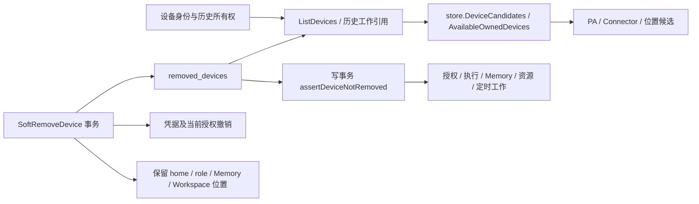

# DEV-032：设备生命周期与失效引用

状态：本项实现、自验和 dev Server / 组合 Web 发布已完成；Worker 无本项改动。已验增量交 DEV023 唯一联合 CI / 源码集成，未宣称用户亲测。设备移除原本已有 tombstone、凭据撤销和派发事务围栏，本项补齐历史身份与新工作候选混用的边界。

## 现场证据

2026-10-21，只读日常 dev 数据库确认：本人设备 `dev_5e739096-ab81-4270-a62f-a7324bd447c2`（VM-x-y-debian），owner `user_598c0c16-cb10-4ddf-99d7-a1c4f797ffd8`，于 `2026-10-08T08:14:28.209712484Z` 移除，凭据随后同事务撤销。原 payload 的 disconnected 是历史快照，ListDevices 会根据 removed_devices 覆盖为 removed。另一个同名 `dev_afcd564c-ac4f-41e5-b7fe-5e79b53794f6` 属于其他账号且没有 tombstone，不能按名称修复。

本人 PA settings.devices 含已移除 ID 且 allowWork=true。原因链：DevicesOwnedBy 有意保留历史所有权 → PA NormalizeSettings 自动补齐每个 owned ID 的权限 → assistant-settings 仅筛 owned → PlacesSection 把所有非 connected 状态显示成 Offline，并渲染权限勾选和 Computer settings。不是删除机制缺失，也无证据表明重新注册复活。

## 边界与不变量

- 历史所有权、配对身份、报文快照、候选可用性、在线状态分离；离线及刚配对但尚未上报 inventory 的有效身份不等于删除，不按名称合并身份。
- 保留历史 ListDevices 和 DevicesOwnedBy；组合式 store 查询函数提供明确候选语义，不增加巨型管理服务。
- HTTP 控制权限同时检查所有权与生命周期；删除重试走历史所有权，保持幂等。
- 删除事务移除该设备的 PA 授权条目，不留下可重新归一化为 allowWork/allowCreate 的许可；保留 preferred/home/role/Memory 位置，不替人迁移、切账号或删除文件。
- 相同已失效位置允许随其他设置原样保存，但新增授权和变更到已移除目标被写事务拒绝。执行仍独立检查当前 tombstone。
- 已有启动清理流程负责旧 PA 授权修复，只改确实受 tombstone 影响的 grant，不修改无关配置；二次运行不再改变记录。
- 活动资源租约、未取得停止回执的持久工作和进行中的知识写入阻止删除；删除不发停止命令。资源租约历史保留。

## 入口审计与修订范围

| 入口                                   | 历史语义 / 当前候选与控制                                                                                                    |
| -------------------------------------- | ---------------------------------------------------------------------------------------------------------------------------- |
| Devices                                | 已有 liveDevices 选择器；补服务端控制检查与 rename/labels 写事务围栏                                                         |
| Assistant Where it works / 初始设置    | 共用候选选择器；失效引用单列说明，无工作勾选和设备管理跳转                                                                   |
| PA home / preferred / roles / fallback | 当前位置保留；候选排除 removed，失效当前值不可选；存储写入和运行 snapshot 围栏                                               |
| Memory                                 | 保留根位置与 Workspace 名称；失效源不读文件，复制/重建/读写/发布控件禁用，元数据刷新/其他有效来源/撤销分享保留；存储事务围栏 |
| Connector                              | ownDevices 和执行目标用候选契约；请求与授权取图检查生命周期；绑定/晚到读取写入围栏                                           |
| Resources                              | 候选权限排除 removed；晚到 inventory、lease 与设置写入围栏；不删除已结束 lease 历史                                          |
| Services / schedules                   | 创建、resume/run/adopt、claim 均围栏；停止回执仍允许回写历史                                                                 |
| Workspaces / MCP / 历史会话            | 已有 removed 历史标识/候选排除及 session/claim 围栏保留；不得借历史所有权控制设备                                            |
| Skills / tools                         | 已有删除级联；补晚到扫描与设置写入事务围栏                                                                                   |
| PA routing digests                     | 提示索引和 find_workspace 共享候选投影；get_workspace 的历史 Digest 仍可读，失效默认位置不会静默换设备                       |

## 旧数据处理与部署

生产没有通过手工 SQL 改状态或删除关联行复现。既有 `PurgeRemovedDevicesState` 启动流程及幂等删除重试调用相同的授权失效规则：仅对包含 tombstone ID 的 `settings.devices` 数组做 JSON 局部更新，保留未知字段及其它所有配置。启动前对受影响记录做仓库外定向备份，旧 Server 回滚二进制保留。

本次实际修复两条 PA 记录：本人授权条目 7→6，合成验证账号 4→3；修复后 removed grant 数为 0。逐字段比较证明其它 settings JSON 未改变。原设备移除时间、历史引用、Memory / home / role / preferred 位置均保留。同名另一身份没有 tombstone，未被移除。两项既有持久服务仍为 running / enabled，主执行宿主仍存在；未向它们发送停止或升级操作。

| 组件   | 实际版本与回执                                                                                                                                        |
| ------ | ----------------------------------------------------------------------------------------------------------------------------------------------------- |
| Server | PID `1806348`；health startedAt `2026-10-21T10:07:02Z`；已加载 SHA-256 `fb96a556f670c5696469b18ec029275c90f8603a8940d0ff1b19a180b0d337b8`             |
| Web    | DEV033 一次组合发布：build `42beb69cdbb454c6`；index SHA-256 `786f6a72da0caac5f8644f86f9cdd1f8104c56213609656471f4756d078bd649`；公网、磁盘与产物一致 |
| Worker | 本项未更改；发布指针 SHA-256 `9215ebfc83c704f4b34aae053adf7610276d499ddfff9caa669877a9cd63cbb9`，版本 `0.5.7-dev.49.g84aed61.local.1792570873` 未变   |
| 基线   | DEV023 + DEV029 auth-repair + DEV030 + DEV031 Usage/compact，继承 DEV027 rev9 五项精确增量，排除 DEV028 未准出源码；组合 Web 另含 DEV033 侧栏增量     |

新 Server 与过渡期间的旧 Web 保持原 DTO / 路由 / Worker 协议；正常设备设置保存仍可用，只有已失效的授权和设备控制返回 410。没有用 HEAD 或旧候选整体覆盖相邻事项。公共自动构建发布器仍未启用，旧 Web assets / index rollback 均保留。

## 验证结果与发现后修正

| 验证                 | 实际结果                                                                                                                                                                                                                              |
| -------------------- | ------------------------------------------------------------------------------------------------------------------------------------------------------------------------------------------------------------------------------------- |
| 真实 SQLite 生命周期 | 删除后拒新工作、历史保留、凭据撤销、晚到注册、幂等、同名不同 ID、offline 保留，以及删除对 claim / settings / resource lease 的并发围栏通过；新增用例验证服务必须有停止回执、结束 lease 历史保留、Connector 绑定清理后仍可编辑有效绑定 |
| 存储与领域模块       | check-changed 的 78 项 SQLite 定向回归通过；resources 29 项、personalagent 18 项及 builtinskills 模块通过                                                                                                                             |
| HTTP 完整可运行范围  | 固定候选共 525 个顶层用例：513 PASS、6 个环境依赖用例自行 skip、6 个 Git 仓库夹具待联合 CI；按完整 JSON 事件汇总，未覆盖和未解决失败均为 0，未把 skip 当作通过                                                                        |
| 四个身份查询调用面   | suggestedHomeDevice、setupPersonalAgent、savePersonalAgentSettings、movePersonalAgentHome 在最终修复后定向补跑 4 项通过，涵盖配对尚无 inventory、共享系统账号、移除拒绝、普通设置与 home 迁移                                         |
| Web / 类型 / 审计    | 最终设备与 PA 相关 34 项通过；组合 Web 40 项通过；typecheck、10 项 UI 审计、contract（292 DTO / 117 daemon / 25 browser event）、module（0 violation / core Store 83 方法）通过；新增边界的 check-changed 全通过                      |
| 真实浏览器合成删除   | 正常 Devices 移除使另一标签页 Where it works 经 SSE 从 3→2；同名 offline 身份保留；新标签页/刷新一致；旧默认与角色值明确失效并禁选，旧 Computer settings URL 不提供控制；亮/暗/390px 与菜单关闭检查完成，无横向溢出                   |
| 真实 HTTP / MCP      | 合成旧授权保存、重命名、授权 QR、Memory 新绑定均 410；旧 credential 注册 401；重复删除 200；无关设置保存 200；MCP list_resources / list_workspaces / find_workspace 排除旧目标，历史 Digest 可读；失效默认与 pinned runtime 拒绝      |
| Memory 只读          | 合成旧根 raw state=active，但设备 removed：不再读取 entries 源文件，不显示 Ready/Offline 混合信息，不暴露原始 device_removed 自动加载错误；原位置与名称保留，迁移/重建/新增控件 disabled，Refresh 可用；真实组合 App 冷刷新复验通过   |
| 公网读验             | e2e-alice 页面与 API 一致：3 个有效 owned 行、6 个权限 checkbox、1 个 removed 历史身份不进候选、0 浏览器错误。同名 VM 的 Computer settings 实际指向 `dev_afcd564c-ac4f-41e5-b7fe-5e79b53794f6`，证明保留了另一身份而非按名称隐藏      |

验证中确实发现并修正三处边界：初版候选函数误排除刚配对、尚无报文快照的身份；SSE 撤销授权一度误报为用户未保存的编辑；Memory 根起初仍发起源读取并显示可操作表单。没有通过修改既有期望或忽略失败准出：第一处由既有共享系统账号测试定位，后两处由真实浏览器与组合 App 冷刷新定位，均补回归并重新验证。最初 check-changed 的 HTTP 失败记录保留；后续使用完整 JSON 记录首个失败、已通过范围、修复后调用面与剩余全部用例，避免日志截断掩盖结果。

## 证据与交接

- 最终交付快照为 `/tmp/dev032-evidence/handoff/`（仅 43 路径增量），清单 `/tmp/dev032-evidence/handoff-manifest.json`；报告在部署后定稿，运行候选与编译源码保持不变。README 仅本项行更新，行级 before / after 单独交接。
- 本项候选：`~/workspace/foundry-dev032-release`。43 路径的 before / after 与工作树差异在 `/tmp/dev032-evidence/source-manifest.json`；Web 13 项不可变交接为 `/tmp/dev032-evidence/web-source-manifest-verified.json`，与 DEV033 精确组合，不拷贝其旧全树覆盖本项。
- 现场与旧数据：`incident.json`、`deployment-server.json`、`live-postrepair.json`；凭据及定向 settings 备份仅在仓库外，不写入本报告。
- 检查入口：`httpapi-coverage-final.json`、`identity-callsites-final.jsonl`、`check-changed.log`、`check-new-boundaries.log`、`readonly-ui-final.log`、`ui-audit-readonly-final.log`、`sealed-build.log`，均在 `/tmp/dev032-evidence/`。
- 合成浏览器 / API：`fixture/after-api.json`、`fixture/browser-verification.json`，截图位于 `.foundry/attachments/dev032/`。组合 Memory 图 `.foundry/attachments/dev033/combined-memory-readonly.png` 已等待布局稳定后重截并目视核验；最初过早捕获的空白帧没有被当作验收证据。
- 公网：`/tmp/dev032-evidence/live-smoke.json`、`/tmp/dev033-evidence/deployment.json`。合成服务和本次独立浏览器已精确关闭，数据库与产物保留；没有关闭用户服务。磁盘从约 16 GiB 到约 14–15 GiB 可用，没有删除 DB/WAL、用户产物或唯一回滚。

## 限制与验收入口

6 个生成 Git 仓库历史的既有夹具交由 DEV023 联合 CI 补齐；6 个环境依赖用例的 skip 名单完整保留在 coverage JSON。没有删除用户真实设备做实验，也没有启动真实模型来验证不可派发的目标。生产事故账号用授权只读数据库核对了精确身份与修复范围，公开浏览器使用独立 e2e-alice，未冒称已登录事故账号做用户亲测。

已移除的 Memory 源保留为不可读写的位置引用；本项不提供自动迁移、恢复文件或替换账号，也不把移除记录当作任务已停止。其文件的恢复与显式重新配置仍需要真实来源，不能从缓存伪造。

验收入口为 Assistant settings → Where it works：原 `dev_5e739096-ab81-4270-a62f-a7324bd447c2` 不应再提供权限勾选或 Computer settings；真正 offline 的其他身份继续保留。如 home / role / Memory 曾绑定已移除身份，应出现明确的失效来源及不可执行状态，不能静默选择另一设备。源码合入由 DEV023 按固定增量完成一次联合流程，本项不另起重叠 PR。

## 2026-10-21 用户反馈：共享账号提示放回对应设备

用户要求将 Devices 顶部重复的大幅黄色共享提示改为对应卡片上的图标，悬停展示详情，设备详情页也保留完整说明。本轮仅调整呈现与确认状态，不修改设备生命周期、后端权限、共享关系或用户账号。

- `device-account-share.tsx` 统一卡片弹层与详情页的事实内容：按当前设备 ID 展示成员，明确相同系统账号会共享文件和 Claude/Codex 登录；保留已有选择时间与选择人，没有选择人时只显示已知日期，没有配对选择记录时明确是检测结果。
- 卡片图标与导航按钮并列，避免嵌套按钮及误导航。未读时显示提示图标，明确点击“知道了”成功后继续保留共享状态图标；悬停、聚焦及打开详情均不写已读状态。确认中禁用，保存失败可重试；保存已成功但刷新失败时只重试刷新，避免重复确认新的提示。
- 公共 `Popover` 新增可选 `openOnHover` 与可访问名称接口；默认行为保持点击展开。预览不抢焦点，点击或触摸固定打开，Escape/外部点击关闭，并恢复键盘焦点；继续使用 Radix 的定位、边界碰撞与关闭机制。
- 中英文本、主题与窄屏样式均使用现有公共组件和 tokens，没有按用户名跨设备合并、隐藏共享事实、改动真实通知已读状态或移除任何账号。

独立候选 `~/workspace/foundry-dev032-share` 精确继承 DEV022 timers 完整固定源（已包含 DEV033 tools、DEV029 async 与之前的设备生命周期）。源清单 `/tmp/dev032-share-evidence/source-manifest.json`，11 项 UI/测试增量；2190 个未改基线文件逐个 hash 一致，未收录工作树未验 DEV028/034 改动。

验证证据位于 `/tmp/dev032-share-evidence/`：`build3.log` 包含类型检查、22 项直接回归与正式构建；`browser-matrix.json` 的 11 场景涵盖 hover 跨入弹层、focus/Enter/Tab/Escape、真实触摸、busy/error、已读/未读/无共享、同名不同 ID、详情事实、长名字多成员及中英/亮暗/390px。生产 CSS 从实际待发布 Web 产物抽取再重跑完整矩阵，`production-css.json` 记录 hash，`production-browser.log` 为 11 场景通过且 0 浏览器错误。截图 `.foundry/attachments/dev032-share/production-*.png` 已实际查看。

`check-changed.log` 最终为 prettier、Web 类型、18 个相关测试文件及 10 项 UI 审计全部 PASS。发布于 2026-10-21 14:02:32 UTC：Web build `4a50be1cdb2778a4`，公开 index SHA-256 `0f654c2802d4cf45296396d85ce5fbfe3e1d73dbe06aa5debde8a5eb52988841`。`deployment.json` 记录磁盘/公网/产物一致，旧 index/version 及全部 assets 保留。Server PID `1840661` / loaded SHA `3b6403643063afff677888c6b2c568aebfa09add25ca312bd12807363b2f142a`、Worker 指针 `264c61395b300b0ad4445b9e8027e17d547d6ac6f5a8e0dd8adae59202523720` 均未改变；健康正常。

公网使用授权验证账号 e2e-alice，`live-smoke.json` 与 `public-*.png` 记录 3 张有效设备卡片 / 2 个共享入口、无列表顶部重复提示、悬停跨入弹层、键盘 Escape 焦点恢复、亮暗/390px 无溢出、详情事实保留。全程 0 控制写入、0 浏览器错误，没有点击真实“知道了”。未读、确认中、失败及确认后状态使用隔离合成数据验证；这不冒充用户账号亲测。最终磁盘约 10.3 GiB 可用。

本次公开验收由 parent 转达用户的小范围 UI 调整及自主验证/部署委托完成；源码仍交 DEV023 联合流程。下一纯 Web 窗口与 11 路径已验 delta 交 DEV034，旧生命周期发布记录保留为当时准确历史。验收入口：Devices 每张共享设备卡片的图标，鼠标悬停或键盘聚焦查看，点击/触摸固定展开；设备详情显示同一套完整事实。
