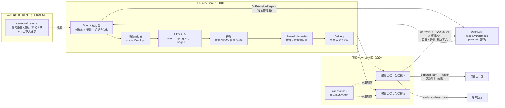

# DEV-203 消息通道（Message Channel）：任意推送源 → 助理，OpenLark 为首个适配器

## 状态

已合入 main（PR #265，squash bb3f7fdd），已部署 dev；真实飞书消息的端到端由本人首次实测。

v1 已实现、验证并部署 dev（Server、Web、7 台 Worker，2026-11-13 04:55 UTC+8），等本人体验与验收。设计 2026-11-13 经编排会话 “go”（带四项答复，见“待决的答复”）。来源：[编排会话](https://dev.foundryapp.app/chats/sess_1794464313271186377) 转述的本人需求（2026-11-13 01:50）与回复决定的更正（见“取舍 · 回复由助理决定”）。前置：[DEV-191 §5 Channel](DEV-191-multi-assistant.md#5-channel)、[连接器扩展](../connector-extensions.md)、[DEV-196](DEV-196-assistant-progressive-disclosure.md)、[DEV-200](DEV-200-assistant-no-injection.md)、[DEV-202](DEV-202-needs-you-scope.md)。

## 结论

1. **Foundry 只定义“消息进来”的抽象**：`Source`（订阅，产出固定结构 `Envelope`，带游标 / 去重 / 续传 / 断档语义）+ `Filter`（同一接口的若干阶段）+ `Delivery`（把留下的消息作为简短事实通知交给助理的一个会话）。**发出去（回复、表情、不理、先派 helper 写代码再回复）全部是助理自己用被授权的连接器原生完成**，Foundry 不代管回复、不打分、不设自动回复阈值。
2. **OpenLark 适配器是数据，不是代码**：在 `extensions/open-lark/foundry-extension.json` 的 `serverHeld.events` 里声明“用哪条已编目的 read 路由长轮询、游标在哪、断档怎么认、每条原始事件怎么映射成 Envelope、助理怎么回读上下文”。Foundry Server 用通用执行器跑它，代码里不出现 OpenLark / 飞书字样；open-lark 仓库零改动（只用它公开的 `GET /agent/v1/changes`）。
3. **运行在 Server，经现有通用网关的上游通道**：本人的实例是 server-held、`network: device`（byte-dev 回环 `127.0.0.1:8081`）。Server 用 `externalaccounts.DoExtensionRequest` 发起长轮询，设备转发由已有机制完成，Worker 不需要新代码；server 直连实例同一条路径。
4. **本人的“通道 system prompt”变成助理 home 里的原生 skill**（`.foundry/assistant-skills/channel-<id>/SKILL.md`，软链到 `.claude/skills` 与 `.agents/skills`，DEV-196 机制），通知本身只写事实，不带任何引导。
5. **Foundry 在代码里管住的**：通道会话（及其 helper）能用哪些连接器 / 工作区 = 通道范围 ∩ 助理权限包；OpenLark 写入是否逐次确认由本人在通道上选；接入护栏（每小时 / 每天投递上限、积压、暂停开关）；去重与续传；每条消息的处理审计（收到 → 过滤结果 → 投到哪个会话 → 会话做了哪些连接器写入 / 交给本人）。
6. **助理拿不准时自己交给本人**：用已有的 `needs_you hand_over`（带它的草稿或打算做的动作），本人在“等你处理”里处理。置信度是助理在通道 skill 指引下的判断，不是 Foundry 字段。

## 抽象与契约

### 数据流



### “基类”：Source 契约

本人说的 C++ 基类，在 Foundry 里是一个 Go 接口加若干“特化”。特化由**数据**选择，而不是由产品名选择：

```go
// internal/channels: Source is what an adapter provides.
type Source interface {
    // Subscribe/拉一批：从 cursor 之后取，最多等 wait；空批合法。
    Poll(ctx context.Context, cursor string, wait time.Duration) (Batch, error)
    Capabilities() Capabilities   // 支持的 op、是否有 mentionsMe / threads / 自己、推送延迟级别
    ContextHint() string          // 助理自己回读上下文的方式（渲染进通道 skill）
}
type Batch struct {
    Envelopes []Envelope
    Cursor    string  // 处理完这一批后提交的位置（Kafka offset 式：先落库再提交）
    More      bool    // 还有积压，立即再取
    Gap       *Gap    // 游标失效：Reset 为新起点，Reason 给人看
}
```

| 特化（实现）                         | 由什么选中                                                 | v1   |
| ------------------------------------ | ---------------------------------------------------------- | ---- |
| `httpLongPoll`（声明式，经网关）     | server-held 扩展描述符 `serverHeld.events.poll`            | ✅   |
| `httpStream`（NDJSON/SSE）           | `serverHeld.events.stream`；需网关支持流式响应             | 推迟 |
| `deviceCLI`（Worker 跑命令读 JSONL） | 设备持有型扩展 `cli.events` 或程序扩展 `events.*` 协议方法 | 推迟 |
| `webhook`（Foundry 托管入站 URL）    | 通道配置生成带签名的 URL                                   | 推迟 |

**扩展里怎么写（OpenLark，纯数据）**，挂在 `serverHeld` 下，Server 校验形状（`descriptor_checks.go`），Worker 的 manifest 校验同步放行：

```json
"events": {
  "poll": {
    "method": "GET", "path": "/agent/v1/changes",
    "query": { "since": "{cursor}", "wait": "25", "kinds": "message", "limit": "100" },
    "omitWhenEmpty": ["since"],
    "cursor": "/cursor", "items": "/changes", "more": "/more",
    "gap": { "status": 410, "code": "/error/code", "codeEquals": "CHANGES_CURSOR_GONE", "reset": "/error/reset" },
    "busy": { "status": 429 }
  },
  "envelope": {
    "id": "{/op}:{/id}", "kind": "/kind", "op": "/op", "occurredAt": { "pointer": "/at", "unit": "ms" },
    "conversation": { "id": "/feedId", "name": "/item/where/name",
      "kind": { "pointer": "/item/where/kind", "map": { "p2p": "direct", "group": "group" }, "otherwise": "other" } },
    "thread": { "id": "/item/thread/id", "isReply": "/item/thread/reply" },
    "message": { "id": "/id", "text": "/item/text" },
    "sender": { "id": "/item/author/id", "name": "/item/author/name", "isSelf": "/item/signals/mine", "isBot": "/item/signals/bot" },
    "mentionsMe": "/item/signals/atMe",
    "attributes": { "replyToMe": "/item/signals/replyToMe", "hidden": "/hidden" },
    "skipWhen": [ { "pointer": "/gone", "equals": true } ]
  },
  "context": {
    "hint": "olk im context {message.id} --limit 50",
    "hints": { "zh-CN": "olk im context {message.id} --limit 50" }
  },
  "readRoute": "/agent/v1/changes"
}
```

- 规则：`path` 必须是实例路由目录中 `access: read` 的路由（运行时再查一次），所以通道**只能读**；模板只能用 `{cursor}` 和 JSON pointer，同 `serverHeld` 其余模板的规则。
- 扩展文件归 Foundry 仓库 `extensions/open-lark/`（官方扩展，随 Worker 发布），维护者是 Foundry；OpenLark API 的形状以 open-lark 仓库 `src/server/routes/agent-changes.ts`、`src/server/context/message-items.ts` 为准（2026-11-13 已读）。上游改了字段，只改这份 JSON。
- 已核实：本人实例 `xapp_8ef44948…` 的 1132 条路由里有 `GET /agent/v1/changes`（read，domain ctx）；该路由长轮询 `wait` 上限 25 s，扩展声明的上游超时 60 s，单账号最多 32 个同时等待；410 `CHANGES_CURSOR_GONE` 带 `reset`；日志保留约 7 天。

### Envelope（固定结构）

| 字段                                         | 含义                                                         | IM（OpenLark）            | 邮件                       | Webhook / 告警          |
| -------------------------------------------- | ------------------------------------------------------------ | ------------------------- | -------------------------- | ----------------------- |
| `id`                                         | 适配器内唯一，去重键                                         | `op:messageId`            | Message-ID                 | 事件 id / 指纹          |
| `kind`, `op`                                 | 事件类别、动作                                               | message / new·edit·thread | message / new              | alert / firing·resolved |
| `occurredAt`                                 | 源头时间                                                     | `at`                      | Date                       | 触发时间                |
| `conversation{id,kind,name}`                 | 归属的对话；kind ∈ `direct`/`group`/`channel`/`feed`/`other` | 会话 feedId，p2p→direct   | 线程（References 根）/feed | 告警分组键 / feed       |
| `thread{id,isReply}`                         | 对话内子话题                                                 | 话题 id                   | —                          | —                       |
| `message{id,text}`                           | 回读与回复用的 id；正文（≤8 KB，截断标记）                   | message id；markdown      | 主题+正文摘录              | 摘要                    |
| `sender{id,name,isSelf,isBot}`               | 发送者                                                       | author；signals.mine/bot  | From；是否本人地址         | 系统名，isBot           |
| `mentionsMe`, `mentions[]`                   | 是否点名本人                                                 | signals.atMe              | To 含本人（Cc 为 false）   | 指派给本人              |
| `attributes{}`                               | 适配器私有小字典（≤16 键，值 ≤256 字符），过滤器可读         | replyToMe、hidden         | 标签                       | 严重级别                |
| `source{channelId,connectorKind,instanceId}` | Foundry 填，不来自适配器                                     |                           |                            |                         |

私聊、群、@我这些 IM 特有行为落在**通用字段的取值**上（`conversation.kind`、`mentionsMe`、`sender.isSelf`），过滤器只认这些字段，不认识“飞书”。

## 各问题的决定与取舍

### Q1 适配器契约放在哪

- 决定：适配器 = 扩展描述符里的 `events` 段 + Foundry 的通用执行器。OpenLark 那份在 `extensions/open-lark/foundry-extension.json`。
- 理由：符合“私有服务是描述符驱动的扩展”（DEV-111/174/185）和“Server 只执行数据”。比“扩展程序在 Worker 里实现 `events.subscribe`”少一个常驻进程，也不需要 Worker 发布新运行时。
- 取舍：声明式映射表达力有限（只有 pointer、等值映射、`skipWhen`）。不够用的源走推迟的 `deviceCLI` / 程序扩展特化，契约（`Batch`/`Envelope`）不变。

### Q2 Envelope

见上表。正文只保存在投递记录里（命中过滤的才存，≤8 KB，30 天）；丢弃的事件只记 id、规则结果和计数（24 h），不存正文（DEV-191 §5 护栏）。

### Q3 Filter

- 接口：`Stage.Decide(ctx, Envelope) → keep|drop + reason (+ tags, sessionKey 覆盖)`。阶段按顺序执行，任一 drop 即停。
- v1 阶段 `rules`：规则列表，任一命中即 keep；每条规则是若干条件的“且”。条件：`conversationKinds`、`mentionsMe`、`fromSelf`、`ops`、`textPrefixes`（比较前去掉开头的 @提及与空白，大小写可选）、`conversationIds` 包含 / 排除、`senderIds` 包含 / 排除、`attributes` 等值。规则存在通道配置里，页面上用结构化表单编辑，不写死在代码里。本人首批配置：
  - 私聊：`conversationKinds=[direct]`、`fromSelf=false`、`textPrefixes=["<前缀>"]`
  - 群里 @我：`conversationKinds=[group]`、`mentionsMe=true`、`textPrefixes=["<前缀>"]`
  - （测试用，可删）自聊：`conversationIds=[<自聊 id>]`、`fromSelf=true`、`textPrefixes=["<前缀>"]`
- 推迟：`program` 阶段（DEV-191 本人决定 5：home 工作区里的脚本，stdin 读 Envelope JSON，stdout 回 keep/drop；在 home 设备上由 Worker 运行），`triage` 阶段（用助理的 helper 模型做一次便宜判断，计入通道预算）。接口已经为它们留好。

### Q4 运行器

| 项         | 决定                                                                                                                                                                                                                                                                  |
| ---------- | --------------------------------------------------------------------------------------------------------------------------------------------------------------------------------------------------------------------------------------------------------------------- |
| 在哪跑     | server-held 实例（含 `network: device`）一律在 Server：一个监督循环每 30 s 对齐“启用的通道 ↔ 运行中的轮询”。设备持有型源（推迟）在持有它的设备 Worker 上跑，同一契约经守护连接上报批次。                                                                              |
| 起点       | 新建通道从“现在”开始（不带 `since`），不回放 7 天历史。                                                                                                                                                                                                               |
| 游标与去重 | 先把批次里命中的投递记录与丢弃计数落库，再在同一事务里写游标（at-least-once）；`channel_deliveries` 以 `(channel_id, envelope_id)` 唯一，重放无副作用。                                                                                                               |
| 断线与重连 | 长轮询每次 ≤25 s 等待，天然没有“1 h 连接上限”问题；网络错误、5xx 指数退避 2 s→5 min，429 按 `Retry-After`；设备离线显示“等设备上线”，游标保留。                                                                                                                       |
| 断档       | 410 + 声明的错误码 → 游标改为 `reset`，记一条断档事件（时间、原因），通道状态显示“有一段消息可能漏了”，并给本人一条“等你处理”（可关闭）。v1 不自动补拉。                                                                                                              |
| 积压与限流 | `more=true` 立即再取；每通道每小时 / 每天投递上限（默认 20 / 100），超限的命中消息记为 `held`，停止投递并给本人一条“等你处理”；接入继续，不丢。本人放行或调高上限后按序投递。                                                                                         |
| 权限前提   | 轮询前检查：通道的助理权限包对该连接器实例不是 off；否则不轮询，状态写明缺什么，页面给一个“允许这个助理使用”按钮（本人点击才改）。实现时核对到助理自己的会话本来就能用权限包允许的所有账号（`externalaccounts.Policy.Bound`），所以去掉了“绑定到 home 工作区”这一条。 |
| 暂停开关   | 通道 `enabled=false`：停止轮询和投递，游标保留；恢复时问“从暂停处继续 / 从现在开始”。助理整体停止（已有）时投递等待，接入继续。                                                                                                                                       |

### Q5 投递给助理

- **会话键**：默认“每个来源对话一个会话”（`conversation.id`）；群里的话题回复可选“每个话题一个会话”（`conversation.id + thread.id`）。会话在助理 home 工作区，`role` 仍是助理会话，标题“通道名 · 对话名”，与本人和助理的直接对话分开，页面上可见、可打开。
- **复用已有收件箱**：投递走 `pa_inbox` 的持久化、幂等、等待原因（设备离线、助理停止、账号不可用）与回执；新增 `channel_ref`（通道 id、会话键、投递 id），不复用飞书 Bot 的 `Origin`。**改动**：现在 `deliverInbox` 只要助理有任何会话在跑就 `assistant_busy`，通道投递改为只看**同一会话键**的会话是否在跑；不同对话并行，每通道并发上限默认 3。
- **攒批**：同一会话键 5 s 内到达、或该会话正在跑时到达的消息合并为一次输入（按时间排列），不打断正在跑的回合。
- **通知内容（只写事实）**：

```
[Message from channel "飞书 /fd" (OpenLark · byte-dev OpenLark): not the person's words]
delivery dlv_… · conversation 7207… (group "XX 项目群") · thread 7311…
message 7312… from 张三 (id 7201…) at 2026-11-13 10:02 +08:00 · mentions you
> /fd 帮我看下这个 MR 为什么挂了
[End of channel message]
```

不含“你应该……”。怎么回读上下文、怎么处理，在通道 skill 里。

### Q6 每通道指引与范围

- **指引 → 原生 skill**：通道的“处理原则”文本（本人写，≤8,000 字符）生成 `channel-<slug>` skill：frontmatter `description` 由 Foundry 生成（“处理来自 Foundry 消息通道 X 的消息时使用”），正文 = 本人原文 + Foundry 附的事实段（适配器 `context.hint`、会话键规则、needs_you hand_over 的用法、通道范围）。随每次助理运行写入 home（DEV-196 的 `.foundry/assistant-skills` + 软链），删除通道即清理。**这就是本人说的“给它一个 system prompt”在 Foundry 里的落点**：Claude Code / Codex 按描述匹配原生加载，不是 Foundry 拼进提示词。
- **范围 = 通道范围 ∩ 助理权限包**，在 `permission.Resolve` 落实：会话（或其 lineage 上的祖先）是通道会话 → `Access` 增加 `Narrow`：
  - 连接器：每个账号取两者较低级别；通道没列出的账号 = off；
  - 工作区：通道 include ∩ 权限包；
  - 带身份的资源（浏览器、屏幕等）：通道会话默认关闭，可逐项打开；
  - helper 经 lineage 继承同一 `Narrow`，所以“先派 helper 写代码再回复”也在范围内。
- **OpenLark 写入方式**（通道上的一个选项，本人决定）：`只读` / `读写 · 每次写入出确认卡` / `读写 · 助理自行决定（不出卡）`。第三项让网关对该通道会话及其 helper 的这个账号跳过 `extension_write` 确认，其余检查不变，所有写入照常审计。新通道默认是第三项（编排答复 1）。

### Q7 回复（按本人更正后的决定）

- 不做 `channel_reply` 工具、置信度阈值、自动回复开关，适配器契约里没有 `reply`。
- 助理用 OpenLark 自己的工具（`olk im reply` / reaction / 不理）完成；需要先干活就 `dispatch_item` 派 helper，回来再回复。
- 拿不准：`needs_you hand_over`（note 里写草稿或打算做的动作），本人在“等你处理”里回答，答复回到这个通道会话。核对点：`hand_over` 目前对“没有开放条目 + sessionId”的情况是给 helper 用的，需要确认 / 放开对通道会话自身可用。
- Foundry 只做事后可见：每条投递记录关联该会话期间经网关的写入（路由、时间、结果）和产生的“等你处理”，页面上逐条显示“助理做了什么”。

### Q8 UI

- 位置：助理设置 › “触达与限额”分组里，在“入口”后新增 **「消息通道」** 一节（`/assistants/{id}/settings/channels`）；侧栏不变（遵循 apps/web/AGENTS.md）。
- 列表：每个通道一行——名称、来源实例、状态（运行中 / 已暂停 / 等设备 / 缺权限 / 出错 + 原因）、最近事件时间、24 h 收到 / 命中 / 投递 / 超限、启停开关。
- 编辑：来源（选已有连接器实例，只列声明了 `events` 的）、过滤规则（结构化表单）、处理原则（文本框）、范围（来源连接器的三档写入方式、其他连接器是否沿用助理权限）、会话粒度、上限。新建时来源写入默认“读写 · 助理自行决定（不逐条确认，全部留痕）”。v1 的工作区固定“沿用助理权限”、带身份资源固定为无；“用最近 N 条预览命中”推迟，改为“显示未命中的消息”帮助找会话 ID。
- 最近处理：每条命中消息一行——时间、对话、发送者、正文首行、状态（已投递 / 等待原因 / 超限）、会话链接、助理动作摘要（回复 / 表情 / 交给你 / 无动作）。
- 不做：在通道页里重复“等你处理”；草稿与交给本人的事仍在“等你处理”，卡片标注来源“通道 · 名称”（DEV-202 的来源标注）。

### Q9 v1 范围（明早可试）

做：

1. 描述符 `serverHeld.events`（poll + envelope + context）与 Server / Worker 校验；OpenLark 扩展加上这段（Worker 需发布，因为扩展随 Worker 打包上报）。
2. `internal/channels`：Source 接口、`httpLongPoll` 执行器、映射执行器、`rules` 过滤、运行器（游标、去重、退避、断档、限流、暂停）。
3. 存储：`message_channels`、`message_channel_state`（游标、状态、计数）、`message_channel_deliveries`（审计）；契约 `contracts/models/message_channel.yaml`；API `/api/assistants/{id}/channels…`（列表、建、改、删、启停、最近处理、过滤预览）。
4. 投递：收件箱 `channel_ref`、按会话键并发、攒批、事实通知；通道 skill 生成。
5. 范围：`permission.Resolve` 的通道 `Narrow`（连接器、工作区、身份资源）与 OpenLark 写入方式。
6. Web：消息通道一节（列表、编辑、最近处理）。

推迟：`program` / `triage` 过滤阶段、流式 / CLI / webhook 特化、断档自动补拉、附件与图片、编辑 / 撤回事件的处理（v1 只要 `op=new`）、一个通道多个来源、按 token 计的通道模型预算（v1 用投递次数上限 + 助理已有用量上限）。

## 取舍

- **回复由助理决定（本人 2026-11-13 更正，原话）**：“是否回复这个动作是由assistant的行为去判断的，而不是由Foundry这个系统去约束的。因为回复是直接让assistant去调OpenLark的接口去跑……有一些话就是不需要回复的，有些事情他可能做一个reaction，甚至不做，然后他处理这个指令就好了。还有一些事情，就是他回复之前，他要做很多其他的事情，甚至包括写代码、MR，最后才是回复。所以这个回复的动作不应该由Foundry去代管，而是由Assistant这个agent自行去决定它什么时候回复、回复什么、回复之前要做什么事情。” 因此删去回复工具、阈值和自动回复开关；Foundry 保留的强制只有范围、接入护栏和审计。与 DEV-191 风险 10（“自动对外回复”）的关系：由本人在通道上选择 OpenLark 写入方式承担；按编排答复，新通道默认“助理自行决定”，所有写入审计并在“最近处理”可见。
- **长轮询而非流**：`/changes?wait=25` 有新变化立即返回，延迟与流相当；它是普通请求 / 响应，直接复用网关的上游、超时、体积上限、审计和设备转发，没有“1 h 断开”“流中途断开”的处理。代价：每个通道每 25 s 一个请求，单账号 32 个等待名额足够。
- **Server 跑而不是 Worker 跑**：令牌本来就封存在 Server，设备只转发；在 Worker 跑要么把令牌给设备，要么再绕回 Server。设备离线时接入暂停，日志保留 7 天内不丢。
- **每对话一个会话**：上下文自然连续（同一个人连续追问），不同对话并行且互不污染；代价是会话数量多，靠页面分组与归档处理。没有选“所有通道消息进一个会话”（会串话、串权限、阻塞）。
- **指引放 skill 而不是每轮注入**（DEV-200）：通知只有事实。风险是模型不加载 skill；skill 描述精确写通道名，通知第一行带同一名称，验证计划里专门检查加载。
- **复用 `pa_inbox` 而不是新投递管线**：持久化、等待原因、回执已经有；只放开“助理忙”为按会话键判断。
- **业界参照（凭知识，未逐一重新核对原文）**：Slack Events API 以 event_id 去重、失败重投（at-least-once）；Kafka 消费者处理完再提交位移；Zapier / n8n 的 trigger → filter → action；Matrix appservice 桥由桥自己做协议映射、homeserver 保持通用（对应“映射在扩展里”）；Mattermost outgoing webhook 的 trigger words（对应前缀过滤）。

## 风险

1. **他人消息即不可信输入**：可能诱导助理越权。缓解：范围在代码里收窄（通道范围 ∩ 权限包，含 helper），写入是否逐条确认由本人在通道上选（新通道默认助理自行决定，前缀过滤保证只投递有意发给它的消息），通知标注“not the person's words”，审计逐条可查。
2. **刷屏耗额度**：投递上限 + 攒批 + 前缀过滤；超限停投递并通知本人。
3. **路由错助理**（DEV-191 风险 6）：通道属于一个助理，投递只进它的 home；API 一律按 `assistantOwner` 校验。
4. **前缀判断被 @ 文本形式影响**：OpenLark `item.text` 中 @ 的写法需要实测，必要时在映射里加“去掉提及后的正文”字段。
5. **重复处理**：at-least-once 下同一消息可能二次投递（崩溃在投递后、回执前）；去重键 + 收件箱 InputID 栅栏已覆盖大部分，剩余窗口记录在案。
6. **断档漏消息**：只提示不补拉（v1）。
7. **skill 未被加载**：见取舍，验证计划覆盖。
8. **写入不出卡后的误发**：只在本人显式选择后发生；所有写入审计并在“最近处理”可见。

## 验证计划

- **单测（Go）**：映射执行器（OpenLark 样例 JSON → Envelope，含 p2p / group / atMe / mine / thread / gone）；rules 过滤（含去掉开头提及后的前缀）；运行器用 `httptest` 假源：游标只在落库后前进、重复批次不重投、410 断档改游标并记事件、429 / 5xx 退避、暂停与恢复、超限 held；`permission.Resolve` 对通道会话与其 helper 的收窄；网关在“助理自行决定”时跳过确认、其他两档照旧。
- **合成适配器端到端（scratch stack 或测试）**：一个虚构扩展（`extensions/examples/acme-events-server-held`，纯数据）指向本地假服务，走完 过滤 → 投递 → 会话收到事实通知 → skill 存在 → 去重 / 续传 → 暂停开关 → 权限包关掉该连接器后不轮询、写入被拒。
- **真实 OpenLark（byte-dev，只读）**：建通道（默认助理或本人指定的助理），只做订阅 + 过滤 + 投递；用本人自聊发带前缀的消息验证命中、投递和延迟；不对任何他人发消息，回复测试只在自聊。byte-dev 上只运行 Worker 的正常运行时，不跑任何构建 / 测试。
- **截图（正常比例）**：消息通道设置页、最近处理里的一条已投递消息、“等你处理”里助理交给本人的一条（带草稿）。

## 待决的答复（编排 2026-11-13 “go”）

1. 新通道的来源写入方式默认“读写 · 助理自行决定（不出卡、全部审计）”，另两档保留。
2. 不写死前缀：模板三条规则（私聊 + 前缀；群聊 @我 + 前缀；我自己发的私聊 + 前缀，测试用、默认开、可删），前缀框为空、只显示示例，开着的规则没填前缀不能保存。
3. 默认每个来源会话一个对话，可改为每个话题一个。
4. 用哪个助理由本人在表单里选；不替本人改权限包或绑定，缺权限时表单只给一个按钮，由本人点。

## 实现

- 契约：`contracts/models/connectors.yaml` 新增 `ConnectorEventsSpec`（`serverHeld.events`：poll / envelope / context）；`contracts/models/message_channels.yaml`（Envelope、Channel、Rule、Scope、Limits、Status、Delivery…）。生成的 Go / TS / JSON Schema 已重生成。
- 适配器（数据）：`extensions/open-lark/foundry-extension.json` 1.3.0 加 `serverHeld.events`，长轮询 `GET /agent/v1/changes?since&wait=25&kinds=message&limit=100`，410 `CHANGES_CURSOR_GONE` → reset；映射 p2p→direct、`signals.atMe`→mentionsMe、`signals.mine`→sender.isSelf；上下文提示 `olk im context {message.id} --limit 50`。Server 校验在 `connectors/descriptor_checks.go` `checkServerHeldEvents`，Worker manifest 只查形状。
- 通用实现 `apps/server/internal/channels/`：`envelope.go`（JSON Pointer 映射）、`filter.go`（Stage 接口 + Rules；前缀在开头的 @提及之后比较，名字最多 3 个词）、`source.go`（Source 接口 + LongPoll）、`runner.go`（每个启用通道一个轮询循环、游标与批次同事务、退避、断档、超限 held、暂停）、`dispatch.go`（按会话键 5 s 攒批，一个会话一轮在跑时后来的消息等它结束，事实通知）、`skill.go`（通道 skill）。包内不出现任何产品名。
- 存储 `sqlitestore/message_channels.go`：`message_channels`、`message_channel_runtime`、`message_channel_deliveries`（`(channel_id, envelope_id)` 唯一，未命中只存 id 与原因、1 天删除，其余 30 天后清空正文）。
- 投递复用收件箱：`pa_inbox.channel = mc:<通道>:<会话键哈希>`。`DuePersonalAgentInbox` 改为“本人消息之间一次一条、每个通道会话之间各自一次一条”；`deliverInbox` 对通道条目只等同一会话，本人消息不再等通道会话；本人收件箱列表与助理首页都不显示通道会话。新会话标题“通道名 · 对话名”。
- 范围：`permission.Access.Channel`，`Resolve` 沿会话祖先找通道；连接器取通道与权限包的较低级别，未列出的按 `connectorDefault`；工作区取交集；带身份资源只放行通道列出的。网关 `pipeline.go`：通道把该账号设为 direct 时跳过写入确认卡，其余检查与审计照旧。
- `needs_you hand_over`：通道会话属于助理自己，`sessionId` 填本会话即直接交给本人（`mcp_needs_you.go` `needsYouHelper`）。
- 通道来源经 `externalaccounts.DoExtensionRequest` 发起（设备转发沿用现有机制），并核对该路径在实例路由目录中是 read；代码在 `httpapi/connector_extension_instances_channels.go`（模块边界规则只允许该类文件用 externalaccounts）。
- API（`/api/assistants/{id}/channels…`，`/api/personal-agent/channels…` 为默认助理别名）：列表（含可选来源）、新建、修改（`resumeFromNow`）、删除、最近处理（`?dropped=1` 含未命中）、放行超限、`grant-source`（把来源账号在该助理权限包里设为读写）。
- 等你处理新增来源 `message_channel`（超限、断档两类提醒）。
- Web：助理设置「触达与限制」组新增「消息通道」：列表（状态、最近消息、24 h 计数、开关、恢复时选“接着读/从现在开始”）、编辑对话框、最近处理（状态、助理动作：连接器写入 / 被拒请求 / 交给你、打开对话、显示未命中、放行超限）、缺权限提示与按钮。

## 验证

- Go：`go test ./internal/channels`（OpenLark 样例映射、规则矩阵、游标只在落库后前进、重复不重录、重启续传、410 断档改游标并提醒、超限 held 与放行、暂停不轮询、按会话攒批与“一轮在跑时后来的等它”、skill 内容）通过；`go test ./internal/httpapi -run 'TestMessageChannel|TestChannelInbox'`（通道会话与其 helper 的范围收窄、direct 免卡只对该账号、权限包仍封顶；通道会话 hand_over 直接给本人并出现在最近处理；本人消息与两个通道会话互不阻塞、本人收件箱不含通道条目）通过；`go test ./internal/connectors -run 'TestExtensionDescriptorsPassServerChecks|TestServerHeld'`（随包 OpenLark 描述符通过新校验）通过；`go build ./...`、`go vet` 通过。`TestNeedsYouVisibilityFollowsAssistantScope` 在当前 dev 基线上失败（期望新助理能看到“allowed account”，与正在落地的“新助理连接器默认关闭”有关），与本项改动无关，留给该切片。
- Worker：`server-held-extension`、`connector-extensions`、`extension-examples` 25/25；`tsc` 通过。`scripts/audit-module-boundaries.mjs` 通过。
- Web（子会话执行）：`tsc --noEmit`、13 项 UI 审计、`message-channel-model`/`assistant-conversation-order`/`app-navigation`/`pending-items`/`assistant-settings-connectors`/`assistants-web` 测试通过。
- 真实 OpenLark（byte-dev，只读）：给本人的 ByteWork 助理建了一个验证通道（规则只认“我自己发的私聊 + `/dev203`”，OpenLark 只读、其他连接器关闭）。部署后 30 s 内开始经 byte-dev 长轮询，状态 running；约 15 分钟收到并过滤 163 条（全是群消息，均为“未匹配规则”，未存正文），映射出的 kind/mentionsMe/isSelf 与 OpenLark 一致。往自聊发测试消息的子会话按 olk skill 要求等本人亲自确认，没有发送，所以没有真实消息走完整条链。
- 投递链路（真实助理，合成消息）：向同一通道插入一条明确标注“合成”的待投递记录，dispatcher 5 s 后经收件箱在 ByteWork 的 home 新建会话 `sess_1794516461657851283`（标题“DEV-203 验证（可删除） · DEV-203 合成会话”，首条输入是事实通知），记录状态随之变为 delivered。该会话随后因 ByteWork 所用的模型账号（profile hell-tw）额度用尽失败（429，额度在 04:02 UTC 恢复），记录如实变为 failed。验证通道与其记录随后已删除；该失败会话保留。
- 助理在通道指引下的实际行为（2026-11-13 05:00，e2e-alice 默认助理，Codex gpt-6-astra，合成来源）：给 e2e-alice 的助理放一个夹具通道（来源是测试夹具，直接写入两条待投递记录，不碰 OpenLark；连接器全关；指引为编排给的英文原文），两条消息各进一个会话：
  - 访问申请 → `sess_1794517142738224301`：先 `cat .agents/skills/channel-dev203fixture000001/SKILL.md`，再 `printenv FOUNDRY_SESSION_ID`，调用 `needs_you hand_over`（sessionId=本会话），生成 `pnd_51e7d6c8…`：source question、rule handed_over、handler person、handedReason assistant、open，note 含回复草稿；没有其他工具调用、没有外部写入。
  - 简单问题 → `sess_1794517142111608485`：同样先读通道 skill，然后在会话里一句话作答，没有任何工具调用。
  - Foundry 的“Loaded skills”事件只列 Foundry 选的 skill；通道 skill 由 Codex 原生发现并读取（上面的 cat）。
  - 发现：“等你处理”卡片对 handed_over 条目原来只显示标题（note 第一行），多行 note 的草稿会被藏起来。改为 note 比标题多时显示 note（`pending-item-card.tsx`），Web `77349401c8f25d14` 已部署；截图 `.foundry/attachments/dev203/needs-you-live.png`（真实条目，未注入）显示完整草稿。
  - 清理：两段会话已归档，条目已标为不需要，夹具通道经 API 删除。
- 在合并 B3 后的 dev 树上重跑 `go test ./internal/httpapi -run 'TestMessageChannel|TestChannelInbox|TestNeedsYou'`：全部通过（之前失败的 `TestNeedsYouVisibilityFollowsAssistantScope` 也已由其切片修好）。
- 截图（e2e-alice，正常比例 1440×1000，通道数据与一条“等你处理”只在浏览器内替换 GET 响应，未写入）：`.foundry/attachments/dev203/channels-settings.png`、`channels-deliveries.png`、`channels-editor.png`、`needs-you-draft.png`。

## 部署

- 三方合并进 dev 检出（无冲突），契约重生成。DB 备份 `~/.foundry/server/backups/foundry-20261113-pre-dev203.db.gz`（`quick_check` ok）。
- Server：回滚副本 `releases/dev023-candidate/foundry-server.pre-dev203`（首次）与 `.pre-dev203b`（去掉绑定前提后的再部署）；当前 SHA-256 前缀 `56424c608335d0ee`，`/healthz` ok。
- Web：`04a6970b29b191d1`（`web-releases/dev203-channels-c`，上一版保存在其 `previous-*`）。
- Worker：`0.5.7-dev.354.geb87723d.local.1794514792`，7 台设备（byte-dev、CanWendeMac-mini、limen-canada、cottoncpp、macbook、byte-dev-sg、sg-chaos）经 `update_worker` 全部在新版本。

## 已知限制

- 真实飞书消息还没走过完整链路（见上）；明早第一条消息就是验收。
- `program` / `triage` 过滤、流式 / CLI / webhook 来源、断档补拉、附件与图片、编辑 / 撤回事件推迟。
- 删除通道会删除它的记录，之后它的旧会话不再按通道范围收窄（只按助理权限包）。

## 明天怎么试

1. 打开 dev 的 Foundry，左侧「助理设置」，上方切到要接飞书消息的助理（例如 ByteWork），在「触达与限制」里点「消息通道」。
2. 点「新建消息通道」：起个名字，来源选你的 OpenLark 实例；三条规则里都填上你想用的前缀（例如 `/ai`）；需要的话写「处理原则」（会变成助理的 skill）；写入方式默认是「读写·助理自行决定」，想先保守可以改成「每次写入需确认」。保存。
3. 如果出现“这个助理的权限里没有开启该连接器”，点「允许这个助理使用」。
4. 在飞书里给自己的自聊发一条「前缀 + 内容」，几秒后在通道的「最近消息」里能看到它，点「打开对话」看助理怎么处理；它拿不准时会出现在「等你处理」，带它的草稿。
5. 注意：ByteWork 目前用的模型账号 hell-tw 额度到 12:02（UTC+8）才恢复，之前助理会话会直接失败；可以先在「用哪个模型」里换一个账号再试。
6. 想停就把通道的开关关掉；重新打开时可以选“从现在开始”，不补之前的消息。

## 时间线

| 时间（UTC+8）    | 变化与证据                                                                                                                                                         | 剩余动作           |
| ---------------- | ------------------------------------------------------------------------------------------------------------------------------------------------------------------ | ------------------ |
| 2026-11-13 02:30 | Phase 1 设计；回复由助理决定（本人更正）写入取舍                                                                                                                   | 等 go              |
| 2026-11-13 04:20 | go 后实现 v1，worktree `foundry-dev203`；Go / Worker / Web 检查通过                                                                                                | 部署               |
| 2026-11-13 04:31 | Server / Web / 7 台 Worker 部署；真实 OpenLark 轮询与过滤、合成消息投递到真实助理会话                                                                              | 本人明早体验与验收 |
| 2026-11-13 05:15 | e2e-alice 实测：通道 skill 被读取、访问申请交给本人（handler person，带草稿）、简单问题会话内作答无外部写入；needs-you 卡片显示多行草稿，Web 部署；worktree 已删除 | 本人明早体验       |
