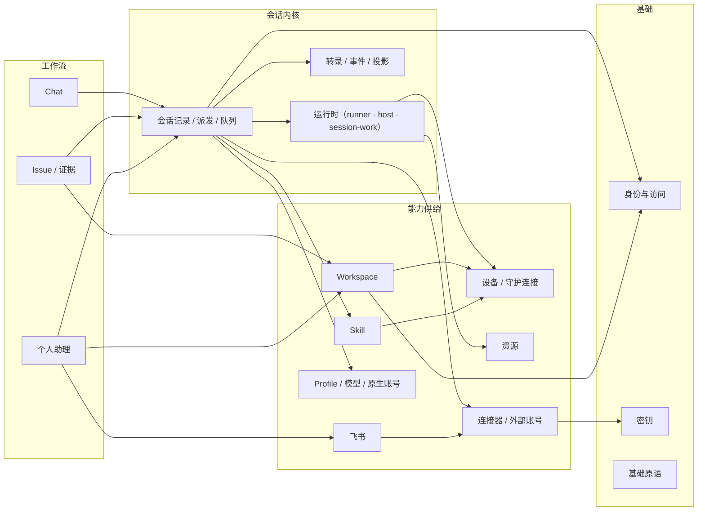

# 代码组织全景图（重构工作底稿）

状态：工作底稿，2026-11-01，基于 `615b51d7` 的源码阅读。不是正式文档；重构完成后基于新代码重写 `docs/`。
用途：按**领域概念**横切四个包，看清每个概念的代码落在哪里、同一逻辑有几份、跨语言契约怎么同步，便于决定"哪些封在一起、哪些抽成公共逻辑、哪些跨语言统一"。

细节附录（文件、行数、入口 file:line、每条重复的位置与差异）：

- [会话与运行时](code-map/sessions.md)
- [Workspace、设备、Skill、资源](code-map/workspace-device-skills.md)
- [Issue、证据与隔离](code-map/issues-evidence.md)
- [个人助理、集成、账号与身份](code-map/agent-integrations-identity.md)
- [跨切面基础原语与组件契约](code-map/cross-cutting.md)

缩写：`S/` = `apps/server/internal/`，`W/` = `packages/worker/src/`，`B/` = `apps/web/src/`，`P/` = `packages/protocol/src/`。
行数为非测试代码 `wc -l`，按概念归属时有共享文件，矩阵数字是 ±10% 的估计。标 ✅ 的条目已在主会话中逐行核实，其余来自子代理读码。

---

## 1. 总体形状

| 包             | 非测试代码               | 测试代码                                | 组织方式                                                                                                                |
| -------------- | ------------------------ | --------------------------------------- | ----------------------------------------------------------------------------------------------------------------------- |
| Server（Go）   | ~10.6 万                 | ~6.4 万（1211 个 Test）                 | `httpapi` 一个包 4.7 万行 / ~200 文件 / `*Server` 893 个方法；`sqlitestore` 2.6 万；`store` 0.9 万；另有 ~20 个小领域包 |
| Worker（TS）   | ~7.6 万                  | ~5.3 万（1121 个 test）                 | `src/` 顶层平铺 181 个文件（62%），另 11 个子目录                                                                       |
| Web（TS/TSX）  | ~9.1 万（不含 i18n）     | ~5.0 万（1000 个 test）+ 0.6 万审计脚本 | `features/` 18 个、`components/`、`app/`、`lib/`、`api/`、`stream/`；全局 CSS 1.86 万                                   |
| Protocol（TS） | ~0.85 万 + 生成的 schema | 少量                                    | 按领域分文件；除类型外还有 cron、evidence 校验、provider endpoint 等纯函数                                              |

运行拓扑（略）：浏览器 ⇄ Server（REST + 单条 SSE）；Server ⇄ Worker 守护进程（一条 WebSocket 承载 RPC/事件/文件分块）；守护进程 ⇄ execution host（Unix socket JSONL）；host ⇄ Claude SDK / Codex app-server（stdio）；Agent 带会话令牌回调 `/api/mcp`。

---

## 2. 概念 × 层 矩阵（核心视图）

每格：大致行数 · 主要落点。"Server 领域包"指 `httpapi` 之外的 `internal/*` 包。

| 概念                                                                                                                                                         | Protocol                                                                                                      | Server store + sqlitestore                                                                                  | Server 领域包                                                                                                                                                              | Server httpapi                                                                                                     | Worker                                                                                                                     | Web                                                                                                                                                    |
| ------------------------------------------------------------------------------------------------------------------------------------------------------------ | ------------------------------------------------------------------------------------------------------------- | ----------------------------------------------------------------------------------------------------------- | -------------------------------------------------------------------------------------------------------------------------------------------------------------------------- | ------------------------------------------------------------------------------------------------------------------ | -------------------------------------------------------------------------------------------------------------------------- | ------------------------------------------------------------------------------------------------------------------------------------------------------ |
| **会话与运行时**（会话记录、派发、聊天队列、steer、转录、子代理、会话文件、定时/后台任务、用量、传输、执行宿主、会话令牌）                                   | ~2.5k · `session.ts` `chat.ts` `session-work.ts` `cron.ts` `process-labels.ts`                                | ~9.7k · `agent_sessions.go`(1184) `native_sessions.go`(1058) `session_work.go`(933) `chat_*`                | ~1.6k · `eventstream` `browserevent` `sessionwork` `chattitle`                                                                                                             | **~15k** · `session_*` `chat_*` `daemon_*` `mcp_sessions/inspect/outputs` `subagent_*`                             | **~31k** · `runner/` `session/` `execution-host/` `session-work/` `transport.ts` `session-*.ts` `native-*.ts` `agent-*.ts` | **~31k** · `features/chat`(103 文件) `components/conversation` `stream/` `app/projections`                                                             |
| **Workspace / 设备 / Skill / 资源**（注册与生命周期、配对与凭据、守护连接、安装与自更新、Skill 扫描/目录/仓库/选择/草稿/工具、资源发现与租约、服务隧道）     | ~1.7k · `workspace.ts` `device*.ts` `skills.ts` `resources.ts`（+ `daemon-messages.ts` 734 共享）             | ~7.8k · `sqlitestore.go` 中的老 CRUD + `device_*` `skills_catalog.go`(966) `resource_leases.go`             | ~5.3k · `resources` `skillarchive` `skillrepo` `skilltools` `builtinskills` `personalagent/placement`                                                                      | ~13.9k · `daemon_*` `workspace_*` `device_*` `skill*` `service_tunnel*` `resource_leases`                          | ~24k · `daemon/` `resources/` `execution-host/` `workspace-*` `skill-*` `device*` `worker-install` `service*`              | ~20k · `features/{workspaces,devices,skills,skill-library,resources}` `components/{skills,workspace,devices}`                                          |
| **Issue / 证据 / 隔离**（契约与澄清、认领执行、候选与 Git、证据采集/判定/校验、审阅与合入、沙箱、验证者、旧 Run）                                            | ~1.1k · `issue.ts` `evidence*.ts`（+ 生成的 schema 2.7k）                                                     | ~4.8k · `issue*` `evidence_*` + `daemon.go` 里的认领/Run                                                    | —                                                                                                                                                                          | ~2.9k · `issue_*` `evidence_*` `feishu_issues.go`                                                                  | ~9.5k · `issue-*` `evidence-*`(3.7k) `execution-*` `sandbox/` `issues.ts`(旧)                                              | ~9.1k · `features/{issues,issue-detail,runs}`                                                                                                          |
| **个人助理 / 集成 / 身份**（助理核心与工作循环、知识库、Workspace 摘要、连接器与外部账号、外部连接、飞书、profile/模型/原生账号/用量配额、账号与访问、密钥） | ~2.5k · `personal-agent*.ts` `knowledge*.ts` `external-accounts.ts` `connectors.ts` `profiles.ts` `feishu.ts` | **~11.5k** · `personal_agent_*` `knowledge_*` `external_accounts` `feishu*` `profiles` `accounts` `secrets` | **~15.5k** · `personalagent`(2.3k) `workspacedigest` `externalaccounts`(3.8k) `connectors` `feishu`(3.1k) `feishuevents` `feishugateway` `accounts` `secretstore` `redact` | **~19k** · `personal_agent_*`(8k) `connectors.go` `external_*` `profiles.go`(1058) `auth*` `access.go` `routes.go` | ~12k · `connectors/` `profiles.ts` `native-*`(账号/配额/用量) `external-connection*` `knowledge/` `device-pairing`         | **~24k** · `features/{personal-agent,external-accounts,profiles,channels,accounts,sharing,agent-defaults}` + `features/devices` 中的账号/provider 部分 |
| **跨切面基础设施**（HTTP、重试、RPC 关联、id、时钟、配置、路径、原子写、锁、进程、日志、错误、校验、截断、脱敏、缓存、调度）                                 | `validation.ts` 等少量                                                                                        | —                                                                                                           | 无公共包（`redact` 例外）                                                                                                                                                  | 散在各文件（`http_responses.go` `request_validation.go` `projection_cache.go`…）                                   | 无模块：`utils.ts`(77) `storage.ts` `paths.ts` `process-group.ts` `task-scheduler.ts` + 各处私有副本                       | 较集中：`api/http.ts` `stream/` `lib/`                                                                                                                 |

读法：

- 四个概念在 Server 侧的主体都落在 `httpapi`；`*Server` 是事实上的领域服务对象。已经独立成包、模式清晰的只有 `workspacedigest`（`Sources` 接口 + httpapi 胶水）、`resources`（lease 状态机）、`connectors`（`Module` 门面）、`eventstream`、`secretstore`。
- Worker 的会话运行时（~31k）与 Web 的 chat（~31k）是两个最大的块，且内部都是平铺。
- 个人助理是 Server 上最大的业务块（store + 领域包 + httpapi 合计 ~4.6 万行），但它的领域包只装了规则和 prompt，流程在 httpapi。

---

## 3. 概念之间的依赖

依赖方向大体合理。实际代码里偏离这张图的点（证据见附录）：

- **会话内核反向认识上层**：`daemon_session_inbound.go` 的 `onSessionEvent` / `onSessionCompleted` 直接调用 Issue（`appendIssueExecutionEvent`、`settleIssueSession`）、个人助理（`PersonalAgentRunControlStore`）、原生账号；另一半反应走 `server.go:265` 注册的 11 个观察者。
- **存储层调用领域逻辑**：`sqlitestore` 引用 `chattitle`、`personalagent/flow`，并在 `native_sessions.go` 里渲染给 Agent 看的对话上下文文本。
- **设备概念住在个人助理里**：托管根目录在 `W/personal-agent-settings.ts`，设备放置/标签规则在 `S/personalagent/placement.go`。
- **Workspace 的 Git 就绪检查走 Issue 环境消息**（`issue_git.go` 发 `issue_environment`，`issueId:""`）。

---

## 4. 同一件事的多份实现（领域层）

| 事情                                 | 份数与位置                                                                                                                                                                                                                                                          | 状态                                                 |
| ------------------------------------ | ------------------------------------------------------------------------------------------------------------------------------------------------------------------------------------------------------------------------------------------------------------------- | ---------------------------------------------------- |
| 启动 Claude/Codex                    | 3：`W/runner/*`（Chat/编排/Issue 执行）、`W/session/{claude,codex}.ts`（证据判定者）、`W/issue-executor.ts`（带仓库 broker）；另有 `provider-check.ts` 等一次性调用                                                                                                 | 两个 `sdk.query` 入口 ✅                             |
| Worker 执行路径                      | 2：execution host（`execution-host/server.ts`）与守护进程内回退（`daemon/handlers/sessions.ts`、`issues.ts`）；21 处 `executionHostClient()` 分支 ✅；调度 key 两份已分叉（host 把带 `issueId` 的所有会话排到 `issue:<id>`，守护进程只对 `issue_execution` 这样做） | 测试因 `NODE_TEST_CONTEXT` 主要跑回退路径 ✅         |
| 创建并派发会话（Server）             | 规范入口 `createAndDispatchWith`；`personal_agent_maintenance.go:272`、`workspace_digests.go:451` 手工重做 ✅；MCP `createAndDispatchForMCP` 是 REST 的镜像副本                                                                                                     | REST 缺 `requireVerifierDevice` ✅                   |
| 持久任务队列 + 轮询循环              | ~10：助理 inbox/operations/maintenance/context patch/run controls/reminders、知识库 4 个队列、会话 inbox、chat queue steer；每个各有表、Due/Claim、可选 store 接口、ticker、`TryLock`；启动分 `lifecycle.go` 裸 `go`（12 个 ✅）与 `integrationStarters` 两种       | 是否受 `FOUNDRY_INTEGRATIONS=off` 控制取决于注册方式 |
| 定时器触发                           | 2：旧 `W/session-timers.ts` → `/timer-fires`，新 `W/session-work/supervisor.ts` → `/work-fire`；令牌也有两条签发路径                                                                                                                                                | 共存，supervisor 用 `hasLegacyTimers` 桥接           |
| 给运行中会话插消息（boundary steer） | 2：Server chat queue（人发的消息）与 `W/runner/codex-boundary.ts`（agent→agent），各自的时间常数                                                                                                                                                                    | —                                                    |
| 失败后重发的 outbox                  | 4 种文件布局：`session-outbox-store.ts`、`issue-recovery.ts`（completion.json）、`issue-clarification.ts`（replies/）、`evidence-rpc.ts`（outbox/*.intent）                                                                                                         | —                                                    |
| 会话事件 → 侧栏状态投影              | 4：Go `SessionStateKey`、`sessionwork/projection.go`、`subagent_cache.go`、Web `chat-context-model.ts`；三个 Go 子任务标签匹配器规则互不相同                                                                                                                        | 已分叉                                               |
| 精简会话的 SQL 投影                  | 4 处手写 `json_remove`；`session_lineage.go:152` 写成顶层 `$.importedContext`，其余是 `$.input.importedContext` ✅                                                                                                                                                  | **bug**                                              |
| 设备 RPC 包装                        | 6：`daemon_knowledge.go`、`personal_agent_context_patch.go`、`external_connection_setup.go`、`external_connections.go`、`connectors.go`、`device_accounts.go`，各自的错误码→HTTP 状态映射；`daemon_requests.go` 是跨领域杂物堆                                      | 已分叉                                               |
| 设备注册                             | 2：`POST /api/daemon/register`（HTTP）与 WS `hello`；只有 WS 路径设置在线状态、能力、served workspaces                                                                                                                                                              | —                                                    |
| 资源清单                             | 2：旧 `DeviceResource`（随注册上报）与新 `resources_report`                                                                                                                                                                                                         | 旧路径仍在 `resource-pool.ts` 使用                   |
| 安装器                               | 5：managed tools、资源后端（cua-driver）、原生 CLI、连接器（aws）、worker 自身；解压另有 3 份                                                                                                                                                                       | —                                                    |
| Issue 合入                           | 2：现行 `evidence-acceptance.ts` + `workspace-acceptance.ts`；旧 `W/issues.ts` 的 patch 合入在每次启动跑 `syncReviews`，但它读的 `execution.json` 已无写入方                                                                                                        | 旧路径疑似死代码                                     |
| Issue 预览                           | 2：`issue-preview.ts` 与 `issues.ts` 里的旧实现（前者还从后者 import 工具函数）                                                                                                                                                                                     | —                                                    |
| Issue 创建 / 消息路由                | 2：REST 与 `feishu_issues.go`；飞书路径不做 Git 就绪检查、不校验运行选项，路由优先级与 Web 不同                                                                                                                                                                     | 已分叉                                               |
| Issue 变更通知                       | 2：`s.issues.updated`（发布 + 观察者）与 `projectionsChanged`（只刷新数据）；Web 发起的部分变更不通知飞书/待办/摘要观察者                                                                                                                                           | —                                                    |
| Run 记录                             | 同一执行事件存 4 份：`agent_session_events`、`run_events`、`runs.payload_json`、`issues.payload_json.run`                                                                                                                                                           | 旧模型镜像                                           |
| 网关会话授权                         | 2：`feishugateway.check` 与 `cloudflare_gateway.checkBinding`，后者更严；Cloudflare 网关写入飞书 grant 表（占位 hash）                                                                                                                                              | 已分叉                                               |
| 访问控制                             | 路由表 `accessRule` + 手写 `agentRouteAllowed`（`policy.go`）+ `accessScope` / `visibility` / `paScope` + 若干 ad-hoc 守卫（`currentAccount` 接受设备凭据，`personOnly` 不接受）                                                                                    | —                                                    |
| Web 端 HTTP                          | `api/` 之外直接 `request`/`apiFetch`：`issue-detail/evidence-api.ts`（293 行，整套证据客户端）、`skills/workspace-drafts.tsx`、`chat-file-download.tsx` 等                                                                                                          | —                                                    |
| Web 端队列                           | Server chat queue + 浏览器 `useLocalQueue` + `useServerQueue` 内存预队列 + `chat-outbox.ts`                                                                                                                                                                         | —                                                    |

---

## 5. 公共原语：该有一份、现在有很多份

### Go（Server）——没有 infra 包，helper 都在 `httpapi` 里，其他包各写各的

| 原语                      | 现状                                                                                        |
| ------------------------- | ------------------------------------------------------------------------------------------- |
| 按 rune 截断              | 7 个函数，3 种语义（是否加省略号、是否 trim、N 还是 N-1）                                   |
| 出站 HTTP client          | 4 处用 `http.DefaultClient`、4 处各自构造；超时都靠调用方的 context，没有统一的 client 策略 |
| id 生成                   | ~10 种前缀/格式方案 + ~35 处内联 `uuid.NewString()`                                         |
| 后台循环 / 持久队列       | 见 §4，~10 份                                                                               |
| 可选 store 能力           | ~50 处 `s.store.(store.X)` 运行时断言 ✅，失败时静默降级或 501                              |
| 字符/语言检测、token 估算 | 5 份 CJK 检测（Han-only 与 Han+Kana+Hangul 两派）；2 个 token 估算公式                      |
| 时钟                      | 12 个结构体各有 `now func()`，339 处直接 `time.Now()`                                       |
| 日志                      | `log.Printf` ×210，无级别无结构                                                             |
| 错误                      | `statusError` 222 处；22 处用 `strings.Contains(err.Error())` 判断错误                      |
| keyed 锁                  | `lockIssueMutation` 是只增不删的 `sync.Map`，被证据、恢复等借用                             |

### Worker——有零散 helper，但大量私有副本

| 原语                   | 现状                                                                                                  |
| ---------------------- | ----------------------------------------------------------------------------------------------------- |
| 路径包含判断           | `paths.ts` + 8 个本地函数 + 17 处内联，至少 4 种语义（含不含根、`..` vs `..${sep}` vs `"../"`）       |
| 原子写                 | `storage.ts writeFileAtomic`（88 处）+ 3 个私有副本 + ~20 处裸 `renameSync`                           |
| 请求/响应关联          | 5 套（execution host、host-child、Codex JSON-RPC、MCP stdio、foundry client），9 个 JSONL reader      |
| 单飞（in-flight 去重） | 6 份模块级 `pending` Map                                                                              |
| 按 key 串行            | 6 条手写 promise 链；现成的 `ConcurrentTaskScheduler` 只有 1 个使用方                                 |
| 重试 / 退避            | 6 套（全仓 14 套）                                                                                    |
| 脱敏                   | 3 套规则（`redactSecrets`、`transcriptSecretPatterns`、`diagnostics.secretPatterns`），阈值与标记不同 |
| 环境变量               | ~40 个文件直接读 `process.env`，~60 个 `FOUNDRY_*` 名字，无配置模块                                   |
| 状态目录布局           | ~40 个 `foundryStatePath("<name>")` 名字散在 45 个文件                                                |
| 错误消息               | 有 `errorMessage`，但 `instanceof Error ? … : String()` 仍内联 20 次                                  |
| `utils.ts`             | 混了文件读取、slug、字节标签、CLI 选项、sleep、进程停止（反向 import `agent-processes.ts` ✅）        |

### Web——基础设施最集中（`api/http.ts`、`stream/`、`lib/single-flight.ts`），问题在别处

- 26 处 `Intl.DateTimeFormat` / `toLocale*` 在 `lib/time-format.ts` 之外；45 处内联错误消息提取；16 处用正则匹配服务端错误文本。

---

## 6. 跨语言：同一规则在 Go 和 TS 各写一份

| 规则                                                                                                          | Go                                                                                  | TS                                                                                                    | 状态                                                                             | 现有同步手段                                                   |
| ------------------------------------------------------------------------------------------------------------- | ----------------------------------------------------------------------------------- | ----------------------------------------------------------------------------------------------------- | -------------------------------------------------------------------------------- | -------------------------------------------------------------- |
| 证据模型 / 契约校验                                                                                           | `store/evidence_validation.go`                                                      | `P/evidence-validation.ts`                                                                            | **已分叉** ✅：TS 不查 `minimumCount`、`project_command`、"确定性标准需要检查器" | 生成的 schema + 共享 fixture；生成器 `--check` 失败且未接入 ✅ |
| 已确认契约门禁 / 人类 actor 判定                                                                              | `contract_gate.go`、`IsHumanActor`                                                  | `issue-execution.ts`、`evidence-rpc.ts`（更弱）、`evidence-acceptance.ts`、`P/evidence-validation.ts` | 已分叉                                                                           | 无                                                             |
| 规范化 JSON 摘要                                                                                              | `evidence_records.go`                                                               | `W/evidence-store.ts`                                                                                 | 一致                                                                             | 测试里内联一份 JS 作参照                                       |
| 回合用量累加                                                                                                  | `httpapi/session_usage.go`                                                          | `W/turn-usage.ts`                                                                                     | **已分叉** ✅：费用合并规则、"有用量"判定不同                                    | 无（注释声称一致）                                             |
| 交接上下文截断                                                                                                | `sqlitestore/native_sessions.go`（按 rune、"Assistant:"）                           | `W/native-chat-records.ts`（UTF-16、"Codex:"/"Claude:"）                                              | 已分叉                                                                           | 无                                                             |
| 会话来源分类（utility/helper）                                                                                | ~9 处 Go                                                                            | `W/session-roles.ts`                                                                                  | 已分叉（"maintenance" 只在 Worker）                                              | 无                                                             |
| 会话"活跃"状态集合                                                                                            | ~8 处 Go（含 `blocked`）                                                            | `B/lib/session-status.ts`（不含 `blocked`）                                                           | 已分叉                                                                           | 无                                                             |
| 转录标签 / 事件 id 语法（"Response stream"、"Steered into active turn"、`evt_<input>`、`_response_stream_N`） | ~10 处                                                                              | Worker、Web 各多处                                                                                    | Go 内部已分叉                                                                    | 只有飞书标签有对照测试                                         |
| Skill 包格式（摘要、CRC、frontmatter、名字规则）                                                              | `skillarchive`                                                                      | `skill-files/zip/scanner/snapshots.ts`、草稿                                                          | 名字规则 3 种 ✅，frontmatter 正则 4 种                                          | 注释 + 各自测试                                                |
| 托管根目录判断                                                                                                | `insideDeviceRoot`（设备分隔符）vs `pathWithinRoot`（Server 本机 `filepath.Rel`）✅ | `W/workspace-registration.ts`                                                                         | 已分叉                                                                           | 无                                                             |
| 服务隧道端口策略                                                                                              | `service_tunnels.go`                                                                | `W/service-tunnels.ts`                                                                                | 已分叉                                                                           | 无                                                             |
| Skill 版本自动解析                                                                                            | `store/skill_resolution.go`                                                         | `B/components/skills/skill-version-state.ts`                                                          | 已分叉                                                                           | 无                                                             |
| Skill 依赖闭包                                                                                                | 无（Server 照单保存）                                                               | 只在 Web                                                                                              | 个人助理 / CLI 可存出缺依赖的选择                                                | —                                                              |
| 回环地址判定                                                                                                  | 3 种 Go 变体                                                                        | 2 种 TS 变体                                                                                          | 已分叉                                                                           | provider endpoint 一对有 fixture                               |
| Profile 连接类型推断                                                                                          | `httpapi/profiles.go`、Web                                                          | `W/profiles.ts`（忽略 authMode）                                                                      | Worker 已分叉                                                                    | 无                                                             |
| 个人助理策略预设、上限、停止词                                                                                | `personalagent/defaults.go`                                                         | `B/features/personal-agent/assistant-model.ts`                                                        | 一致                                                                             | 仅注释                                                         |
| cron 语法                                                                                                     | `sessionwork/cron.go`（只校验）                                                     | `P/cron.ts`（解析/下次触发/人类可读）                                                                 | 未证实一致                                                                       | 无共享 fixture                                                 |
| 能力 / feature 字符串（~50 个，决定派发）                                                                     | ~25 个 Go 文件，部分内联字面量                                                      | Worker 列表、host 列表、4 个 protocol 文件                                                            | 无主                                                                             | 无审计                                                         |
| HTTP 错误 `code`（~35 个）                                                                                    | Go 手写                                                                             | Web 手写检查 ~15 个                                                                                   | —                                                                                | 无                                                             |
| 脱敏规则                                                                                                      | `redact/redact.go`                                                                  | Worker 3 套                                                                                           | 已分叉                                                                           | 无                                                             |
| 状态根目录规则                                                                                                | `config.go`                                                                         | `state-root.ts` + 4 个脚本                                                                            | 一致（`$HOME` vs `os.homedir()`）                                                | 无                                                             |
| id 语法                                                                                                       | `feishu/ids.go` + 各 mint 点                                                        | `B/lib/foundry-ids.ts`；`dev_` id 两边都会 mint                                                       | —                                                                                | 无                                                             |
| 身份 DTO                                                                                                      | `store/accounts.go`                                                                 | 只在 `B/api-types.ts`，不在 protocol                                                                  | —                                                                                | 无                                                             |

---

## 7. 组件之间的契约

| 契约                                         | 定义方                                              | 唯一来源？         | 同步手段                                | 缺口                                                                                                        |
| -------------------------------------------- | --------------------------------------------------- | ------------------ | --------------------------------------- | ----------------------------------------------------------------------------------------------------------- |
| 守护 WebSocket（141 种消息）                 | `P/daemon-messages.ts` + `S/httpapi/daemon_wire.go` | 否，两份           | `audit-contract.mjs` 比对名字与字段名   | 类型、可选性、方向、处理方覆盖都不查；注册 payload 无 TS 类型；能力字符串不查；两端大小上限 2 MiB vs 96 MiB |
| 守护 REST（`/api/daemon/*`）                 | Go handler                                          | Go                 | 无                                      | Worker 侧类型本地或内联，路径两边手写                                                                       |
| 浏览器 REST DTO                              | protocol 26 文件 + Go store 38 文件                 | 否                 | 审计按名字和字段名比对 305 个类型       | 类型不查；~57 个 Web 本地 DTO 不在审计内；路由路径无共享表                                                  |
| SSE 事件                                     | `S/browserevent` + `P/browser-events.ts`            | 否                 | 名字集合审计 + 共享 fixture             | 客户端投影规则重新推导服务端状态                                                                            |
| MCP 工具目录                                 | `mcp_tools.json`                                    | **是**             | 测试比对目录与 handler、CLI、skill 文档 | `inputSchema` 运行时不强制                                                                                  |
| execution host 控制 socket                   | Worker 两端                                         | 否，`any`          | 仅测试                                  | 旧 host 可能比守护进程活得久，版本门槛只有 `protocol: 1`                                                    |
| 证据 schema / RPC                            | `P/evidence.ts` → 生成 Go 与 schema                 | 是（模型）；RPC 否 | 生成器（检查失败且未接入 ✅）           | Go 侧 RPC 用 `map[string]any` 构造，未审计                                                                  |
| provider endpoint、子代理指纹                | 双方                                                | 否                 | 共享 fixture                            | 这是现有最好的跨语言模式                                                                                    |
| Agent 环境变量（`FOUNDRY_SESSION_TOKEN` 等） | Worker 写、CLI 读                                   | 否                 | 无                                      | 名字各处手写                                                                                                |

现有三种跨语言同步机制，可作为"定义一次"的候选手段：

1. **共享 JSON fixture**（provider endpoint、子代理指纹、浏览器事件、证据）：两边各自实现，用同一组用例锁定行为。适合算法类规则（截断、用量累加、cron、路径判断、脱敏、状态推导）。
2. **从 TS 生成 Go**（目前只有证据模型）：适合大块数据结构（守护消息 payload、REST DTO、证据 RPC）。
3. **单一嵌入数据文件**（`mcp_tools.json`）：适合纯数据清单（能力字符串、错误码、标签词表、预设与上限、端口黑名单）。

---

## 8. 命名冲突

| 词                                                 | 指代                                                                                                                                     |
| -------------------------------------------------- | ---------------------------------------------------------------------------------------------------------------------------------------- |
| verification                                       | ① 只读验证者会话（`source=verification`）② Worker 内部证据判定者（`SessionRole="verification"`）③ 证据的 `Verification` 记录             |
| digest                                             | Workspace 摘要、守护进程聊天摘要、助理每日摘要消息、子代理摘要、`digest` 会话来源                                                        |
| connector / external account / external connection | Server 持有的 OAuth 账号；设备注册的模型网关（实为 profile 的 `connectionType`）；设备上的 CLI 凭据                                      |
| service                                            | OS 服务（launchd/systemd：`service.ts`、`execution-host/service.ts`）；用户的 HTTP 应用（`service-tunnels.ts`、`workspace_services.go`） |
| runner                                             | execution host 进程；`W/runner/` 目录（回合引擎）                                                                                        |
| watchdog                                           | `W/watchdog.ts`（回合活性）与 `scripts/watchdog.sh`（进程看门狗）                                                                        |
| WSManager                                          | `feishu.WSManager` 不持有 socket，只做消息路由；socket 在 `feishuevents`                                                                 |
| evidence vs issue                                  | 契约、澄清、审阅、合入的文件叫 `evidence_*`，同一流程的另一半叫 `issue_*`                                                                |

---

## 9. 绘图过程中发现的缺陷（待修，不属于结构问题）

| #   | 问题                                                                                   | 位置                                                    | 核实      |
| --- | -------------------------------------------------------------------------------------- | ------------------------------------------------------- | --------- |
| 1   | REST 创建验证者会话不做设备能力检查                                                    | `sessions_http.go:235` vs `mcp_sessions.go:313`         | ✅        |
| 2   | 子会话列表没有裁掉导入上下文（JSON 路径写错）                                          | `sqlitestore/session_lineage.go:152`                    | ✅        |
| 3   | 证据 TS 校验漏掉 `minimumCount`、`project_command` 等规则                              | `P/evidence-validation.ts`                              | ✅        |
| 4   | 证据生成器 `--check` 失败且未接入任何门禁                                              | `scripts/generate-evidence-models.mjs`                  | ✅        |
| 5   | 用量累加 Go/TS 规则不同                                                                | `session_usage.go:178` vs `turn-usage.ts:62`            | ✅        |
| 6   | 托管根目录判断用 Server 本机路径语义                                                   | `local_files.go:475` 经 `mcp_personal_agent.go:436`     | ✅        |
| 7   | `security.md` 说 URL 里没有令牌，`/api/events` 接受 `access_token`                     | `security.go:159`                                       | ✅        |
| 8   | Web 发起的 Issue 变更不通知飞书/待办/摘要观察者                                        | `issues_http.go`、`issue_contracts.go`                  | 子代理    |
| 9   | 飞书创建 Issue 跳过 Git 就绪检查和选项校验                                             | `feishu_issues.go:25`                                   | 子代理    |
| 10  | `GET /review` 会写库                                                                   | `sqlitestore/evidence_review.go:121`                    | 子代理    |
| 11  | host 与守护进程的调度 key 不同，澄清会话在 host 上会排在 Issue 执行之后                | `execution-host/server.ts:374` vs `workspace-ops.ts:86` | 子代理    |
| 12  | Skill 依赖闭包只在 Web 计算，其他入口能保存缺依赖的选择                                | `skill-selection-engine.ts:48`                          | 子代理    |
| 13  | ~~4 处 `http.DefaultClient` 无超时~~：复查后不成立，每个请求都带 5–20s 的 context 超时 | `skillrepo`、`skilltools`                               | ✅ 已排除 |

---

## 10. 待你决定的方向（不是计划）

这些是全景图上自然浮现的"要不要统一"的决策点，按影响面从大到小：

1. **Server 领域服务从 `httpapi` 里拿出来吗？** 候选第一刀：会话服务（创建/派发/发送/取消/inbox/队列），因为它是其他所有工作流的依赖；`workspacedigest` 的 `Sources` 接口模式可作模板。
2. **Worker 的执行路径收成一条吗？** 一个"接收—调度—结算"核心，host 与进程内回退只是外壳；测试覆盖 host 路径。
3. **会话启动收成一个入口吗？** Server 侧一个 `createAndDispatch`；Worker 侧 runner 与 `session/` 的判定者合并为一套 harness。
4. **持久任务队列抽成一个通用模块吗？** 表、Claim/Retry、循环、锁、`FOUNDRY_INTEGRATIONS` 开关统一。
5. **跨语言契约选哪种机制？** 数据清单用嵌入数据文件，算法规则用共享 fixture，大结构用 TS→Go 生成；第一批候选：能力字符串、错误码、转录标签与 id 语法、证据 RPC、守护消息 payload 类型。
6. **两端各建一个基础原语模块吗？** Go 一个小 `internal/` 公共包（截断、id、HTTP client、退避、后台循环）；Worker 一个 `platform/`（路径、原子写、JSONL RPC、单飞、按 key 串行、配置、脱敏、状态布局）。
7. **遗留路径删除吗？** 旧 Run 镜像、`W/issues.ts` 旧合入与预览、HTTP 注册、旧资源清单、旧定时器、`features/runs`、`runner.ts` 转出文件。需要先确认各自的兼容窗口（已发布 Worker 版本）。
8. **命名统一吗？** §8 的词表，尤其 verification、connector 三义、evidence/issue 文件命名。

测试与防御逻辑的抽样审计放在你给出方向之后做，以便只审计将要动的区域。
