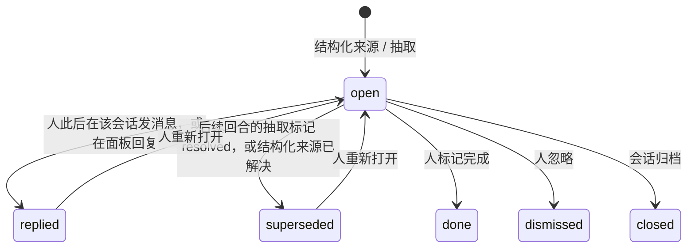

# Agent 待交互事项：被动识别与抽取（DEV-079）

日期：2026-10-29。仅调研与设计，无产品代码。事项记录见 [DEV-079](../devlog/DEV-079-agent-decision-inbox.md)。

> 方向说明：前两稿分别按“提问收件箱”和“决定记录（T0/T1/T2，Agent 默认自主执行）”设计，后者的 P0 曾改动 foundry Skill 和会话提示，已被用户否决并完全回滚。用户原话：不要加 “Decide; do not ask”，不要影响 Agent 的行为；真正想要的是把需要交互的内容识别、抽取出来；不想约束 Agent，也不想改变它们平常的做法。本稿据此重写。

> 2026-10-29 本人决定：只做 P1（结构化来源 + 「待处理」页，不调用模型）；P2 文本抽取因模型成本暂不做，以后可能由 Foundry 系统内的低成本模型承担；P3 旧对话补抽不要。P1 已上线，实现与证据见 [DEV-079](../devlog/DEV-079-agent-decision-inbox.md)。

## 结论（先看这里）

**值得做：一个只读、事后的“待交互事项”面板。Foundry 不改 Agent 的提示词、Skill、工具说明和行为，只从已经产生的对话里识别需要人回应的内容，连同上下文抽出来，人可以在面板里直接回复。**

1. **原则：零改动 Agent。** 不新增 Agent 工具，不改 Skill 和会话提示，也不改 `ask_person` 的说明。Agent 照常提问、照常写长回复；识别全部在 Agent 之外完成。
2. **先用结构化来源，不需要推理。** 包括 DEV-063 问题卡片（Codex `request_user_input`）、Issue `ask_person`、失败或阻塞的回合，以及表明“需要人动手”的工具错误。Claude `AskUserQuestion` 目前不开放，开放后按同样方式接入。
3. **自由文本靠抽取器。** 抽取器只在回合结束时运行，只读最终回答。先用便宜的正则预过滤（问号、“需要你 / 请确认 / 要不要 / should I / do you want”、选项列表），命中的回答再批量交给小模型。抽取器本身是一个 Foundry 会话（与命名、摘要会话同类），经 Claude Agent SDK 或 Codex CLI 运行，不直接调用模型接口。每个工作区可以单独开关。
4. **每一项都带上下文，不是一句话。** 每项包含：原文段落的逐字摘录；Agent 写的选项和推荐（原文）；指向那条消息的深链接；来源会话和时间。
5. **生命周期自动推进。** 人之后在该会话里回复，或后续回合取代了这一项（由抽取器或人的回复判断），这一项就自动解决；也可以手动标记完成或忽略。同一事项在多条回复里重复出现时，按相似度合并为一项，保留每次出现的链接。
6. **界面：侧栏一个页面，加上每个对话的计数。** 默认不发任何新通知。在面板里回复，会作为普通用户消息发回来源会话（DEV-057 收件箱），并引用这一项的摘录。
7. **分期**：P1 结构化来源、存储、页面与回复，约 4 人日；P2 文本抽取，约 4–5 人日；P3（可选）旧对话补抽和 Feishu 摘要，约 2 人日。

待决问题只有 4 个，每个都附推荐默认，见文末。

## 1. 问题与证据

用户原话（2026-10-29）：Agent 常给我 TODO / 确认项，我还没来得及看就被别的内容刷走；回来时每项只剩一句话，没有上下文，没法决定。

本仓库编排会话就是一个实例（只读查看其 `Response stream` 事件）：一天内有 32 条回复含“需要你……”。同一批事项（轮换一项代理凭据、给上游提 issue、清理过期数据、CDN 源站加固、接受邀请）分散在不同时间的长回复里，每次都被重新列成一句话，用户只好回头问“这是什么意思”。

**根因**：需要交互的内容只是对话正文中的一句话，没有身份、没有状态、没有到原文的链接，会被滚动刷走，被转述时还会丢掉上下文。要解决的是“找得到、看得懂、能就地回应”。是否让 Agent 少问，不在本设计范围内。

| 事项（当天的实际例子） | 在面板里的样子                                                                                      |
| ---------------------- | --------------------------------------------------------------------------------------------------- |
| 轮换那项凭据           | 文本抽取一项：摘录 Agent 写的原因和步骤，带回原消息的链接；三次出现合并为一项，标注“出现 3 次”      |
| 给上游提 issue         | 文本抽取一项：摘录草稿位置和 Agent 的推荐；人在面板回“提吧”，作为用户消息发回编排会话               |
| 清理过期数据行         | 文本抽取一项：Agent 写的选项（删除 / 保留）原样列出；人后来在会话里直接回复，这一项自动标为“已回复” |
| Codex 回合中的问题卡片 | 结构化一项，不需要模型；卡片作答或会话里回复后自动解决                                              |

## 2. 业界做法（对照）

借鉴的是**格式**：每项自包含、有状态、链接到来源、可以就地处理、可以暂缓、可以合并重复。不借鉴的是让 Agent 停下来等人，因为本设计不改变 Agent 的行为。

| 产品 / 机制                                                                                                                                                                                                                                                                                                                                              | 每项保存的内容                                        | 对本设计的启发                                                                                                                         |
| -------------------------------------------------------------------------------------------------------------------------------------------------------------------------------------------------------------------------------------------------------------------------------------------------------------------------------------------------------- | ----------------------------------------------------- | -------------------------------------------------------------------------------------------------------------------------------------- |
| [LangChain Agent Inbox](https://github.com/langchain-ai/agent-inbox) / [LangGraph `HumanInterrupt`](https://reference.langchain.com/python/langgraph.prebuilt/interrupt/HumanInterrupt)                                                                                                                                                                  | 动作和参数、Markdown 描述；可以接受、编辑、回复、忽略 | 卡片自带上下文；有“回复”和“忽略”两种处理方式                                                                                           |
| [OpenAI Agents SDK HITL](https://openai.github.io/openai-agents-js/guides/human-in-the-loop/)                                                                                                                                                                                                                                                            | `needsApproval` 的工具调用进入 `interruptions`        | SDK 不负责通知和集中查看（[评论](https://thehandover.xyz/blog/openai-agents-sdk-needs-approval)），正是面板要补的部分                  |
| [MCP Elicitation](https://modelcontextprotocol.io/specification/2025-06-18/client/elicitation)                                                                                                                                                                                                                                                           | 消息加表单；响应为 accept / decline / cancel          | 结构化问题可以直接映射成卡片                                                                                                           |
| [Claude Code `AskUserQuestion`](https://code.claude.com/docs/en/agent-sdk/python)                                                                                                                                                                                                                                                                        | 1–4 个问题；选项带说明，推荐项标 “(Recommended)”      | 选项和推荐原样展示；Foundry 目前不开放，开放后作为结构化来源                                                                           |
| Codex `request_user_input`（[#37472](https://github.com/openai/codex/issues/37472)）、DEV-063 问题卡片                                                                                                                                                                                                                                                   | 问题加选项；异步时回合结束未作答显示 “已按假设继续”   | 已经是结构化数据，直接进面板                                                                                                           |
| [Devin](https://docs.devin.ai/release-notes/overview)、[Cursor](https://cursor.com/changelog/1-5)                                                                                                                                                                                                                                                        | 会话级状态（“Awaiting instructions”“需要输入”）加通知 | 反例：只说明“在等你”，不说明等什么（[第三方通知](https://github.com/dennisonbertram/rakazo/pull/544)读不到问题时只能写“正在等你回答”） |
| [Linear Inbox](https://linear.app/docs/inbox)、[Notion Inbox](https://www.notion.com/help/updates-and-notifications)、[Slack Later](https://slack.com/help/articles/360042650274-save-messages-and-files-for-later)、[Jira 审批](https://support.atlassian.com/jira-service-management-cloud/docs/approve-or-decline-a-request-from-the-new-issue-view/) | 来源链接、状态、暂缓、就地处理                        | 页面交互：链接回原处、就地回复、完成 / 忽略、合并重复                                                                                  |
| [Renovate Dependency Dashboard](https://docs.renovatebot.com/configuration-options/)                                                                                                                                                                                                                                                                     | 一个持续更新的面板，列出等待人处理的项目              | 面板是自动生成、自动更新的视图，人不需要手动维护                                                                                       |

## 3. 来源

### 3.1 结构化来源（不需要推理）

| 来源                                 | 在哪里                                                        | 何时生成                                                                                                                   | 何时自动解决                             |
| ------------------------------------ | ------------------------------------------------------------- | -------------------------------------------------------------------------------------------------------------------------- | ---------------------------------------- |
| DEV-063 问题卡片                     | `ChatStep.Questions`（`Delivery: "async"`，`store/chats.go`） | 回答步骤写入时；每个问题一项，选项原样带上                                                                                 | 卡片作答，或人此后在该会话发消息         |
| Claude `AskUserQuestion`             | 目前不开放；开放后读取对应工具调用的输入                      | 工具调用时                                                                                                                 | 同上                                     |
| Issue `ask_person`                   | `Issue.Question`（`issue_questions.go`）                      | Issue 进入等待人回答                                                                                                       | Issue 收到回答，或 Issue 关闭            |
| 失败或阻塞的回合                     | 会话状态 `failed` / `blocked` 及失败原因                      | 回合以失败或阻塞结束时                                                                                                     | 该会话之后有成功的回合，或会话被归档     |
| “需要人动手”的工具错误（确定性规则） | 回合内最后一次失败、且之后没有成功重试的工具结果              | 回合结束时匹配：sudo 要求密码、工作区外 `EACCES`、`401/403`、登录过期、`Foundry gateway:` 拒绝、“请在 Connectors 重新授权” | 同一工具之后成功，或人此后在该会话发消息 |

工具错误的规则只是确定性的字符串匹配，不调用模型；规则表放在 Server 里，可以单独测试。

### 3.2 自由文本抽取

**触发**：只在回合结束时运行，只读这个回合的最终回答，不读工具输出，也不读中间步骤。

**预过滤**（Server 端，正则，不花模型用量）。先去掉代码块和引用块，然后满足以下任一条件才进入抽取：

- 句末是 `?` 或 `？`。
- 含有关键词：需要你、请确认、要不要、是否、你来决定、等你、需要你动手、should I、do you want、would you like、let me know、please confirm、need you to。
- 含有选项列表：“方案 A / B”“选项一 / 二”，或编号列表与“或 / or / 还是”同时出现。

用当天编排会话的回答做抽样标注（P2 第一步），用来确定关键词表并估算命中率。

**执行**：

- 抽取器是 Foundry 自己启动的一种只读提示会话，`source: "extract"`，与命名、摘要会话同类：没有任何工具，只读提示中的数据，不出现在对话列表里。
- 它经 Claude Agent SDK 或 Codex CLI 运行（遵守 AGENTS.md：所有模型请求都走 Agent 自己的 SDK 或 CLI），不直接调用 `/messages` 等接口。
- 它在来源会话所在的设备上运行，用同一运行时可用的最小模型（Claude Haiku 级或 Codex mini 级）。该运行时没有小模型时就跳过抽取，不退回大模型。

**批量**：按工作区排队，每 5 分钟或满 10 条回答处理一批，一个抽取会话处理一整批。每条回答最多截取 8 KB。同时附上该会话当前未解决的项目（只带标题和 id），用来判断重复和取代。

**输出**（JSON schema 约束，Server 校验）：

```jsonc
{
  "items": [
    {
      "answerRef": "evt_…", // 这一批中的哪条回答
      "excerpt": { "start": 1520, "end": 2210 }, // 原文中的字符区间；Server 取原文，保证是逐字摘录
      "title": "轮换代理凭据", // ≤ 40 字，只用于列表显示；卡片正文始终是原文摘录
      "options": ["现在轮换", "下周统一轮换"], // 只能是原文里出现的选项，Server 校验是否为原文子串
      "recommendation": "现在轮换", // 原文里 Agent 的推荐；没有就留空
      "sameAs": "itm_…", // 与已有项是同一件事
    },
  ],
  "resolved": ["itm_…"], // 这条回答表明已经做完或不再需要的已有项
}
```

摘录、选项和推荐都必须能在原文中找到，否则丢弃。这样既防止抽取器改写原意，也防止回答里夹带的指令借抽取器生效：抽取器没有工具，它的输出只是经过校验的数据。

**开关**：工作区设置“待交互事项识别”，分三档：关闭、仅结构化来源、结构化来源加文本抽取。抽取用量计入该设备的登录，在用量页按 `extract` 单独列出。每个工作区每天的抽取会话数有上限（默认 48 次）；达到上限后改为每 30 分钟一批，不丢弃回答。

## 4. 每一项的内容

| 字段     | 内容                                                                                  |
| -------- | ------------------------------------------------------------------------------------- |
| 摘录     | 原文所在段落的逐字摘录，加上它所属的小标题；卡片默认显示 4 行，可以展开               |
| 选项     | Agent 写的选项和推荐，原文照录；结构化来源取问题卡片的选项                            |
| 链接     | 到那条消息的深链接（会话 id 加消息 id）；Web 还没有消息定位功能的话，P1 补上          |
| 来源     | 来源会话及其标题、工作区、时间、来源类型（问题卡片 / Issue / 失败 / 需要动手 / 文本） |
| 出现次数 | 合并后每次出现的时间和链接                                                            |

数据表 `interaction_items`（`sqlitestore/interaction_items.go`）的字段：

- 归属：`id`、`user_id`、`workspace_id`、`session_id`、`event_id`、`source`。
- 内容：`title`、`excerpt`、`options_json`、`recommendation`。
- 状态：`state`、`resolution`（谁、何时、怎样解决）、`occurrences_json`、`similarity_key`、`extract_run_id`。
- 时间：`created_at`、`updated_at`。

一项能不能看到，跟随来源会话的读取权限。

## 5. 生命周期



- **人的回复**：人在来源会话中发出消息后，该会话中更早的未解决项标为“已回复”。这个规则简单、可预测；启用文本抽取时，下一批抽取再判断这次回复是否真的回应了它，没有回应就改回未解决。
- **取代**：后续回合的抽取在 `resolved` 中列出它，或者结构化来源自身已解决（卡片作答、Issue 回答、回合成功）。
- **合并**：先看抽取器给出的 `sameAs`。没有时退回到便宜的相似度：同一工作区、7 天内、标题字符三元组 Jaccard ≥ 0.6。合并后保留所有出现，卡片标注“出现 3 次”。
- **手动**：完成、忽略、重新打开。“已解决”的项在页面里保留 7 天，可以查看。

## 6. 界面

**侧栏**（`navigation.ts` 新增 `interactions` 视图，使用前进箭头）：

```
┌ 侧栏 ───────────────────┐
│ 对话                     │
│ Issues                   │
│ 待处理            3  ›   │   ← 未解决项的数量；只显示数字，不发通知
│ Workspaces            ›  │
└─────────────────────────┘
```

**待处理页**（1280 宽）：

```
待处理                                   [全部工作区 ▾] [来源 ▾] [搜索]
── 编排会话 · 2 ──────────────────────────────────────────────────────
│ 轮换代理凭据                       文本 · 14:02 · 出现 3 次          │
│ > 那串凭据曾以明文出现在本机对话记录里，记录已抹掉；但服务商侧仍有效，│
│ > 建议在后台生成新凭据后粘贴到 Connectors…                    展开 ▾ │
│ 选项：现在轮换（推荐） · 下周统一轮换                                │
│ [回复…]  [打开原消息 ›]  [完成]  [忽略]                              │
│ 给上游提 issue                     文本 · 11:40                      │
│ …                                                                    │
── DEV-076 会话 · 1 ─────────────────────────────────────────────────
│ 预览域名用哪种格式？               问题卡片 · 10:15                  │
│ 选项：每服务一级子域 · 三级域名                                      │
│ [每服务一级子域] [三级域名] [回复…]  [打开原消息 ›]                  │
── 最近已解决 · 7 天 ─────────────────────────────────── 折叠 ▸ ─────
```

- **回复**：在卡片里写一句话，作为普通用户消息发回来源会话，经 DEV-057 收件箱，按 `boundary` 投递。消息开头引用摘录（`> …`），这样即使对方会话已经压缩过上下文，也知道在回应什么。卡片显示投递回执。会话空闲时，这条消息照常开始一个新回合，与人在对话里直接发消息完全一样。
- **选项按钮**：点一下，把“关于「标题」：选择 X”填进回复框，仍由人确认后发送。
- **对话页**：对话列表中，每个对话显示未解决项的数量。对话标题栏下方有一行“2 项待处理 ›”，打开一个只含该对话项目的抽屉。对话正文不做任何改动。
- **通知**：默认不发。现有通知（Feishu、DEV-071 提示）保持不变。
- **键盘**：`j/k` 切换，`Enter` 展开，`r` 回复，`o` 打开原消息，`d` 完成，`x` 忽略。
- **窄屏（390）**：卡片全宽，按钮换行；回复框在底部固定。
- **无障碍**：标题是可聚焦的 `button`；来源用文字标出，不只靠颜色；数量变化通过 `aria-live="polite"` 播报；light/dark 下选中项和悬停项都能分清。

## 7. 分期与估算

| 期         | 内容                                                                                                                                                                                                                                                                | 估算        |
| ---------- | ------------------------------------------------------------------------------------------------------------------------------------------------------------------------------------------------------------------------------------------------------------------- | ----------- |
| P1         | `interaction_items` 表和迁移；从问题卡片、Issue 问题、失败回合、工具错误规则生成项；自动解决；`/api/interactions` 路由；Web：侧栏页面、对话计数和抽屉、面板回复（DEV-057）、消息深链接；工作区开关；中英文文案；单测和真实浏览器 E2E（light/dark × 1280/390、键盘） | 约 4 人日   |
| P2         | 预过滤和标注样本（编排会话 2026-10-29 当天的回答）；`extract` 会话类型（Worker，仿照 `naming` / `digest`）；批量调度和每日上限；schema 与原文子串校验；合并与取代；用量单列；用样本评估精确率和召回率                                                               | 约 4–5 人日 |
| P3（可选） | 对旧对话手动补抽（按钮触发，同一抽取器，默认只抽最近 7 天）；Feishu 每日摘要（默认关闭）                                                                                                                                                                            | 约 2 人日   |

## 8. 风险

| 风险            | 表现                                                                         | 对策                                                                                                                                       |
| --------------- | ---------------------------------------------------------------------------- | ------------------------------------------------------------------------------------------------------------------------------------------ |
| 抽取不准        | 误报：反问句、复述人的问题、示例文本；漏报：没有问号的祈使句（“请在后台……”） | 卡片是原文摘录，误报一键忽略，代价低；忽略记录用来调整预过滤；P2 用标注样本设定目标（精确率 ≥ 0.8，召回率 ≥ 0.8），达不到就只开结构化来源  |
| 成本            | 每次命中预过滤的回合都要花一次小模型用量                                     | 正则预过滤、批量、小模型、截断 8 KB、每日上限、工作区开关；用量单列，可以看到花了多少                                                      |
| 隐私            | 摘录被另存一份                                                               | 抽取在来源会话的同一设备、同一登录下运行，不发往新的服务；摘录存在已经保存这段对话的同一个库里，权限跟随来源会话；会话删除或归档时一并处理 |
| 提示注入        | 回答里的文本试图影响抽取器                                                   | 抽取器没有工具；输出必须符合 schema，且摘录、选项必须是原文子串                                                                            |
| 延迟            | 文本抽取最多晚 5 分钟出现                                                    | 结构化来源实时出现；文本项本来就不紧急                                                                                                     |
| 误改 Agent 行为 | 后续实现时又往提示词或 Skill 里加约定                                        | 本设计明确不改；P1、P2 的检查项之一是 foundry Skill 修订号和会话提示没有变化                                                               |

## 9. 衡量指标

- **找得到**：从生成到解决的时长；通过面板回复所占的比例。
- **看得懂**：人回头问“这是什么意思”的次数（基线：编排会话 2026-10-29 当天）。
- **抽得准**：文本项的忽略率；标注样本上的精确率和召回率。
- **花得少**：每个工作区每天的抽取会话数和用量。

## 待决问题（每项都有推荐默认）

1. **文本抽取默认开不开**：推荐本人拥有的工作区默认开启“结构化来源加文本抽取”，其他工作区默认“仅结构化来源”；每个工作区都可以改。
2. **“人回复了”是否就算解决**：推荐算，标为“已回复”，可以重新打开；启用文本抽取时由下一批抽取复核。
3. **抽取用哪个模型**：推荐使用来源会话同一运行时中最小的模型；没有就跳过，不退回大模型。
4. **通知**：推荐默认不通知，只显示侧栏计数；Feishu 每日摘要放在 P3，默认关闭。
