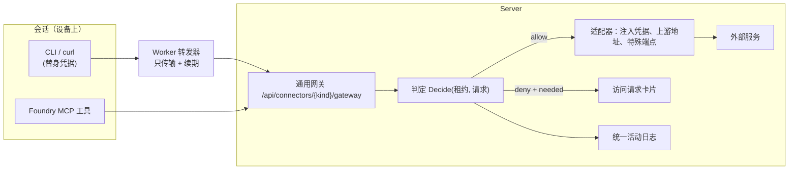

# 连接器：Cloudflare 写入的根本修复与统一封装方案（2026-10-30）

[连接器](../connectors.md) · [Roadmap](../roadmap.md)

状态：方案稿，待本人决定第 8 节的问题；未改代码。

## 1. 结论

- **这次写不进去的根因**：判断“能不能写”的地方不止一处。服务器按工作区绑定的级别判断（已是 `dns_edit`），但 Worker 的本地转发器和服务器的网关路由各自又写死了“只读”，会话还从 Worker 写死的说明里得知“只能读”。三处里只有一处看了你的设置。
- **根本修复的原则**：**只有服务器做决定，其他环节只传话。** 会话无论走 MCP 工具还是 `cf`/curl，都进同一个判断函数。Worker 不判断读写，也不写死能力说明。
- **封装现状**：设备持有型（bytedcli、AWS）基本抽象好了；Server 持有型（飞书、Cloudflare）几乎没有抽象。两个网关、两种替身、两套审计、两套策略写法、两套页面；Cloudflare 还借用了飞书命名的授权表。“可用范围”和“访问级别”只有 Cloudflare 有，而且只在 Cloudflare 的专用面板里。
- **方向**：做法与 Nango / Pipedream / Composio、GitHub App、Fly.io Tokenizer 一致，归结为五个通用对象：**连接器描述 → 身份 → 工作区授权（范围 + 级别）→ 会话租约 → 统一网关与判定**。每种连接器只用一个适配器回答少数几个问题。页面由描述数据驱动，不再每种一套面板。

## 2. 这次的问题，按链路看

```
入口 A  会话 ─ MCP cloudflare 工具 ─▶ Server mcpCloudflare ─▶ RequestSession（看级别）─▶ Cloudflare   ✅ 能写
入口 B  会话 ─ curl/cf ─▶ Worker 转发器 ✗GET only ─▶ Server GET-only 路由 ─▶ ReadHandle → ReadSession ✗只读
说明    Worker 注入："The Cloudflare MCP tool and official cf CLI can read only …"（写死，不看级别）
```

| 位置                                                        | 现状                                                       | 性质                    |
| ----------------------------------------------------------- | ---------------------------------------------------------- | ----------------------- |
| `packages/worker/src/connectors/cloudflare.ts:105`          | 转发器 `methods: ["GET"]`，其余方法本地返回 "read-only"    | Worker 越权做了策略判断 |
| `apps/server/internal/httpapi/routes.go:471`                | 网关只注册 `GET …/gateway/{path...}`                       | 入口和判定绑死          |
| `apps/server/internal/httpapi/cloudflare_connectors.go:141` | 网关只调 `ReadHandle`，从不经过 `RequestSession`           | 两个入口两套逻辑        |
| `packages/worker/src/connectors/cloudflare.ts:132`          | 会话说明写死“只能读”                                       | 能力说明与真实级别脱节  |
| `connectors/cloudflare_writes.go:78`                        | `RequestSession` 的 GET 丢弃 query                         | 统一入口前要补          |
| `connectors/cloudflare_gateway.go:184`                      | `/zones` 只接受 page/per_page，`cf zones list --name` 被拒 | 与 CLI 常见用法不符     |

DEV-092 把写入只接到入口 A，把入口 B 记为“限制”，同时在页面上给出“Read + DNS edit”。界面的承诺比实现宽。会话的最后一次尝试（`sess_1793277998160628174`，15:09Z）走的是入口 B，POST 在 Mac 本地被拦，服务器活动表里没有这次记录。

## 3. 根本修复（第一步，范围小，先做）

目标：任何入口都由服务器的同一个函数判定；级别一改，下一次请求立即生效，不需要新开会话。

1. **服务器网关接受所有方法，统一走 `RequestSession`。** 路由改为 `GET|POST|PATCH|PUT|DELETE /api/connectors/cloudflare/gateway/{path...}`。凭替身找到会话租约后，调用与 MCP 相同的 `RequestSession(method, path, query, body)`。`RequestSession` 补上 GET 的 query。body 沿用 16 KiB 上限。
2. **拒绝的答复可被机器读。** 返回 Cloudflare 形状的 403，同时带结构化字段，例如 `{"errors":[{"code":403,"message":"…needs dns_edit…"}],"foundry":{"needed":"dns_edit","where":"Connectors → <workspace> → Cloudflare"}}`。会话因此能准确告诉人缺什么，第 5.6 节的“请求授权”卡片也直接用它。
3. **Worker 转发器只做传输。** 删除 `methods` 白名单，只保留：替身校验、替身续期、附加设备凭证、拒绝 WebSocket upgrade。Worker 不再知道“读”和“写”。
4. **能力说明由服务器生成。** `ExternalAccountMaterial` 增加 `access`（级别名）和服务器渲染好的一句能力说明，Worker 原样拼进会话说明，并附上“级别可能在会话中被调整，以 `cloudflare accounts` 为准”。Worker 代码里不再出现“read only”。
5. **`/zones` 支持 `name` 过滤**：只在已绑定的 zone 中匹配，不扩大枚举。
6. **合同测试**：仿照飞书的 `external_accounts_cli_contract_test.go`，用真实 `cf` 0.14.0 经真实转发器和网关对假 Cloudflare 跑以下场景：
   - read 级别 POST 被拒，返回结构化原因；
   - 切到 dns_edit 后，同一会话不重启即可 POST、PATCH、DELETE；
   - 活动日志逐条记录；
   - 替身过期后续期。
7. **发布**：Worker 声明 `cloudflare_gateway_v2`。旧 Worker 仍在本地拦写入，但服务器侧已正确，MCP 入口照常可写。Mac（`dev_d783b240…`）需要更新 Worker，设备空闲时更新或经你同意。

这一步不改数据模型，也不改页面。下文的统一方案会把同样的“单点判定”推广到所有连接器。

## 4. 现有封装评估

### 4.1 做得好的

- **设备持有型的适配器抽象成立。** Worker 的 `DeviceHeldAdapter`（读版本、读登录、发起/完成登录、登出、安装）加 `catalog.json` 描述，bytedcli 和 AWS 共用以下部分：
  - 服务器的通用路由 `/api/devices/{id}/connectors/{kind}/…`；
  - `device_connector_states` / `device_connector_bindings`；
  - Web 的 `DeviceHeldConnector`。
- **模块边界清楚**：`internal/connectors`、Worker `connectors/index.ts`、Web `features/external-accounts`，由 `audit-module-boundaries` 检查。
- **凭据不出服务器**（Server 持有型）和**替身 + 设备凭证双因素**的思路正确，与业界的 credential-injecting proxy 一致（见第 5 节）。

### 4.2 问题：Server 持有型没有抽象，每种连接器自成一套

| 方面              | 飞书                                                   | Cloudflare                                                              | 问题                                                 |
| ----------------- | ------------------------------------------------------ | ----------------------------------------------------------------------- | ---------------------------------------------------- |
| 网关              | `internal/feishugateway`（`/api/feishu-gw/*`，734 行） | `connectors/cloudflare_gateway.go` + `cloudflare_writes.go`             | 两个网关，鉴权、限流、审计各写一遍                   |
| 会话替身          | `fsg_/fsu_/fsr_/fst_`，表 `feishu_gateway_grants`      | `fdycf_user_`，**借用** `feishu_gateway_grants`，填假 `unused-app` 哈希 | 没有通用“会话租约”                                   |
| 策略写法          | 在已授 scope 内透传 + 黑名单                           | 路径白名单 + 级别规则                                                   | 同一个问题（能做什么）有两套表达                     |
| 范围（resources） | 无                                                     | zone 列表，存在 `external_account_bindings.resource_ids`                | 只有 Cloudflare 有，AWS profile、bytedcli 站点都没有 |
| 级别（access）    | 无                                                     | `read` / `dns_edit`                                                     | 同上                                                 |
| 审计              | `feishu_gateway_requests`                              | `external_account_events`（kind `cloudflare_*`）                        | 两张表，设备持有型没有审计                           |
| 入口              | `feishu-cli` profile + MCP `feishu_events`             | `cf` 环境变量 + MCP `cloudflare`                                        | 每种自己决定入口，判定逻辑随入口复制（这次的根因）   |
| 会话说明          | Worker `feishu.ts` 写死                                | Worker `cloudflare.ts` 写死                                             | 说明与真实能力脱节                                   |
| HTTP 路由         | `/api/external-accounts/*`、`/api/feishu/*`            | 另有 8 条 `/api/connectors/cloudflare/*`                                | 每种自己的 API                                       |
| Web               | `feishu-connector` 等约 1.8k 行                        | `cloudflare-*` 约 1.4k 行（账号卡、权限、活动、访问各一套）             | 每种一套面板和表单                                   |

另外两处设计问题：

- **工作区授权放在了身份页上。** 截图中的 “Workspace access” 是 Cloudflare 全局页里的工作区下拉加 zone 勾选加级别单选。飞书的工作区绑定却在工作区的 Connectors 页。同一个概念出现在两个地方，也违反“一页一对象”（AGENTS.md UI 原则）。
- **设备持有型的“级别”目前无法强制。** 凭据在设备上，会话以设备用户运行，只能做到防误用。统一模型里必须如实标明 `enforced: false`，不能在页面上给出同样的单选，让人以为它和 Cloudflare 一样受控。

## 5. 业界做法

| 方案                                                                                                                                | 核心对象                                                                                                          | 可借鉴                                                                            |
| ----------------------------------------------------------------------------------------------------------------------------------- | ----------------------------------------------------------------------------------------------------------------- | --------------------------------------------------------------------------------- |
| [Nango](https://nango.dev/docs/getting-started/intro-to-nango.md)                                                                   | Integration（声明式 provider 配置）→ Connection（每人一份）→ 认证代理；Agent Session 限定可用的连接和工具及有效期 | provider 差异写成数据；**一个**代理对所有 provider 注入凭据；会话级授权有显式到期 |
| [Pipedream Connect](https://pipedream.com/docs/connect/api-proxy)                                                                   | 每个外部用户多个 connected account；同一账号同时提供 API Proxy、Actions、MCP 三种入口                             | **多个入口共用同一份账号与鉴权**，不是每个入口一套                                |
| [Composio](https://docs.composio.dev/docs/authentication/controlling-scopes)                                                        | Auth config（同一 toolkit 可有只读和全权两份）→ Connected account → Session 限定 toolkits/tools                   | “级别”是一份显式配置，可以有多份；session 决定用哪份                              |
| [Arcade](https://docs.arcade.dev/home/auth/auth-tool-calling) / [Auth0 Token Vault](https://auth0.com/ai/docs/intro/token-vault.md) | 每个工具声明所需 scope；缺权限时在调用时中断，引导用户授权（JIT），每次调用都检查                                 | **缺权限是可恢复的中断**：拒绝里带“缺什么”，产品据此发起授权，而不是让 Agent 去猜 |
| [MCP 授权规范 2025-11-25](https://modelcontextprotocol.io/specification/2025-11-25/basic/authorization)                             | 403 `insufficient_scope` + 所需 scope → 客户端 step-up 重新授权                                                   | 拒绝答复**机器可读**，写明所需级别                                                |
| [GitHub App](https://docs.github.com/en/rest/apps/apps)                                                                             | Installation = (App, 账号) + 选定仓库 + 权限级别；每次签发短期 token 时还能再缩小到部分仓库与权限                 | 与我们的“工作区授权 = 身份 + zone + 级别、会话租约再缩小”同构                     |
| [Fly.io Tokenizer](https://fly.io/blog/tokenized-tokens/)                                                                           | 应用只拿密封的 token，代理解封并注入真实凭据，密封 token 自带 `allowed_hosts` 等限制                              | 我们的替身 + 网关就是这个模式；**限制跟着凭据走、在代理处统一执行**               |
| [GCP Credential Access Boundaries](https://cloud.google.com/iam/docs/create-downscoped-short-lived-credentials)                     | token broker 用高权限凭据签发按资源降权的短期 token                                                               | 将来 AWS（STS session policy）可走“降权 token”路线，让设备持有型也有可执行的级别  |

共同点：**连接器差异写成数据加小适配器；授权是“身份 × 使用方 × 范围 × 级别”的一条记录；所有入口共用一个判定点；缺权限返回机器可读的拒绝，由产品发起授权。**

## 6. 目标架构



### 6.1 五个通用对象

| 对象                   | 内容                                                                                                                                                               | 现有对应                                                      |
| ---------------------- | ------------------------------------------------------------------------------------------------------------------------------------------------------------------ | ------------------------------------------------------------- |
| **连接器描述**（数据） | kind、持有方式、登录方式（设备码 / OAuth / CLI / 本地）、工具与入口、**资源类型**（zone、profile、站点、租户）、**级别表**（名称、所需上游 scope、是否可强制执行） | `catalog.json` + `Provider.Describe()`，合并为一份            |
| **身份**               | 一个人在该服务上的一份登录，Server 持有或设备持有                                                                                                                  | `external_accounts`、`device_connector_states`                |
| **工作区授权**         | (身份, 工作区) → 资源列表 + 级别 + 谁能用（本人 / 成员）                                                                                                           | `external_account_bindings`、`device_connector_bindings` 合一 |
| **会话租约**           | 会话启动时按授权签发的短期替身；只存哈希；会话结束或授权变更即失效                                                                                                 | `feishu_gateway_grants` 改名并通用化                          |
| **活动**               | 登录、授权变更、每次写入（含被拒），设备持有型的登录与共享变更也记                                                                                                 | `feishu_gateway_requests` + `external_account_events` 合一    |

### 6.2 适配器只回答这几件事

Server 持有型：

- 如何登录、刷新、吊销、读身份。已有 `Provider` 接口，保留。
- 如何列出可选资源（Cloudflare zone、飞书租户）。
- 如何把一个请求解析成 `(资源, 动作)`：Cloudflare 路径 `/zones/<id>/dns_records` + POST 解析为 `(zone <id>, dns.write)`。
- 如何注入凭据、上游地址是什么，以及少数特殊端点：飞书的 token 端点模拟、事件 WebSocket。

**判定不在适配器里**：`Decide` 是通用代码，用“级别表里该级别允许的动作集合”比对适配器解析出的动作。飞书现在的“scope 内透传 + 黑名单”表达为一个级别 `granted`：允许已授 scope 覆盖的一切动作，再扣除黑名单。两种策略写法因此合一。

设备持有型：保持现有 `DeviceHeldAdapter`，补上资源（AWS profile、bytedcli 站点）。级别默认 `full` 并标 `enforced: false`。

### 6.3 入口

- CLI 入口：Worker 为每个租约生成该 CLI 认得的配置（feishu-cli profile、`CLOUDFLARE_API_TOKEN`/`BASE_URL`），转发器只做传输。配置的生成方式写在描述数据里（环境变量模板或 profile 写入器），只有飞书这种需要多文件 profile 的才用代码。
- MCP 入口：一个通用工具 `connector_request(kind, accountId, method, path, query, body)`，加上 `connector_accounts`（列出身份、资源、当前级别）。Cloudflare 专用工具保留为别名，一段时间后移除。新连接器默认不再新增专用工具。
- 两个入口进同一个 `Decide`，同一份活动日志。

### 6.4 会话说明

服务器根据租约渲染说明：身份、资源、当前级别允许什么、被拒时怎么办。Worker 只拼接。说明末尾统一写明：级别可能在会话中调整，以 `connector_accounts` 为准；被拒时把原因告诉本人，不要建议改用其他凭据。这次会话就反复建议本人去建 API 令牌、存钥匙串。

### 6.5 页面（数据驱动，不再每种一套面板）

- **Connectors（全局）**：每种连接器一个 Tab。内容是通用的“身份卡”列表，包括状态、身份、已授权限摘要、活动，以及“重新授权”和“断开”。只有**登录方式**是插槽：二维码、OAuth 跳转、设备码、AWS 浏览器登录各一个小组件。身份卡不再包含工作区选择。
- **工作区 → Connectors**：通用的“授权”编辑器，每行是一份工作区授权：身份、资源多选（数据来自适配器的列资源）、级别单选（来自级别表，所需 scope 不足时禁用并说明如何重新授权）、谁能用。飞书、Cloudflare、AWS、bytedcli 共用同一组件。全局身份卡上显示“已用于 N 个工作区”，并链接到对应工作区。
- 现有的 `cloudflare-access`、`cloudflare-account-card`、`cloudflare-activity`、`cloudflare-scopes` 并入通用组件，成为通用组件的第一批实现，不重写行为。

### 6.6 缺权限时：由产品发起授权（step-up）

会话被拒时，判定返回 `needed: {kind, account, workspace, level}`。服务器为这次会话生成一条“访问请求”，在对话里显示卡片，例如：“这个会话想在 strangeoutlier.com 新增 DNS 记录，需要工作区 X 的 Cloudflare 授权为 ‘只读 + DNS 编辑’。[授予] [查看详情]”。

- 本人点“授予”，就等于在工作区 Connectors 页把级别改为该值，同样记入活动。
- 如果所需 scope 本身没授，卡片改为引导重新授权。
- 会话随后重试即可。

这样就不需要人去各个面板里找开关，也避免 Agent 猜测原因。这次排查花的时间，大部分就在“到底哪里没开”。

## 7. 分阶段

| 阶段 | 内容                                                                                                                                 | 依赖             |
| ---- | ------------------------------------------------------------------------------------------------------------------------------------ | ---------------- |
| P0   | 第 3 节：Cloudflare 单点判定、Worker 只传输、说明由服务器渲染、CLI 合同测试；更新 Mac Worker                                         | 无，可立即做     |
| P1   | 服务器核心：通用租约表（迁移 `feishu_gateway_grants`）、`Decide` + 级别表、统一活动日志；Cloudflare 先迁，飞书网关接入同一租约与判定 | P0               |
| P2   | 通用 MCP 工具 `connector_accounts` / `connector_request`；会话说明服务器渲染推广到所有连接器                                         | P1               |
| P3   | Web：数据驱动的身份卡与工作区授权编辑器；工作区授权移到工作区 Connectors 页                                                          | P1（API 稳定后） |
| P4   | 访问请求卡片（step-up）                                                                                                              | P1、P3           |
| P5   | 设备持有型并入同一授权与活动模型；AWS profile、bytedcli 站点作为资源；AWS 降权（STS session policy）评估                             | P1               |

每阶段单独可验收，P0 不等后续。

## 8. 需要本人决定

1. **工作区授权在哪里编辑**：建议只在“工作区 → Connectors”，全局身份页只读展示和链接。这样截图里的工作区下拉会从 Cloudflare 全局页移走。
2. **访问请求卡片**：是否允许会话在对话里请求提升级别，由本人一键批准？建议做，只对本人自己的会话，批准即修改工作区授权并记活动。
3. **无人值守的使用**（例如证书每 60 天续期）：
   - 建议：定时工作每次起一个会话，经网关续期，凭据始终不出服务器。
   - 另一种：让 Cloudflare 签发一个只限该 zone 的原生 API token 放在设备上。更简单，但违背“设备上没有真实凭据”。
4. **通用 MCP 工具**：是否用 `connector_request` 统一替代各连接器专用工具（保留别名一段时间）？建议是。
5. **P0 先行**：是否先单独做第 3 节（含 Mac Worker 更新），再开始统一封装？建议是。

## 参考

- Nango：<https://nango.dev/docs/getting-started/intro-to-nango.md>、<https://nango.dev/platform/mcp>
- Pipedream Connect API Proxy：<https://pipedream.com/docs/connect/api-proxy>
- Composio scopes / auth configs：<https://docs.composio.dev/docs/authentication/controlling-scopes>
- Arcade 授权的工具调用：<https://docs.arcade.dev/home/auth/auth-tool-calling>
- Auth0 Token Vault：<https://auth0.com/ai/docs/intro/token-vault.md>
- MCP Authorization 2025-11-25：<https://modelcontextprotocol.io/specification/2025-11-25/basic/authorization>
- GitHub Apps installation access token：<https://docs.github.com/en/rest/apps/apps>
- Fly.io Tokenized Tokens：<https://fly.io/blog/tokenized-tokens/>，<https://github.com/superfly/tokenizer>
- GCP 降权短期凭据：<https://cloud.google.com/iam/docs/create-downscoped-short-lived-credentials>
