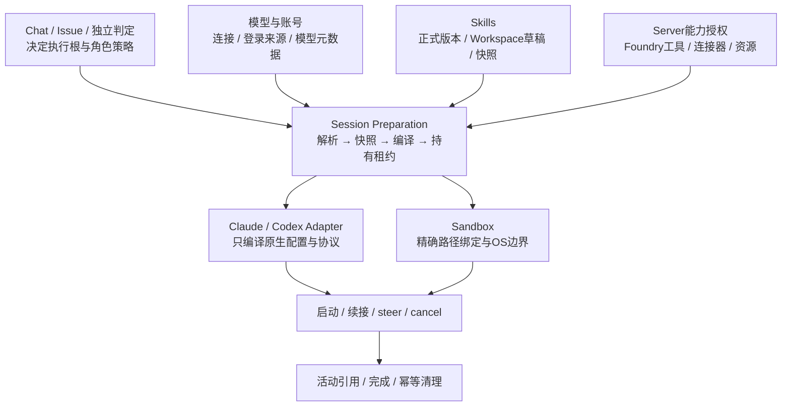

# 会话配置隔离、Workspace Skill 草稿与启动准备重构

[执行内核](execution-kernel.md) · [Skills](skills.md) · [模型与账号](models-and-accounts.md) · [安全边界](security.md)

状态：**实施中**，方案确定于 2026-10-18。第一批基础修复与实测范围见[实施记录](session-isolation-implementation-20261019.md)；Workspace 草稿、固定版本试验与生命周期补齐的实现和实测见[接续记录](session-isolation-drafts-20261019.md)，完整 Issue 准出和发布仍待完成。依据当前工作区代码（含未提交补丁）和本次审查复现编写；不代表所有设备已加载这些实现。本文规定跨模块契约和迁移步骤，各模块文档继续拥有已交付状态。

## 1. 目标与决定

保留原生执行配置隔离，补齐配置、认证和恢复回归；让 Workspace 草稿成为可正式试用的 Skill 来源；将这些能力收口到共同的启动准备流程。普通会话与 Issue 独立判定保留各自入口和策略，共用配置、材料与凭据准备组件。

| 事项     | 本方案的决定                                                                                           |
| -------- | ------------------------------------------------------------------------------------------------------ |
| 配置来源 | Foundry 显式提供运行配置；原生登录来源、原生数据来源、执行配置目录分别建模                             |
| 草稿范围 | **Workspace 范围**，A 创建后 B 可以发现和试用；不要求先发布到库                                        |
| 草稿文件 | 新建统一写 `.agents/skills/<name>/`；现有 `.claude/skills`、`.codex/skills` 作为兼容来源，冲突显式处理 |
| 正式发布 | 仍是独立动作；草稿试用不创建库版本、不改变其他 Workspace 的选用                                        |
| 一次执行 | 绑定不可变的配置与 Skill 快照；运行中不追读可变草稿                                                    |
| 同名草稿 | 不静默覆盖正式选用或固定版本；保留可明确调用的草稿来源                                                 |
| 封装     | 统一准备与生命周期，保留 Claude/Codex 的原生适配差异；不重写两者的 Agent 循环                          |
| 权限范围 | Skill 来源变化不增加文件、网络、连接器、资源或 Foundry 工具权限                                        |

本次不把普通 Chat 改成 OS 沙箱，不新增通用插件框架，不改变 Server 代表本人授权的范围，不把 Issue 判定强行改为可续聊的普通 AgentSession。共享 Workspace 草稿属于可变项目方法，与项目规则一样可能影响其他协作者；界面和项目策略应明确这项信任，不将其冒称为正式发布审核。

## 2. 现状、缺陷和封装评估

### 2.1 当前实现

- `runtime-isolation.ts` 为 Codex/Claude 生成执行目录，链接原生历史，并保留登录来源。目录按来源、账号、profile、连接类型与工作区共享，不按 session 独占。
- `native-homes.ts` 同时被登录检查、恢复和上下文用量代码调用；当前过滤受管目录的补丁混淆了来源与执行路径。
- `session-policy.ts` 同时包含 Claude launch plan、Skill 呈现、MCP 注入、设备说明、settings 文件和 Codex secret 配置。Codex 的组装另在 `runner/codex-options.ts`、`codex-thread.ts`、`codex-app-server.ts`；运行前多次生成环境。
- `skill-isolation.ts` 同时处理提示目录、缺失程序、调用校验、原生盘点和 native session receipt。`skill-materializer.ts` 负责下载及全局缓存。
- `runWorkspaceSession` 服务 Chat、Issue 和协作验证，`startSession` 服务独立判定；后者另行准备 profile、环境和凭据，窗口准备未完整接入。
- Sandbox 已有清晰的 profile 和后端接口；Server 逐调用授权也已有边界，应继续复用。

结论：已有模块划分，但**启动输入的准备契约和资源所有权仍不完整**。模块审计通过不等于同一职责只有一处实现。此次重构优先建立共同契约、消除重复逻辑，再逐步移动文件。

### 2.2 问题清单

| ID  | 性质             | 当前事实                                                                              | 本方案的处理                                                          |
| --- | ---------------- | ------------------------------------------------------------------------------------- | --------------------------------------------------------------------- |
| C1  | 已复现回归       | 自定义原生目录历史存在，却因路径回退被判 `transcript_missing`；相关恢复/fork 回归失败 | 分离 credential/data/config 三种路径，恢复和用量只读实际数据定位器    |
| C2  | 已复现回归       | 隔离移除了用户模型目录，单传 thread 窗口仍被 Codex 未知模型上限截断                   | 统一模型解析，在进程启动前加载受管目录；覆盖 start/resume 和所有入口  |
| C3  | 已复现补丁缺陷   | 模型目录生成器在 Issue 沙箱内写全局状态目录失败                                       | 宿主预先物化，编译准确的进程路径与只读挂载                            |
| C4  | 已复现凭据副本   | 原生 API key login/start 在受管 HOME 写 `auth.json`                                   | 凭据租约统一管理，优先不持久化的原生通道；必要临时文件限时回收        |
| C5  | 已确认覆盖缺口   | 独立判定的模型窗口和目录准备与普通执行不一致                                          | 两种入口共享配置准备；策略仍保持独立                                  |
| S1  | 已复现流程缺口   | 草稿可扫描，但不在派发目录；creator 的写稿、测试、修改无法闭环                        | 增加 Workspace 草稿来源、刷新与试验选择                               |
| S2  | 已复现完整性缺口 | 缓存仅校验 checksum 标记；正文修改后仍被复用                                          | 保存文件清单并复核实际内容，绑定执行快照和只读材料                    |
| S3  | 已确认暴露范围   | 沙箱开放整个 `skill-sets` 根目录                                                      | 仅开放本次精确快照与所需原生官方 Skill 路径                           |
| S4  | 现有语义不足     | 移除 Skill 不清除已进入历史的内容                                                     | 区分停止后续加载与清洁上下文；试验/严格撤销使用新 native session      |
| S5  | 待补验收         | Claude 顶层 Skill 名单仅保证主会话；原生子 Agent 未完整验证                           | 对原生子 Agent 独立验收；不支持可靠约束时禁用该路径或改用受管测试会话 |
| S6  | 已确认维护缺口   | 原生 Skill 验收脚本仍引用已删除的 runner 导出                                         | 改为调用公共准备入口，纳入原生兼容性验收                              |
| A1  | 接口不足         | 原生 HOME、布尔隔离标记、零散环境推导承担隐式上下文                                   | 使用有来源、目标和版本的显式准备结果，不以环境标记证明已经隔离        |

代码证据入口（Worker 源码相对 `packages/worker/src/`）：`native-homes.ts`、`runtime-isolation.ts`、`native-session.ts`、`context-usage.ts`、`agent-runtime/codex-auth.ts`、`agent-runtime/codex-model-catalog.ts`、`session/{index,codex}.ts`、`skill-{isolation,materializer}.ts`、`execution-sandbox.ts`；原生验收在 `packages/worker/scripts/verify-native-skill-isolation.mjs`。Server 的 `apps/server/internal/httpapi/session_dispatch.go` 每轮重新解析正式 SkillRefs，尚无草稿/试验引用。

合入基线前的最小修补：C1 的恢复检查和 Codex 用量跟踪改读实际执行环境中的 HOME；C3 的模型目录在 Issue 内改写可写的执行 scratch。这两处恢复现有行为，尚未实现本方案的数据定位器、宿主预物化和统一准备契约。问题清单保留原始审查事实，后续实施以重构和完整验收为准。

## 3. 隔离保证分别定义

| 层         | 要保证什么                                    | 不作出的承诺                                     |
| ---------- | --------------------------------------------- | ------------------------------------------------ |
| 身份与工具 | Server 从真实 session、发起人、角色逐调用授权 | 父子血缘或 Skill 文本不能授予权限                |
| 配置来源   | 仅加载 Foundry 选定的连接、运行参数和集成     | 不绕过 OS/企业管理策略，不证明后端容量           |
| Skill 加载 | 目录、调用入口和本次方法快照一致              | 普通 Chat 的 Read/Bash 不会因此失去原有文件权限  |
| 内容完整性 | 执行输入可追溯到实际校验的文件内容            | 同一 OS 用户可任意改文件时，哈希缓存不是安全沙箱 |
| 文件系统   | 需要沙箱的角色由 OS 限制写根、读根和治理状态  | 不把配置目录分离称为操作系统隔离                 |
| 历史上下文 | 每条原生对话独立恢复；说明目录变更            | 删除目录项不等于模型忘记旧内容                   |
| 生命周期   | 准备资源有明确持有者、失败清理和活动引用      | 回答结束不等于后台任务、进程和调度全部结束       |

Skill 脚本使用当前执行本来拥有的权限；没有每个 Skill 的独立权限提升。普通 Chat 中仍存在同 UID 文件、环境和凭据可读的边界，本次只减少隐式继承与永久副本，不宣称解决该既有风险。

## 4. 配置隔离契约

### 4.1 三种目录与两种身份

| 对象                     | 负责方         | 用途                                                                        |
| ------------------------ | -------------- | --------------------------------------------------------------------------- |
| `NativeCredentialSource` | 模型与账号模块 | 选中的文件/Keychain/原生登录来源；禁止从受管目录反推并静默回退账号          |
| `NativeDataLocator`      | 原生数据适配   | transcript、索引及必要项目状态的准确位置；支持自定义来源与受管历史链接      |
| `ExecutionConfigHome`    | 启动准备       | Foundry 生成的 settings、CLI 私有执行状态；不作为登录来源                   |
| `RuntimeIdentity`        | 执行内核       | 决定进程能否复用；包括 native thread、账号、连接、CLI generation 和配置摘要 |
| `InputSnapshotIdentity`  | 执行输入       | 本轮模型元数据、Skill、规则与策略的摘要，用于复现和差异解释                 |

目录布局是内部实现，不再让消费方分析路径字符串。登录检查显式取得 source；恢复显式取得 data locator；进程启动显式取得 config home。服务安装/升级只继承已验证的来源配置，不继承 session 生成的 HOME、标记或认证来源环境。

目标共享范围：模型目录、Skill 和无秘密的配置模板可按内容共享；**可写的原生执行 HOME 由一个 runtime owner 独占**，跨 turn 复用时跟随该 owner 存活，不让不同 session 共写 `.claude.json`、认证文件或其他原生运行状态。配置变化时只在安全边界换代。历史依然通过明确的数据来源续接，不能因换执行 HOME 丢失对话。

历史适配还需区分 transcript/索引和会进入提示的原生 memory；不能把整个 `projects` 目录一律归为无行为的数据。目标默认只继承续聊所需的数据，关闭原生目录中的隐式 auto-memory；项目长期规则仍通过显式 Workspace 输入提供。若适配器无法隔开读取范围，应使用原生开关并通过真实 CLI 验证，不靠路径命名推断。

### 4.2 准备、启动与清理

1. 宿主确认运行时 generation 并取得维护租约；从可信派发解析连接、角色策略和路径。
2. 解析模型窗口及其来源，读取本次 CLI 内置模型元数据；获取 Skill/规则快照。
3. 在进入沙箱前物化全部输入，生成准确的 `hostPath → processPath` 绑定。模型目录和 Skill 快照可按内容共享；凭据文件放独立租约目录。
4. 原生适配器编译 argv、SDK options、环境和需要的文件；Sandbox 只消费已经确定的读写根与绑定。
5. 启动、认证、start/resume 后记录原生实际模型/窗口；期望值与实际值分别显示。
6. 取消、准备失败、初始化失败、消费流失败和退出走同一幂等清理。共享输入按活动引用回收；凭据按租约回收；历史保留。

Codex 兼容端点同时设置模型目录里的窗口上限与 thread 配置；目录在 app-server 启动时加载。官方登录保留官方模型能力来源。目录变化产生新内容身份；不并发改共享 `config.toml` 来切换模型。元数据失败应给出来源与错误，已知窗口不得悄悄退成未知模型小窗口；端点暂时不可读时，可用同一连接/模型的最后成功元数据并标记时间，不能跨连接套用。未知且未设置窗口时保留明确标注的既有回退规则，不宣称已验证容量。

凭据对象不进入可序列化 manifest、日志、提示和复用键。复用身份使用账号 ID、连接修订和 secret version 等非秘密引用。access token 轮换不应无故更换身份；账号变化不得复用。API key 优先使用 CLI 支持的环境/非持久认证方式；若原生必然写盘，只在本次私有租约内写入并清理，禁止写进跨会话共享 config home。Claude settings 中必要的秘密同样纳入这套管理，不只处理 `auth.json`。

环境从明确的 OS/网络变量、已选连接和本次会话能力组装；profile 的自定义原生来源仍可支持，但不能覆盖可信的角色策略。`FOUNDRY_RUNTIME_CONFIG_ISOLATED=1` 仅可作诊断信息，不可作为跳过准备的授权或幂等判据。

## 5. Workspace 草稿能力

### 5.1 可见性与使用

普通 Chat 的默认行为：项目草稿无需先入库，同一 Workspace 的会话都能发现和试用。新建/编辑的文件仍属于项目，是否提交 Git 由原任务决定。发现由 Worker 进行，Server 保存带设备、Workspace、执行根、修订及时间的元数据；草稿正文不因发现就上传到公共 Skill 库。

- 新建写 `.agents/skills/<name>/`。兼容目录按相同规则发现；相同名字但不同内容不猜选一个。
- 新 turn 前按需刷新受信目录，目录监听只用于加速，不能成为唯一正确性来源。离线/失败显示状态，不用旧清单冒充最新。
- 一个会话创建草稿后，可调用拟新增的 `refresh_workspace_skills`，让自己和其他会话发现。该工具只扫描调用方真实 Workspace/执行根的允许目录，不接受任意宿主绝对路径。
- 刷新返回具体的受管快照引用和路径。会话策略允许读取并试用这类可信返回；不要求模型忽略原有允许目录自行读取任意草稿。
- 新草稿与正式 Skill 无同名冲突时可按名称使用。发生冲突时保留正式 `/foo` 的含义，提供明确的 `draft:foo` 来源；界面显示“foo · 草稿”和正式版本。测试通过引用选择来源，不靠名称猜测。
- Foundry 保留的治理名称不被草稿静默替换；开发同名方法可用独立草稿引用测试，不能借此改写工具授权或平台策略。

Workspace 草稿默认是项目内的可变方法，不是设备全局安装。项目可关闭草稿使用；管理权限跟随 Workspace 的 Skill 设置权限。关闭后文件仍可作为项目文件编辑/审阅，不能作为 Skill 加载。共享 Workspace 中，有项目文件写权限的人能够改变草稿；这是允许同项目协作的代价，不能假装经过了库发布审核。

### 5.2 快照与冲突

`WorkspaceDraftRef` 至少包含 `workspaceId`、`deviceId`、`executionRootId`、`relativePath`、逻辑名称、`contentDigest` 和状态。身份不靠文件名或模型声明的创建者确定；移动工作区时更新位置映射，内容摘要保持可比较。

每次使用先生成快照：校验真实路径、包内全部文件和依赖，防止符号链接越界、路径穿越及大小超限；拒绝重复的规范调用名。修改中的文件需稳定读取，检测到变化就重试有限次数，仍不稳定则明确失败。快照只包含本次包和明确依赖，不复制整个工作区。

静态依赖分析用于提示和解析明确引用，不宣称能发现脚本动态拼出的所有依赖。无效、重名或缺依赖的草稿标为不可用，不阻塞无关对话；显式请求该条目时准确失败，不能退用同名正式版本或其他路径。

同一时刻 A 读到 v1、B 编辑成 v2 是允许的：A 当前执行仍使用 v1，下一次解析可用 v2。编辑操作不被启动器偷偷覆盖；两个会话并发编辑同一草稿遵守项目已有文件协作语义，不虚构每 session 独占副本。每次测试绑定 digest；文件变化后界面标记“已修改，尚未验证此版本”。

发布可以直接复用已验证的快照，保留来源和测试摘要；发布后将草稿摘要与正式 revision 对齐。同内容不产生双重调用项；后续本地修改再次表现为草稿，不自动发布，也不静默切掉 Workspace 固定的正式版本。

### 5.3 不同执行根

| 执行上下文               | 草稿来源与范围                                                        |
| ------------------------ | --------------------------------------------------------------------- |
| 普通 Chat / 普通协作会话 | 当前 Workspace 的项目目录；A 的草稿 B 可用                            |
| Issue 执行及其协作会话   | 本 Issue 候选中的草稿；同 Issue 可共享，接受前不进入源 Workspace 会话 |
| Issue 澄清               | 源 Workspace 草稿，保留只读和工具限制                                 |
| 协作 verifier            | 默认正式选用；明确试验可传草稿快照，仍不能写工作区                    |
| Issue 独立判定           | 正式可信选用；候选中的 Skill 可作为被检查材料，不自动作为判定者指令   |

跨设备试验须显式传输精确的快照并重新校验，执行端不得用同名本地包代替。执行根不可用、依赖未找到或权限不足时返回准确原因，不通过读取其他 Workspace 或设备的草稿补齐。

### 5.4 当前 turn、后续 turn 与原生运行时

当前 turn 刷新后，可以读取快照并以当前权限试用其方法，也可立即启动受管测试会话；不把返回一个路径冒称为原生 Skill 工具已经动态注册。

后续 turn 的原生目录与快照身份一起更新。若 CLI 不支持热更新，原生适配器请求安全重建并恢复同一 native thread。正在运行的回合、原生后台工作、定时 own-turn 继续绑定原快照；不为刷新 Skill 强杀它们或并发启动第二个 native writer。无法安全切换时显式显示待切换状态，立即试验使用新的测试会话；不得悄悄以旧 Skill 执行一个明确要求新稿的调用。

因此“B 可以使用 A 的草稿”保证的是能够取得并执行明确的草稿快照，不保证在 B 正忙时无损替换其原生进程。

### 5.5 Creator 与对照试验

Creator 适配遵循“写项目草稿 → 刷新 → 测试快照 → 迭代 → 发布”。创作、编辑、审阅草稿作为项目文件始终允许；把草稿加载为方法则使用已解析引用。修正文案中的“所有未发布草稿都必须先入库才可使用”。

新增单次执行的 Skill 选择，支持 `inherit`、`include(refs)`、`exclude(targets)` 和锁定快照；Server 校验来源可达性与角色，Worker 校验内容。模型不能任意填写 `skillRefs` 绕过 Server。Foundry 内置治理和角色约束不属于可删除的试验对象。

- `with_skill`：新建原生测试上下文，绑定新稿快照。
- `old_skill`：绑定旧正式版本或旧草稿快照，不能误跟随当前文件。
- `without_skill`：排除目标 Skill 及其别名/同内容替身，不在提示中带入目标正文；保留等价的工具和其余方法条件。
- 两组都不能继承 creator 已经读过草稿的原生历史；输出、用量和断言各自归属。任务结束和停止遵循 Foundry 持久工作机制，不靠 detached 进程完成试验。

原生内部子 Agent 必须验证相同规则；无法证明时，creator 的对照试验走 Foundry 受管测试会话。无需因为 Skill 文本要求子 Agent 就扩大平台允许的委派范围。

## 6. 高内聚的封装方案



### 6.1 公共契约

以下是目标接口，不是现有实现或新增通用框架：

```ts
interface ExecutionRequest {
  identity: ExecutionIdentity;
  workspace: WorkspaceExecutionContext;
  connection: ResolvedConnection;
  policy: ExecutionPolicy;
  skillSelection: SkillSelection;
  history: NativeHistoryRequest;
}

interface PreparedExecution {
  manifest: ExecutionManifest; // 可记录；无凭据
  native: PreparedNativeLaunch; // 私有；不写入日志或Server投影
  mounts: ArtifactBinding[];
  reuse: RuntimeReuseDecision;
  dispose(): Promise<void>; // 幂等，尊重后台及共享输入的活动引用
}
```

公共 manifest 包括 schema/policy version、执行根身份、模型与窗口来源、Skill 引用/digest/来源、规则摘要、CLI generation 和必要能力摘要。它是审计及复现输入，不是新的授权来源，也不要求预取所有工作区源代码。

`prepareExecution(request, ports, signal)` 由可信宿主调用；凭据、模型读取、Skill 物化和历史定位通过窄接口注入。可测试的解析/合并尽量保持纯函数；IO 阶段显式取得资源。SDK options、argv 和环境不得在后续调用方再次随意 spread 覆盖。

### 6.2 模块与依赖

| 模块                            | 对外职责                                                       | 不承担的职责                                       |
| ------------------------------- | -------------------------------------------------------------- | -------------------------------------------------- |
| 启动准备 `session/preparation/` | 单入口、顺序、失败回收、manifest、复用决策                     | 不判断某个 Issue 是否可 Accept，不直接发现外部账号 |
| 模型与账号                      | 解析连接、登录来源、元数据、凭据租约                           | 不拼 Skill 提示，不依赖 session workflow           |
| Skills 公共接口                 | 解析来源/覆盖、草稿索引、内容校验、快照及清单                  | 不启动 Agent、不决定系统权限                       |
| Native adapter                  | 将中立输入编译成 Claude/Codex 原生选项，报告能力与限制         | 不从 process.env 猜 Workspace，不重新解析库选用    |
| Sandbox                         | 编译已经确定的路径权限和进程包装                               | 不发现模型目录或 Skill，不按 Chat/Issue 名称分支   |
| Runtime owner                   | 单 native writer、后台工作、steer/cancel、持有准备租约         | 不复刻配置合并策略                                 |
| Server                          | 身份/角色授权、正式选用、草稿索引元数据、试验引用校验和Web展示 | 不信任 Agent 自报路径，不扫描设备磁盘              |

中立类型放在低层、无 SDK/IO 的契约模块；只有跨设备传递的 DTO 进入 protocol。避免把 `ManagedSkillRuntime` 或带原始秘密的 profile 塞进各原生 adapter，形成反向依赖。业务可以依赖 preparation，供应模块不能反向 import 它。

保留现有 `runWorkspaceSession`、`startSession` 作为兼容门面，先改成消费共同准备结果；独立判定仍每次新上下文、无 MCP、不加载候选指令。元数据查询使用同一来源与配置策略，但不自动继承会话 token、连接器或推理能力。

新增文件先在模块审计中明确归属；为 preparation 和 Skills 的新公共入口建立 sealed imports。旧入口逐步变为转发，迁移完成后删除重复逻辑，不通过扩大依赖白名单维持旧耦合。

## 7. 内容、权限与生命周期的补全

- 缓存保存完整文件 manifest 并复核实际字节；marker 仅提示缓存状态。异常包隔离后重建，不继续执行。处理并发构建、崩溃 staging 和替换竞态。
- 沙箱只读开放精确的 Skill/model 快照；独立判定可复用同一材料绑定机制，禁止开放整个缓存根。原生官方 Skill 路径也纳入明确输入。
- 普通 Chat 保持本人终端权限，所以内容哈希只能检测更改；同 UID 的任意恶意写入、TOCTOU 的全面阻断需 OS/存储权限隔离，单靠 chmod/哈希不能承诺。
- receipt 记录版本、Workspace/执行根、来源和已用 snapshot，供恢复诊断；不能把可读的 receipt 当作授权。更改快照不强制丢失正常对话；严格撤销或对照试验选择清洁上下文。
- native runtime 复用键统一从 manifest 中的相关字段产生；模型、窗口、身份、Skill、规则或能力变化都产生明确决策。目录刷新不能绕过活动后台工作保护。
- 可共享材料由活动执行/后台持有引用；租约关闭后回收秘密和私有暂存。启动崩溃后仅按已知租约及进程启动身份清理，不清空原生登录、历史、宿主 Skill 或用户草稿。
- Web 显示实际来源（正式版本/草稿摘要）、本轮已绑定版本、可用更新和错误；不把“扫描到”“原生已加载”“当前执行已使用”合为一个状态。

## 8. 实施顺序与迁移

| 阶段              | 交付范围                                                  | 完成条件                                                       |
| ----------------- | --------------------------------------------------------- | -------------------------------------------------------------- |
| 1：回归修复       | C1–C4；公共路径/凭据类型和精确材料绑定先建立              | 自定义来源续聊、原生窗口与沙箱启动通过；无永久新增 key 副本    |
| 2：准备契约       | 两种执行入口和元数据查询接入 preparation；消除裸环境推导  | 同输入产生可解释 manifest；判定安全策略不变；取消/失败无泄漏   |
| 3：Skill 完整性   | S2/S3/S6；正式 Skill 快照接口、精确挂载、修复原生验收入口 | 篡改被发现、其他集合不可从沙箱读、原生加载与目录一致           |
| 4：Workspace 草稿 | 草稿索引、刷新、快照、同名来源、Web 状态                  | A 创建 B 可试用，正式固定版本不被静默替换，活动执行稳定        |
| 5：Creator 闭环   | 单次试验选择、快照传递、baseline、原生子 Agent 策略       | 新建和修改都有可靠对照结果；无先发布要求，角色权限不扩大       |
| 6：收尾与发布     | 移除重复准备代码，补模块审计和模块文档                    | 下表验收完成，实际 execution host 加载新版本；未完成项明确记录 |

每阶段保持可构建、可回归，不把所有代码先搬目录再修行为。先为已复现问题保留失败用例；本次文档不添加镜像实现的测试。

Server/Worker 通过能力版本协商 `workspace_draft_skills_v1` 和准备 manifest 版本。旧 Worker 继续正式 Skill；草稿请求显示“不支持，需更新”，不能报告已使用。阶段 1 保留兼容门面，阶段 2 后才删除旧实现。

迁移已有受管目录时保留原生数据和真实登录源。已确认由 Foundry 生成的临时凭据副本按租约清理；不能对匹配某段路径的任意目录批量删除。草稿仍在项目文件系统，不迁移成隐藏的 session 私有文件。

更新 Worker 包与实际宿主生效分别验收。忙碌原生进程继续原 manifest；在安全边界切换，不因部署主动中断后台。回退到旧 Worker 后草稿文件和正式库版本都保留，草稿试用能力显示不可用。

## 9. 验收矩阵

| 场景                                                       | 必须观察到的结果                                                                      |
| ---------------------------------------------------------- | ------------------------------------------------------------------------------------- |
| 默认及自定义 Codex/Claude 登录来源，新建/恢复/fork         | 同一账号、正确历史与用量；没有错误 `transcript_missing`；来源不被执行 HOME 替换       |
| 污染原生全局/项目配置、MCP、hooks、模型目录                | 执行仅使用明确选定输入；官方登录来源仍正确                                            |
| 兼容模型窗口变化、别名/不透明 ID、CLI 更新、元数据失败     | 启动目录和配置一致；显示原生实际窗口；不重用旧配置或静默降窗                          |
| Chat、Issue 执行/澄清、协作 verifier、独立判定、元数据查询 | 准备逻辑共用，角色权限和数据范围准确；沙箱不写全局状态                                |
| 官方 OAuth/API key、Claude settings、刷新及账号切换        | 来源受控，秘密不入日志/manifest，临时副本正确回收；账号切换不静默发生                 |
| 缓存正文/脚本/marker 被修改、并发准备与准备崩溃            | 检测内容不一致，无半包执行，无其他活动执行文件被清理                                  |
| Workspace A/B 与 Issue 候选                                | 同 Workspace 跨 session 可试用；跨 Workspace 隔离；候选草稿接受前不外泄成源工作区方法 |
| 发布版本、固定版本和同名草稿                               | 显示并调用确切来源；原生/管理内置名称冲突确定；发布不产生同内容双重入口               |
| 当前 turn 创建并试用、B 下一次使用、忙碌进程更新           | 新稿能通过快照试用；活动执行稳定；不为刷新强杀后台或创建第二 writer                   |
| creator 新建/修改与 with/old/without 三组                  | 各自加载指定快照与干净上下文，结果绑定 digest；修改后测试变为过期                     |
| 原生 Claude/Codex 子 Agent、Skill 引用依赖                 | 仅使用允许集合；不支持的路径有明确降级到受管试验，不能静默放开                        |
| 沙箱读其他集合、越界链接、依赖缺失、跨设备离线             | 无越界挂载、不用同名替身补齐；错误和能力状态准确                                      |
| UI                                                         | 键盘、忙/错、亮/暗、窄屏；草稿创建、来源选择、刷新、试用和发布可发现且不混淆          |

纯合并和授权做定向单元/接口测试；Linux/macOS 路径与凭据行为用临时 HOME、合成凭据和真实原生 CLI 验收；窗口请求用 localhost stub，不用生产凭据探测 Provider。真实模型与真实账号验收另记实际证据和范围，不用 mock 结果代替。Issue 行为变更还须满足现有对话准出标准。

## 10. 主要取舍

- Workspace 草稿使开发自然，但本地文件变化会影响其他会话下一次可选的方法；通过显式来源、快照和项目信任策略管理，不恢复设备全局自动发现。
- 固定快照使一次执行可复现，但不会随编辑即时变化；刷新与新试验明确选择新稿，避免共享可变目录。
- 同名来源显式区分，保留正式固定版本的稳定性；creator 指向草稿引用，无需发布每次迭代。
- 共用启动准备减少入口遗漏，但不能形成全能的 `isolation.ts`。来源、Skill、原生配置编译、OS 权限和进程生命周期各由自己的模块承担。
