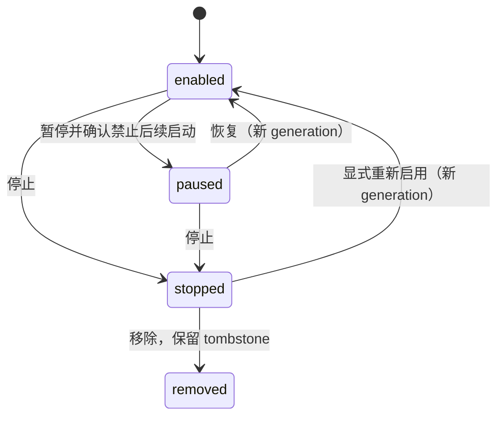
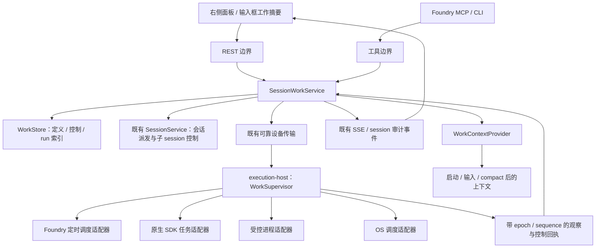

# 会话工作管理：定时任务、后台进程与子 Agent

状态：目标设计，2026-10-17。当前实现、实测证据和仍未覆盖的边界见 `session-work-management-validation.md`；本文中的目标接口与完整能力清单不等于已经全部实现。

## 1. 决策与范围

把“会话发起、可能继续执行的工作”建成独立领域，持久保存其身份、归属、期望状态、实际状态和控制结果。右侧面板、Foundry MCP、CLI 和恢复上下文都读取同一个领域服务。会话对话记录是审计证据，不再承担任务清单数据库的职责。

纳入三类工作：

1. **定时任务**：Foundry 定时任务、Claude 原生 cron / wakeup / loop、会话创建的宿主 crontab / systemd timer / launchd job。
2. **后台执行**：命令、常驻服务、monitor、workflow driver、脱离原始 shell 的进程，以及它们的子进程。
3. **子 Agent**：原生 subagent，以及通过 Foundry 创建的子 session。后者复用既有 session 控制服务。

OMH 业务任务不纳入发现、控制、迁移或“全部停止”的范围。普通文件变更、预览、用量、上下文信息继续留在现有面板区域。

核心选择：

- **新建定时任务由 Foundry 统一调度**，支持 Claude 和 Codex；不再要求模型另配宿主 cron，也不同时保留一个原生调度器触发同一逻辑任务。
- 原生/宿主机制通过适配器接入；“被发现”与“已受控”是两种明确状态，不能用登记代替实际接管。
- UI 上按用途分类，来源放副标题；同一任务只出现一次，定时任务的本轮执行放在它下面。
- 暂停、停止、恢复、重新运行具有不同语义；能力由后端返回，不给不支持暂停的任务画一个假按钮。
- “停止全部”是一项确定性的服务端操作，先禁止后续启动，再停止当前执行，最后逐项核验；不依赖模型记得有哪些任务。
- compact / 进程重启 / session completed 不移除任务归属，不重置用户的暂停或停止决定。

## 2. 现状与故障证据

### 2.1 事故回放

会话 `sess_1791532977920187026` 的服务端记录：

| 北京时间                | 事实                                                                  |
| ----------------------- | --------------------------------------------------------------------- |
| 10-10 14:27:13          | 创建巡检 timer `9b17c9d2`，cron=`28,58 * * * *`                       |
| 10-17 01:04:59          | 创建另一 timer `30c32941`，快照共两个                                 |
| 10-17 01:06:36          | `CronDelete` 只删除 `30c32941`，快照仍有旧 timer                      |
| 10-17 08:33:54          | 用户要求停掉所有 task                                                 |
| 10-17 08:36:05          | 模型声称全部停止；没有清理旧 timer 的操作                             |
| 10-17 08:37:05—08:38:02 | 旧 timer 实际又执行一轮，只读巡检；两个 fire 事件是同一轮的开始、结束 |

这说明“回答完成”“业务任务停止”“某个 crontab 为零”都不能证明会话没有后续工作。页面当时显示一个 timer 有事实依据。

### 2.2 已有模块与缺口

| 位置                                                                      | 已有职责                                                   | 缺口                                                                                                        |
| ------------------------------------------------------------------------- | ---------------------------------------------------------- | ----------------------------------------------------------------------------------------------------------- |
| `packages/worker/src/agent-timers.ts`                                     | 观察 CronCreate/Delete/List、Stop hook、timer fire         | 观察型 tracker；无公开原生 timer 控制通道；仅靠 prompt 前缀关联 fire，可能误关联；忽略子 Agent timer        |
| `packages/worker/src/session-timers.ts`                                   | 保存 timer，在没有进程持有时恢复会话执行                   | 本地已存在记录优先，不能表达服务端更高版本的暂停/删除；进程退出后仍保留 timer；无控制 tombstone             |
| `apps/server/internal/sqlitestore/session_schedule.go`                    | 从事件快照保存 schedule，重连时发给设备                    | 定义和控制意图缺少独立记录，不能只靠旧快照防复活                                                            |
| `apps/server/internal/httpapi/session_timer_fires.go`                     | 设备请求触发，转成 session input                           | 校验设备、会话和 native session；缺少 task revision、enabled 状态和控制屏障校验                             |
| `packages/worker/src/agent-background-tasks.ts`                           | Claude 后台命令/monitor/workflow/subagent 的观察、输出记录 | 已结束记录只保留最近 20 个；runtime attach/close 假设旧工作随进程退出，不能作为任意 detached 进程的存活证明 |
| `apps/server/internal/httpapi/session_background_tasks.go`                | 读取日志，通过 SDK stopTask 停止后台任务                   | 现有能力可复用，但停止请求返回不代表已观察到终止；没有通用暂停/恢复                                         |
| `packages/worker/src/runner/active-runtimes.ts`                           | 持有原生 runtime，stopTask，退出处理                       | SDK stopTask 路径主要查后台 task，原生前台 subagent 的控制需要单独适配                                      |
| `apps/server/internal/store/session_state.go`、`httpapi/session_state.go` | 为分页对话补齐面板状态事件                                 | 解决浏览器加载窗口，不解决模型 compact 之后的任务认知                                                       |
| `apps/server/internal/httpapi/mcp_inspect.go`                             | 会话摘要、后台记录、事件检索                               | 摘要没有完整 schedule 清单；事件文本隐藏 metadata 中的任务细节；旧事件回查昂贵                              |
| `apps/web/src/features/chat/chat-context-*`、`chat-detail-*`              | timer/background/subagent 分类和详情                       | timer 无控制；后台已有停止；subagent 无统一任务控制；多处自行推断活跃状态                                   |
| `packages/worker/src/task-scheduler.ts`                                   | 并发和按 key 串行                                          | 是执行并发队列，不是 cron；保留其单一职责，不把领域管理塞进它                                               |

补充版本事实：本机 Claude 2.1.295 的实现包含 `CronCreate(durable: true)`、`.claude/scheduled_tasks.json` 和 `CLAUDE_CODE_DISABLE_CRON`。前两项表明原生任务也有持久化模式；当前 Foundry DTO 和 Stop hook 摘要没有完整保留这一属性。这里只证明本机版本的实现，不推定事故设备使用同一版本。

本机 SDK `Query` 有公开 `stopTask()`，没有公开 cron list/delete/pause 方法。`UserPromptSubmit` hook 只有 prompt，没有 taskId。不能把“调用 CronDelete 的自然语言提示”当成用户按钮的控制实现，也不能按 prompt 匹配来承诺精确停止。

## 3. 领域模型

### 3.1 定义、执行和控制分开

`WorkItem` 是一个逻辑工作，`WorkRun` 是它的一次执行，`WorkOperation` 是一次控制请求。周期任务反复产生 run；一次 shell 命令也是一个 item 和一个 run。这样暂停调度与停止本轮执行不会挤在一个 status 字段里。

```ts
type WorkKind = "schedule" | "process" | "agent";
type WorkDesiredState = "enabled" | "paused" | "stopped" | "removed";

interface WorkItem {
  id: string; // Foundry 稳定 ID，非 PID / 临时 native task id
  workspaceId: string;
  deviceId: string;
  ownerSessionId: string; // 首次创建者，不随 runtime 复用而改写
  ownerThreadId: string; // 同一对话延续链的展示/查询归属
  createdByInputId?: string;
  parentWorkId?: string;
  kind: WorkKind;
  source: string; // foundry / claude / crontab / systemd / launchd
  title: string;
  management: "managed" | "observed" | "unattributed";
  desiredState?: WorkDesiredState; // observed/unattributed 不能伪造已有控制意图
  revision: number; // 服务端控制与定义版本
  generation?: number; // 接管后分配；每次重新启动/恢复生成新代际
  spec: ScheduleSpec | ProcessSpec | AgentSpec;
  capabilities: WorkCapabilities;
  observation?: WorkObservation; // 实际状态、观测时间、设备 epoch/序号
}
```

具体 DTO 使用 `kind` 判别联合，不能允许 `kind=schedule + ProcessSpec` 的非法组合；上面的缩写用于解释模型。

- `ScheduleSpec`：cron 或一次性 UTC 时间、IANA 时区、prompt/command 引用、目标会话策略、profile/model 引用、执行寿命、过期规则、错过触发策略、并发策略。执行寿命与记录保留时间分开；导入 session-only/有期限的原生任务不能静默延长执行期限。
- `ProcessSpec`：受控启动的 argv、cwd、环境引用、重启策略；不保存 shell 环境中的明文密钥。原始参数和日志沿用 member 权限和设备端脱敏。
- `AgentSpec`：原生任务标识或既有 Foundry 子 session 的引用，不复制子 session 的会话数据库。
- `WorkRun`：runId、itemId、generation、触发来源、计划时间、实际起止、run 状态、退出原因、输出引用、用量、执行身份。
- `WorkOperation`：operationId、幂等键、actor、目标及版本、动作、创建时间、`pending/applying/verified/failed/unknown`、逐项结果和证据。

`desiredState` 表示用户/Agent 已提交的决定；`observation` 表示设备实际确认的事实。服务端断线时收到暂停请求，可以显示“暂停待设备确认”，不能显示“已暂停”。

失联用 freshness 表达，进程退出用 observation 表达。`unknown` 不是 `stopped`，也不是 `orphaned`。需要分别显示：设备离线、控制未确认、来源已丢失、归属未确认。

### 3.2 身份与所有权

- 原生映射唯一键至少含 `(deviceId, provider, nativeSessionId, nativeTaskId)`；进程映射含 bootId、PID、进程开始时间及受控 group/job 身份，防 PID 复用。
- subagent 内创建的 timer/process 使用 `parentWorkId`。当前丢弃 `hook.agent_id` 的做法改为路由到对应 owner，不混入主 Agent 的 timer 集合。
- 主列表的活跃、已暂停、待确认项目不得受“最近 20 个”等历史裁剪限制；只有结束项分页和归档。compact 不参与保留策略。
- Foundry 子 session 在“子 Agent”分组引用展示；其生命周期仍由 SessionService 控制，不生成第二套 session 状态机。
- 创建者可以控制自己的后续工作，跨 session 可见/可控范围复用现有 workspace 和 session token 权限。模型不能通过声明一个 ownerSessionId 获得别人的任务权限。
- compact、恢复、重命名、原生 runtime 复用都不改变 itemId 和创建来源。fork 的新对话不自动复制定时任务；handoff 通过明确的转交记录关联旧工作，避免双重执行。
- 会话结束后仍有任务，属于“有后续工作”，不直接判孤儿。无法关联有效 owner 或来源失配时才需要归属处理；不自动认领相同命令行的进程。

## 4. 用户操作的确定语义

| 对象          | 操作          | 语义                                                                  |
| ------------- | ------------- | --------------------------------------------------------------------- |
| 定时任务      | 暂停          | 禁止新的 run；本轮继续，按钮旁说明“本轮继续运行”                      |
| 定时任务      | 恢复          | 从恢复后的下一个计划时间执行；默认不补跑暂停期间的触发                |
| 定时任务      | 立即运行      | 创建单独 manual run；不修改周期或解除暂停                             |
| 定时任务      | 停止          | 先停止未来调度，再停止当前 run 和该 run 创建的可控后代                |
| 定时任务      | 移除          | 停止后从常用清单归档；保留定义、历史、tombstone 和审计                |
| 受控进程      | 启动/重新运行 | 由保存的启动定义创建新 generation；不冒充原执行恢复                   |
| 受控进程      | 停止          | 对准确执行身份和受控进程组停止；先正常终止，再按已定义超时升级        |
| 受控进程      | 暂停/恢复     | 仅适配器有经过验证的组级 freeze 或应用协议时提供                      |
| 原生 subagent | 停止          | 走 SDK 原生 task 控制，并等待终止事实                                 |
| 子 Agent      | 继续/重试     | 仅 runtime 支持明确续跑入口时提供；否则新建一次 run，注明依据的上下文 |

原生 SDK 当前没有通用 subagent pause/resume，也不能把对宿主 Claude 的 SIGSTOP 当成暂停某一个 subagent。UI 对此显示能力原因，提供真正可用的停止/继续入口。未来增加原生能力只改适配器，不改公共状态机。

定时调度状态：



run 独立经历 `queued → starting → running → succeeded/failed/stopped`，可有受支持的 `running ↔ suspended`。`stopping` 是尚未证实结束的过渡状态。item 可以同时是 paused、而 run 仍 running。

### 4.1 “全部停止”必须先封住新工作

对当前对话提供“暂停全部定时任务”和“停止全部后续工作”两个明确动作。输入框原停止键保持“停止当前回答”的既有含义，旁边提供可见菜单进入全部停止，不能悄悄扩大原按钮的作用范围。

`stop_all(scope=thread)` 的顺序：

1. 事务内建立该对话的工作屏障，增加 scope generation；暂停全部调度，阻止旧 generation 创建新 run 和新后代。
2. 保存本次操作及目标清单；控制产生的日志/维护操作不被当成普通新工作拦截。
3. 先禁用调度源，再停止其活动 run 和后代进程、subagent、纳入范围的 Foundry 子 session。父 Agent 可最后停止，便于它拿到操作结果，但操作执行不依赖它存活。
4. 重新发现并核验，合并步骤 1 前已发出但晚到的任务；已超过启动检查点的任务也必须纳入终止核验。
5. 逐项返回 verified / pending / failed / unknown；只有所有目标和发现检查均确认，才显示“全部停止”。

屏障不会因用户发下一条普通消息而自动清除。显式恢复只恢复选定项目，并产生新 generation；旧延迟 dispatch、旧 timer 快照、旧控制回包不能使其复活。

控制按逐项单调停止处理，不为了回滚一个失败项而重新启用已经停掉的任务。批量操作只影响所选 thread 及有证据关联、当前 actor 有权控制的后代；不能扩大为杀掉整台设备所有 cron 或所有 Claude 进程。

离线设备的控制显示待确认；Foundry 立即禁止自己的新派发，但不能宣称已停止离线设备的 OS cron。设备重连先应用控制和 tombstone，再允许调度。已经 detached 到非受控环境的任务，要显示未核验项，不能计入“零运行”。

## 5. 架构边界



### 5.1 高内聚与依赖限制

- `SessionWorkService` 负责授权、身份、状态转换、控制顺序、批量停止和对外投影。它不执行 shell、不认识 React、也不保存 native query 对象。
- `WorkStore` 保存 item/run/operation 与观察游标；数据库事务处理并发变更。原生事件作为观察输入，不反向覆盖 desired state。
- `WorkSupervisor` 只负责本设备的执行、控制和核验。常驻在 execution-host，daemon/WebSocket 重连不能再启动一个同类 scheduler。
- 每个适配器负责该来源的发现、标识、能力、控制、实际状态核验。原生私有格式或版本检查只出现在适配器内。
- 复用既有可靠 outbox、设备 RPC、SSE、会话派发、脱敏和权限，不新增通用消息总线，不在 `service.ts` / `App.tsx` 堆状态机。
- Web 的分组、按钮和摘要读取服务端 work DTO；浏览器只做时间展示和交互状态，不从聊天文本推测已停，也不自行决定某来源能否暂停。
- `WorkContextProvider` 用同一 query 投影生成小型任务简报，不读全部历史，不启动额外模型。

适配器接口保持窄而明确：`discover(scope, cursor)` 返回来源范围和完整性标记；`capabilities(ref)` 返回可验证动作；`apply(operation)` 执行带幂等身份的控制；`inspect(ref)` 返回实际状态；`readOutput(ref, cursor)` 按需读取日志。`apply` 的接受回执与 `inspect` 的终态证据不能混为一个 boolean。进程探测区分 alive/gone/unreadable，不用一个 undefined 同时代表“已退出”和“无权读取”。

建议落点：

| 层            | 模块                                                                                                |
| ------------- | --------------------------------------------------------------------------------------------------- |
| protocol      | `packages/protocol/src/session-work.ts`：判别联合、操作/观察 DTO、事件类型                          |
| server domain | `apps/server/internal/sessionwork/`：Service、状态转换、策略；通过窄接口使用 store/session/dispatch |
| persistence   | `apps/server/internal/store/session_work.go` 接口，`sqlitestore/session_work*.go` 实现              |
| transport     | `httpapi/session_work.go`、`mcp_session_work.go`，只做解码、授权上下文和结果映射                    |
| device        | `packages/worker/src/session-work/`：supervisor、持久副本、context、adapters、reconcile             |
| UI            | `features/chat/session-work/`：面板控制 hook、分组、行与详情；复用公共 Button/菜单/Alert            |

### 5.2 状态一致性与防复活

服务端是定义和控制意图的权威；设备是本地实际执行事实的权威。两者不能互相覆盖所属字段。

- 控制使用 `expectedRevision + idempotencyKey`；冲突返回当前版本。
- 设备观察使用 `(executorEpoch, sequence)`；旧 epoch/旧序号不更新最新观察。
- 控制回执附 task revision 和 generation；先到的 stop 不能被后到的旧 start 回包覆盖。
- 删除留下 tombstone；重连全量 reconciliation 必须包含暂停、停止、移除状态，不能只发送“仍活跃的 timers”。
- 启动前在 execution-host 同一串行检查点校验 revision、generation、scope barrier；服务端接受触发时再校验一次。
- 创建和派发采用既有持久 outbox 的事务衔接，避免任务成功启动却没有可恢复的登记记录。
- 一个任务的 schedule spec 只有一个 `executionOwner`。迁移时必须验证旧来源已停，再切换 owner，不能靠两边“应该不会同时触发”。
- delta 观察不携带的任务不能视为消失；只有同一来源范围的完整 inventory 才能据缺席生成结束/失配结论。扫描失败、权限丢失或超时不能用空列表清空状态。
- SDK start/notification、后台快照、进程扫描对同一工作的观察先按稳定映射合并；command 相同不足以合并。调度定义、其 run 和 run 的子进程按关联展示，不形成三个重复的独立任务。

单次触发键为 `(workId, generation, scheduledAt)`，server/worker 都去重。同一个逻辑周期的去重不等于保证外部命令副作用 exactly-once；崩溃发生在外部动作之后、完成回执之前时，run 显示 unknown，不自动重跑。

## 6. 定时执行与来源适配

### 6.1 Foundry 管理的新定时任务

新入口 `create_scheduled_work` / `foundry work schedule` 写入定义后由设备调度；不创建宿主 crontab。到期复用 SessionService 和设备现有原生 SDK/CLI 启动流程，重新解析 profile、连接器授权和本轮 session token，不持久化临时凭据。

两种 target 策略必须明确：

- `continue_thread`：恢复原对话，带工作清单；适合持续巡检。
- `new_session`：在同 workspace 创建关联 session，读取固定简报；适合每轮独立上下文。每个 run 都关联来源 item 和 owner。

默认一个 item 同时一个 run；重复触发合并为一次待执行，不积累无限队列。时区保存为 IANA 名称；一次性任务保存完整 UTC 时间，不再用缺年份的 cron 模拟。迁移原生任务时保留已知 offset/expiry；新任务按声明时间运行，不静默继承 Claude jitter。

每轮保留最大时长和并发上限；登录失效、持续限流和重复失败显示 blocked/backoff 事实，不做高频无界重试。设备必须取得服务端的当前启动许可才执行托管调度，断线时不拿旧 enabled 副本继续启动；已运行任务的状态则保持离线待核验。

恢复默认跳过暂停期间的触发；设备离线期间 recurring 默认跳过，one-shot 默认标记 missed 并提供“立即运行”。需要补一次的任务在创建时显式声明 `misfire=run_once`。DST、时区修改、设备换区和过期规则都属于 spec，前后端共用计算契约。

### 6.2 Claude 原生 timer：迁移前必须解决执行所有权

推荐终态：Foundry 启动的 runtime 禁用原生调度，模型通过 Foundry MCP 创建管理任务。`/loop` 和 wakeup 的产品意图映射到同一个 schedule 入口；已有 timer 按 stable mapping 导入，不重建多个 item。

**不能直接假定禁用环境变量已经足够。** 本机二进制虽有 `CLAUDE_CODE_DISABLE_CRON` 和 scheduler 的 killed 检查，但这是版本相关能力，未做真实执行验证。交付前必须完成独立兼容性实验，证明：

1. 原生已有 session-only / durable / loop / subagent timer 都不会在 managed runtime 中自行触发。
2. 恢复原 native session 不会重放旧 timer，也不会丢正常对话。
3. durable 来源的旧任务不会被另一原生进程再次执行。仅禁用 Foundry 中的 scheduler 不足以消除共享持久文件的其他读取者。
4. 原生 create/list/delete 不会绕开统一清单；不可用的入口给出 Foundry 替代工具，不能只在系统提示词里劝阻。

已有运行中的 runtime 不能热改 env。安全迁移在空闲且无其他后台任务时切换；不能为暂停一个 timer 而隐式杀掉整组无关工作。用户要求停止全部时，可按该操作已明确覆盖的范围关闭 runtime，但 durable 来源仍需核验禁用。

若 SDK 没有控制 API，原生持久来源的停用需要一个**版本化、锁和 CAS 完整、可验证的格式适配器**，或原生新增公开 API；只读解析不足以接管。格式不识别时保留 observed 状态并显示具体阻碍，禁止静默改原生文件。不得调用一个模型“帮忙删任务”来伪装确定性控制。

该实验是排期第一步，也是“原生 timer 全部可控”的交付阻断项。验证失败时交付范围必须明确为：新任务受控、旧任务可见且待迁移，不能宣称已经满足全部管理。

### 6.3 宿主 crontab / systemd / launchd

适配器首先发现、再归属、再控制：

- managed 创建先登记 workId，再写带 Foundry 标记的来源；执行时通过 `foundry work run --id ... --generation ...`，产生可追踪 run。能用 Foundry scheduler 时不再新建 OS timer。
- 在会话工具调用前后采集调度源 revision，关联 input/toolCall；结合 marker、执行路径和记录形成归属证据。并发修改、SSH、sudo、脚本间接写入不能仅凭时间接近就自动认领。
- 旧任务通过来源清单和历史证据导入；无法确认的放“待归属”，显示来源和发现理由，提供关联/接管入口。不能因为命令里有 claude 就归到当前 session。
- 暂停 cron 只改自己标记的精确条目，保留原定义；systemd/launchd 区分 timer/job 和它启动的 service/process。执行前后 CAS 和复读校验，避免覆盖用户其他 crontab 条目。
- 重复 cron 行需要明确块标识或一次性接管后标记；不能用内容 hash 删除所有相同行。
- 持续观察外部修改；来源被人工重新启用时显示 drift，按照已接管任务的 desired state 收敛并记录。无法安全收敛则显示控制失败。
- 管理权限与设备用户权限一致；不能因为读取到一个系统级任务就声称有权控制它。

发现触发点：worker 启动/重连、相关工具调用完成、周期 reconciliation、用户刷新、批量停止前后。扫描工作不依赖面板是否打开。

### 6.4 detached 进程与能力边界

只观察 SDK background task 不足以覆盖 `nohup`、`setsid`、double-fork、外部 CLI 或被 SDK 提前返回的执行。新托管后台工作通过 ProcessSupervisor 启动，分配准确进程身份、独立进程组/OS job、日志和 owner；使用现有 `agent-processes.ts` 的平台监督基础设施，补齐每个 work 的边界，不能只依赖 execution-host 的大 cgroup。

原生 shell 产生的后代可通过进程监督和工具关联补充发现；进程退出事实必须由可核验的身份、组状态或原生 ACK 确定。重启发现旧记录时先 reconcile，不能把“tracker 已 close”直接翻译成“所有进程已死”。

**全权限 shell 无法保证自动发现任意跨账号、远程或外部系统中的任务。** PATH wrapper、关键词扫描和环境标签都不是完整拦截。产品保证分两层：托管启动路径的确定控制；旁路来源的持续发现、明确覆盖状态与未确认结果。若要求所有旁路都不可发生，需要改变工具执行边界/OS 隔离，不能用提示词假装做到了。

面板和 MCP 的批量结果包含 `coverage` 与未核验来源；存在可疑任务、来源读取失败或离线设备时，禁止将范围内结果表达成无条件“全部停止”。这不是忽略旁路，而是使它们成为可见、可处理的项目。

## 7. API、MCP 与上下文恢复

### 7.1 同一领域入口

| 接口                                         | 用途                                                  |
| -------------------------------------------- | ----------------------------------------------------- |
| `GET /api/chats/{threadId}/work`             | 当前对话工作清单、计数、revision、freshness、coverage |
| `POST /api/chats/{threadId}/work`            | 创建托管工作定义；返回稳定 workId 和已验证能力        |
| `GET /api/work/{id}`、`/runs`、`/output`     | 定义、历史、实际状态和受权限约束的日志                |
| `POST /api/work/{id}/operations`             | 带 revision 和幂等键的单项控制                        |
| `POST /api/chats/{threadId}/work/operations` | 暂停全部定时任务、停止全部、显式恢复选定集合          |
| `GET /api/work-operations/{id}`              | 慢操作和离线操作的实际结果                            |

MCP 提供 `list_session_work`（带 `id` 时含该项执行历史；DEV-101 起取代 `get_session_work` 与 `read_context` scope=work）、`control_session_work`、`create_scheduled_work`，CLI 对应 `foundry work list/show/control/schedule`。所有入口调用同一服务，不在 MCP 内重写另一套控制逻辑。保留个人助理现有 `list_tasks` 的计划清单语义，避免重名混淆。

`list_session_work` 默认当前 thread，包含已暂停、未确认、未知和未归属候选，历史结束项分页读取；不要默认只列 running。跨 workspace 查询和控制继续经过现有授权策略。

`read_context(scope=summary)` / `get_session` 默认加入 bounded work summary；新增 `scope=work` 便于查询完整清单。摘要至少列出所有仍可能启动或待确认的项目 ID、来源、期望/实际状态、下一次执行、待处理控制。超预算时保留全量计数、未返回数量和游标，不能让尾部任务消失。

操作回答示例：

```json
{
  "operationId": "wop_...",
  "state": "pending",
  "verifiedStopped": 2,
  "pending": 1,
  "failed": 0,
  "unknown": 0,
  "coverage": { "hostSchedules": "unavailable" },
  "items": [
    {
      "id": "work_inspection",
      "desiredState": "stopped",
      "observedState": "running",
      "reason": "device_offline"
    }
  ]
}
```

返回“请求已接受”不能等同于“实际已停止”。超时是 unknown，重试同一 operationId，不生成第二次启动/停止。

### 7.2 不依赖 compact 摘要的工作简报

`WorkContextProvider` 从已同步的服务端投影/设备持久副本生成简报，带版本和观测时间。例如：

```text
Foundry work state, revision 42, observed 08:40:
- work_inspection：每 30 分钟巡检；enabled；下次 09:07；来源 Claude，创建于 10-10。
- work_driver：后台命令；停止待确认；设备离线。
本对话仍有 1 个可自动启动任务，1 个停止未确认项目。
通过 list_session_work 查询，通过 control_session_work 控制。
回答已完成不代表任务停止；“全部停止”只能依据已核验操作结果。
```

注入时机：

1. runtime 首次启动/恢复、每个用户输入、定时 run 启动前。
2. compact 边界后，在继续执行前重新提供最新简报。
3. 用户从面板控制后，现有 run 下一个安全交互点收到已应用的状态变更；没有活跃模型时不额外启动模型只为通知。
4. 任何创建/控制工具结果返回当前 workId 和简报 revision。

Claude 优先复用 SessionStart / UserPromptSubmit 的 additionalContext；原生 SDK 的 PostCompact 类型当前没有 additionalContext 字段，不能杜撰 hook 返回值。compact 后补充应通过已验证的 SDK 上下文消息/下一安全边界实现，并做真实自动 compact 验收。静态 systemPrompt 不是动态清单缓存；本机 CLI 还可能快照 systemPrompt。

Codex 在现有 app-server 的 turn/start / resume 接缝加入同源简报，处理中 compact 的通知和继续交互必须验证实际协议能力。若某版本不能在 compact 后立即插入，至少在下一工具边界强制提供最新 work 状态；该降级需在能力中标明，不能声称与即时注入等价。

上下文简报只帮助模型发现和解释；真正阻止旧任务启动的是 registry、revision 和工作屏障。即使模型再次忘记，用户的手动控制仍生效。

## 8. 右侧面板

保留现有右侧上下文面板，工作区置于文件和预览等信息之前。布局平铺，不嵌套多层卡片；按三个分组呈现：

```text
后续工作                         [暂停全部定时] [停止全部]
1 项待设备确认 · 更新于 08:40

定时任务 · 2
巡检机队                 已启用   [暂停] [立即运行] […]
每 30 分钟 · 下次 09:07 · 来自 Claude
夜间 loop                已暂停   [恢复] […]
宿主 crontab · 本轮仍在执行

后台执行 · 1
night loop driver        运行中   [停止] […]
来自夜间 loop · 本轮 08:30 启动

子 Agent · 1
检查更新                 运行中   [停止] […]
来自当前会话 · 已运行 2 分钟

待归属 / 待核验 · 1        [展开]
已结束 · 8                 [展开]
```

上例中“后台执行”的 timer run 是关联展示：可提供跳转/过滤，但同一 run 不计作第二个独立工作。展开定时行可看本轮和 run 历史；全局 active run 计数按 runId 去重。

每行默认显示名称、实际状态、来源、下一次/已运行时长、直接可发现的常用操作；详情展示创建者、所属 input/subagent、调度时区、执行策略、日志、用量、控制记录。技术标识按需展开。

操作语义和权限来自后端 `capabilities + allowedActions + reason`。UI 不硬编码“Claude 都可暂停”。按钮请求中防重复，成功后等待实际回执；失败保留错误和重试入口。用户暂停 timer 时明确区分“暂停后续”和“连本轮一起停止”。

活跃、暂停、异常都保持可见；结束项目折叠。离线/过期显示最近观测，不能显示旋转图标冒充实时运行。窄屏在同一侧面板抽屉显示，不增加第二聊天框；键盘、焦点、明暗主题、繁忙和错误状态使用现有 UI primitives。

## 9. 迁移与兼容

1. 从最新 timer/background 快照、subagent 记录和既有 parentSessionId 回填工作身份；回填是幂等读取，不触发执行。
2. 为已知 native source 建立映射，保留真实 createdAt、prompt 全文、过期和来源信息。不能把导入时间当成新建时间，让旧任务多活一周。
3. 外部 OS 调度和 detached 进程走独立发现；不以不存在旧 Foundry 事件为理由隐藏它们。
4. 先开启双读校验：现有面板投影与 registry 比较，记录遗漏、重复与误归属；控制必须只有一个写入口。
5. 完成原生 scheduler 停用/来源迁移实验后，按安全边界迁移 executionOwner；一次迁移最多一个调度所有者。
6. 新 worker 与旧 server、旧 worker 与新 server 都要协商能力。设备不支持某操作时明确失败/待升级，不提前显示成功，也不能下发它不理解的 resume。
7. 控制入口稳定后，旧 `background-tasks/.../stop` 转为同服务兼容路由，旧 timer fire 接口加入 work 映射与版本校验。历史 transcript DTO 保留只读兼容，避免重写既有对话。
8. 所有面板/MCP 消费者切换后再删除旧的独立状态推导；不长期维持两个 timer 真相源。

事故会话的预期迁移结果：`9b17c9d2` 和已删除 `30c32941` 各只有一个历史身份；旧巡检仍活跃的事实从清单和简报可见。选择“停止全部”后禁止再次派发，原生/宿主来源和活动 run 都被核验；后来的旧快照无法复活它。

## 10. 验证与交付顺序

### 10.1 必须通过的契约测试

| 场景                      | 通过条件                                                                 |
| ------------------------- | ------------------------------------------------------------------------ |
| 历史事故重放              | 删新 timer 后旧 timer 仍显示；stop_all 后无新增 run，compact 不影响清单  |
| 双来源 timer              | 同一逻辑任务只一条定义，一个计划时间只一个 run；不得双调度               |
| fire 与 pause/stop 并发   | 已排队未启动的旧 generation 不得启动；越过检查点的 run 纳入停止核验      |
| 停止时产生新后代          | scope barrier 拒绝创建/纳入核验，不漏掉晚到子进程或 subagent             |
| 重连与乱序                | 旧 start/快照/重试不能覆盖 pause/stop/tombstone；先应用控制再调度        |
| 操作超时/ACK 丢失         | 显示 unknown/pending，以同 operationId 查询，不重复运行                  |
| 设备离线                  | 未确认不能显示已停；重连应用最新决定                                     |
| 原生 timer 兼容           | session-only、durable、loop、subagent timer、恢复、共享来源逐项验证      |
| 暂停后恢复                | 不补跑暂停期间触发；手动立即运行不解除暂停                               |
| detached / PID 复用       | 杀准受控进程组；身份失配拒绝；未知存活不误报停止                         |
| crontab 并发写入          | 只改自己的精确条目，不丢第三方新增行，不批删重复内容                     |
| session 结束/关闭 tracker | 不把会话 completed 或 observer close 推断为后续工作全部结束              |
| 权限                      | owner/member/maintainer/session-token/Issue scope 延续现有边界；输出脱敏 |
| compact 多轮              | 三次真实 compact 后，清单相同，最新控制可见，模型能报告仍可能启动的工作  |
| 日志与计数                | scheduler/run/subagent 无重复计数，历史分页不使活跃任务消失              |
| 任意旁路覆盖不足          | 面板和 MCP 明确未确认范围，不输出无条件“全部停止”                        |

### 10.2 实施顺序与每步出口

**A. 兼容性实验与契约。** 验证原生 timer 禁用/迁移、每种 runtime 的 compact 上下文入口、OS 控制与进程身份。产出实测能力矩阵；无法精确控制的来源先明确阻碍。确认 DTO、暂停/停止和批量操作语义。

**B. registry + 查询 + 同源摘要。** 回填、持续观察、MCP 清单、恢复简报，先让遗留工作可见且可查；完成遗漏/重复校验。此阶段不宣称已经具备统一控制。

**C. 确定性控制与新调度。** 复用 stopTask 和 SessionService，补屏障、操作回执、单一调度所有权、OS/进程适配器、重连防复活。新定时任务走 Foundry 入口；旧来源完成经过验证的迁移后才标为 managed。

**D. 面板交互与完整事故验收。** 分类行、单项/批量按钮、状态/能力/覆盖展示；通过真实浏览器操作和真实原生执行，覆盖 keyboard、light/dark、窄屏、失败、离线、刷新与 compact。记录独立测试任务、截图和实际设备核验证据，不控制生产遗留任务来做测试。

**E. 去旧与发布。** 替换独立状态推导和兼容 route，实现旧 worker 协商、恢复/回滚验证，检查 active workloads 后按既有部署流程发布。未通过原生/旁路控制和 compact 验收，不得宣称“所有任务均已管理”。

本文保留完整目标设计；本轮实际实现和验收以 `session-work-management-validation.md` 为准，未修改运行中的生产任务或业务 cron。
