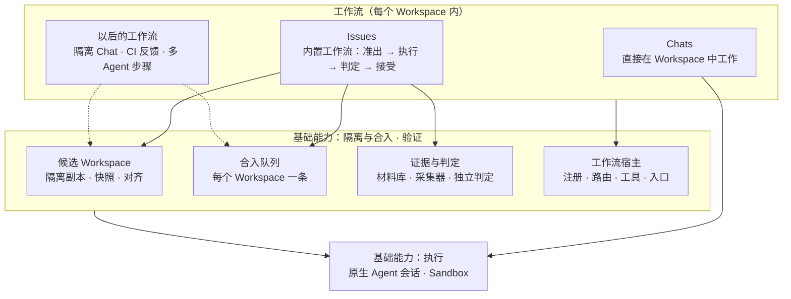

# 工作流与平台能力：Issue 作为一种工作流

[Roadmap · 自定义工作流](roadmap.md#自定义工作流) · [Roadmap · 隔离与合入](roadmap.md#隔离与合入) · [文档索引](README.md)

状态：**设计提案**（2026-10-24），未实现，也未排期。现状描述基于 main `3081b85` 的源码阅读，路径已附。
Issue 本身的语义（准出条件、六态、证据与接受规则）仍以 [Issue 工作流设计](issue-workflow.md) 为准，本文只讨论它在平台中的位置。

## 结论

2026-10-26 本人确认的分层：**基础能力是 Foundry 的核心，工作流是基础能力的组合**（见 [Roadmap · 架构](roadmap.md#架构)）。Chats 是让 Workspace 演进的最直接路径，改动直接写入、由人把关；Issues 在此之上组合隔离、验证与接受；以后用户可以用基础能力搭自己的工作流（插件，尚未设计实现）。候选基于 Git worktree 是既定选择：Git 是版本工具，不限于代码，文稿、研究等项目同样适用，worktree 也不做整份复制。下面的分析在此前提下进行。

**拆分成立，但顺序是“先把平台能力抽出来，再开放工作流扩展”，现在不建通用插件框架。**

- Issue 是一种业务工作流：准出条件 → 执行 → 证据与判定 → 接受 → 合入。它依赖的三项能力本质上是平台的，
  只是目前按 Issue 命名、以 Issue 为键：**候选 Workspace**（每项任务一份隔离副本与写边界）、**合入队列**
  （每个 Workspace 逐个合入已接受的候选）、**证据与判定**（材料库、候选快照、独立判定会话）。
- 把这三项变成平台模块后，Issue 成为第一个**内置工作流**，与 Chats 并列在“工作流”层。其他工作流
  （隔离模式的 Chat、CI 反馈、按步骤分给多个 Agent、Personal Agent 发起的维护任务）可以复用同一套隔离与合入，
  不必再造一份。
- “插件”在第一阶段指**编译进产品、按固定接口注册的工作流模块**，不是动态加载的第三方代码。至少有两个内置
  工作流真正用上平台接口之后，才讨论声明式或第三方扩展；那时沿用[插件体系调研](research/plugin-system.md)
  的分层与安全前提（不在页面内运行第三方 JS，受保护动作只能由人发起）。

取舍：好处是边界清楚、能力可复用、Issue 的规则不会被其他流程绕过；代价是一次跨 Server / Worker / 协议的改名与
迁移，以及过早抽象的风险。对策是每一步都不改变 Issue 的用户行为，且平台接口必须有第二个使用方才算完成（见[迁移步骤](#迁移步骤)）。

## 现状：Issue 与平台能力的耦合点

| 能力           | 现在在哪里                                                                                                                                                                                                                                                                                                                               | 与 Issue 的耦合                                                                                                                                                                                  |
| -------------- | ---------------------------------------------------------------------------------------------------------------------------------------------------------------------------------------------------------------------------------------------------------------------------------------------------------------------------------------- | ------------------------------------------------------------------------------------------------------------------------------------------------------------------------------------------------ |
| 候选 Workspace | Worker `execution-storage.ts`、`execution-git.ts`、`execution-types.ts`、`issue-environments.ts`；Server `httpapi/issue_environment.go`；daemon 消息 `issue_environment` / `issue_environment_result` / `issue_environment_changed`（`packages/protocol/src/daemon-messages.ts`）                                                        | 类型叫 `IssueEnvironment` 且必带 `issueId`；锁名 `execution-${issueId}`。[模块架构 §3](architecture-modules.md#现状中的违例)早已把它列为“共享底层以 Issue 命名”的违例                            |
| 合入           | Worker `workspace-acceptance.ts`（`store.lock(workspaceId, "accept")` 串行、`acceptances/<id>/acceptance.json` journal、`assertNoOtherPartialIntegration`）、`candidate-refresh.ts`（对齐）、`evidence-acceptance.ts`；Server `sqlitestore/evidence_acceptance.go`（`ApproveReview`、`RegisterIntegrationSnapshot`、`FinishAcceptance`） | “队列”只是 Worker 上每个 Workspace 一把文件锁加 journal：没有排队顺序、位置、取消，也不在 Server 上可见；入口要求 Issue 的审阅快照与接受决定（`evidence-acceptance.ts` 校验 `request.decision`） |
| 证据与判定     | 材料库 `evidence-store.ts`、`evidence-uploads.ts`；采集器 `evidence-collectors.ts`；快照 `evidence-snapshots.ts`；判定会话 `session/index.ts` `startSession`（`readonly_agent` 沙箱）                                                                                                                                                    | 材料库本身是内容寻址的通用存储；采集请求、快照与判定结果都挂在 Issue 与契约修订上                                                                                                                |
| 会话           | `AgentSession` 带 `issueId`；`run_session` 携带 `issue?: Issue`（`daemon-messages.ts`）；Worker `sessionExecution()` 按 `issueId` 选目录与沙箱（[执行内核](execution-kernel.md#session-runtime)）                                                                                                                                        | Session Runtime 需要认识 Issue，违反“下层不分支于上层概念”（[模块架构 §2](architecture-modules.md#2-分层与依赖规则)）                                                                            |
| 流程与入口     | Server `store/issue_loop.go`（状态机）、`store/issues.go`（仍保留 `Run`）、约 30 个 `httpapi/issue_*` / `evidence_*` 文件、`mcp_issues.go`；Web `features/issues`、`issue-detail`、`runs`；渠道 `internal/feishu/issues.go`                                                                                                              | 这些本来就是 Issue 自己的，拆分后留在 Issue 工作流模块中                                                                                                                                         |

这里的“Workspace 隔离”指任务级的候选副本与写边界（Sandbox `writable_tree`，见[执行内核](execution-kernel.md#sandbox)）。
会话配置隔离（[会话隔离方案](session-isolation-design.md)）与“Chat 不经沙箱”的已知风险（[安全边界](security.md)）是另外两件事，不在本文范围。

## 目标分层

规则沿用[模块架构 §2](architecture-modules.md#2-分层与依赖规则)：平台模块不 import、不命名、不分支于任何工作流；
工作流差异通过不透明的归属引用 `owner = {kind, id}` 与回调传入。

## 平台能力的接口

以下是接口形态与不变量，字段名在实现时可调整。

### 候选 Workspace

- **身份**：`Candidate { id, workspaceId, owner: {kind, id}, repositories[], baseRevisions, status, revision }`，
  `status` 沿用现有值（preparing / ready / running / review / integrated / abandoned）。平台只认 `owner`，不解析它。
- **操作**（Worker）：`create(owner, repos)`、`snapshot(id) → CandidateSnapshot{contentDigest}`、
  `refresh(id) → {aligned | conflicts[]}`（把 Workspace 新接受的提交合入候选，冲突留在候选中）、
  `launchProfile(id, role)`（交给 Sandbox 的 `writable_tree` 参数）、`release(id)`。
- **协议**：新增 `candidate_*` daemon 消息；`issue_environment*` 在最低 Worker 版本提升前继续作为别名保留，
  由 Worker 能力声明决定走哪条。
- **不变量**：Agent 只写候选；候选内容未经接受不进入源目录；同一个 `owner` 同时最多一个活动候选。

### 合入队列

- **记录在 Server**：`IntegrationRequest { id, workspaceId, candidateSnapshotId, owner, approval{decisionId, actor,
reviewDigest}, position, status }`，`status` 为 queued / aligning / checking / applying / integrated /
  needs_rework / failed。Server 决定顺序、可见性、取消与重试；Worker 仍按现有锁加 journal 逐个执行，锁保留为
  最后一道保护。
- **工作流的职责**：提交前给出已签发的接受决定（Issue 即现有 `ApproveReview`）；基线前移时收到
  `needs_rework` 回调，由工作流决定如何对齐与复验（Issue 即现有“让 Agent 解决冲突”后重新判定）。
- **平台的职责**：核对接受者角色（Maintainer 及以上）、快照与候选未变、没有其他未恢复的部分集成；平台不判断
  “证据是否充分”，那是工作流的规则。
- **不变量**：同一 Workspace 同时只有一个请求处于 applying；部分应用可检测并恢复；人工批准与最终集成成功分开表达
  （与 [Issue · 合入约束](issue-workflow.md#合入约束)一致）。

### 证据与判定

- 平台提供：内容寻址材料库与访问控制、采集器（command、project_command、受控 HTTP、上传、候选导出）、
  候选快照、独立判定会话的启动（只读沙箱、按角色收窄工具）。
- 工作流提供：要证明什么（Issue 的准出条件与修订）、判定结果如何组合成“可接受”。
- 现有 [Evidence & Verify v1](evidence-and-verify-v1.md) 的数据结构不变，只是归属从 Issue 改为 `owner`。

### 工作流宿主

- **注册**：Server 启动时注册编译进来的工作流 `Definition { kind, states, transitions, commands, sessionRoles,
tools }`；状态机仍是显式表（Issue 即 `store/issue_loop.go`）。
- **接入点**：HTTP 路由与访问规则（`routes.go`），MCP 工具按工作流命名空间登记（`mcp_tools.json`），Web 经
  `navigation.ts` 注册入口与页面（feature 之间仍不互相 import），渠道命令映射（例如飞书 `/issue`）。
- **归属**：工作流拥有自己的记录；平台记录只保存 `owner` 引用。删除或放弃工作流对象时，由工作流调用平台的
  `release` 与队列取消。

## 迁移步骤

每一步都不改变 Issue 的用户行为；Issue 的功能准出仍按[对话式准出标准](foundry-conversation-release-gate.md)。

| 步骤 | 内容                                                                                                                                                       | 完成标准                                                                                                                  |
| ---- | ---------------------------------------------------------------------------------------------------------------------------------------------------------- | ------------------------------------------------------------------------------------------------------------------------- |
| WF-1 | 命名与边界：共享底层类型去掉 Issue（`IssueEnvironment` → `Candidate`，`issueId` → `owner`），磁盘与协议格式保持兼容；模块审计禁止平台文件 import `issue-*` | `scripts/audit-module-boundaries.mjs` 新规则通过；Issue 相关测试不改断言全部通过；Linux 与 macOS 各跑一次真实 Issue 闭环  |
| WF-2 | 合入队列放到 Server：新表与每个 Workspace 的队列视图；Worker 锁与 journal 不变                                                                             | 两个已接受的 Issue 在页面上按顺序排队、依次合入；Server 与 Worker 重启后队列与部分集成都能恢复；现有 journal 恢复测试通过 |
| WF-3 | 候选成为平台 API：`candidate_*` 消息与 Worker 能力声明；第二个使用方落地（候选选项：隔离模式的 Chat，在候选中工作、接受后经同一队列合入）                  | Issue 与第二个使用方都只经平台接口；旧 Worker 仍能执行 Issue；平台代码中不再出现 Issue 分支                               |
| WF-4 | 工作流宿主：Issue 经注册接入路由、MCP、导航与渠道                                                                                                          | 去掉 Issue 模块后其余产品能编译运行（审计检查）；Issue 页面、MCP 工具与飞书命令行为不变                                   |
| WF-5 | 探索：声明式工作流定义或第三方扩展                                                                                                                         | 只在 WF-3 的第二个使用方上线并有真实需求后再立项                                                                          |

## 兼容与归属

- **数据**：WF-1 不改表；WF-2 新增队列表，旧接受记录不迁移，只在新请求上使用。journal 格式不变。
- **协议**：Server 同时支持新旧消息，直到最低 Worker 版本提升；旧 Worker 上不提供第二个使用方。
- **归属**：候选、队列、证据与判定由基础能力中的“隔离与合入”“验证”两组模块负责（代码上属于[模块架构](architecture-modules.md#3-模块清单)中的
  候选存储与 Git、Material Store，以及新增的队列）；Issue 的语义、页面与准出标准仍由 Issues 模块负责。
- **不做**：不把 Chat 默认改为候选模式（Chat 直接在 Workspace 中工作是既定设计，见[执行内核](execution-kernel.md#sandbox)）；
  不建动态插件加载；不把外部副作用纳入合入队列（部署、发消息等仍需执行当时单独授权）。

## 依据

- [Issue 工作流 · 后续](issue-workflow.md#后续)：“Workflow 插件化”的最初设想与“出现具体需求前不建立通用插件框架”。
- [总纲 · 术语表](workspace-sandbox-overview.md#术语表)：Merge Queue 定义为每个 Workspace 一条的合入队列。
- [模块架构 §3 违例表](architecture-modules.md#现状中的违例)：共享底层以 Issue 命名。
- [插件体系调研](research/plugin-system.md)：分层可改性、受保护动作与第三方 UI 的安全前提。
- [Workspace 候选文件系统调研](research/workspace-candidate-filesystem.md)：非 Git 候选的备选方案，平台接口不应排除它。
